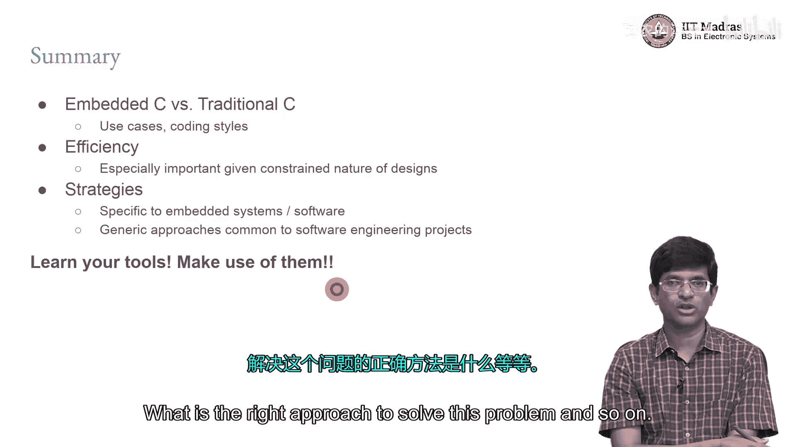

# 006：嵌入式系统的低功耗设计

在本节课中，我们将要学习如何编写高效的C语言代码，并探讨一系列策略，以实现嵌入式系统语境下的“高效”。我们将从理解“效率”的多重含义开始，然后深入探讨具体的技术和最佳实践。

## 概述：什么是效率？

在嵌入式系统的语境中，“效率”是一个关键术语，它包含多个不同的组成部分。

我们可以讨论**资源效率**。这意味着需要高效利用计算系统可用的资源。CPU计算周期当然是最重要的资源之一。但内存通常是构建嵌入式系统时最重要的受限资源。还有**I/O带宽**，即系统可以输入和输出多少数据。构建嵌入式系统时，我们希望高效地使用这些资源。这意味着，如果系统有一定量的内存，就应该充分利用它，但要以最佳方式使用。不应因为使用了构造不佳、占用过多内存的数据结构，或使用了错误的数据类型导致内存使用超出必要，从而限制了程序的编写，最终导致没有足够内存存储其他实际需要的数据。

**速度效率**通常归结为最佳利用可用的CPU指令。这意味着，例如，有些处理器拥有可以直接更新内存中值的CPU指令（如递增1）。使用这种指令，与从内存加载数据、在寄存器中加1、再存回内存相比，哪种更高效是显而易见的。当然，这取决于硬件是否支持此类指令。了解硬件类型和CPU指令集，并以正确方式使用它们，就构成了我们所说的效率。

**能效**也是一个概念，它关注的是运行系统是否使用了超出所需的功率。例如，我们构建的设备需要通过Wi-Fi进行网络通信。Wi-Fi往往是一种耗电的网络通信协议，因为它必须不断唤醒、发送信标等。而像蓝牙这样的协议具有更好的低功耗模式，它可以进入类似睡眠的模式，并以比Wi-Fi低得多的频率唤醒，因此在功耗方面有更好的表现，最终转化为系统消耗的总能量。

效率的另一个维度是**代码可维护性**。尤其是在需要长期维护和更新的场景中，代码的编写质量以及他人理解和更新系统的难易程度，会对效率产生重大影响。

由此可见，效率并非一个可以简单套用的公式。在审视嵌入式系统的效率概念时，会遇到许多不同的变体，因此具有一定的主观性。但所有这些方面都需要在构建系统时识别、理解并能够衡量。

## 为什么效率至关重要？

嵌入式系统通常需要长时间运行。这里我使用了“部署即忘”这个术语，意思是这些系统启动后，你期望它们能永远运行下去。你通常不希望不断检查、重启或关闭系统。很多时候，系统没有关闭的概念。以电梯或升降机的控制逻辑为例，它需要7x24小时运行。它虽然不做大量工作，但无论白天黑夜，只要有人按下按钮，它就应该响应。不应出现内存耗尽或电池耗尽的情况。任何时候有人按下按钮，它都应该响应。这就是“一次部署，永久运行”的行为含义。在这种场景下，你不能需要每天重启一次电梯或做其他事情来清空内存、确保没有问题。

你可能还想**最小化系统成本**，这一点绝对重要。成本本身也有多个维度。首先是开发成本，有时你可能愿意选择特定的组件组合以便快速启动。但到了部署阶段，当你需要大规模部署、发布多个系统时，部署成本就开始变得重要。最终，你可能还会有一些维护成本，这意味着在系统的整个生命周期中，需要多久升级一次、是否需要更改其中的任何内容、是否需要调整或修改，所有这些都构成了整体系统成本。

最后，效率对于系统的**性能**也起着非常重要的作用。特别是在汽车或其他安全关键应用等实时应用中，你希望代码尽可能高效，因为你绝不希望它因为运行速度不够快而失败。

## 提高代码效率的策略

我们可以使用多种策略来提高获得高效代码的可能性，下面我们将探讨其中的一些。

### 策略一：使用内存高效的数据类型

基本思想是确保数据存储不会消耗超出必要的内存，这在内存有限的系统中尤其关键。

例如，假设你的数据只是8位值。可能你正在采样来自模数转换器的数据，而该转换器只有8位大小。那么，就使用8位整数数据类型来存储该值。现在，如果你的模数转换器是10位值，这就变得有趣了，因为C语言中通常没有10位数据类型。这时你必须思考：我应该怎么做？是丢弃两位？还是直接将10位提升到16位？或者尝试将几个10位值分组，比如五个一组，从而得到5个8位值？当处理非标准大小的数据类型时，可以考虑许多不同的选项。但我们在此试图阐述的基本概念是：不要使用不必要的大数据类型。例如，将一个8位值存储在32位整数中（顺便说一下，如果我将所有变量都声明为`int`，这将是默认行为）可能是一种空间浪费，特别是当你开始声明此类值的数组时，开销会随着存储值的数量成倍增加。

同样，在`for`循环等场景中，你经常会发现循环索引可能可以使用更小的数据类型，比如8位或16位整数。但这有点棘手，因为大多数时候，`for`循环中的索引并不真正存储在内存中，所以你在那里节省不了多少。事实上，你可能会发现，将其作为32位值存储时，它会进入内存中的一个常规寄存器并作为寄存器使用。在那里，你可能会遇到相反的问题：尝试将其视为8位值可能会使情况更糟，因为现在需要额外的逻辑来判断它是否在8位范围内溢出，而不是直接将其视为32位值并让它运行所需的迭代次数。

明显的益处是减少了内存使用量，在更小、更便宜的微控制器中尤其有益。

### 策略二：最小化全局状态

正如我们稍后将看到的，在嵌入式系统中，有许多场景我们希望使用全局变量，主要是因为我们有传感器值或其他一些在代码各个部分使用的参数。这些全局变量的问题在于，它们占用固定数量的内存，更重要的是，它们从程序启动到系统关闭期间一直存在。对于一个长时间运行的系统，如果你有许多这样的全局变量，但如果它们是固定的，并且之后你永远不需要再创建其他变量，你可能没问题。但如果存在需要更多内存的场景，而你已经拥有大量全局变量，你实际上可能会遇到问题。

因此，这里可以使用一些思路。例如，你可以使用局部函数参数，而不是这种所谓的“全局状态”概念。全局状态是我们将多次讨论的内容。本质上，系统中内存中的所有内容定义了系统的某种状态。程序对其输入的反应是当前输入以及系统整体状态的函数。因此，拥有全局状态的概念——即许多参数存储在不同位置，但它们共同影响程序的可能行为——实际上可能使你的程序难以推理或优化。所以一般来说，尽量减少程序中的全局状态概念总是一个好主意。

相反，如果你可以只在需要时使用函数局部参数，并在退出函数后丢弃它们，这通常是有益的。另一件事是，你也可以尝试减少动态分配和释放。正如我们稍后将看到的，动态内存分配在C编程环境中发生在堆上。而堆往往是全局变量也使用的区域，拥有这些可能会相互干扰，最终可能导致内存耗尽。因此，所有这些不仅增强了代码的模块化和可重用性，还降低了因存在全局状态而产生错误的风险，否则这些错误可能难以识别和推理。

### 策略三：优化循环和函数调用

循环和函数调用显然很有用，主要是因为它们允许你构建程序结构。但在某些情况下，它们实际上可能消耗比你所需更多的CPU周期。可能存在一些场景，与其使用涉及在栈中保存数据、为新函数创建新栈、将其参数加载到适当位置、然后跳转到该新函数位置、执行并返回的循环或函数调用，不如直接写出函数对应的指令，这样可能更高效。

一个（希望不常见的）例子是，你可能有一个`for`循环，在循环内部，一个函数被多次调用，但使用相同的参数集。如果发生这种情况，简单的解决方案是取出那个函数调用，将其放在循环之前执行一次，然后在内部使用该值。在许多情况下，这类优化可以由编译器自动识别，大多数编译器会尝试自动应用它们。但这并不总是发生，不能保证一定会有。因此，在编写代码时，需要将这些事情记在心里。这是编写代码时可以牢记的另一个策略。

### 策略四：利用编译器优化和处理器特性

另一件与编译器理念相关的事情是，请记住，归根结底，你编写的是C代码，但你也在使用编译器将该代码转换为特定于特定处理器的汇编语言。可能存在特定的处理器特性（我们稍后会看一个例子），例如，对于ARM处理器，有一个称为“位带”的概念，这在其他类型的处理器中通常不可用。你可以编写代码来显式利用处理器的这一特性。但如果不使用特定于给定处理器的功能，如果你知道有非常适合特定处理器的编译器，你可能应该多了解一下可以给编译器哪些编译标志或指令，以使其能够提高代码性能。

在不同类型的处理器中，越来越普遍的一个趋势是它们支持更多计算，形式是所谓的**单指令多数据**或**向量操作**，即一个操作同时并行地对多个数据执行。例如，如果我需要添加四组数字，我可能可以给出一个指令，该指令基本上取四对数字并在单个指令中将它们全部相加。为了利用这一点，你需要一个编译器，该编译器能够识别遍历这四个数据点的`for`循环，并将其转换为对多个数据进行操作的单个指令。

因此，使用这些内置函数或编译器内部函数的概念，归根结底是理解你正在尝试使用的工具，并尝试充分利用其功能。

## 编写高效代码的最佳实践

到目前为止，我们讨论的是提高所编写代码效率的策略。还有一些通常被称为**最佳实践**的东西，这些是长期编写代码的人们观察到的、随时间推移被证明有用的常见模式。在某些情况下，可能存在非常具体的指导方针来增强系统的安全性或安全性。在大多数情况下，它们并不是强制性的，换句话说，编译器不会告诉你必须这样编写代码，否则会失败。因此，违反这些最佳实践并不是语法错误。它们只是建议。在某种意义上，它们类似于策略的理念，只是可能更具体一些，会说“以这种方式编写代码通常有帮助”。

通常有称为**Linter**或**代码检查器**的软件工具，用于提供关于可以做什么的建议。你们中的许多人可能已经遇到过集成开发环境，包括像VS Code这样的环境，在那里你可能编写过C代码。当你编写代码时，它可能会画出一条波浪形的红色或黄色下划线。红线表示错误，但黄线通常表示这里有些不太对劲或不太清楚，编译器认为如果你以稍微不同的方式编写代码，可能会有所改善。因此，许多这些最佳实践实际上都被Linter捕获了。所以，再次强调，利用此类工具来提高代码质量。

以下是几个关键的最佳实践：

**避免浮点运算**

什么是浮点数？C语言中的`float`数据类型使用32位值，但它将这32位中的一部分用于表示指数，剩余的位用于所谓的尾数，它实际上存储数字的有效数字。这些对人类来说非常容易使用和理解。但无一例外，它们对计算机来说实际上很难使用。在某些情况下，你的微控制器可能甚至不支持浮点运算，这意味着如果你使用`float`数据类型，它仍然可以工作，但必须完全在软件中模拟浮点行为。这可能非常昂贵，可能需要许多时钟周期，甚至可能数百个时钟周期来完成像两个数字相加这样简单的操作。因此，如果你遇到需要进行数值计算的场景，请尝试使用所谓的**定点计算**。这些本质上是整数，通过使用某种缩放因子来近似表示十进制值。它们对人类来说更难理解，因为存在溢出、下溢、范围归一化等问题，这些问题在使用定点数时并不明显且不易使用。但回报可能非常有用，特别是考虑到最终获得的代码速度。

**谨慎进行动态内存管理**

这是我们将会更多讨论的内容。存在诸如**内存泄漏**之类的场景，即你分配了一定量的内存但没有以正确的方式释放它。一段时间后，你会发现系统内存耗尽。这要么使系统不稳定（意味着某些类型的内存分配失败），要么直接崩溃，系统只是说“内存耗尽，我不知道该怎么办”并重启。这里可以使用许多策略。典型的是确保跟踪所有动态分配并在需要时释放它们。另一个我们稍后会讨论的策略是，在可行的地方使用静态内存分配。

**利用编译器优化和指令**

我之前简要提到过这一点。这些是允许编译器修改生成的机器代码的设置，通常它们可用于提高性能或减少代码大小。例如，`-O2`只是一个在调用编译器时给编译器的标志或选项。毕竟，编译器也是一个程序，当你运行它时，你给它一个选项标志，告诉它进行何种优化。`-O2`通常指速度，尝试通过应用各种优化使其更快。而`-Os`表示优化大小，尝试使最终的程序尽可能小。如果你发现系统在关键时刻无法运行得足够快，或者没有足够的内存来做你想做的事，使用这类标志会对你的系统是否实际可用产生重大影响。

**合理使用内联函数和宏**

宏，即我们在C语言中遇到的`#define`，是可以显著增强编程能力的工具。例如，如果我的库中没有定义绝对值函数，我可以很容易地通过替换条件来创建一个。如果使用得当，这类工具（宏等）可以显著减少运行时开销，因为它们都在编译时展开，并直接转换为更简单的代码。但如果你不小心，它们也可能使你的代码难以阅读和理解。因此，必须谨慎使用。有些场景使用它们是有意义的，有些场景如果不小心，它们实际上会影响代码的可读性、可维护性甚至性能。

**进行充分的测试**

我们在C编程的背景下简要地看过测试，基本上是说，如果我编写一个函数，我大致知道给定输入应该得到什么输出。你需要广泛地进行这种测试。这类最佳实践来自所谓的软件工程领域。在某种程度上，嵌入式C编程是软件工程的一种形式，因此了解软件工程的工具将对你作为程序员或设计嵌入式系统的工程师如何处理手头的问题产生重大影响。测试、单元测试、集成测试、系统级测试、设置模拟对象、仿真环境，这些内容我们将在课程中在一定程度上进行探讨，但在某种程度上，无法在一门课程中完全详细地涵盖，而是需要通过实践来吸收。但重要的是要理解，在程序中捕获错误的最佳方法是尽早捕获它。这意味着，如果你能在编写每个函数时对其进行测试，那么当你将所有内容集成在一起并创建大型程序时，实际存在错误的几率会显著降低。

**使用性能分析工具**

性能分析是另一组工具，在我们实际识别代码中资源密集型部分时非常有用。有许多工具，如Valgrind、gprof等，可用于发现内存瓶颈、性能瓶颈（即与速度相关的瓶颈）等。在许多情况下，你拥有的编译器工具链会提供特定的工具来帮助你识别此类问题，它们会告诉你应该将优化工作集中在何处以获得最大收益。

## 总结

本节课中，我们一起学习了嵌入式C语言编程中实现高效代码的核心概念。我们首先探讨了“效率”在嵌入式系统中的多重含义，包括资源效率、速度效率、能效和代码可维护性。接着，我们深入研究了提高代码效率的几种策略：使用内存高效的数据类型、最小化全局状态、优化循环和函数调用，以及充分利用编译器优化和处理器特定特性。最后，我们回顾了编写高效、可靠嵌入式代码的一系列最佳实践，如避免浮点运算、谨慎管理内存、进行充分测试和使用性能分析工具。

归根结底，有许多工具可供你使用。在某种意义上，这是工程学的精髓所在。这里的理论很少，有许多最佳实践需要你吸收，在一定程度上可以通过阅读了解，但最终，实现它的唯一方法就是实际编写代码。本课程的目标是至少尝试让你体验一下，以便建立正确的思维过程。你需要能够思考并推理一种给定的代码编写风格，并判断“这可以做得更好吗？”、“解决这个问题的正确方法是什么？”等等。