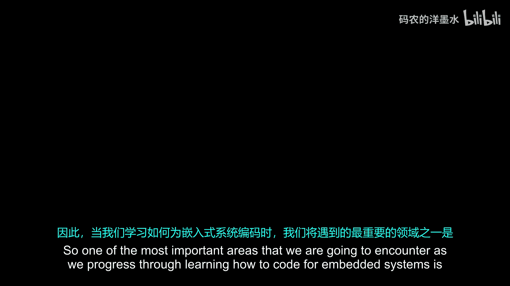
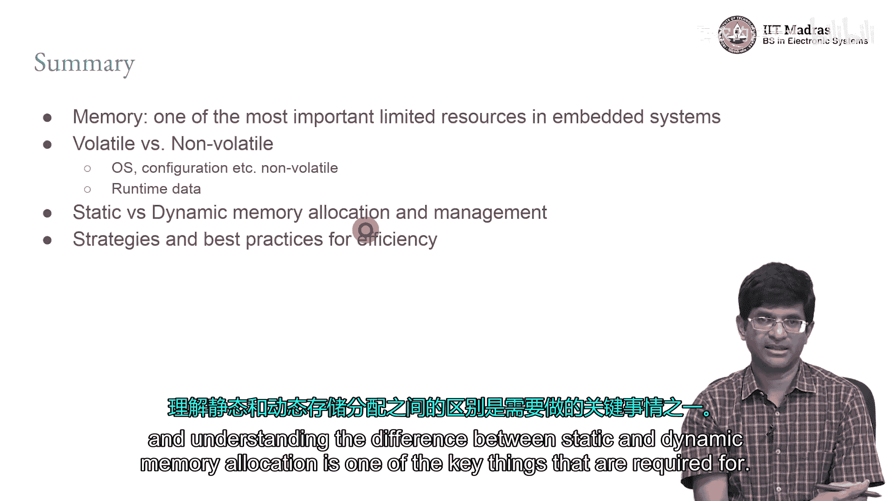

# 007：内存管理 💾

在本节课中，我们将要学习嵌入式系统中至关重要的一个主题：内存管理。我们将了解嵌入式系统中可用的不同类型内存，以及管理这些内存的各种技术。理解这些概念对于编写高效、可靠的嵌入式代码至关重要。

## 系统架构回顾

上一节我们介绍了嵌入式系统编程的基础，本节中我们来看看一个典型处理系统的构成。一个核心处理系统通常包含算术逻辑单元、一组用于临时存储的寄存器，以及一个控制单元。控制单元从某个地方获取指令，这就引出了系统与外部世界的交互。

在那里，我们会发现系统的主内存。指令以及用于存储所有中间计算的数据都来自这里。此外，还有二级存储器，它通常是一种容量更大但速度可能较慢的长期存储设备。主内存是系统的工作内存，我们可以在这里创建变量、修改和更新它们。

你还会注意到输入和输出设备，它们至少在连接到主内存的方式上看起来非常相似。这是有意为之的，因为我们稍后会看到，用于与主内存通信的相同技术，对于与输入输出设备通信也同样有用。

最终，我们拥有计算部分（ALU和解码逻辑）和I/O部分（一系列外围设备以及与外部世界的交互）。当然，我们还有内存。内存在任何计算系统（不仅仅是嵌入式系统）的运行中都扮演着极其重要的角色。

## 内存类型

了解了内存的重要性后，我们来具体看看嵌入式系统中可能遇到的不同类型的内存。

以下是几种关键的内存类型：

*   **RAM**：RAM代表随机存取存储器。这意味着可以以近似恒定的时间，随机访问该内存中的任何位置并进行读写。RAM通常是易失性的，即系统断电时会丢失内容。在现代语境中，RAM通常被视为系统的工作内存，用于存储程序运行时的一切数据。
*   **ROM 和 EPROM**：ROM是只读存储器，EPROM是可擦除可编程只读存储器。它们本质上是RAM的变体，但通常不被称为RAM。关键点在于它们是非易失性的，即使系统断电也能保留数据。它们基本上是出厂固化的，之后无法更改。EPROM可以在有限程度上进行编程更新，通常用于存储配置信息。
*   **Flash**：闪存是目前微控制器中最常见的非易失性存储器，用于存储大量数据。它具有高密度、非易失性的特点。但其写入速度不如RAM快，因此通常不用于存储运行时频繁变化的数据，而多用于存储程序代码和配置信息。
*   **其他类型**：还存在其他类型的内存，如FRAM（铁电存储器），它提供了一种可以同时存储程序代码和非易失性数据的统一内存。还有相变存储器、MRAM等新技术，但它们通常比常见的Flash和RAM组合更昂贵。

对于嵌入式系统开发者而言，最需要关注的是系统中有多少RAM，以及有多少非易失性存储（通常是Flash）。

## 内存管理概述

在了解了数据存储的位置之后，让我们来看看内存管理本身的实际问题。

内存管理是指我们如何在有限的存储资源内，高效地组织、分配和使用内存，以存储程序运行期间产生的各种数据（如临时值、数组、传感器数据等）。这些数据通常太大，无法全部放入CPU寄存器中，但又需要存储在可以快速访问和更新的地方。

我们为什么需要进行内存管理？归根结底，任何嵌入式系统的存储资源都是有限的，我们希望尽可能高效地利用它。这里需要考虑的是，关于如何存储、在哪里存储、存储什么数据的决策，可以通过两种方式完成：在程序运行时动态决定，或者在编译时、系统实际部署之前静态决定。

## 静态内存分配

首先，我们来考虑静态内存分配。在这种方式下，内存的分配、数据存储的位置和方式、为存储数据分配多少空间等所有决策，都由程序员决定，并由编译器在编译时实现。换句话说，在C语言的上下文中，这意味着我们不能使用 `malloc` 在运行时请求内存块，而必须在部署系统之前，将所有内存预先分配为静态数组。

这意味着这种静态分配将在系统执行的整个生命周期内保留在内存中。其优势在于可预测性，所有需要的内存都在编译时分配，运行时不会改变。这避免了内存碎片化的问题（我们稍后会详细解释）。同时，它开销较低，例如，我们可以在编译时检查数组索引是否越界。

当我们将这些优势结合起来时，意味着在嵌入式系统背景下，静态分配带来了**简单性**（固定的内存布局，通过简单计算进行内存寻址和访问）、**可靠性**（没有内存分配失败的可能性，如果系统启动，就意味着已经分配了所有需要的内存）以及对**实时应用**的友好性（没有运行时分配内存的开销，也没有碎片整理或垃圾回收等可能引入不确定性的操作）。

当然，静态内存分配也存在一些缺点。它相对不灵活，所有要分配的内容必须在编译时已知。这可能导致空间浪费，因为你可能分配了实际上并未使用的过量数据。对于动态数据结构（如树）的可扩展性支持不佳。此外，如果你想改变系统能处理的数据量，可能需要修改代码中的多个地方，增加了开发复杂性。

## 动态内存分配

既然静态分配有这些限制，那么替代方案是什么呢？答案是动态内存分配。正如你可能从C语言课程中学到的，`malloc` 和 `free` 在运行时定义数组和数据结构方面扮演着非常重要的角色。

在嵌入式系统的背景下，例如，你正在进行数据记录，从传感器收集数据，存储到缓冲区，然后通过网络发送出去。所有这些数据都是动态的，在数据实际到达之前，你并不知道有多少数据。动态内存分配通过C标准库提供的函数（如 `malloc`）实现，它们在运行时分配指针，这些指针在编译时是未知的。

动态分配的优势非常明显：它可以适应实际的使用场景。使用单一的代码库，我可以针对具有不同RAM大小的不同微控制器，而无需为每个特定配置重写代码。它还有助于处理平均情况与最坏情况下的场景，例如，网络缓冲区的平均大小可能很小，你可以为此设计，而不是总是为最坏情况预留大量空间。

然而，动态内存分配也带来了一个最大的问题：**内存碎片化**。那么，碎片化到底是什么意思呢？让我们通过一个例子来理解。

假设系统的总可用内存是一个大矩形区域。当我多次调用 `malloc` 分配不同大小的内存块后，内存被分割成多个区域。之后，如果我释放了其中某个较小的内存块（例如 `malloc 3`），那么这块内存就空闲了。但是，之前分配的其他内存块（如 `malloc 4`）并不会自动移动来填补这个空隙。此时，如果我请求分配一个较大的新内存块（`malloc 5`），即使所有空闲内存的总和足够大，也可能因为没有足够大的连续空闲地址空间而分配失败。这种情况就是内存碎片化。

碎片化是一个现实存在的问题，每个计算系统在某种程度上都会面临。操作系统内核通常有专门处理碎片化的部分，它会尝试整理空闲块、移动数据以防止此问题发生。

因此，动态内存分配可能导致不可预测的内存使用。例如，如果发生内存泄漏（分配了内存但未释放），情况会比碎片化更糟，因为它意味着你持有着不再使用的内存，而其他真正需要内存的请求将无法得到满足。

如果不进行适当的动态内存管理，最终可能导致运行时故障，例如内存分配失败引发系统崩溃。此外，你还会遇到**非确定性**问题：由于需要在运行时进行碎片整理或垃圾回收，某个你预期在几微秒内完成的操作，最终可能花费数百微秒，这会影响实时性能保证。

因此，对于嵌入式系统，一般的总体建议是：**尽可能始终使用静态内存分配**，尽量减少动态变量和结构的使用。许多系统采用一种折中方案：将内存划分为两部分，一部分用于关键部分（如操作系统、实时任务），另一部分用于非关键部分（如网络缓冲区、数据记录）。这样，即使非关键部分因内存不足而丢失一些数据，系统核心功能也不会崩溃。

## 内存使用优化

在了解了静态和动态内存管理之后，我们还需要看看如何优化数据的使用。

以下是一些有效的内存优化策略：

*   **使用合适大小的数据类型**：例如，如果你存储的值都在0-255之间，就使用 `uint8_t` 而不是 `int`，可以节省大量空间。在循环计数器不会超过特定范围时，也应选择合适宽度的整数类型。
*   **优先使用局部变量而非全局变量**：全局变量存在于整个程序生命周期，占用堆内存，与 `malloc` 操作竞争资源。尽可能使用局部变量，它们分配在栈上，函数结束后即被释放。
*   **理解静态变量的影响**：静态变量是全局变量和局部变量之间的折中。它们在内存占用上与全局变量类似（也占用堆空间，且生命周期长），但其作用域仅限于声明它的函数，这有助于代码模块化。
*   **数据打包**：在嵌入式系统中，经常需要将多个小数据打包到一个更大的数据类型中。例如，将RGB颜色值（每个8位）打包到一个16位变量中。这可以通过位操作（移位、掩码）来实现，能更有效地利用内存。
*   **内存池**：一种常见的优化是使用内存池。你可以预先声明一些静态数组供操作系统和库使用，同时划出另一块内存作为动态空间池，用于分配缓冲区等。这样，即使动态空间池发生故障，也不会影响静态分配的操作系统核心部分。

## 总结

本节课中我们一起学习了嵌入式系统内存管理的核心知识。内存是嵌入式系统中最重要且有限的资源之一。我们了解了不同类型的内存，其中易失性与非易失性是在决定如何使用内存时需要牢记的最重要区别。我们探讨了高效使用内存的多种策略和最佳实践，而理解静态与动态内存分配之间的差异，是实际实现嵌入式系统的关键所在。记住，在资源受限的嵌入式环境中，谨慎而明智地管理内存是构建稳定、高效系统的基石。