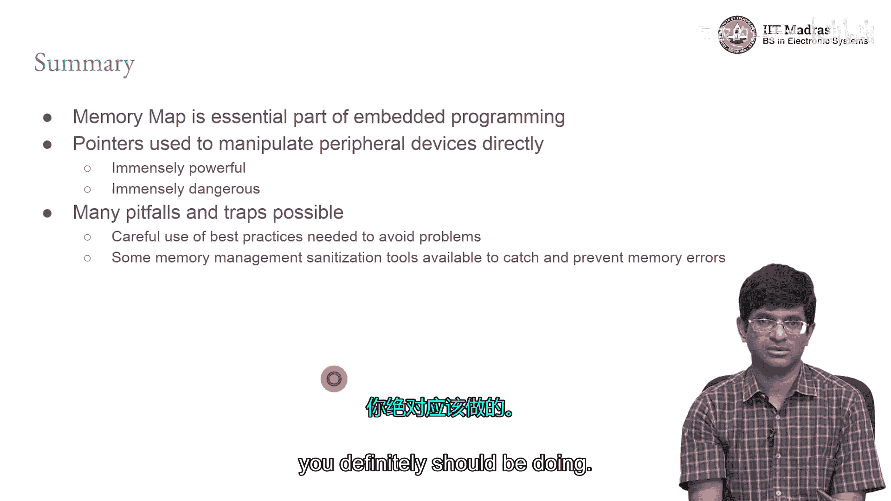

# 008：位操作与指针


在本节课中，我们将要学习嵌入式C语言编程中的两个核心概念：位操作和指针。位操作是直接控制硬件的基础，而指针则是访问内存和外围设备的关键工具。我们将通过具体的例子和代码，详细讲解它们的原理、应用场景以及最佳实践。

---

## 位操作的必要性

上一节我们讨论了内存管理，本节中我们来看看位操作。在常规的C语言编程中，直接操作内存中的单个位并不常见。然而，在嵌入式系统中，这却是至关重要的。这是因为嵌入式系统经常需要直接控制各种硬件单元，而硬件寄存器中的单个位常常充当开关或控制信号，用于启用或禁用特定功能。

CPU通常以8位、16位或32位的字为单位处理数据，这使得直接设置或清除字中的单个位变得不那么直观。因此，我们需要使用特定的技术来精确控制这些位。

## 位操作的基本方法

以下是进行位操作的几种标准方法，它们都依赖于一个核心概念：**位掩码**。位掩码是一个数字，其中只有我们感兴趣的位被设置为1，其余位为0。

### 设置单个位

假设我们有一个8位寄存器，其初始二进制值为 `1101 0011`。我们想要将第3位（b3，从0开始计数）从0设置为1。

步骤如下：
1.  创建一个位掩码：将数字1左移3位。
2.  使用逻辑或（OR）操作将原数据与位掩码结合。

**公式与代码描述：**
```c
// 假设 data 是8位变量
uint8_t data = 0b11010011; // 初始值
uint8_t bitmask = 1 << 3;   // 设置第3位的掩码
data = data | bitmask;      // 设置位操作
// 执行后，data 变为 1101 1011
```

### 清除单个位

现在，我们想将第4位（b4）从1清除为0，同时保持其他位不变。

步骤如下：
1.  创建一个位掩码：将数字1左移4位。
2.  取该位掩码的**按位取反**（NOT），得到一个除了目标位为0，其余位均为1的掩码。
3.  使用逻辑与（AND）操作将原数据与该掩码结合。

**公式与代码描述：**
```c
uint8_t data = 0b11011011; // 假设这是设置位后的值
uint8_t bitmask = 1 << 4;   // 目标位掩码
data = data & (~bitmask);   // 清除位操作
// 执行后，第4位被清零
```

### 切换单个位

切换操作意味着如果某位是0，则变为1；如果是1，则变为0。例如，切换第5位（b5）。

步骤如下：
1.  创建一个位掩码：将数字1左移5位。
2.  使用逻辑异或（XOR）操作将原数据与位掩码结合。

**公式与代码描述：**
```c
uint8_t data = ...; // 某个值
uint8_t bitmask = 1 << 5;
data = data ^ bitmask; // 切换位操作
```

### 检查单个位是否被设置

有时我们只需要读取某个位的状态，而不修改它。例如，检查第6位（b6）是否为1。

步骤如下：
1.  创建一个位掩码：将数字1左移6位。
2.  使用逻辑与（AND）操作将原数据与位掩码结合。
3.  检查结果是否为0。如果非0，则目标位被设置；如果为0，则未被设置。

**公式与代码描述：**
```c
uint8_t data = ...; // 从状态寄存器读取的值
uint8_t bitmask = 1 << 6;
if ((data & bitmask) != 0) {
    // 第6位被设置（值为1）
} else {
    // 第6位未被设置（值为0）
}
```

## 位操作的实际应用与原子性

在嵌入式编程中，位操作常用于控制硬件，例如点亮或熄灭LED，或者读取按钮状态。

**代码示例（控制LED）：**
```c
// 假设 LED_PIN 定义了控制LED的位位置
#define LED_PIN 5
volatile uint32_t *ODR = (volatile uint32_t*)0x40000000; // 假设的寄存器地址

// 点亮LED（设置位）
*ODR |= (1 << LED_PIN);

// 熄灭LED（清除位）
*ODR &= ~(1 << LED_PIN);
```

**代码示例（读取按钮）：**
```c
#define BUTTON_PIN 3
volatile uint32_t *IDR = (volatile uint32_t*)0x40000004; // 假设的输入寄存器地址

int is_button_pressed() {
    if ((*IDR & (1 << BUTTON_PIN)) != 0) {
        return 1; // 按钮被按下
    } else {
        return 0; // 按钮未按下
    }
}
```

需要注意的是，简单的“读取-修改-写入”操作在多任务或硬件中断环境下可能存在**竞争条件**风险。例如，在读取旧值和写入新值之间，硬件可能已经改变了该位的状态。这需要**原子操作**来保证整个过程的不可分割性。某些处理器架构（如ARM Cortex-M系列）提供了硬件支持来实现原子性的位操作。

## ARM Cortex的位带操作

ARM Cortex-M处理器提供了一种称为**位带**的特性，它使得对单个位的操作更加简单和原子化。位带区域将存储器的一个地址“映射”到位带别名区的32个地址，每个别名地址对应原始字中的一个特定位。直接向这个别名地址写入0或1，就能原子性地设置或清除对应的位，无需使用位掩码和逻辑运算。

**优势：**
*   **原子性**：避免竞争条件。
*   **代码清晰**：意图明确，易于阅读和维护。

## 指针在嵌入式系统中的应用

了解了位操作后，我们转向另一个核心工具：指针。指针是一个存储另一个变量地址的变量。它允许我们间接访问内存位置，这在嵌入式系统中至关重要，尤其是用于访问内存映射的外围设备。

### 内存映射

在32位系统中，指针是32位宽，可以寻址最多4GB（2^32字节）的空间。然而，实际的物理内存（如512MB）只占用这个地址空间的一部分。剩余的地址空间并未浪费，而是被系统设计者用来映射**外围设备**。

**关键概念：**
*   CPU通过地址总线发出访问请求。
*   如果地址落在物理内存范围，则访问RAM。
*   如果地址落在为外围设备保留的地址范围，则访问相应的硬件外设（如GPIO、ADC、UART等）。
*   对CPU和软件而言，访问内存和访问外设在语法上没有区别，都是通过指针读写一个地址。

### 使用指针访问外设

**代码示例：**
```c
// 将一个地址定义为指向8位外设寄存器的 volatile 指针
volatile uint8_t *sensor_reg = (volatile uint8_t*)0x20001000;

// 读取传感器数据
uint8_t sensor_data = *sensor_reg;

// 向控制寄存器写入命令
volatile uint32_t *control_reg = (volatile uint32_t*)0x40000000;
*control_reg = 0x00000001; // 例如，启动某个功能
```

**`volatile`关键字的重要性：**
当指针指向内存映射的外设寄存器时，**必须**使用 `volatile` 关键字进行声明。这告诉编译器：
1.  该指针指向的内容可能被硬件异步改变（例如，传感器更新了数据）。
2.  禁止编译器对该指针的访问进行优化（如缓存读取结果或消除看似无用的写入操作），确保每次访问都会生成实际的加载/存储指令。

### 指针使用的陷阱与最佳实践

指针功能强大，但也容易引发错误。

**常见陷阱：**
*   **空指针**：指针值为 `NULL`，解引用会导致崩溃。
*   **野指针**：指针未初始化，指向随机地址。
*   **悬空指针**：指针指向的内存已被释放，继续使用会导致未定义行为。

**最佳实践：**
1.  **始终初始化指针**：在声明时将其设置为 `NULL` 或有效地址。
2.  **检查指针有效性**：在使用前（尤其是解引用前）检查是否为 `NULL`。
3.  **配对使用 `malloc` 和 `free`**：动态分配的内存必须及时释放，防止内存泄漏。
4.  **善用 `const` 限定符**：明确指针的用途，如 `const uint8_t *p` 表示指向的数据是只读的。
5.  **谨慎使用指针运算**：确保运算后的指针仍然指向合法内存范围。
6.  **利用工具**：使用编译器提供的静态分析工具、内存消毒工具等来提前发现潜在问题。

---

## 总结

本节课中我们一起学习了嵌入式C语言编程中的两个基石：位操作和指针。

*   **位操作**是直接控制硬件寄存器中特定位的必要手段。我们学习了如何使用位掩码和逻辑运算（OR、AND、XOR）来设置、清除、切换和检查单个位，并了解了ARM Cortex处理器的位带特性如何简化并原子化这些操作。
*   **指针**是访问内存和内存映射外设的核心机制。我们深入探讨了内存映射的概念，理解了CPU如何通过统一的地址空间与RAM和外设通信。重点强调了使用 `volatile` 关键字来确保对外设寄存器的正确访问，并回顾了安全使用指针以避免常见陷阱的最佳实践。




掌握这些概念，是编写高效、可靠嵌入式系统软件的关键。