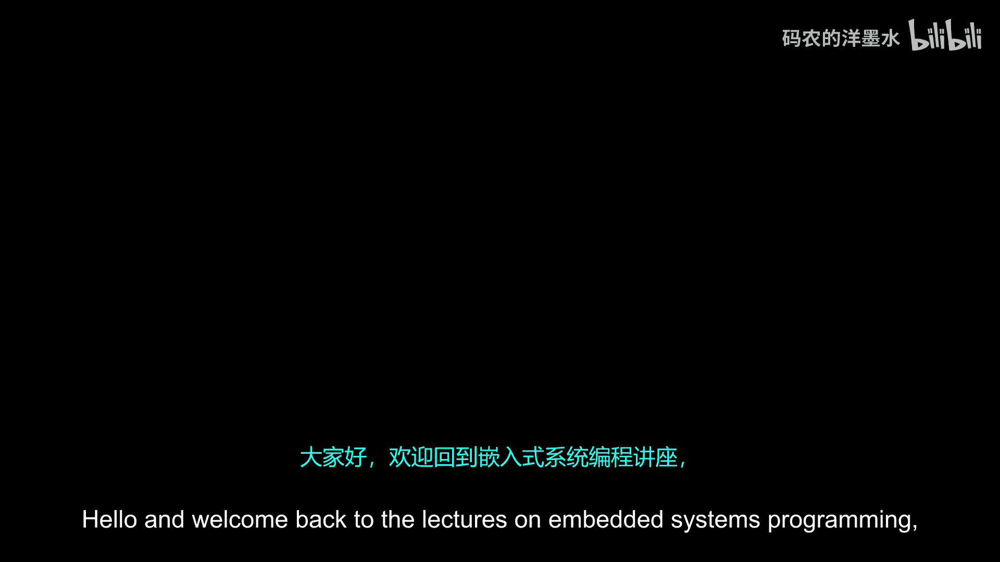
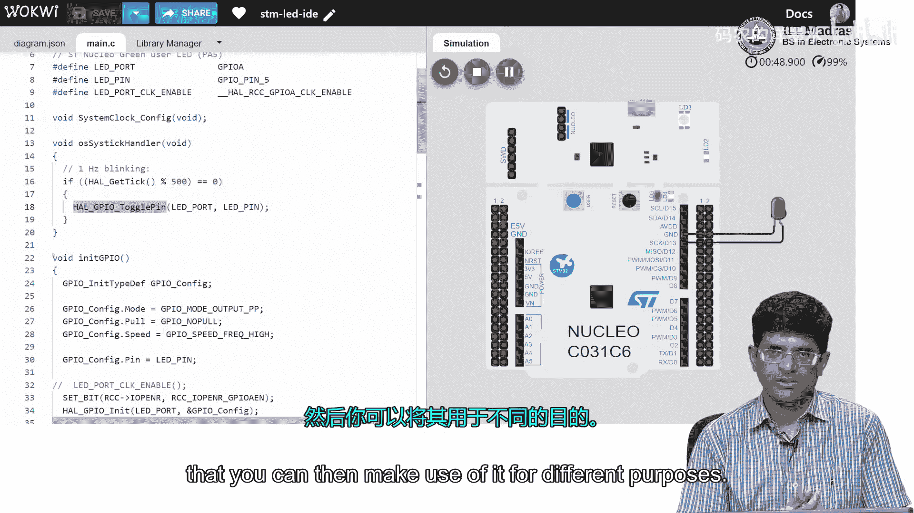

# 009：微控制器上LED闪烁与硬件控制的三种方法 💡




在本节课中，我们将学习如何通过编程控制微控制器上的LED灯闪烁。我们将通过三种不同的方法来实现这一目标，从最抽象、最易用的方式，逐步深入到最底层、最接近硬件的控制方式。这有助于我们理解不同编程层次背后的原理。

## 概述

我们将从一个简单的“Hello World”式程序——让LED闪烁——开始。我们将展示三种实现方法：
1.  使用类似Arduino的高级抽象环境。
2.  使用纯C语言直接操作硬件寄存器。
3.  使用硬件抽象层（HAL）库进行编程。

通过对比这三种方法，我们将清晰地看到代码是如何从用户友好的高级指令，逐步转化为直接与微控制器硬件交互的低级操作的。

## 第一种方法：使用Arduino风格编程

首先，我们来看一种最简单、最直观的方法，它使用了类似Arduino平台的编程风格。这种方法隐藏了大部分硬件细节。

以下是实现LED闪烁的核心代码片段：

```c
#define LED D13

void setup() {
    pinMode(LED, OUTPUT);
}

void loop() {
    digitalWrite(LED, HIGH);
    delay(500);
    digitalWrite(LED, LOW);
    delay(500);
}
```

在这段代码中，`D13`是一个预定义的宏，它对应着开发板上的一个特定引脚。`pinMode`、`digitalWrite`和`delay`都是平台提供的函数，它们封装了底层复杂的硬件操作。`setup`函数在程序开始时运行一次，用于初始化设置；`loop`函数则会无限循环执行。

当我们编译并运行这段代码时，连接到`D13`引脚的LED就会以1秒为周期（亮500毫秒，灭500毫秒）开始闪烁。这种方法的好处是代码简洁易懂，非常适合快速原型开发。

## 第二种方法：使用纯C语言直接操作寄存器

上一节我们使用了高级抽象，本节中我们来看看如何用更底层的C语言来实现同样的功能。这种方法需要我们直接读写微控制器的内存映射寄存器。

以下是核心代码的解析。首先，我们需要包含标准整数类型定义头文件，以确保数据类型的位宽明确：

```c
#include <stdint.h>
```

接着，我们定义了两个关键函数：`init_GPIO`用于初始化引脚，`toggle_pin`用于切换引脚状态。主函数`main`的结构如下：

```c
int main(void) {
    init_GPIO();
    while(1) {
        // 软件延时循环
        for(uint32_t i=0; i<1000000; i++);
        toggle_pin(GPIOA_BASE, 5);
    }
}
```

这里的`for`循环是一个简单的软件延时。`toggle_pin`函数是核心，它直接操作硬件寄存器。以下是该函数的关键操作：

```c
void toggle_pin(uint32_t gpio_base, uint8_t pin) {
    // 1. 读取当前输出数据寄存器(ODR)的值
    uint32_t odr_value = *(volatile uint32_t *)(gpio_base + 0x14);
    
    // 2. 根据当前值，准备写入置位/复位寄存器(BSRR)的数据
    uint32_t bsrr_value;
    if (odr_value & (1 << pin)) {
        // 如果当前为高电平，则准备复位该位（写入高16位）
        bsrr_value = (1 << (pin + 16));
    } else {
        // 如果当前为低电平，则准备置位该位（写入低16位）
        bsrr_value = (1 << pin);
    }
    
    // 3. 将计算出的值写入BSRR寄存器，完成引脚电平切换
    *(volatile uint32_t *)(gpio_base + 0x18) = bsrr_value;
}
```

**公式解释**：
*   `(1 << pin)`：将数字1左移`pin`位，生成一个只有第`pin`位为1的掩码。
*   `(1 << (pin + 16))`：将数字1左移`pin+16`位，生成一个对BSRR寄存器高16位（复位位）操作的掩码。

这种方法要求我们查阅芯片数据手册，了解`GPIOA_BASE`（GPIO端口A的基地址）、`ODR`和`BSRR`寄存器的偏移量（分别是`0x14`和`0x18`）以及引脚编号（D13对应引脚5）。它给予了程序员对硬件最精细的控制，但代码复杂且与特定硬件紧密耦合。

## 第三种方法：使用硬件抽象层

前面两种方法分别代表了最高层和最低层的控制。本节我们来看看一种折中的、在工业实践中广泛应用的方法：使用硬件抽象层。

HAL库由芯片厂商提供，它用一组统一的函数接口封装了底层寄存器的操作细节。以下是使用HAL实现LED闪烁的代码框架：

```c
#include “stm32c0xx_hal.h” // 包含HAL库头文件

// 定义LED使用的端口和引脚
#define LED_PORT GPIOA
#define LED_PIN GPIO_PIN_5

int main(void) {
    // 1. 初始化HAL库和系统时钟
    HAL_Init();
    SystemClock_Config();
    
    // 2. 初始化GPIO
    GPIO_InitTypeDef gpio_config;
    gpio_config.Pin = LED_PIN;
    gpio_config.Mode = GPIO_MODE_OUTPUT_PP; // 推挽输出模式
    gpio_config.Pull = GPIO_NOPULL;         // 不上拉也不下拉
    gpio_config.Speed = GPIO_SPEED_FREQ_HIGH; // 高速模式
    HAL_GPIO_Init(LED_PORT, &gpio_config);
    
    // 3. 在主循环中切换LED状态
    while (1) {
        HAL_GPIO_TogglePin(LED_PORT, LED_PIN);
        HAL_Delay(500); // HAL库提供的延时函数
    }
}
```

使用HAL库的好处非常明显：
*   **可读性强**：`HAL_GPIO_Init`、`HAL_GPIO_TogglePin`等函数名清晰地表达了其功能。
*   **可移植性好**：如果更换同一厂商的不同型号芯片，通常只需修改引脚定义和少量配置，核心逻辑代码不变。
*   **安全性高**：厂商提供的库函数通常经过充分测试，避免了直接操作寄存器可能带来的错误。

这种方法在底层硬件控制和上层应用开发之间取得了良好的平衡，是现代嵌入式开发的主流方式。

## 总结

本节课中我们一起学习了让微控制器上LED闪烁的三种编程方法。

1.  **Arduino风格**：最高层抽象，使用预定义函数，简单快捷，适合入门和快速验证想法，但隐藏了硬件细节。
2.  **纯C操作寄存器**：最底层控制，直接读写内存映射寄存器，需要对芯片数据手册有深入了解，控制力最强，但代码复杂且不可移植。
3.  **硬件抽象层**：折中方案，通过芯片厂商提供的库函数来操作硬件，兼顾了可读性、可移植性和控制力，是专业嵌入式开发中的常用方法。




理解这三种层次的实现，有助于我们构建完整的嵌入式系统知识体系。我们知道高级API最终都会转化为对底层寄存器的操作，这让我们在调试复杂问题或进行性能优化时，能够洞察问题的本质。在后续课程中，我们将基于这些概念，深入探讨通用输入输出、通信协议等主题。