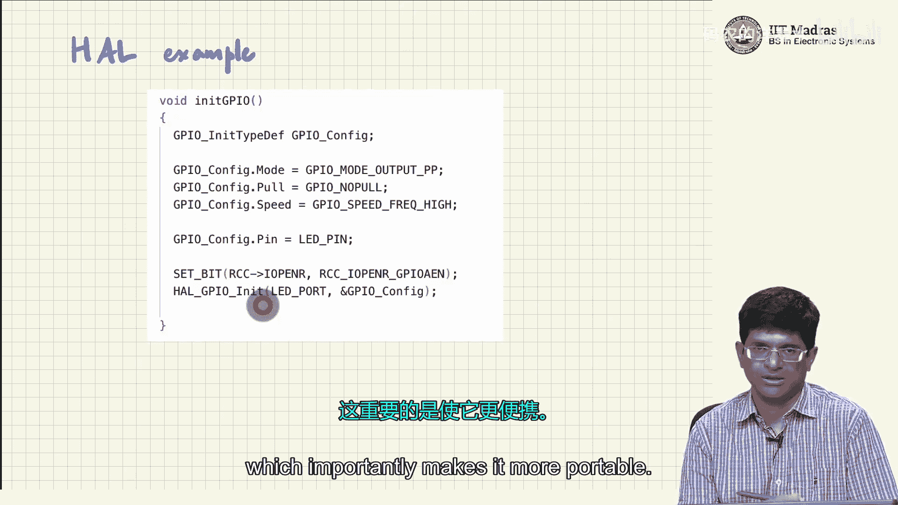

# 010：微控制器中的通用输入输出 (GPIO) 🧠


在本节课中，我们将深入学习微控制器中的通用输入输出 (GPIO) 概念。我们将探讨CPU如何通过总线与外部世界交互，GPIO的工作原理、配置方式以及在实际电路设计中需要注意的关键事项。通过理解这些底层机制，你将能够更安全、更有效地编写嵌入式程序来控制硬件。

## CPU、MCU与总线接口

上一节我们介绍了嵌入式系统的基本概念，本节中我们来看看CPU是如何与外部世界通信的。首先，我们需要理解几个核心术语。

*   **CPU (中央处理单元)** 是执行指令的核心部件。
*   **MCU (微控制器单元)** 则包含了CPU以及内存、定时器、GPIO等外设。在实际讨论中，这两个术语常可互换使用。

CPU的核心部件包括**算术逻辑单元 (ALU)**、用于存储数据的**寄存器**以及控制逻辑。然而，CPU本身无法感知外部世界，它只能处理寄存器中的数据。为了与外部交互，我们需要**内存**来存储和读取数据。

CPU通过一组被称为**总线**的导线与内存通信。总线主要承载两类信息：
1.  **数据**：在CPU和内存之间传输的实际信息。
2.  **控制信号**：包括**地址**（指定要访问的内存位置）以及**读/写使能**信号。

CPU写入数据到内存的过程可以概括为以下伪代码逻辑：
```c
// 写入过程
address = target_memory_location;
data_out = value_to_write;
write_enable = HIGH; // 激活写操作
// 内存单元将 `data_out` 的值存入 `address` 指定的位置
```

从内存读取数据的过程则类似：
```c
// 读取过程
address = target_memory_location;
read_enable = HIGH; // 激活读操作
data_in = memory[address]; // 从总线获取该地址的数据
// CPU可将 `data_in` 存入寄存器进行处理
```

## 内存映射与GPIO的抽象

总线接口的关键在于其**抽象性**。对于CPU而言，只要一个电路能对特定的地址和读写使能信号做出正确响应（即接受写入的数据或返回读取的数据），那么该电路在CPU看来就是一块“内存”。

这个抽象概念引出了**内存映射**。系统的所有可访问资源（如实际的内存芯片、GPIO、串口等）都被分配了唯一的地址。一个**地址解码电路**会根据CPU发出的地址，决定将访问请求路由到哪个设备。

这意味着，用于访问内存的相同指令（存储和加载），也可以用来与GPIO这类**输入输出 (IO) 块**通信。当CPU向一个被映射为GPIO的地址写入数据时，它实际上是在设置某个引脚的电平；当它从该地址读取数据时，它是在读取该引脚的状态。

## GPIO的功能与配置

在开发板（如Nucleo板）上，微控制器周围有许多引脚。其中，**通用输入输出 (GPIO) 引脚**是与外部世界交互的主要通道。

以下是GPIO的一些关键特性：
*   **多功能性**：许多引脚可以配置为**数字输入**、**数字输出**，有些还可以作为**模拟输入**或用于**专用通信协议**（如I2C的SCL/SDA）。
*   **可配置性**：引脚的功能（输入/输出）甚至可以在系统运行时动态改变。
*   **编程接口**：对CPU而言，GPIO的状态（引脚电平）表现为某个特定**寄存器**（即内存映射中的一个地址）中的位。写入该寄存器会改变对应引脚的输出电压，读取该寄存器则能获取引脚的输入电压。

## 输入与输出模式详解

理解GPIO是配置为**输入**还是**输出**模式至关重要，这关系到电流的驱动方向。

*   **输出模式**：CPU**驱动**引脚。它通过内部电路将引脚连接到高电平（如3.3V）或低电平（地）。这相当于一个**信号源**。
    *   **注意**：切勿将配置为输出的引脚与另一个主动驱动电路（如另一个输出引脚或传感器）直接相连，如果两者电平相反，会导致**短路**和大电流，可能损坏芯片。
*   **输入模式**：外部世界驱动引脚。CPU内部电路呈现**高阻抗**状态，仅监测引脚上的电压，而不驱动它。这相当于一个**信号接收器**。
    *   **安全默认值**：系统启动时，GPIO通常默认配置为输入模式，以防止意外短路。

因此，在使用任何GPIO引脚前，必须**显式地将其配置为所需的模式**。

## 数字与模拟信号

GPIO处理的信号主要分为两类：

*   **数字信号**：在逻辑上代表 **0** 或 **1**。物理上通常对应 **0V (地)** 和 **VDD (供电电压，如3.3V)**。
    *   **阈值电压**：数字电路通过一个阈值电压来区分0和1。例如，对于3.3V系统，高于约1.65V可能被视为1，低于则被视为0。具体阈值需查阅芯片数据手册。
    *   **特点**：数字信号不应长时间处于中间电平，应快速稳定在高低电平。
*   **模拟信号**：电压值可以在一定范围内（如0V到3.3V之间）**连续变化**。许多传感器（如温度、光强传感器）输出模拟信号。
    *   **模数转换 (ADC)**：微控制器通过内置的**ADC**外设，将模拟电压值转换为数字代码，供CPU处理。具有“A0”、“A1”等标识的引脚通常可用作模拟输入。

## 上拉与下拉电阻

当一个配置为输入的引脚**悬空**（未连接任何电路）时，其电压是不确定的，容易受到干扰，导致误读。为了解决这个问题，我们需要使用**上拉**或**下拉**电阻。

*   **下拉电阻**：在引脚和地之间连接一个电阻。当引脚无外部驱动时，电阻将其电压“拉”到低电平（0V）。
*   **上拉电阻**：在引脚和VDD之间连接一个电阻。当引脚无外部驱动时，电阻将其电压“拉”到高电平（VDD）。

这两种电阻为输入引脚提供了一个**确定的默认状态**，防止其浮空。许多微控制器允许通过软件配置，启用内部的上拉或下拉电阻，无需外接。

### 开漏输出与上拉电阻

**开漏输出**是一种常见的输出结构。你可以将其想象为一个连接到地的开关（晶体管）。当开关闭合时，引脚被拉低至0V；当开关断开时，引脚处于高阻态。

为了使开漏输出能输出高电平，**必须外接一个上拉电阻**。这样，当开关断开时，上拉电阻将引脚电压拉至高电平。这种配置的优点包括：
1.  便于实现**“线与”**逻辑：多个开漏输出可以连接到同一根总线，只要任何一个输出拉低，总线即为低；只有所有输出都释放时，上拉电阻才将总线拉高。
2.  兼容不同电压等级的设备。
3.  简化电路，例如连接**按键**：按键一端接地，另一端接GPIO引脚并启用内部上拉电阻。未按下时，引脚被上拉为高电平；按下时，引脚被直接接地变为低电平。

## 硬件抽象层 (HAL)

直接操作寄存器来配置GPIO是繁琐且容易出错的，而且代码高度依赖于具体的微控制器型号。为了提高代码的**可移植性**和**可读性**，我们使用**硬件抽象层 (HAL)**。

HAL是一组函数和定义，它将底层硬件的具体操作细节（如寄存器地址、位定义）封装起来，提供统一的、高级的API。例如，一个 `HAL_GPIO_TogglePin()` 函数可以在不同型号的MCU上实现相同的翻转引脚功能，但其内部实现可能完全不同。

使用HAL后，你的应用层C代码可以保持基本不变，只需更换底层的HAL库，就能移植到不同的硬件平台。这大大简化了开发流程。

---




本节课中我们一起学习了微控制器中GPIO的核心概念。我们了解了CPU如何通过内存映射与GPIO交互，深入探讨了输入/输出模式的区别与重要性，以及数字/模拟信号的特性和处理方法。我们还学习了使用上拉/下拉电阻来稳定输入信号，以及开漏输出的原理与应用。最后，我们认识到通过硬件抽象层(HAL)编程可以提升代码的健壮性和可移植性。掌握这些知识是进行安全、有效嵌入式硬件编程的基础。