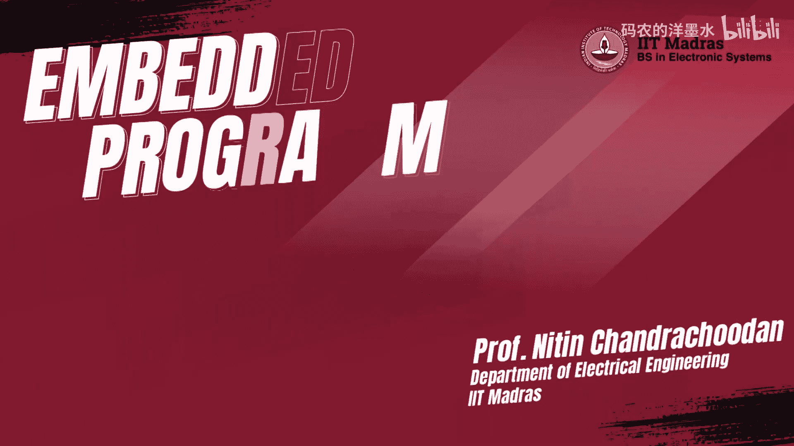
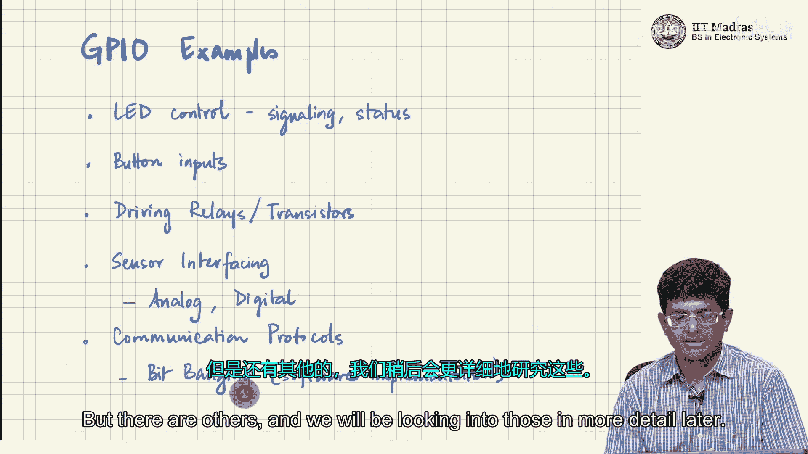

# 011：通用输入输出（GPIO）的使用

在本节课中，我们将学习使用微控制器通用输入输出（GPIO）引脚时需要牢记的关键因素。这些知识对于任何使用GPIO进行系统开发的用户或开发者都至关重要。

## 电压电平的考量

上一节我们介绍了GPIO的基本概念，本节中我们来看看使用GPIO时首要考虑的因素：电压电平。

每个CPU或MCU都有一个为其整个运行提供动力的电源电压。常见的电源电压有1.8伏、3.3伏。对于新型低功耗微控制器，电压可能低至1.2伏，甚至在某些手机处理器中会低于1伏。

另一方面，一个传感器可能运行在更高的电压上，例如5伏。问题在于，如果CPU工作在1.8伏，而传感器输出5伏的高电平，那么连接线将被拉高至5伏。这很可能是个问题，因为CPU仅设计用于1.8伏。在不确切知道输入缓冲器内部构造及其能否承受此高压的情况下，直接连接可能导致损坏。

这里隐含的假设是两者的地（GND）是相同的。实际上，如果地电位不同，问题会更严重。地并非通用参考点，它是每个电路的参考电位。除非能保证两个电路有相同的参考电位，否则一个电路中的5伏相对于另一个电路的地可能看起来是25伏。

即使有相同的地参考，将5伏传感器直接连接到1.8伏端口也可能损坏端口。反之亦然，一个运行在3.3伏的CPU连接一个仅能承受1伏的外设，也可能损坏外设。

除非你确切知道电路的构造方式，否则存在损坏风险，这是此处的重要结论。

## 电流驱动能力

上一节我们讨论了电压电平，本节中我们来看看另一个关键因素：电流驱动能力。

一个例子是让CPU驱动LED闪烁。LED需要一定的电流才能发光。这个电流来自电源，并流经微控制器单元。很可能，微控制器内置的缓冲器无法提供LED所需的足够电流。

如果只是这样，最可能的结果是LED不亮。这虽然不会造成损坏，但功能错误，并且是硬件调试中难以排查的故障来源。例如，一个需要12毫安的LED连接到一个只能提供10毫安的端口，就可能发生这种情况。

更糟糕的是相反的情况：假设一个传感器或其他电路试图驱动一个高电平，从而向CPU灌入电流。CPU能够灌入（Sink）的电流是有限的，因为它必须通过微控制器内部的电路流向地。如果试图灌入过多电流（例如40毫安），同样会损坏端口甚至整个微控制器。

以下是使用LED构建电路时需要注意的一些要点：
*   LED是一种二极管，其电压-电流特性曲线显示，当正向电压超过某个阈值（导通电压）后，电流会急剧上升。
*   不同颜色的LED有不同的正向电压：红色约2伏，绿色约2.5伏，蓝色约3伏，白色约3.5伏。
*   如果直接将5伏输出连接到LED（假设其正向电压为2.5伏），剩余的2.5伏无处“消耗”，很可能导致LED烧毁。

因此，我们需要串联一个电阻，这被称为限流电阻。假设我们有一个5伏电源，希望LED在20毫安电流下正常发光，其正向电压为2伏。那么，剩余的3伏电压将降落在电阻上。

根据欧姆定律，我们可以计算电阻值：
`电阻值 R = 电压 V / 电流 I = 3V / 0.02A = 150Ω`

所以，我们需要在LED和地之间串联一个150欧姆的电阻，以确保电流被限制在20毫安左右。这种限流对于几乎所有从微控制器端口驱动的电路都很重要。你需要检查电路的电流需求，确保没有试图从端口汲取过多电流，也没有造成短路。

## 驱动高电流负载

上一节我们讨论了电流不足可能导致功能失效，本节中我们来看看当负载需要比微控制器能提供的更大电流时该怎么办。

例如，尝试驱动一个电机。微控制器可能只能提供5毫安电流，但电机实际需要100毫安才能以所需速度转动。如果直接连接，可能不会损坏任何一方，但电机要么根本不转，要么转速极慢。

你不能使用多个端口并联来提供更大电流，这几乎必然会造成短路，而且100毫安电流仍需流经微控制器，这对微控制器不利。

解决方案是使用晶体管（或MOSFET）作为开关。晶体管有三个功能端子（以双极型晶体管BJT为例）：
*   **集电极 (C)**：连接电源电压。
*   **发射极 (E)**：连接负载和地，可以输送大电流。
*   **基极 (B)**：作为开关控制端。

通过在基极施加一个较小的控制电流（可能小于5毫安），可以控制集电极和发射极之间通过一个大得多的电流（例如100毫安）。MOSFET的工作原理类似，其端子称为漏极(D)、源极(S)和栅极(G)。

晶体管常用于电机驱动等场景。也有继电器可以实现类似功能，通过一个小信号控制，能在另一侧提供大电流或高电压。关键点是：**低控制电流，高驱动能力**。

## 按键与去抖动

GPIO也常用于读取按键输入。需要注意的是，按键是一个机械开关，按下时金属片接触，但由于物理弹跳，接触会在短时间内多次通断。

这种弹跳在实际中可能持续几毫秒（如10毫秒）。对人来说太短无法感知，但对运行在兆赫兹频率的电路来说，10毫秒相当于成千上万个时钟周期。在这期间，程序可能已经执行了许多指令，误以为信号已稳定变高，但下次读取时却发现是低电平，造成误判。

因此，我们需要进行“去抖动”。有几种解决方法：
*   **硬件去抖**：使用锁存器或专用的去抖电路。
*   **软件去抖**：更常见且易于实现。检测到信号变化后，程序等待一段去抖时间（如10毫秒），然后再次读取信号值。只有当信号值在此期间保持稳定，才确认按键事件。

## 静电放电防护

另一个重要方面是静电放电（ESD）。在干燥气候中，人体或物体表面容易积累静电荷。当你触摸门把手时产生的小火花就是ESD。

想象同样的微小火花进入微控制器电路，足以彻底损坏电路。因此，切勿直接触摸电路板上的引脚。在处理电子设备前，应确保身体已放电。安全做法是在防静电工作台上工作，使用接地腕带将身体电位接地，防止电荷积累，减少此类问题发生。

许多微控制器和系统都有电路级的ESD保护，但这并非万无一失。在使用GPIO引脚进行接口连接时，尤其需要小心，因为它们更容易因使用不当而出问题。

## GPIO的应用示例

最后，简要介绍GPIO的一些应用示例。正如我们所见，LED是最简单的应用，除了闪烁显示系统“存活”状态外，它们对于指示系统各种状态非常重要。LED功耗低，是状态指示的常用选择。

GPIO的其他常见应用包括：
*   **按键输入接口**：读取用户输入。
*   **驱动继电器或晶体管**：用于控制其他大功率系统的开关。
*   **传感器接口**：可用于连接模拟传感器（后续课程会讲到）或数字传感器（其输出类似按键，为0或1状态）。
*   **通信协议模拟**：在某些情况下，如果没有专用的通信模块（如UART、I2C），可以使用GPIO通过软件模拟通信协议，这被称为“位敲打”（Bit Banging）。即通过直接控制GPIO端口各位的电平变化来输出协议时序。这不常见，但在需要与特定协议设备通信而硬件不支持时可以使用。

综上所述，GPIO是微控制器中最通用的连接形式，我们将在后续课程中探讨其他类型的接口。

本节课中我们一起学习了使用GPIO时需要考虑的电压电平、电流能力、高负载驱动、按键去抖动、静电防护等关键因素，并了解了GPIO的多种应用场景。正确理解和使用这些概念，是进行可靠嵌入式系统硬件接口设计的基础。