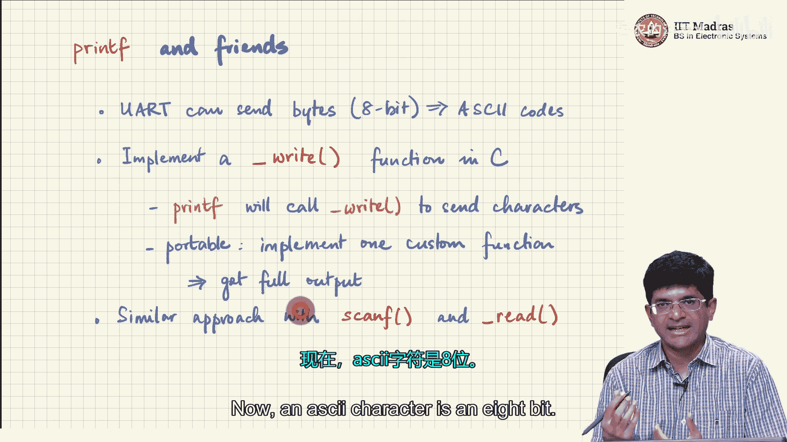

# 012：串行通信与通用异步收发传输器 (UART) 🚀


在本节课中，我们将要学习一种特定的通信方式——通用异步收发传输器（UART）。我们将了解其工作原理、数据帧结构、配置参数以及它在嵌入式系统中的典型应用和优缺点。

## 通信需求与异步概念

上一节我们介绍了通信的基本需求，本节中我们来看看如何实现简单的数据传输。假设我们有两个系统，CPU1和CPU2。我们需要将数据从CPU1发送到CPU2，例如，将温度传感器的读数发送给中央控制器。

我们寻找的是最简单的方式。这里引入了一个新术语：**异步通信**。最简单的数据传输方式是使用一个额外的时钟信号线，接收方根据时钟信号来读取数据线上的值。但这需要三根线：数据线、返回线和时钟线。

问题在于，两个系统的时钟频率可能存在微小差异，这会导致数据读取错误。因此，我们希望找到一种不需要共享时钟的传输方式，即异步通信。

## UART协议与数据帧

为了解决上述问题，人们设计了UART协议。我们首先考虑单向通信（从CPU1到CPU2），并且希望只用一根线。实际上，我们隐含地假设了两系统之间存在第二根线作为公共地线，它为电路提供参考电压，本身不传输数据。

现在，我们需要解决两个核心问题：
1.  CPU2如何知道数据何时开始传输？
2.  CPU2如何识别传输的是哪些比特位？

协议通过构建一个**数据帧**来解决这些问题。其核心思想如下：
*   我们假设发射器和接收器之间有公共地线。
*   默认状态下，从发射器到接收器的传输线保持高电压（逻辑1），这称为**空闲状态**。
*   当CPU1想要通信时，它会将传输线拉低（逻辑0）持续一个特定的时间长度。这称为**起始位**。
*   CPU2内部的电路检测到这个起始位，就知道数据传输即将开始。
*   CPU2还需要知道**比特持续时间**（即每个比特位的宽度）。这需要双方提前约定好通信速率。
*   检测到起始位后，CPU2会在约定的时间点对数据线进行采样，以读取后续的数据比特。
*   数据发送完毕后，需要至少一个比特时间内将线路拉高，这称为**停止位**，表示一次传输结束。

在最后一个数据位和停止位之间，可以插入一个可选的**奇偶校验位**，用于错误检测。

以下是数据帧的构成示意图：

```
[空闲状态: 高电平] -> [起始位: 1比特低电平] -> [数据位 (如8位)] -> [奇偶校验位 (可选)] -> [停止位: 至少1比特高电平] -> [空闲状态]
```

## 配置参数与通信模式

要使UART通信正常工作，通信双方必须就一组参数达成一致。最常见的参数组合是：**8-N-1， 9600**。

*   **8**： 数据位为8位。
*   **N**： 无奇偶校验位。
*   **1**： 1个停止位。
*   **9600**： 波特率（每秒传输的比特数），即9600比特/秒。在UART中，波特率与比特率通常等同。

接收方必须正确知道所有这些参数，否则会解码错误。这些参数的协商通常由协议之外的方式（如预先设定或初始握手）完成。

UART支持几种通信模式：
*   **单工**： 数据只能在一个方向上传输（如CPU1到CPU2）。
*   **半双工**： 数据可以在两个方向上传输，但不能同时进行。
*   **全双工**： 数据可以同时在两个方向上传输。这是通过使用独立的发送（Tx）和接收（Rx）线实现的。连接规则是：A的Tx连接B的Rx，B的Tx连接A的Rx。

## UART的优缺点与应用

UART被广泛使用，主要归功于其优点：

*   **简单**： 硬件需求极简，全双工也仅需两根信号线加一根地线。
*   **无需时钟同步**： 降低了系统复杂性和成本。
*   **通用性强**： 几乎所有微控制器都支持，历史悠久，资源丰富。
*   **可软件模拟**： 在必要时可以用软件代码实现UART功能。
*   **低成本**： 硬件实现简单，IP核易于获取和集成。

当然，UART也有其局限性：

*   **速度较低**： 对时钟偏差敏感，通常用于中低速通信（常见于115200 bps以下）。
*   **不适合长距离高速通信**： 信号完整性在长距离或高速下易受影响。
*   **无共享时钟**： 依赖双方精确的波特率匹配，时钟漂移会导致错误。
*   **点对点通信**： 难以直接构建多主多从的总线网络，通常是点对点连接。
*   **协议开销**： 每个字节都有起始位和停止位的开销。
*   **错误处理能力弱**： 仅有基本的奇偶校验检测，无纠错能力，发现错误后只能丢弃数据。
*   **CPU占用**： 通常需要CPU介入每个字节的发送和接收，虽然可用中断优化，但相比某些协议效率较低。

一个非常常见的UART应用是提供**控制台接口**。在嵌入式系统开发中，控制台是一个基于文本的界面，主要用于调试、监控、配置和控制。由于其简单性，串口常被用作控制台接口。它易于实现，硬件需求最小，并能提供实时的交互体验。

最后，UART与C语言的标准输出函数`printf`有很好的结合。`printf`函数的一部分功能是将格式化后的ASCII字符发送出去。而UART正是传输字节（如ASCII码）的理想工具。在许多嵌入式开发环境中，通过实现一个底层的`_write`函数（或类似函数），将字符通过UART发送出去，就可以直接使用`printf`函数向串口终端输出信息，极大方便了调试。



## 总结

本节课中我们一起学习了通用异步收发传输器（UART）。我们了解了异步通信的必要性，深入探讨了UART数据帧的结构，包括起始位、数据位、奇偶校验位和停止位。我们还学习了配置UART通信的关键参数（如8-N-1， 9600）以及不同的通信模式（单工、半双工、全双工）。最后，我们分析了UART简单、通用、低成本等优点，也认识了其在速度、距离、多设备互联和错误处理方面的局限性，并了解了它在嵌入式系统中作为控制台接口的典型应用。掌握UART是进行嵌入式设备间通信的基础。