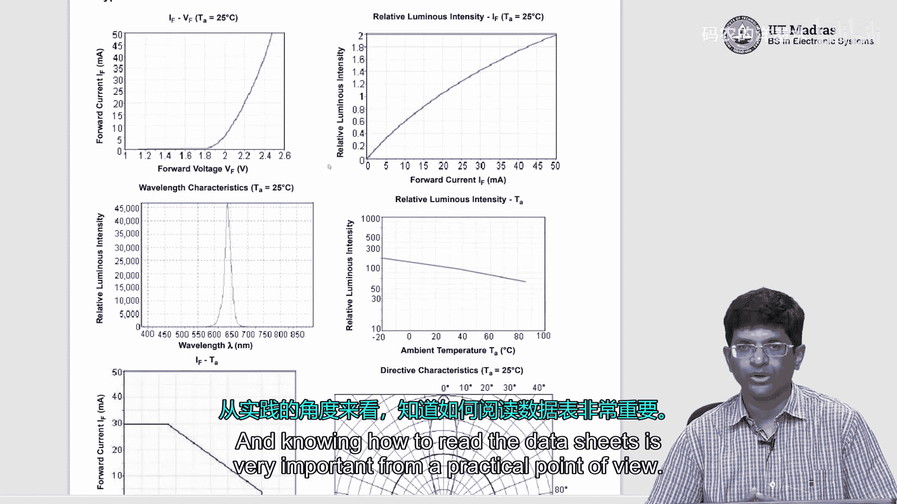

# 013：嵌入式系统电子元器件规格解读 📖

在本节课中，我们将学习如何阅读和理解嵌入式系统中电子元器件的核心文档——数据手册。我们将通过分析微控制器和LED的数据手册，了解如何从中提取关键信息，为系统设计和编程提供依据。

## 数据手册概述

上一节我们介绍了微控制器外围的物理基础设施，如GPIO和通信协议。本节中，我们来看看如何了解一个微控制器具体拥有哪些功能。这些信息通常通过一种称为“数据手册”的文档提供。数据手册的核心目的是详细描述一个电子元器件，以便用户能有效地使用它。

数据手册的重要性在于，它描述了电子元器件。更重要的是，你需要知道在其中寻找什么信息以及在哪里寻找。

## 数据手册与数据简介

我们将简要查看两个数据手册的例子：一个是用于我们示例中的STM32 C031系列微控制器，另一个是一个标准红色LED的数据手册（来自电子元件分销商Farnell的页面）。

我们在这里看到的实际上是一个“数据简介”，而非完整的数据手册。这是针对STM32 Nucleo开发板的。数据简介和数据手册的区别在于，数据简介更像是一个高层概述，旨在让你了解某个部件或组件的大致功能，而不深入其实现细节。

以下是数据简介通常包含的内容：

*   **产品系列信息**：例如，它列出了Nucleo C031、C6、F系列、G系列、L系列等。
*   **通用特性**：例如，所有板卡都使用STM32微控制器，采用LQFP 64或48封装。LQFP指的是芯片的封装类型，这对PCB设计者非常重要。
*   **板载资源**：例如，有一个类似Arduino的用户LED、两个按钮（用户按钮和复位按钮）、一个提供32.768 kHz时钟的晶体振荡器。
*   **特定功能**：例如，部分板卡提供USB连接，部分内置加密原语。
*   **订购信息**：包括产品变体、标识码等。
*   **开发环境与文档历史**：包括工具链要求和文档的修订记录。

## 微控制器数据手册详解

另一方面，针对实际微控制器芯片（如STM32 C031）的数据手册则包含更详细的信息。数据手册的第一页通常有一个特性摘要。

数据手册首页的摘要信息非常丰富：
*   **核心**：STM32 C0系列采用ARM Cortex-M0+内核，是32位MCU。
*   **内存**：拥有32 KB闪存（用于存储程序和配置）和12 KB RAM（用于系统运行时变量和临时存储）。
*   **外设**：包含2个USART、定时器、一个ADC（模数转换器）。
*   **通信接口**：需要查阅数据手册了解具体类型。
*   **工作电压**：2V 至 3.6V。

特性摘要部分进一步描述了：
*   **内核与工作温度**。
*   **内存类型**。
*   **时钟管理**：支持外部晶体振荡器和内部RC振荡器。内部RC振荡器精度较低（1%-5%容差），适用于对时序要求不高的场景。
*   **GPIO**：数量取决于封装，且所有GPIO引脚**耐受5V电压**。这意味着即使CPU工作在较低电压（如2-3V），直接连接输出5V信号的外设也是安全的。
*   **DMA**：直接内存访问。
*   **ADC**：最多19个通道。
*   **定时器与RTC**：实时时钟。
*   **通信接口**：例如1个I²C总线、2个USART、1个SPI（速率最高24 Mbps）。
*   **调试支持与合规性**。

完整的数据手册还会深入以下细节：
*   **功能概述与系统框图**：显示CPU只是整个系统的一小部分，还包括电压调节器、内部时钟、复位控制、GPIO端口、ADC、SPI以及连接定时器、USART、I²C等外设的总线。
*   **引脚描述与电气特性**：包括最小/最大电压、工作电流、电源管理模式。
*   **封装信息**。
*   **内存映射与控制寄存器**：这部分信息通常在独立的**参考手册**中提供，数据手册会指明需要查阅哪个参考手册。

了解如何阅读数据手册，对于如何利用微控制器至关重要。例如：
*   如果你需要连接大量传感器，就需要寻找ADC通道数多的型号。
*   如果你需要多于2个USART，或需要多个SPI接口来控制其他外设，就需要相应型号。
*   定时器可用于PWM（脉冲宽度调制）来控制电机。

不同的微控制器系列（如ESP系列、TI的MSP430、Microchip的PIC）都有各自的数据手册，结构相似但各有特点。明确设计需求并能在数据手册中找到关键参数，是构建或使用嵌入式系统的重要技能。

## 简单元器件数据手册示例

以一颗标准红色LED的数据手册为例，它来自Farnell网站，由Multicom公司生产。LED的数据手册相对简单。

它首先提供了简要特性，并包含物理封装尺寸图及公差说明。例如，标称直径为5mm，但公差可能为±0.25mm。这提醒PCB设计者，实际尺寸可能存在微小偏差。

更重要的是电气参数部分：

*   **最大额定值**：
    *   **最大功耗**：80 mW。
    *   **峰值正向电流**：100 mA（占空比1/10，即脉冲宽度≤0.1ms）。
    *   **连续正向电流**：20 mA（这是进行限流计算时应采用的**安全值**）。
    *   **反向电压**：5 V（若阴极阳极接反，施加的反向电压超过此值将损坏LED）。
    *   **降额曲线**：当环境温度超过50°C时，允许的电流需减小。
    *   **工作温度范围**：-40°C 到 +100°C。

数据手册还提供了LED的特性曲线：
*   **正向电压-电流曲线**：显示在约2.2V正向电压时，电流约为20mA。电压升至2.4V-2.6V时，电流可能超过50mA，这会损坏LED。
*   **波长分布图**：显示其发光波长在600-615纳米之间，属于红光范围。
*   **光强角度分布图**等信息。

## 总结

本节课中，我们一起学习了如何解读嵌入式系统的核心文档——数据手册。

我们了解到，数据手册（或数据简介）为电子元器件提供了全面描述。对于微控制器，我们需要关注其核心架构、内存容量、外设类型与数量（如GPIO、ADC、通信接口）、电气特性（如工作电压、电流、I/O耐受性）以及封装信息。这些信息决定了元器件的适用场景和设计限制。

即使是简单的元器件如LED，其数据手册也包含了关键的电气参数（如最大电流、正向电压）和物理特性（如尺寸公差），这些对于电路设计和可靠性至关重要。

掌握阅读数据手册的技能，不仅能帮助系统设计者选择合适的元器件并进行正确设计，也能让最终用户更深入地理解所用系统的实际能力，是从理论走向实践的关键一步。