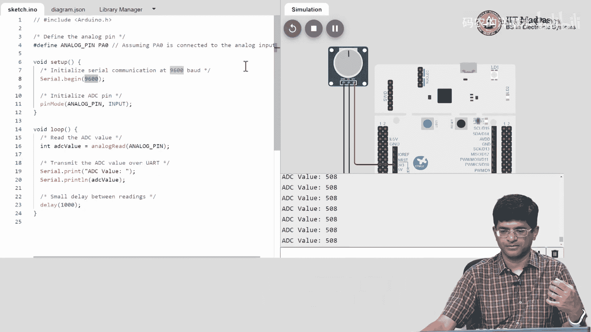

# 014：模数转换


## 概述
在本节课中，我们将要学习嵌入式系统中一个非常有用且常被集成到微控制器中的功能：模数转换。我们将了解什么是模拟信号，为什么需要将其转换为数字信号，以及模数转换器的基本工作原理和关键参数。

## 什么是模拟信号？🤔
上一节我们介绍了微控制器与外界的交互，本节中我们来看看一种常见的交互方式：处理模拟信号。

模拟信号通常指连续变化的物理量，这与只能在0和1之间切换的数字信号形成对比。数字信号本质上是二进制的，而模拟信号可以取一个范围内的任意值。

在现实生活中，模拟信号无处不在。以下是常见的模拟信号来源：
*   **温度传感器**：如热敏电阻，其电阻或通过的电流与系统温度相关。
*   **光传感器**：产生的电流与照射到传感器上的光强相关。
*   **压力传感器**：通常基于压电原理，施加的压力会改变系统的电压或电流特性。
*   **湿度传感器、力传感器、气体浓度传感器**。
*   **声音**：声音是一种物理量，通过麦克风将声波转换为变化的电流或电压。
*   **位置传感器**：用于检测在特定方向上移动的距离。
*   **pH传感器、土壤湿度传感器**等用于农业和土壤管理的传感器。

这意味着，如果你希望微控制器与外部世界通信，就需要一种方法将这些模拟量转换为微控制器可以处理的形式。

## 为什么需要模数转换？🔌
核心问题在于，微控制器的核心处理单元不直接处理模拟值，它只处理已经转换为二进制形式的数字。

因此，我们需要在利用这些信号之前，将模拟值转换为二进制数字。一个常见的方法是**采样**和**量化**。

我们无法存储模拟信号在每一瞬间的值。取而代之的是，我们在特定时间点查看信号的值，例如在t1、t2、t3时刻。这个过程称为**采样**。我们假设，如果采样足够频繁，就能通过插值近似得到任意时刻的信号值。

然而，仅采样还不够。微控制器中存储的不是真正的实数，而是基于有限位数（如8位、16位、32位）的近似值。例如，我们无法精确存储无限不循环小数π。

因此，我们还需要**量化**，即决定需要存储的幅度等级。我们设定一系列离散的幅度水平（例如图中的红线），然后将每个采样时刻的信号值近似到最接近的幅度水平上。

结合**时间上的离散化**（采样）和**幅度上的离散化**（量化），我们就得到了**数字信号**。将模拟信号（橙色曲线）转换为数字信号（绿色阶梯曲线）的过程，就称为**模数转换**，由**模数转换器** 执行。

## ADC的关键特性 ⚙️
了解ADC如何构建和工作超出了本课程范围，但你需要对其几个关键特性有大致了解。

### 工作范围与理想特性
ADC通常在某个电压范围内工作，这个范围称为ADC的**满量程范围**。一个理想的ADC会将输入电压`V_in`线性地映射到输出数字码`N`。公式可以表示为：
`N = (V_in - V_min) / (V_max - V_min) * (2^n - 1)`
其中`n`是ADC的位数，`V_min`和`V_max`是输入电压的最小值和最大值。

在实际中，由于电路的非理想性，ADC的转换特性可能并非完美的直线（如图中绿色曲线），会存在非线性误差。

### 分辨率
ADC的输出通常是一个`n`位的二进制数。如果将其视为无符号整数，其输出范围是从`0`到`2^n - 1`。

理想情况下，`V_min`映射为输出码`0`，`V_max`映射为输出码`2^n - 1`。那么，每个数字码代表的电压步进大小（即**分辨率**）为：
`分辨率 = (V_max - V_min) / 2^n`

举例来说，如果一个10位ADC的`V_min = 0V`，`V_max = 3.3V`，那么：
*   输出范围：0 到 1023。
*   分辨率 = 3.3V / 1024 ≈ 0.0032V = 3.2mV。

这意味着该ADC可以测量低至约3.2mV的电压变化。分辨率的选择取决于具体应用和信号特性。

### 采样率
采样间隔`T`是指两次采样之间的时间。**采样频率** `F_s`是`T`的倒数：`F_s = 1 / T`。

一个关键问题是：应该使用多高的采样频率？直观上，采样频率越高，对原始信号的还原就越好，但也会产生更多数据需要处理。

根据**奈奎斯特采样定理**，为了能够无失真地重建原始信号，采样频率`F_s`必须至少是信号中最高频率成分`f_max`的两倍，即`F_s > 2 * f_max`。这个最低要求`2 * f_max`被称为**奈奎斯特频率**。采样频率超过此值太多并不会带来显著改善，反而增加系统负担。因此，需要根据信号特性选择合适的ADC和采样率。

## 微控制器中的ADC实践 💻
在STM32等微控制器中，需要配置才能使用ADC功能。默认情况下，引脚并非模拟模式，需要显式配置。

以下是配置ADC时可能涉及的一些参数和概念：

### 基本配置
*   **预分频器**：允许ADC工作在比主时钟频率更低的时钟下，以适应所需的采样率。
*   **分辨率**：可以配置为12位、10位或8位等。位数越高，精度越高，但转换时间通常也更长。如果8位分辨率已满足需求，选择它可以实现更快的采样和更低的功耗。
*   **数据对齐**：当ADC结果（如10位）被读入一个更宽的寄存器（如16位）时，可以指定是左对齐还是右对齐。这对于处理有符号数（二进制补码）时尤其重要。

### 多通道与扫描模式
微控制器中的ADC通常支持**多通道**。一个物理ADC模块可以通过一个多路复用器连接到多个输入引脚。

这意味着你可以使用单个ADC硬件来转换多个不同的模拟信号。但需要注意的是，这些通道无法在同一时刻被采样，只能依次转换。在采样率较低的应用中，通道切换的时间可以忽略不计；但在高速采样应用中，不同通道采样时刻的差异可能需要算法补偿。

可以配置**扫描模式**，让微控制器自动按顺序转换一系列通道。还可以使用**序列器**来定义通道转换的顺序。

### 采样模式
*   **连续采样模式**：ADC完成一次转换后，立即开始下一次转换（或切换到序列中的下一个通道）。适用于需要实时、连续采集信号的应用，但功耗较高。
*   **单次/触发采样模式**：仅在收到触发信号（如软件指令、定时器事件）时才执行一次转换。适用于不需要高频采样的场景，例如每分钟读取一次温度值，可以显著降低功耗。

### 采样保持电路
ADC内部通常包含**采样保持电路**。其工作原理是：在转换开始前，一个开关短暂闭合，让输入电压对电容充电；然后开关断开，电容“保持”住该电压，供ADC电路进行相对稳定的转换。更长的采样保持时间通常有利于提高转换精度，但会降低最大采样率。这个时间参数通常也是可配置的。

### 转换触发
如何启动一次ADC转换是需要考虑的重要问题：
1.  **软件触发**：通过代码写特定寄存器来启动转换（如Arduino中的`analogRead()`）。
2.  **硬件触发**：由外部事件（如定时器溢出、外部引脚信号）自动启动转换。这对于需要精确定时采样的应用非常有用。

## 实例演示：读取电位器电压 🎛️
以下是一个使用Arduino风格代码读取模拟值的简单示例，用于说明基本流程：

```c
// 定义使用的模拟引脚
#define ANALOG_PIN PA0

void setup() {
  // 初始化串口通信，波特率9600
  Serial.begin(9600);
  // 将引脚配置为模拟输入模式
  pinMode(ANALOG_PIN, INPUT);
}

void loop() {
  // 软件触发一次ADC转换，并读取10位结果（0-1023）
  int adcValue = analogRead(ANALOG_PIN);
  // 通过串口打印ADC转换值
  Serial.print("ADC Value: ");
  Serial.println(adcValue);
  // 延迟1秒，便于观察
  delay(1000);
}
```

**电路连接**：
*   电位器两端分别接3.3V（VCC）和0V（GND）。
*   电位器中间抽头（信号端）接微控制器的PA0引脚（A0）。

**工作原理**：
1.  `pinMode(ANALOG_PIN, INPUT)`将PA0配置为模拟输入模式，背后隐藏了配置GPIO和ADC默认参数的操作。
2.  `analogRead(ANALOG_PIN)`触发一次软件ADC转换，等待转换完成，并将10位结果（0-1023）返回。
3.  旋转电位器时，PA0引脚上的电压在0V-3.3V之间变化，`adcValue`也随之在0-1023之间变化。
4.  通过串口监视器可以观察到变化的数字。

这个例子展示了Arduino库如何简化ADC的使用，它隐藏了底层复杂的寄存器配置，设置了默认的10位分辨率、软件触发等。然而，这种抽象也牺牲了灵活性。当需要更精细的控制（如改变分辨率、采样率、触发方式、对齐方式）时，通常需要回归到直接操作寄存器的标准C代码。

## 总结 🎯
本节课中我们一起学习了模数转换的核心知识。

*   **目的**：ADC是微控制器与物理世界接口的关键，因为大多数真实世界的信号都是模拟的。
*   **核心过程**：通过**采样**（时间离散化）和**量化**（幅度离散化）将连续模拟信号转换为离散数字信号。
*   **关键参数**：包括**分辨率**（位数）、**满量程范围**、**采样频率**、**非线性度**等，这些都需要根据待转换信号的特性和应用需求来选择。
*   **微控制器中的特性**：在MCU应用中，ADC常具备**多通道**、**可配置的扫描序列**、**多种触发模式**（连续、单次、定时触发）等特点，在设计系统时需要综合考虑。
*   **实践**：高级抽象（如Arduino库）可以简化初始开发，但要获得最佳性能和灵活性，往往需要深入底层进行寄存器级别的配置。




理解ADC的原理和配置方法，是构建能够感知和处理真实世界信号的嵌入式系统的重要基础。