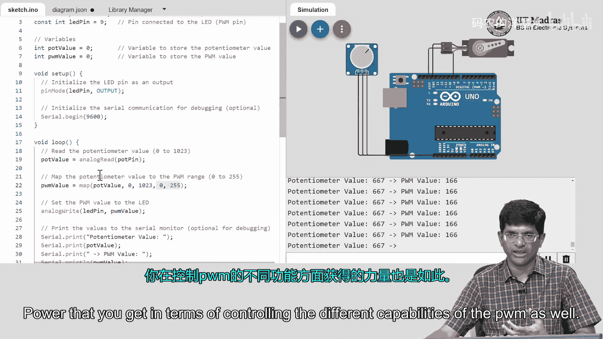

# 015：嵌入式系统中类模拟信号的生成与控制


## 概述
在本节课中，我们将要学习脉冲宽度调制技术。这是一种在嵌入式系统中，使用纯数字方法生成类模拟信号的有效手段。我们将从数字到模拟转换的概念入手，逐步理解PWM的原理、实现方式、应用场景及其优缺点。

## 数字到模拟转换的需求
上一节我们介绍了模拟到数字转换。与之相对，在某些应用场景中，我们需要进行数字到模拟转换。这意味着我们有一个数字值，并希望得到一个能代表该数字值的电压。

例如，假设我需要生成一个0到3.3伏特范围内的电压。如果我的数字输入是10位，就像ADC一样，那么我输入一个0到1023之间的数字。理想情况下，数字400对应的电压值应为：
`Vout = 400 * (3.3V / 1024) ≈ 1.289V`
然而，由于分辨率限制（约3毫伏）以及量化噪声、随机噪声和非理想性等因素，实际输出会存在误差。

## 脉冲宽度调制原理
构建专用的数模转换器电路可能比较复杂。脉冲宽度调制提供了一种更简单的替代方案。

PWM依赖于一个高频时钟，其周期为 `T = 1/f`。我们生成一个信号，该信号只在高电平（如3.3V）和低电平（0V）之间切换。

以下是一个PWM信号的示例：
*   信号先保持2个时钟周期的高电平。
*   然后保持3个时钟周期的低电平。
*   如此循环往复。

如果这种切换速度足够快，从外部观察，我们将看不到每次的电压跳变，而只能看到一个平均值。这个平均值由信号“开启”时间与总周期的比例决定。

## 占空比与平均电压
信号的总周期由 `Ton`（高电平时间）和 `Toff`（低电平时间）组成。`Ton` 占总周期的比例称为**占空比**。

`占空比 = Ton / (Ton + Toff)`

平均输出电压等于占空比乘以高电平对应的电压值。在前面的例子中，占空比为 `2/(2+3)=40%`。如果高电平为3.3V，则平均输出电压约为 `3.3V * 40% = 1.32V`。

通过改变脉冲的宽度（即 `Ton` 的时间），我们可以获得0%到100%之间的任何占空比，从而在0V到高电平电压之间生成任何所需的平均电压值。这种对脉冲宽度进行调制以控制平均输出电压的技术，就是脉冲宽度调制。

这种平均效果，本质上是大多数物理系统固有的低通滤波特性。对于变化非常快的信号，外部测量系统或人眼通常只对其平均值敏感，而将高速变化视为噪声滤除。

## 代码实现示例
在代码层面，我们可以利用微控制器提供的定时器和PWM外设来轻松实现。以下是一个基于硬件抽象层的概念性C代码示例，展示了如何配置一个产生50%占空比、1kHz频率PWM信号的定时器。

```c
// 假设使用16MHz时钟，预分频系数设为16，得到1MHz的定时器时钟
timer.prescaler = 16;
// 设置定时器周期为1000个计数
timer.period = 1000;
// 设置比较值为500，当计数值小于500时输出高电平，大于等于500时输出低电平
timer.compare_value = 500;
// 将定时器设置为PWM模式
timer.mode = PWM_MODE;
// 初始化并启动定时器
timer_init(&timer);
```
这段代码配置的结果是：输出信号高电平持续500个时钟周期（500微秒），低电平也持续500个时钟周期（500微秒），形成一个周期为1毫秒（频率1kHz）、占空比50%的方波。通过修改 `compare_value`，可以轻松改变占空比。例如，将其设为300，即可得到30%的占空比。

使用预分频器将高频时钟分频，是为了将PWM频率调整到一个合适的值。过高的PWM频率可能产生电磁干扰，影响系统中其他电子设备。只要最终频率仍远高于被控物理系统的响应速度，就能保证良好的平均效果。

## PWM的应用
PWM技术因其简单高效，在嵌入式领域有广泛应用。

以下是几个典型的应用场景：

1.  **LED亮度控制**：LED的亮度不能通过简单地线性改变其电流来调节。PWM通过高速开关LED，利用人眼的视觉暂留效应，使人感知到的是平均亮度。LED本身始终处于全亮或全灭状态，从而安全、高效地实现调光。
2.  **电机速度控制**：对于直流电机，平均电压决定了其转速。PWM通过快速通断施加在电机上的电源，利用电机转子的惯性对速度进行平均，从而实现平滑的调速，而非直接改变供电电压。
3.  **开关电源**：现代电子设备中常见的开关电源，其核心就是利用PWM技术来高效地转换和稳定电压。
4.  **舵机控制**：舵机是一种用于精确控制角度的电机。它通过识别输入PWM信号的脉冲宽度（通常是1ms到2ms之间）来确定目标位置，而非平均电压。

## PWM的优缺点
任何技术都有其两面性，PWM也不例外。

以下是PWM的主要优点：

*   **电路简单**：无需复杂的专用数模转换电路，利用数字IO和定时器即可实现。
*   **效率高**：功率器件工作在完全导通或完全关断状态，避免了线性放大区间的功率损耗，特别适合功率控制。
*   **精度可控**：通过提高时钟频率，可以获得更精细的占空比调节分辨率。

然而，PWM也存在一些缺点和挑战：

*   **分辨率与响应时间受限于时钟**：输出精度和系统能响应多快的变化，受基础时钟频率限制。
*   **电磁干扰**：高速开关会产生高频噪声，可能通过辐射或传导干扰周边电路，需要仔细的PCB布局和滤波设计。
*   **可闻噪声**：如果PWM频率落在音频范围内（如几kHz），可能会产生令人不快的蜂鸣声。
*   **对敏感模拟电路的干扰**：PWM产生的高速跳变信号可能通过寄生电容或电感耦合到模拟测量电路中，影响测量精度。

## 实践示例：使用PWM控制LED和舵机
为了展示PWM的实际应用，我们来看一个使用Arduino环境的示例。这个示例通过读取电位器的模拟值，来同时控制一个LED的亮度和一个舵机的角度。

以下是核心代码逻辑：
```c
int potPin = A0; // 电位器连接引脚
int ledPin = 9;  // LED连接引脚
int servoPin = 10; // 舵机信号引脚

void setup() {
    pinMode(ledPin, OUTPUT);
    pinMode(servoPin, OUTPUT);
    Serial.begin(9600); // 初始化串口用于调试
}

void loop() {
    // 读取电位器值 (0-1023)
    int sensorValue = analogRead(potPin);
    // 将0-1023映射到0-255，供PWM输出使用
    int pwmValue = map(sensorValue, 0, 1023, 0, 255);

    // 使用analogWrite函数输出PWM信号
    analogWrite(ledPin, pwmValue); // 控制LED亮度
    // 注意：舵机控制通常需要特定脉宽，此处仅为示意。
    // 实际控制舵机需使用能生成精确脉宽的库（如Servo.h）
    // analogWrite(servoPin, map(pwmValue, 0, 255, 25, 125)); // 近似映射

    Serial.println(pwmValue); // 打印PWM值
    delay(10); // 短暂延迟
}
```
在此示例中，`analogWrite()` 函数封装了所有底层定时器、预分频器和比较寄存器的配置细节，开发者只需关心0到255之间的输出值。这种高度抽象简化了开发，但同时也牺牲了对PWM频率、极性等参数的直接控制权。当旋转电位器时，LED的亮度会平滑变化，舵机（若正确连接和驱动）的轴也会相应转动。




## 总结
本节课我们一起学习了脉冲宽度调制技术。我们从数模转换的需求出发，深入理解了PWM通过调节数字脉冲的占空比来生成等效模拟电压的基本原理。我们探讨了其在代码中的实现方式，并列举了LED调光、电机调速、舵机控制等丰富应用。最后，我们也客观分析了PWM简单高效背后的代价，如潜在的电磁干扰问题。掌握PWM，是进行嵌入式系统交互与控制设计的一项重要技能。