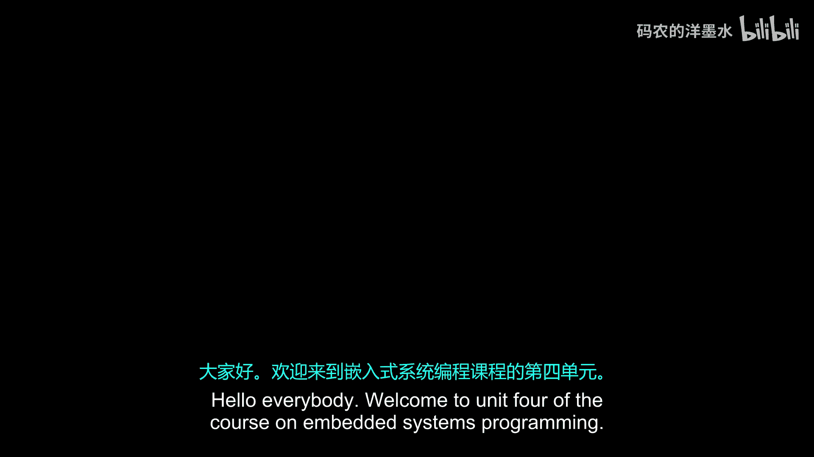
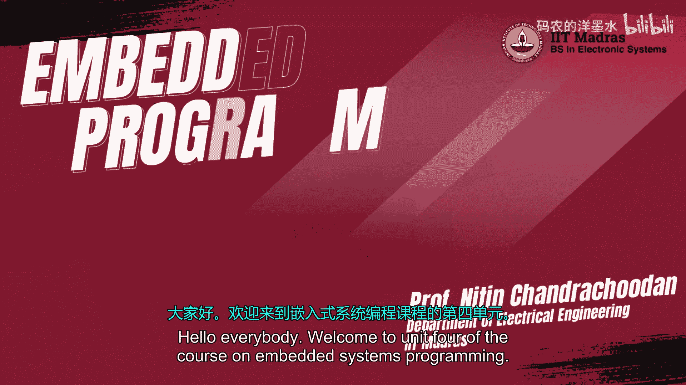
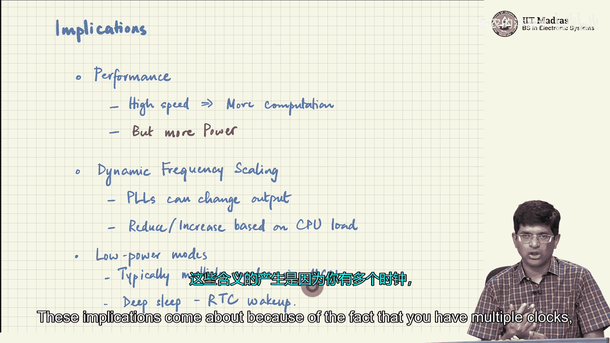

# 016：微控制器中的时钟系统 ⏰

在本节课中，我们将要学习微控制器中时钟系统的核心概念。我们将探讨时钟在数字电路中的作用、时钟速度与功耗的关系、微控制器中常见的多种时钟源及其应用，以及如何通过配置时钟来优化系统性能和功耗。

## 时钟与数字电路 ⚙️

上一节我们介绍了课程概述，本节中我们来看看时钟在数字电路中的基本作用。

数字电路主要由两种逻辑元件构成：组合逻辑和时序逻辑。组合逻辑（如与门、或门、非门）的输出仅取决于当前的输入。而时序逻辑（如触发器、寄存器）则用于存储系统的“状态”，其输出不仅取决于当前输入，还取决于一个称为“时钟”的信号在何时发生跳变。

时钟本质上是一个在0和1之间周期性切换的数字信号。当时钟信号发生跳变（例如从0到1的上升沿）时，时序元件中的状态才会根据其输入进行更新。因此，时钟频率（每秒的周期数）直接决定了系统执行计算的速度。频率越高，单位时间内能完成的计算就越多。

## 时钟速度与功耗权衡 🔋

上一节我们了解了时钟如何驱动计算，本节中我们来看看高速时钟带来的一个关键问题：功耗。

直观上，更高的时钟频率意味着更高的性能。然而，这也带来了更高的功耗。功耗主要来源于数字门电路在0和1之间切换时产生的动态功耗。一个简化的功耗模型可以表示为：

**P ∝ C × V² × f**

其中：
*   **P** 是功耗。
*   **C** 是电路的总负载电容。
*   **V** 是供电电压。
*   **f** 是时钟频率（或开关活动频率）。

这个公式揭示了降低功耗的三个关键方向：
1.  **降低频率 (f)**：减少单位时间内的开关次数。
2.  **降低电压 (V)**：由于存在平方项，降低电压能显著减少功耗。
3.  **减小电路规模 (C)**：使用更简单、门数更少的电路。

然而，降低电压通常会导致晶体管开关速度变慢，从而限制最高可运行的时钟频率。因此，在系统设计中需要在性能和功耗之间进行权衡。

## 微控制器中的多时钟系统 🕰️

上一节我们讨论了时钟速度的权衡，本节中我们来看看为什么微控制器内部通常拥有多个时钟源。

单一的全局高速时钟虽然能提供高性能，但无法满足所有外设的需求，且会导致不必要的功耗。因此，现代微控制器集成了多种时钟源和时钟生成电路，以实现灵活性和能效。

以下是微控制器中常见的几种时钟：

*   **系统时钟 (SYSCLK)**：这是供给CPU核心的主时钟，通常是系统中频率最高的时钟，用于确保核心的处理性能。
*   **外设时钟**：许多外设（如UART、ADC、定时器）的工作速度远低于CPU。为它们提供独立的、可配置的时钟，可以在满足功能需求的同时，关闭或降低不使用外设的时钟以节省功耗。
*   **实时时钟 (RTC)**：这是一个独立的、频率极低（通常为32.768 kHz）的时钟。即使CPU和其他部分进入深度睡眠模式，RTC也能持续运行，用于计时、产生定时唤醒中断或为事件添加时间戳。

## 时钟的产生与配置 🔧

上一节我们介绍了多种时钟的用途，本节中我们来看看这些时钟是如何产生和配置的。

时钟信号需要由振荡器产生。微控制器通常支持多种振荡源：

*   **内部RC振荡器**：集成在芯片内部，成本低，无需外部元件，但精度和稳定性较差（可能有1%-5%的误差）。
*   **外部晶体振荡器**：需要外接石英晶体，精度高、稳定性好，常用于需要精确计时的场合（如RTC的32.768 kHz晶体）。

为了从一个基准时钟生成多种频率，微控制器内部还包含：

*   **锁相环 (PLL)**：可以将输入的基准频率进行倍频，从而产生更高的系统时钟频率（例如，从8 MHz晶体倍频到72 MHz）。
*   **预分频器 (Prescaler)**：通过简单的数字分频电路，将高频时钟进行分频，得到各种较低频率的时钟供不同外设使用。

通过开发环境（如STM32CubeIDE）提供的图形化配置工具，开发者可以直观地选择时钟源、配置PLL和预分频器，从而为CPU、总线及各外设分配合适的时钟频率。

## 时钟管理的应用：动态调节与低功耗模式 🚀💤

上一节我们了解了时钟的生成，本节中我们来看看如何利用时钟管理来实现高级功能。

灵活的时钟系统为嵌入式系统带来了两个强大的特性：

1.  **动态频率调节**：系统可以在运行时根据计算负载动态调整CPU的工作频率。负载高时提升频率以保证性能；负载低时降低频率以节省功耗。这与现代手机和笔记本电脑的CPU调频策略类似。
2.  **低功耗模式**：通过关闭或大幅降低不同模块的时钟，系统可以进入多种低功耗模式。
    *   **睡眠模式**：暂停CPU核心的时钟，但外设仍可运行。
    *   **深度睡眠/待机模式**：关闭大部分模块的时钟和电源，仅保留RTC等极小部分电路工作，此时功耗极低，仅靠RTC定时或外部中断唤醒。

## 总结 📝

本节课中我们一起学习了微控制器时钟系统的核心知识。我们首先理解了时钟在数字电路中驱动状态更新的根本作用。接着，我们分析了高时钟频率带来的性能与功耗的权衡关系。然后，我们探讨了微控制器为何需要系统时钟、外设时钟和实时时钟等多种时钟源，以及它们各自的应用场景。我们还了解了内部RC振荡器、外部晶体、锁相环和预分频器等时钟产生与调节电路。最后，我们看到了通过动态频率调节和低功耗模式，如何利用时钟管理来优化系统的能效比。掌握时钟系统的配置与使用，是进行高效嵌入式系统设计的关键一步。