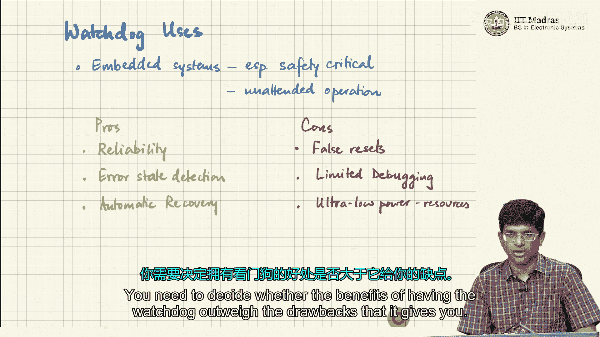

# 017：定时器 ⏱️

在本节课中，我们将要学习微控制器中一个至关重要的子系统——定时器。我们将了解定时器的基本概念、工作原理、常见用途，并特别介绍一个重要的安全功能：看门狗定时器。

## 概述

我们已经讨论过微控制器的时钟、模数转换、PWM等功能。所有这些功能中一个非常重要的方面就是定时器子系统。定时器是大多数微控制器中普遍存在的、功能非常丰富的外设。

## 什么是定时器？🤔

定时器本质上是存在于大多数微控制器中的多功能外设。它们可以用于许多事情，包括生成任意延迟、脉冲宽度调制（PWM）、事件计数（例如测量频率）、输入捕获、输出事件以及时间记录。

例如，PWM是一种特定类型的事件，它本质上是一个占空比。此外，我也可以让定时器计数一段时间，然后触发一个脉冲来表示“工作已完成，时间已到，请执行某些操作”，比如采样一个信号并将其值存储在某处。

定时器还可以用于时间记录，即跟踪已经过去了多少时间。其中有一个非常具体的应用叫做**看门狗定时器**，我们稍后会详细讨论。

## 定时器的特性与独立性

如前所述，定时器在微控制器中非常常见。特别是STM32微控制器，拥有不同类型的定时器。要完全理解定时器的功能，需要详细查阅数据手册，因为不同微控制器的定时器功能差异很大。

关于定时器的一个重要特点是它**独立于CPU运行**。这意味着CPU实际上并不执行指令来进行计数，CPU甚至可以完全休眠或关闭，而定时器电路仍然保持活动状态。它是独立的硬件，彼此之间也相互独立。

这种独立性非常有用，因为它有助于电源管理。我可以让CPU进入深度睡眠模式，而某个定时器仍在活动并计数。一旦定时器达到某个阈值，它可以产生一个信号来唤醒CPU执行任务，然后再次进入睡眠。

## 定时器的工作原理：以高级控制定时器为例

以高级控制定时器（TIM1）为例，它是一个16位计数器。这意味着它可以计数从0到65535，然后再循环回来。

如果给它一个48MHz的时钟输入，它会计数得非常快，因为65536个计数周期可能只略多于1毫秒。这就是我能拥有的最大计数范围。这时，**预分频器**就派上用场了。我可以将48MHz的时钟通过预分频器降低到一个较低的频率，然后告诉定时器使用这个分频后的频率作为计数时钟。

定时器的**周期**决定了它将计数到某个特定值，然后复位。这种复位也可以以某种方式进行，例如可以设置为向下计数器：从一个初始值开始向下计数到0，然后再重新开始计数。这意味着它甚至可以自动重载你希望它开始的初始值。

你可以设置一个比较值，当计数达到该值时停止并返回；也可以设置一个自动起始点，然后向下计数，再翻转回来。

同时，定时器还有不同类型的比较寄存器。例如，**输出比较**功能可以检查计数是否达到了某个特定值，如果超过了，就打开或关闭一个特定信号，这就是生成PWM波的方式。

## 定时器的应用模式

定时器可以用于**输入捕获**。例如，让计数器向上计数，可以用来测量输入信号的脉冲长度。假设我有一个计数器正在向上计数到某个值，在某个时间点输入信号到来，我可以利用这个事件来查询计数器的当前值。这个数值可以告诉我时间戳或信号的长度。要获取信号长度，可以在信号开始时触发捕获，然后在信号结束时再次捕获，两次计数值之差就给出了信号为高电平的时间估计。

在STM32中，TIM3是一个通用定时器，表面上看起来与TIM1相似，也是一个16位自动重载可编程预分频器，但功能稍少一些。TIM1具有一些高级功能，而TIM3是通用定时器，不具备TIM1的所有高级功能，但PWM、输入捕获等基本功能两者都有。

## 如何使用定时器？

使用定时器需要做很多事情，主要是设置配置寄存器。这包括：
*   设置时钟源。
*   设置预分频器，以将时钟源降低到适合使用的有效范围。
*   更改计数器模式，如向上计数、向下计数。
*   配置比较功能，例如告诉定时器一旦计数与某个值比较，就将信号从开翻转到关，从而创建具有特定占空比的信号，即PWM。

所有这些通常通过设置某个寄存器来控制定时器的行为。你可以指定预分频器来降低计数周期，以及PWM或计数需要发生的周期。

定时器还可以用于一个非常具体和有用的目的：生成**定时器中断**。中断是我们目前尚未讨论的内容，我们将在后面讨论，因为它是微控制器的一种非常重要的使用模式，是一个非常强大的功能，但需要更多的讨论，所以暂时不深入。

## 看门狗定时器：系统的守护者 🐕

现在，我想简要讨论一下定时器的一个特殊用例。偶尔，由于代码错误或硬件故障，系统可能会陷入“死机”状态。任何与计算系统交互过一段时间的人都会熟悉“死机”的概念：手机停止工作，或者某些功能不按预期工作。我们通常的解决方法是重启系统。

当我们构建一个无法物理访问的系统时，问题就变得复杂了。一个有趣的例子是几个月前新闻中提到的旅行者号航天器。它于70年代末发射，现在是距离地球最远的航天器，正以极高的速度飞离地球。这意味着绝对没有可能去那里重启系统，甚至与它通信，信号从地球发送到航天器都需要数小时。

在这种情况下，如果航天器因为代码错误或无法预见的硬件错误而“死机”，该怎么办？例如，代码中的循环条件从 `while(something > 0)` 意外变成了 `while(something < 0)`，导致条件永远无法满足，代码就卡在那个循环里等待。

在这种情况下，你希望重启系统，但没有人能物理接触到系统。一个可能的解决方案是引入**超时机制**：如果一定时间内系统没有响应，就强制重置它。但问题来了：谁来处理这个超时？不能是CPU，因为正是CPU本身“死机”了。

这时，微控制器中独立的定时器就派上用场了。特别是，许多微控制器都有一种叫做**看门狗定时器**的东西。它独立于CPU运行，通常从某个数字开始向下计数，直到0。如果它计数到0，就意味着出了问题。

我们对此的思考方式或使用的术语是：主程序必须定期“喂狗”。之所以叫“看门狗”，是因为它的唯一目的是监视电路的行为，并在其行为不正常时将其恢复。

“喂狗”意味着你需要对定时器执行某些操作，将其重置回原始值，以便它重新开始倒计时。这可能很简单，比如向一个特定的寄存器写入一个值。我们所要求的是，主程序必须定期执行这个操作。

这实际上是相当合理的，因为主程序会执行其他功能。你只需要确保每隔一段时间，例如每次函数调用后、完成一定数量的任务后，或者有其他定时器中断来调度不同任务时，去告诉看门狗定时器“一切正常”。

如果主程序没有这样做，看门狗定时器计数到0，它会认为出了问题，并强制重置整个系统。

你需要做的就是确保设置的超时时间足够长，以避免不必要的系统重置。你可以将其设置为一个长间隔，比如几秒或几分钟，这个时间足够长，以确保如果CPU在该时间内没有响应，那一定是出了问题。

## 看门狗定时器的应用场景与权衡

看门狗定时器在嵌入式系统中有何用途？特别是在安全关键和无人值守的操作系统中，例如部署在矿井深处或核电站的设备，可能无法在几秒甚至几分钟内让人到达现场重启系统。

使用看门狗定时器的好处显而易见：提高可靠性、错误状态检测，最重要的是**自动恢复**——你可以实际重启系统，而不是仅仅说“出错了”然后放弃。

但显然，它也有自己的缺点。你需要意识到并小心处理的最大问题是：是否会出现**误复位**？仅仅因为你设置的超时时间太短，没有给CPU足够的时间来完成工作，即使CPU实际上正忙于计算，也会导致复位，这就成了问题。

它还限制了调试的可见性，因为它只是重启系统，并不一定告诉你哪里出错了。事实上，不幸的是，CPU本身已经“死机”卡住了，所以很可能无法获取出错的信息。但这确实限制了你的调试能力。

在某些应用中，特别是超低功耗系统中，仅仅拥有一个看门狗本身就可能是个问题，因为它是另一个功耗来源。但显然，这是一个权衡，就像工程设计中的其他一切一样，你需要决定拥有看门狗的好处是否大于它带来的缺点。

## 总结

本节课中，我们一起学习了微控制器定时器的核心概念。我们了解了定时器作为独立外设的工作原理，包括计数、预分频、比较和捕获等基本模式。我们重点探讨了看门狗定时器这一重要安全机制，它能在系统无响应时自动复位，保障了无人值守嵌入式系统的可靠性，但同时也需要注意超时设置和功耗等权衡因素。理解定时器是掌握微控制器高级功能的关键一步。