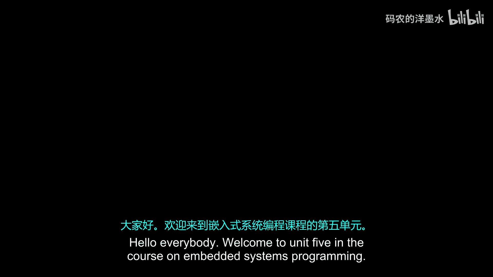
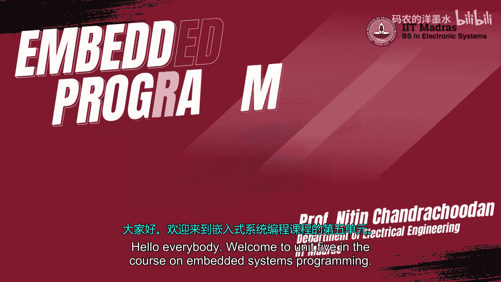
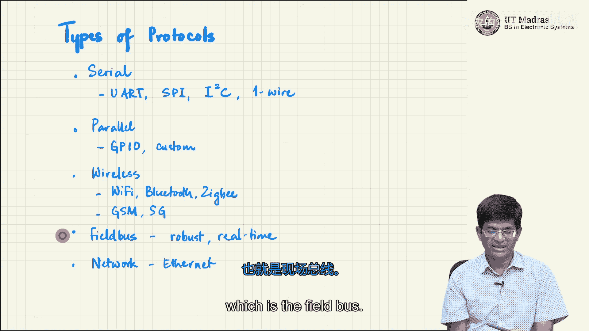

# 018：通信协议的重要性 📡

在本节课中，我们将深入探讨嵌入式系统中的通信概念。我们将首先回顾通信协议在嵌入式系统背景下的重要性，并通过几个实际应用场景来理解其关键作用。最后，我们将概述几种主要的通信协议类型，为后续的深入学习打下基础。

## 嵌入式系统应用场景示例 🏠

为了理解通信协议的重要性，我们先来看几个嵌入式系统的典型应用场景。

### 家庭自动化

在家庭自动化领域，我们通常需要设计一个由多个设备组成的嵌入式系统，而不仅仅是单个系统。典型的应用包括控制灯光、风扇或空调等电器，同时监测室内温度，确保其不会失控。现代家庭自动化系统可以更进一步，例如检测房间内是否有人，并根据时间或用户指令提前调整温度，以节省能源。

此外，安全应用也很常见，例如联网门铃，即使主人不在家，也能远程查看访客并解锁门。在这样的应用中，有多个不同的传感器（如运动传感器、温度传感器）需要将数据发送到中央控制系统，同时，中央控制系统需要向执行器（如灯泡、电机）发送控制命令。

**以下是家庭自动化系统的关键特点：**
*   **低数据速率**：通常只需要传输开关状态或每分钟一次的温度读数，数据量不大。
*   **无线通信需求**：为了避免在房屋内铺设大量新线路，无线通信协议（如Zigbee、Wi-Fi或蓝牙）是理想选择。

### 工业自动化

在工业自动化场景中，例如工厂的装配线，物体在传送带上移动，沿线有多个机器人负责加工。这些机器人需要精确的定时和同步。传送带必须以特定速率运行，机器人必须精确感知物体何时到达，并在物体移出其工作区域前完成任务。

**以下是工业自动化系统的关键要求：**
*   **精确的定时与同步**：不同受控设备间需要高度协调。
*   **抗干扰能力**：工厂环境存在大量的电磁干扰（EMI），例如大电流开关产生的电磁辐射可能干扰敏感的电子设备，导致其状态错误。因此，通信协议必须足够健壮。
*   **确定性高速通信**：需要能够以确定性的方式进行高速通信。像控制器局域网（CAN）这样的协议就是为此类场景设计的。

### 智能农业

在智能农业应用中，可能需要在相距较远的多个农田进行监测和控制。需要感知土壤湿度、温度、二氧化碳水平、酸碱度等参数，并据此决策何时开启洒水器、进行害虫控制或调节灌溉水的酸碱度。

**以下是智能农业系统的通信特点：**
*   **远距离通信**：农田范围大，需要远距离通信。
*   **户外环境**：通信在户外进行。
*   **无线通信为主**：通常不希望为了通信而跨农场铺设长距离线缆，因此主要采用无线协议，且某些协议比其他协议更适合户外通信。

## 通信协议的核心作用与关键属性 ⚙️

通过以上例子，我们可以发现一个共同点：我们讨论的都是**多个不同设备需要相互通信**的场景。通常，会有一个中央控制系统负责接收来自各设备的数据并发送控制命令。单个嵌入式设备（如计算器）可能不需要通信，但现代嵌入式系统（尤其是物联网，IoT）的最大效用正来自于众多设备之间的互联与协同工作。

那么，通信协议在其中扮演什么角色？协议本质上建立了一套规则，确保信息能够可行地交换。

**以下是通信协议需要确立的几个关键方面：**
1.  **功能性**：如何传输信息。
2.  **互操作性**：协议必须标准化。如果只有设计者自己使用，协议就失去了价值。其他人必须愿意采用相同的标准（如电压水平、数据速率、传输起始模式），才能实现设备间的互操作。
3.  **场景适配性**：不存在“完美”的通用协议。不同的使用场景需要不同的优化。例如，在短距离、低电磁干扰的室内环境实现快速、及时的数据传输，与在无法布线、需要远距离通信的户外环境所需的协议截然不同。因此，我们需要多种协议标准。
4.  **可扩展性**：协议能很好地支持多少设备？有些协议可能擅长连接5到10个设备，但在连接40或50个设备时性能会严重下降。而有些协议的主要目的就是连接数百万甚至数十亿的设备。
5.  **实时性操作**：这在嵌入式系统通信中尤为重要。**实时性并不一定意味着“非常快”**，而是指存在一个必须满足的时间约束，这个约束可能是毫秒或几十毫秒级。对于计算机的纳秒级操作速度而言，这并不算快，但对于避免汽车碰撞等物理交互场景，毫秒级的响应时间往往是必需的。如果应用需要，就必须仔细规划协议的实时性。

## 通信协议的主要类型概览 📊

接下来，我们将通信协议分为几种主要类型进行简要介绍。需要说明的是，这里的列举并不详尽，目的是让大家对不同类别的协议有一个高层面的概览，以便在面对新协议时，能够理解其属性并评估其适用性。

**以下是几种主要的通信协议类型：**
*   **串行通信**
*   **并行通信**
*   **无线通信**
*   **网络通信**
*   **现场总线**：这是嵌入式系统领域特有的一类通信方式。

在后续的课程中，我们将逐一深入探讨这些协议类型。

## 总结 📝

本节课中，我们一起学习了通信协议在嵌入式系统中的重要性。我们通过家庭自动化、工业自动化和智能农业等实例，了解了多设备通信的典型场景及其对协议的不同要求，如低数据速率、无线需求、抗干扰、实时性和远距离通信等。接着，我们探讨了通信协议的核心作用，包括确保功能性、互操作性、适配不同场景、具备可扩展性和支持实时操作。最后，我们概述了串行、并行、无线、网络及现场总线等主要协议类型，为后续的详细学习奠定了基础。理解这些基础概念，将帮助你在实际项目中为嵌入式系统选择合适的通信方案。