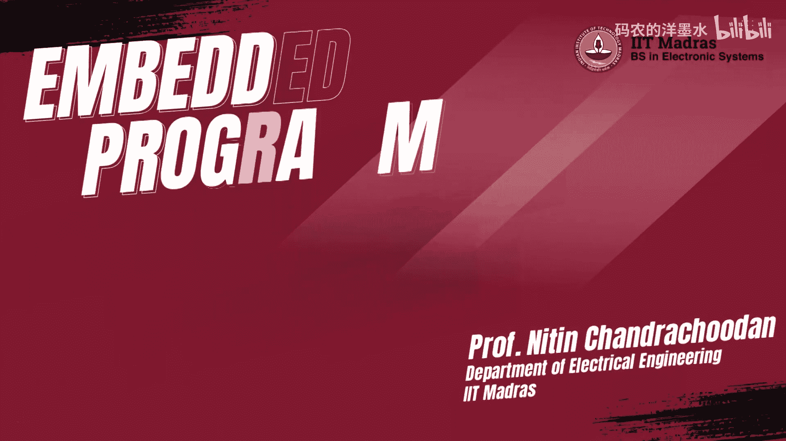
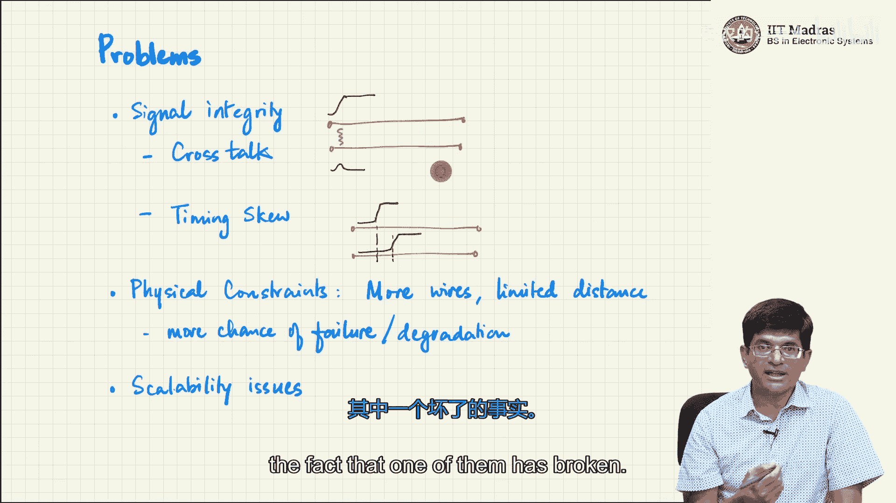

# 019：并行通信




## 概述
在本节课中，我们将要学习并行通信的基本概念。我们将探讨并行通信的工作原理、其面临的挑战，以及为何在现代系统中串行通信协议更为流行。

## 并行通信的基本概念
并行通信的核心思想很简单：两个设备之间通过多条数据线同时传输多个比特位的数据。这通常需要一个主设备（Master）来控制通信的发起和流程，以及一个或多个从设备（Slave）来响应主设备的指令。

上一节我们介绍了通信的基本框架，本节中我们来看看并行通信的具体实现方式。

## 并行通信的物理连接
为了实现并行通信，我们需要在设备之间建立多条物理连接。例如，要传输一个字节（8位）的数据，理论上需要8条并行的数据线。

**代码示例：并行数据线连接**
```c
// 假设的并行数据端口定义
#define DATA_BIT_0_PIN  P1_0
#define DATA_BIT_1_PIN  P1_1
#define DATA_BIT_2_PIN  P1_2
#define DATA_BIT_3_PIN  P1_3
// ... 以此类推定义8个数据引脚
```
需要注意的是，每条信号线都需要一个返回路径以构成完整的电路。在实际电路中，多条信号线可以共享一个公共的接地返回路径。

除了数据线，通常还需要额外的控制线：
*   **时钟信号线**：用于同步数据传输，告知接收方何时采样数据。
*   **控制信号线**：例如读写控制线，用于指示数据传输的方向（从主设备到从设备，或反之）。

## 并行通信的挑战
尽管并行通信在理论上速度很快（每个时钟周期可传输多位数据），但它也面临着一系列严峻的挑战。

以下是并行通信面临的主要问题：

1.  **串扰**
    *   **描述**：当多条导线紧密排列时（如在电路板上），一条导线上的信号变化会通过电容或电感耦合干扰相邻导线上的信号。
    *   **影响**：在高数据速率下，这种干扰可能导致接收端误判逻辑电平（如将0误判为1），严重破坏通信的可靠性。

2.  **时序偏移**
    *   **描述**：由于不同导线的物理长度存在微小差异，信号在每条导线上的传播延迟会略有不同。
    *   **影响**：这会导致原本应该同时到达的多个比特位在时间上出现错位（即使只有纳秒级的差异），使得接收端无法在同一时刻正确采样所有数据位。

3.  **信号完整性问题**
    *   **描述**：这涵盖了串扰、时序偏移以及其他问题，如信号过冲、下冲和上升/下降时间不理想等。
    *   **影响**：随着并行线数量的增加和通信距离的延长，维持所有信号线的完整性变得极其困难。

4.  **物理限制与可靠性**
    *   **描述**：更多的导线意味着更大的连接器、更宽的布线空间和更高的成本。长距离布线会加剧信号衰减和完整性挑战。
    *   **影响**：此外，在多线系统中，任何一条导线的断裂或接触不良都会导致整个通信链路失效，系统缺乏容错能力。

## 并行通信的应用与现状
并行通信的一个经典例子是旧的并行打印机接口（如LPT端口）。然而，由于上述挑战，这种标准的并行接口在现代系统中已基本被淘汰。

如今，并行通信更多地出现在一些定制化场景中。例如，开发者可以利用微控制器（MCU）或FPGA上的通用输入输出（GPIO）引脚，自行设计简单的并行通信协议，用于短距离、板内或芯片间的快速数据交换。

**代码示例：自定义并行写操作**
```c
void parallel_write_byte(uint8_t data) {
    // 将数据的每个比特位写入对应的GPIO引脚
    DATA_BIT_0_PIN = (data >> 0) & 0x01;
    DATA_BIT_1_PIN = (data >> 1) & 0x01;
    DATA_BIT_2_PIN = (data >> 2) & 0x01;
    DATA_BIT_3_PIN = (data >> 3) & 0x01;
    // ... 设置所有8个引脚

    // 产生一个时钟脉冲，通知从设备锁存数据
    CLOCK_PIN = 1;
    delay_ns(10); // 短暂延时
    CLOCK_PIN = 0;
}
```
尽管如此，由于可扩展性差、抗干扰能力弱以及物理实现复杂等问题，构建大型、标准化的通信网络时，并行协议并非首选。



## 总结
本节课中我们一起学习了并行通信。我们了解了其通过多线同时传输数据的基本原理，也深入探讨了它在实际应用中面临的主要挑战：串扰、时序偏移、信号完整性以及物理复杂性。正是这些根本性的限制，促使了串行通信协议的兴起与发展，我们将在后续课程中对此进行详细讨论。