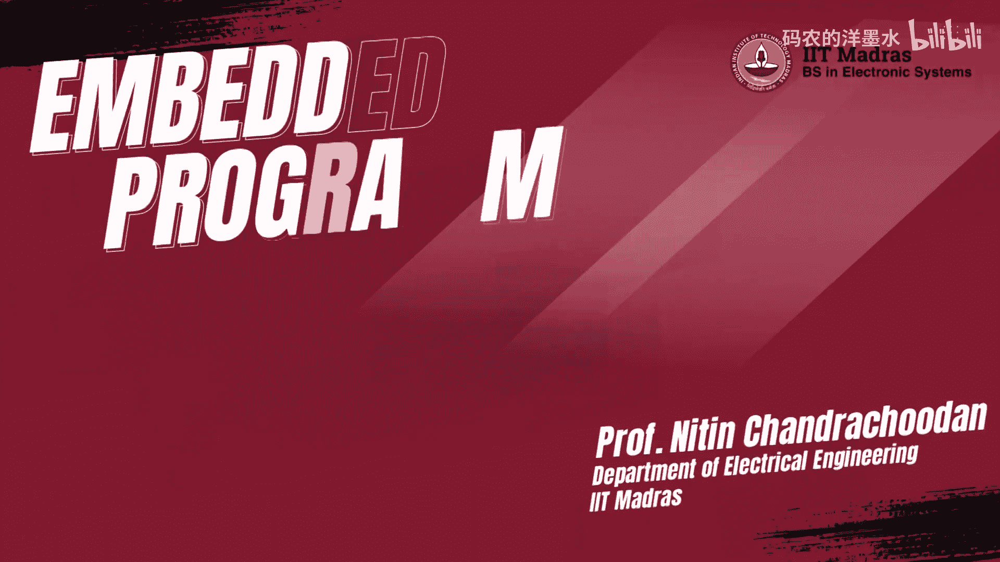
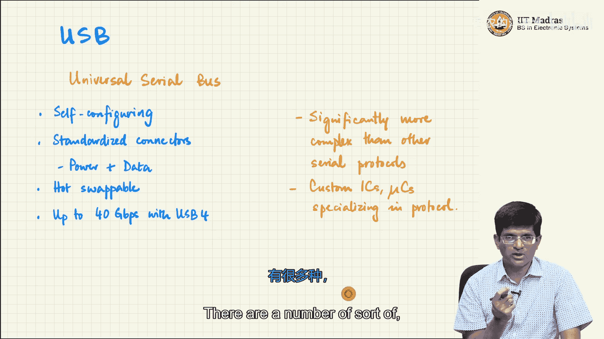
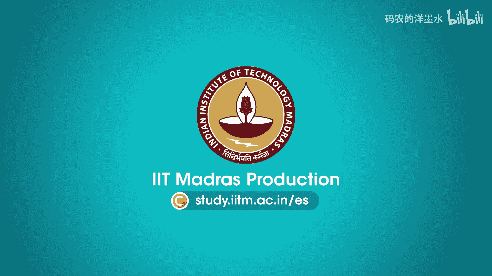

# 020：串行通信协议详解 📡

在本节课中，我们将学习几种常见的串行通信协议。我们将探讨它们的工作原理、优缺点以及适用场景。串行通信因其连线简单、成本较低且易于扩展，在嵌入式系统中应用广泛。

## 串行通信概述

上一节我们介绍了并行通信系统存在的问题。本节中，我们来看看串行通信协议如何解决这些问题。串行通信协议使用较少的导线，这意味着连接更简单、成本更低，并且通常更容易部署。虽然串行协议自身也存在挑战，但多年来，行业趋势已明显倾向于采用串行协议。

以下是串行通信的一些关键优势：
*   **连线更少**：简化连接，降低成本。
*   **时序问题减少**：相比并行通信，时钟偏移等问题有所缓解。
*   **可扩展性与灵活性**：设计复杂度较低，使其更易于扩展和适应不同需求。

常见的串行协议包括UART、SPI、I²C和USB等。接下来，我们将逐一深入了解。

## UART：通用异步收发传输器 🔄

UART是我们已经接触过的第一个串行通信协议。其工作原理可以理解为几乎只需一根信号线（当然还有地线）。这根线在准备发送数据前保持高电平，然后通过一个**起始位**开始传输，接着按预定格式传输数据位，最后以一个或多个**停止位**结束。

UART协议的一个主要要求是发送方和接收方必须**预先约定**通信速率。其核心公式是：
**波特率 (bps) = 1 / 每位时间**
例如，9600波特率表示每秒传输9600位。

UART实现简单，通常只需要Tx（发送）和Rx（接收）两根线（加上地线）即可实现双向通信。它是异步的，因为没有独立的时钟信号随数据一起传输。然而，其速度和通信距离有限，典型速率在100kbps左右。在实际应用中，UART通常基于**RS-232**物理层标准，该标准规定了电压电平等特性，因此可能需要在微控制器和RS-232接口之间使用电平转换器。

UART协议无处不在，是嵌入式系统中最常见的通信接口之一。

## SPI：串行外设接口 ⚡

现在我们已经了解了UART，本节中我们来看看另一种协议：SPI。SPI是一种同步、短距离的串行通信协议，常用于连接传感器、SD卡和LCD显示屏等。它支持更高的数据速率，通常在10Mbps到100Mbps之间。

SPI具有以下特点：
*   **全双工通信**：可以同时进行双向数据传输。
*   **主从架构**：使用**从设备选择**线路。
*   **同步传输**：有独立的时钟信号。

SPI需要4根信号线：
1.  **SCLK (Serial Clock)**：由主设备产生的时钟信号，用于同步数据。
2.  **MOSI (Master Out Slave In)**：主设备向从设备发送数据的线路。
3.  **MISO (Master In Slave Out)**：从设备向主设备发送数据的线路。
4.  **SS/CS (Slave Select/Chip Select)**：用于选择特定从设备的片选信号，低电平有效。

通信过程如下：主设备通过拉低对应从设备的SS线来**激活**该从设备。然后，主设备在SCLK线上产生时钟脉冲。在每个时钟沿，数据通过MOSI线从主设备移出到从设备，同时，从设备的数据通过MISO线移入主设备。数据传输的位数由时钟脉冲的数量决定。

SPI可以连接多个从设备，有两种主要方式：
*   **独立片选**：每个从设备有独立的SS线，所有从设备共享SCLK、MOSI和MISO线。MISO线通常以**开漏**方式连接，需上拉电阻，并确保同一时刻只有一个从设备被选中来驱动MISO线。
*   **菊花链**：所有从设备共享一个SS线。数据从主设备的MOSI进入第一个从设备，再从其MISO传到下一个从设备的MOSI，依次传递，最后从最后一个从设备的MISO传回主设备。这种方式减少了连线，但增加了通信逻辑的复杂性。

SPI的优点包括高速率、无起始/停止位开销、可实现全双工。缺点是需要较多连线（4线），扩展大量设备时需要大量片选线，且缺乏硬件错误校验机制。

## I²C：内部集成电路 🎯

I²C是另一种广泛使用的串行协议。与SPI相比，它使用更少的连线，并支持多主多从架构。其标准速率通常为100kbps，也有快速模式可达400kbps或更高，但速度一般低于SPI。

I²C仅需两根线：
*   **SDA (Serial Data)**：双向数据线。
*   **SCL (Serial Clock)**：时钟线，由主设备产生。
这两条线都需要**上拉电阻**，因此空闲时均为高电平。

I²C的通信帧结构如下：
1.  **起始条件 (S)**：当SCL为高时，SDA出现一个**下降沿**。
2.  **从设备地址 (7位或10位)**：主设备发送目标从设备的地址。
3.  **读写位 (R/W)**：1位，指示读（1）或写（0）操作。
4.  **应答位 (ACK/NACK)**：从设备在第9个时钟脉冲期间拉低SDA表示应答(ACK)，否则为非应答(NACK)。
5.  **数据字节 (8位) + 应答**：传输数据，每个字节后跟一个应答位。
6.  **停止条件 (P)**：当SCL为高时，SDA出现一个**上升沿**。

I²C支持**时钟拉伸**：从设备可以通过在应答周期后继续保持SCL为低电平来暂停通信，实现简单的流控制。

I²C的优点包括连线极少（2线）、支持多主设备、有硬件应答机制、寻址方式标准化。缺点是速度相对SPI较慢、协议开销较大、为半双工通信。

## 其他协议与总结

除了上述协议，还有一些其他串行协议：
*   **单总线协议**：名称虽为“单线”，实际需要数据线、地线和有时需电源线。它支持寻址，数据速率低但距离较长，其独特之处在于可以从数据线上“窃取”功率为从设备供电，适用于无源标签等场景。
*   **I²S**：专用于音频数据传输。
*   **I3C**：I²C的改进和升级版本。
*   **USB**：通用串行总线，是极其复杂和强大的高速串行协议，支持热插拔、自动协商、高功率输送和极高的速度（可达40Gbps）。其实现复杂度远高于前述协议，通常需要专用的控制器芯片。

**软件模拟（Bit-banging）**：对于UART、I²C甚至SPI（在较低速率下），如果微控制器没有对应的硬件外设，可以通过软件精确控制GPIO引脚的电平变化来模拟协议时序。这提供了灵活性，但会占用CPU资源且速度有限。

在本节课中，我们一起学习了UART、SPI和I²C这三种核心串行通信协议的工作原理、连接方式、优缺点以及典型应用。每种协议都有其适用场景：UART简单通用；SPI适合高速、点对点或设备数量不多的场景；I²C则适合连线受限、设备数量较多的中低速通信。理解这些协议是设计和实现嵌入式系统通信功能的基础。