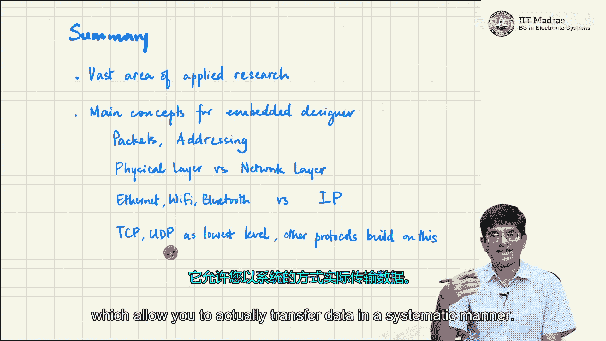

# 021：网络概念 🌐

在本节课中，我们将要学习网络的基本概念。虽然嵌入式系统通常涉及设备间的直接通信，但当设备数量和通信距离增加时，简单的点对点协议会遇到扩展性问题。因此，理解网络的核心概念对于设计可扩展的通信系统至关重要。

## 为什么需要网络？🤔

上一节我们介绍了嵌入式平台上的各种通信系统。本节中我们来看看为什么需要网络。随着需要通信的设备数量增加，以及通信距离的扩大，简单的点对点协议会遇到扩展性问题。例如，假设设备间有直接连接的导线、兼容的电压和共地，这些假设在系统规模变大时都会变得难以维持或出现问题。如果无法保证共地或电压切换等条件，就需要重新思考设备间的数据传输方式。

## 基本定义 📖

以下是网络相关的基本定义。

*   **网络**：一组能够通信的互连设备集合。它们通过某种物理方式连接，目的是进行通信。
*   **协议**：管理这些连接设备之间数据格式和传输的一组规则。

## 网络类型 🌍

以下是几种常见的网络类型。

*   **局域网**：覆盖小范围区域，例如家庭、建筑物或校园内部。即使校园面积可能达到几平方公里，只要能在整个区域内使用兼容的布线，仍可称为局域网。
*   **广域网**：覆盖城市、州、国家乃至全球的大规模网络。其规模远超局域网，且网络内不再保证设备类型或风格的一致性，可能需要更复杂的互联协议。
*   **个人局域网**：范围非常有限的网络，通常指围绕单个人体连接的一组设备，例如笔记本电脑、平板电脑、手机、智能手表等。

## 网络拓扑结构 🕸️

拓扑结构指的是网络的连接形态。了解不同的拓扑结构有助于理解网络的扩展性和可靠性。

上一节我们定义了网络的基本类型。本节中我们来看看设备是如何连接在一起的，即网络拓扑。

以下是几种常见的网络拓扑结构。

*   **网状网络**：每对设备之间都有专用的点对点链路。这是最简单的全连接网状网络。其最大问题是，对于 `n` 个节点，需要大约 `n²` 个连接。当 `n` 增大时，这种结构扩展性很差。
*   **星型网络**：所有设备都连接到一个中心枢纽（如集线器、路由器或交换机）。设备间通信必须通过中心枢纽。这种结构的连接数与设备数成正比，扩展性更好，但中心枢纽会成为瓶颈和单点故障点。
*   **共享总线**：所有设备连接到一个共享的通信介质（如一组导线）。这是扩展性最好的拓扑之一，可以连接许多设备，并且能避免单点故障问题。

## 网络设计考量 ⚙️

在设计大规模网络时，需要考虑以下几个关键因素。

*   **可扩展性**：增加网络设备数量的难易程度。
*   **延迟**：随着设备增加，设备间数据传输所需的时间不应急剧增加。
*   **弹性**：网络对单个组件（如中心枢纽）或链路故障的承受能力。不同拓扑结构对不同类型故障的弹性不同。
*   **介质使用效率**：希望高效利用用于数据传输的底层物理介质，避免资源浪费。

## 数据传输基础 📡

数据传输涉及介质和模式。理解这些基础是设计网络协议的前提。

上一节我们讨论了网络设计的考量。本节中我们来看看数据是如何在实际介质上传输的。

### 传输介质

传输介质主要分为两类。

*   **有线介质**：例如 UART、SPI、I2C 等协议使用的物理导线。
*   **无线介质**：例如 Wi-Fi、蓝牙、4G/5G 等。

### 传输模式

传输模式描述了数据流动的方向。

*   **单工**：数据只能单向传输（如从主设备到从设备）。
*   **半双工**：数据可以双向传输，但在任一时刻只能在一个方向上进行（如 I2C）。
*   **全双工**：数据可以同时双向传输（如 UART 需要独立的 Tx 和 Rx 线）。

### 连接类型

连接类型决定了通信路径的建立方式。

*   **电路交换**：建立一条专用的通信路径（类似于传统电话通话）。只要连接建立，数据就通过这条固定路径传输。
*   **分组交换**：将数据分割成小的**分组**（或数据包），每个分组独立通过网络传输，并在目的地重新组装。这是现代网络（如互联网）的核心概念，提供了极高的弹性和可扩展性。

## 网络设备与术语 🖥️

网络由多种设备构成，并遵循分层模型。了解这些术语有助于理解网络的工作原理。

以下是网络中常见的设备类型。

*   **终端设备**：通信的端点，如计算机、手机、智能手表。
*   **接入点**：允许设备连接到网络的设备，如 Wi-Fi 路由器。
*   **交换机**：负责从多个源收集数据并将其转发到上游的设备，实现数据交换。
*   **路由器**：提供高级连接功能，能够将不同的网络连接在一起，如家庭 Wi-Fi 路由器。

在讨论网络协议时，常会提到 **OSI（开放系统互连）七层模型**。虽然实用中不一定需要深入每一层，但了解**物理层**（负责实际电气信号传输）、**MAC层**（介质访问控制）和**网络层**（处理寻址和路由）等基本概念是有帮助的。

## 分组交换与寻址 📦

分组交换是现代网络的基石。它通过将数据分解、独立传输并重新组装，实现了网络的弹性和可扩展性。

假设设备 A 要向设备 B 传输大量数据。

*   **传统方式（电路交换）**：需要一条 A 到 B 的专用物理链路，该链路在整个传输期间被占用。
*   **分组交换方式**：将数据拆分为多个分组（如 P1, P2, P3, P4）。每个分组携带目的地 B 的**地址**信息。A 可以将这些分组通过不同路径（如经由设备 C 和 D）发送出去。中间设备（C, D）查看分组地址，若目的地不是自己，则根据路由表将其**转发**到下一跳，最终所有分组都能到达 B。B 收到后，根据分组中的顺序信息将其重新组装成原始数据。

这种方式的好处是：
*   **弹性**：即使某条链路失效，分组仍可通过其他路径到达。
*   **高效**：可以同时利用多条路径。
*   **可扩展**：无需在每对设备间建立直接连接。

关键在于需要一个**寻址机制**，让网络中的设备知道每个分组的目的地，以及**路由**机制，指导中间设备如何转发分组。

## 以太网与 MAC 地址 🔌

以太网是一种常见的局域网技术，工作在物理层和 MAC 层。

在以太网中，每个设备都有一个唯一的 **48 位 MAC（介质访问控制）地址**，理论上全球唯一。当设备 D1 想与同一局域网内的设备 D2 通信时，它需要知道 D2 的 MAC 地址。如果不知道，它可以通过**广播**询问，D2 收到后会回复自己的地址（通过 ARP 等协议）。以太网适合建筑物或校园内的通信，传输距离可达百米，速度可达千兆比特/秒甚至更高。

## 互联网协议与 IP 地址 🌐

当需要连接不同类型的网络（如不同的以太网、或其他协议网络）并进行远距离通信时，就需要**互联网网络**协议，即我们常说的**互联网**。

其核心是 **IP（互联网协议）**。IP 使用一种寻址机制，类似于以太网，但底层机制不同。它被设计成能适配各种底层网络。

*   **IP 地址**：用于标识网络终端设备的数字。最常见的版本是 **IPv4**，使用 **32 位**地址，通常以点分十进制表示，如 `192.168.1.1`。每个数字在 0 到 255 之间（即一个 8 位无符号数）。
*   **IPv4 的挑战**：32 位地址空间有限（约 43 亿个），不足以给全球每个设备分配唯一地址。因此产生了 **NAT（网络地址转换）** 技术，让多个设备共享一个公网 IP 地址。
*   **IPv6**：使用 **128 位**地址，地址空间巨大，是未来的发展方向。

## 关键协议简介 📄

在网络通信中，TCP 和 UDP 是两种重要的传输层协议。

以下是两个关键的网络传输协议。

*   **TCP（传输控制协议）**：提供**可靠的、面向连接**的端到端数据传输。它保证数据包按顺序送达，但开销较大，可能有较高延迟。
*   **UDP（用户数据报协议）**：提供**轻量级、无连接**的数据传输。它不保证数据包一定送达或按序送达，但开销小，速度可能更快。

在物联网等嵌入式应用中，常需要根据对可靠性或实时性的要求，在 TCP 和 UDP 之间进行选择。许多高级协议（如 HTTP、FTP）都建立在 TCP 或 UDP 之上。

## 总结 🎯

本节课中我们一起学习了网络的基本概念。作为嵌入式系统设计者，需要了解的核心概念包括：

1.  **分组交换**是现代网络的基础，它依赖于**寻址**和**路由**来实现数据包通信。
2.  网络分为**物理层**（负责实际电气信号传输）和**网络层**（处理寻址、交换和路由等抽象）。
3.  存在多种物理层或介质访问协议，如**以太网**、**Wi-Fi**、**蓝牙**。
4.  **IP（互联网协议）** 用于连接不同类型的网络，实现互联网网络通信。
5.  传输层协议 **TCP** 和 **UDP** 为上层应用提供可靠或轻量级的数据传输服务。

这些概念是理解现代设备间通信，尤其是涉及互联网或大规模设备网络的嵌入式系统设计的重要基础。