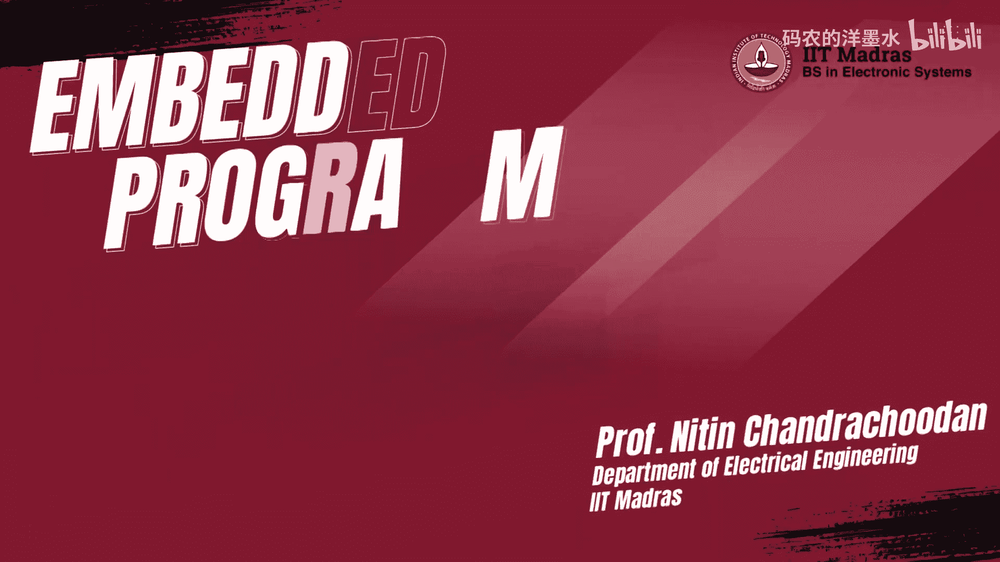
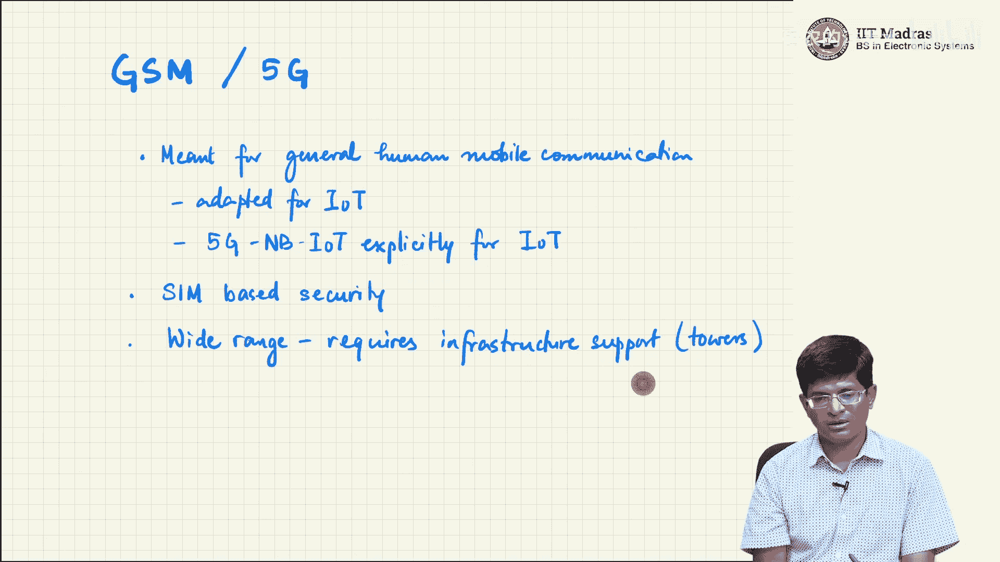

# 022：无线通信 📡

在本节课中，我们将学习无线通信的基本概念、常见形式及其特点。我们将探讨为何需要无线通信，并介绍几种主流的无线通信技术，包括Wi-Fi、蓝牙、ZigBee、LoRa和GSM。最后，我们将对比有线与无线通信的优缺点。

## 概述

无线通信的核心在于无需物理线缆即可传输信息。这主要基于**移动性**和**便携性**的需求。移动性指设备可以随身移动；便携性则指设备可以移动到不同地点并正常工作。此外，在远距离或临时性网络中，铺设线缆可能不现实，此时无线通信提供了可行的解决方案。

## 无线通信基础

上一节我们介绍了无线通信的必要性，本节中我们来看看其基本原理。我们通常所说的无线通信特指使用**射频信号**进行通信。射频是电磁频谱的一部分，光、X射线、伽马射线和各种无线电波（从AM、FM到VHF、UHF，直至低GHz频段）都属于电磁频谱。

电磁频谱与频率的使用方式相关，本质上是将时域信号转换到频域。这需要信号处理知识来深入理解，但其核心是：能量可以以波的形式辐射出去，并在远端被接收并转换回电信号。

**2.4 GHz**和**5 GHz**是通信协议中常见的频段，原因有二：
1.  其波长足够短，所需天线尺寸与便携设备匹配。
2.  这些是**非授权频段**，可供自由使用，因此众多通信协议围绕其发展，但也导致了这些频段内干扰较多。

## 常见无线通信技术

以下我们将快速浏览几种无线通信系统，目的是了解其不同特性，以便根据应用场景选择合适的方案。几乎所有无线技术都内置了我们之前讨论过的网络协议概念，如寻址，并且大多在某种程度上与**互联网协议**兼容。这意味着可以在其上构建IP层，从而让Wi-Fi设备与以太网设备等相互通信。这正是IP协议的强大之处。

### Wi-Fi

Wi-Fi，即无线保真，是一种无线射频通信技术。其技术标准是**IEEE 802.11**，包含多个子类（如目前常见的802.11ac）。不同变体在覆盖范围和传输速度上各有特点。

Wi-Fi工作在**2.4 GHz**和**5 GHz**射频频段，这些频段又划分为多个信道。其特性包括信号会衰减，可以穿过墙壁但信号强度会大幅降低，也会被植被衰减。

**安全性**是无线通信的重要方面。由于信息是辐射出去的，若不加密，则相当于向所有人广播。Wi-Fi标准内置了多种安全形式，但像WEP这样的旧协议已因不够安全而被弃用。WPA2、WPA企业版等提供了不同级别的安全性与实现复杂度的权衡。

Wi-Fi典型应用于住宅、商业环境，主要设备包括计算机、智能手机等。其工作范围通常在一个房间或小型建筑内，不适合户外长距离应用。

### 蓝牙

蓝牙是另一种常见的无线通信技术，您可能通过蓝牙耳机有所了解。它最初为**个人局域网**设计，虽然技术范围可达100米，但最适合在个人周围短距离使用。还有专为最小化功耗设计的**蓝牙低功耗**变体。

与有线通信只需改变导线电压不同，射频通信需要辐射能量，且辐射功率向所有方向扩散，只有极小部分到达目的地。因此，无线通信可能更耗电，对电池供电设备构成挑战。

蓝牙有其安全形式，最常见的是**配对**，需要在屏幕上验证匹配的数字。这同样是在建立安全的便利性与安全性强度之间的权衡。

目前，蓝牙最常见的应用是耳机、扬声器，以及手表、戒指等可穿戴医疗监测设备。

### ZigBee

ZigBee是一个不如蓝牙和Wi-Fi普及的标准，基于**IEEE 802.15.4**标准。它使用网状拓扑，可以连接大量设备，并有可能实现设备间的低延迟通信。

ZigBee主要为低功耗设计，主要目标应用领域是**家庭自动化**，以及医疗设备数据采集等。

在实际设计中，选择ZigBee而非Wi-Fi或蓝牙，需要考虑具体用例。Wi-Fi数据速率显著更高，蓝牙在低功耗等方面有优势。ZigBee在特定应用场景中表现出色，需要根据自身应用判断其适用性。

### LoRa

LoRa的目标与Wi-Fi或蓝牙不同，它明确针对**长距离无线通信**，范围可达数十公里（在建筑物少的地区可达15-20公里，在城市地区也可能达到2公里或更多）。

它设计时充分考虑**极低功耗**，是电池供电设备的理想选择。它使用星型网络拓扑，数据在各级节点聚合，直至最终收集点。

长距离和低功耗的结合意味着其**数据速率**远不及Wi-Fi。LoRa适用于农业、智慧城市等场景，即那些不需要产生大量数据，但需要在偏远地区长期运行的传感器应用。

### GSM

GSM是全球移动通信系统，已发展至第五代，即**5G**。它最初为通用人类移动通信设计，后来也适配了物联网应用。特别是最新的5G标准包含了**窄带物联网**，这是非常适合与物联网设备通信的协议变体。

其优点包括：安全通过**SIM卡**由中央提供商验证身份，无需在设备间共享密钥；覆盖范围广（可达数公里）。但它需要基础设施支持，只有在基站合理范围内才能通信。如果您想部署一个远离其他设备但处于某个蜂窝基站范围内的物联网设备，利用现有基础设施而无需自建中继器，这将是一个完美的解决方案。

## 有线与无线通信对比

最后，让我们快速总结一下有线与无线协议的一些区别。

**有线协议**的优势：
*   **可靠性高**：物理线路可检查，只要线路完好，通信就有保障。
*   **速度高**：可以达到非常高的传输速率。
*   **安全性隐含**：除非物理接入线路，否则难以窃听。
*   **干扰少**：虽然存在串扰，但干扰概念较弱。

**有线协议**的劣势：
*   **部署成本高**：铺设线缆成本较高。
*   **灵活性差**：一旦布线完成，扩展或增加机器较为困难。
*   **线缆杂乱**：需要管理各处线缆。
*   **需要供电**：系统中的交换机和路由器需要电力。

**无线通信**的优势：
*   **便利性**：设置和使用方便。
*   **可扩展性**：可通过中继器或扩展器增加覆盖范围，初期添加设备更容易。
*   **整洁**：无需处理物理线缆。
*   **低功耗模式**：适用于电池供电设备。

**无线通信**的劣势：
*   **共享介质**：所有人都在同一空间广播，容易造成干扰。
*   **安全性问题**：除非明确加密，否则通信可能被监听。
*   **高速与干扰的权衡**：获得高速度需要大带宽，但会增加干扰问题。
*   **可靠性问题**：简单如降雨都可能因水吸收2.4 GHz辐射而中断户外无线链路。
*   **电池依赖**：低功耗模式引入电池依赖，电池寿命成为系统设计时需考虑的因素。

## 总结

本节课中，我们一起学习了无线通信的基本原理和多种常见技术。我们了解了Wi-Fi、蓝牙、ZigBee、LoRa和GSM各自的特点、适用场景以及优缺点。最后，我们对比了有线与无线通信的核心差异。理解这些内容有助于在实际的嵌入式系统项目中，根据可靠性、功耗、距离、数据速率和安全需求，选择合适的通信方式。