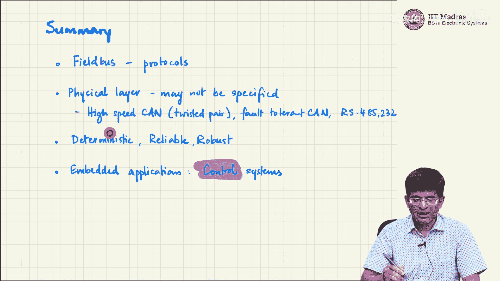

# 023：嵌入式与自动化中的实时控制


在本节课中，我们将学习一类专为嵌入式系统设计的网络协议——现场总线协议。我们将探讨其核心概念、关键特性，并通过两个具体实例来理解它们如何满足实时分布式控制的需求。

---

## 概述

上一节我们介绍了多种网络架构和协议。本节中，我们来看看一类特殊的网络协议：现场总线协议。这类协议旨在为**实时分布式控制**系统提供网络支持。

“实时”意味着系统响应必须有时间上的保证。“分布式”意味着设备可能分布在广阔的区域。“控制”则指需要以可靠、健壮的方式向这些设备收发数据。

---

## 现场总线协议的核心需求

当我们引入上述约束条件后，会发现之前讨论的协议（如以太网、Wi-Fi等共享总线协议）存在一个问题：它们无法保证响应的**确定性**。这些协议在设计上就可能发生冲突和退避，无法确保数据包在固定时间内送达。

那么，对于嵌入式网络系统，我们究竟需要什么？我们最终需要连接一系列**传感器**、**执行器**和**控制器**。

以下是此类系统期望具备的特性：
*   **降低布线复杂度**
*   **提高数据速率**
*   **控制安装成本**

同时，要避免以太网和Wi-Fi的主要问题，即缺乏确定性响应保证。

“现场总线”中的“现场”指的是实际的活动区域，例如工厂车间、汽车内部或大型智能农业解决方案。它通常应用于受控的特定领域，需要可靠、确定的通信。

---

## 现场总线的关键特性

此类系统需要具备以下关键特性：

1.  **确定性**：响应必须一致且可预测。
2.  **实时性**：响应必须在设定的时间约束内完成（实时性不等于快速，而是指时间可保证）。
3.  **健壮性**：系统应能抵抗电磁干扰、噪声或偶发的链路故障。

简而言之，我们可能需要结合物理层协议（如SPI或I2C）的可靠性，并为其增加寻址和扩展能力，以支持更多设备。现场总线协议正是结合了大型网络协议的灵活性与简单串行协议的可靠性。

---

## 实例一：控制器局域网

一个典型的现场总线协议实例是**控制器局域网**。它最初由博世公司为汽车系统引入，现已广泛应用于工厂车间等领域。

CAN是一种**多主站、面向消息**的协议。多个节点均可发送和接收消息，但不能同时进行。在介质访问层面，它采用了**载波侦听多路访问/冲突检测**机制。

其工作流程可表示为以下伪代码：
```c
while (需要发送消息) {
    if (检测到总线空闲) {
        开始发送消息；
    } else {
        检测到冲突，执行退避算法；
    }
}
```

CAN支持最高1 Mbps的速率，通信距离可达40米，并具备错误检测和故障隔离能力。它最初用于汽车发动机功能、空调和安全应用，现已扩展到工业控制领域。

---

## 实例二：Modbus协议

另一个现场总线协议实例是**Modbus**，由Modicon公司于1979年推出。这是一种**主从式**架构，由主设备发起事务。

Modbus可以构建在不同的物理层之上，常见的有RS-485和RS-232。它的一个重要特点是提供了一个**开放、厂商中立**的规范。

Modbus广泛应用于工业环境，特别是在楼宇管理与自动化中，用于连接和管理暖通空调、安防系统等各类传感器与控制系统。

---

## 总结

本节课中，我们一起学习了现场总线协议。现场总线是一类协议的统称，其物理层可能没有严格规定，例如高速CAN、容错CAN等。

它们的核心特性是**确定性、可靠性和健壮性**。现场总线协议主要应用于嵌入式控制系统，例如根据传感器读数来控制执行器或其他设置。



因此，现场总线协议在某种意义上区别于常规网络协议，并**专门且最常见于嵌入式应用场景**。