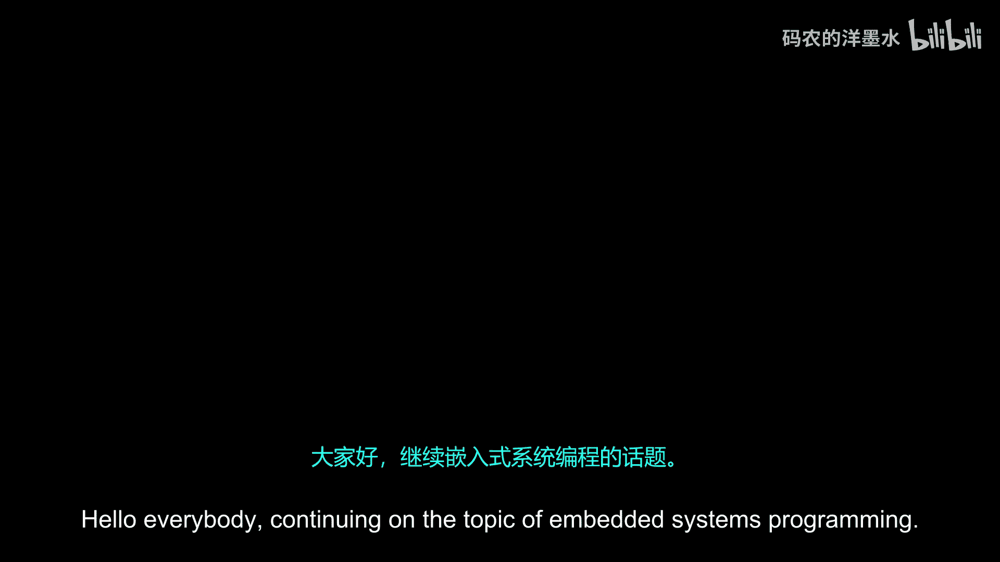
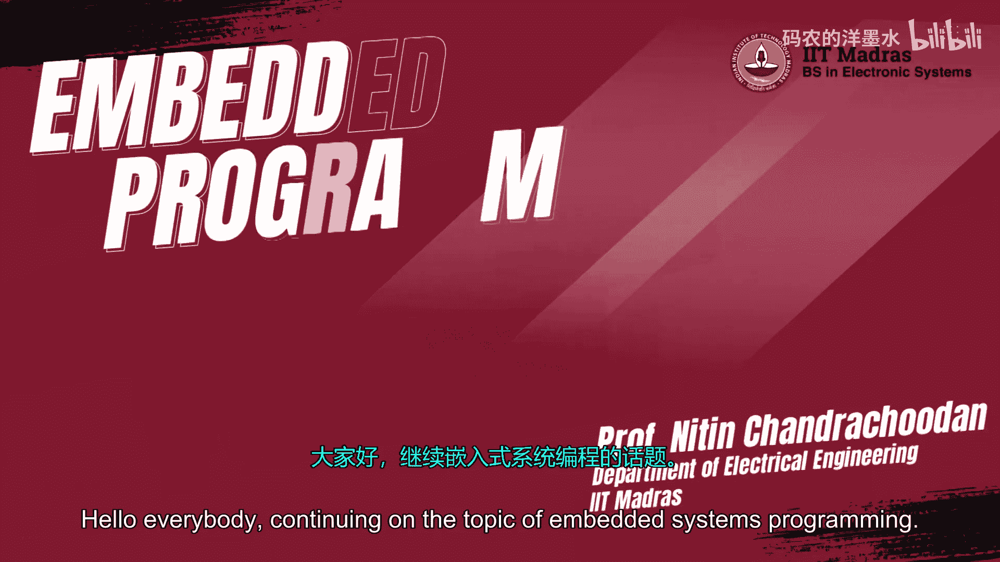
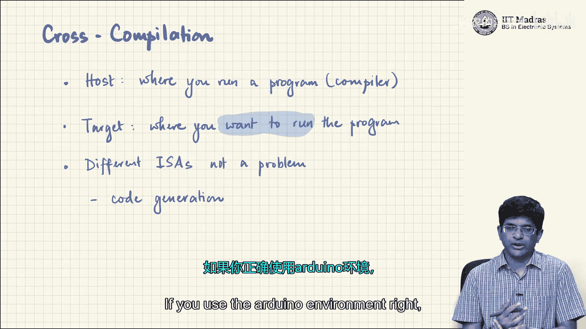

# 024：嵌入式系统中的编译





## 概述
在本节课中，我们将深入探讨程序在计算机中编译和运行时所发生的过程。我们将了解编译过程的几个不同方面，包括从高级语言到机器代码的转换、中间表示、优化以及交叉编译等核心概念。理解这些背景知识，将帮助你作为一名嵌入式系统设计者，更好地利用你所拥有的系统。

## 编译过程详解
上一节我们介绍了编译的基本概念，本节中我们来看看编译的具体步骤。编译过程始于人类可读的代码，最终生成能在物理处理器上运行的机器代码。

### 从源代码到机器代码
编译的起点是使用文本编辑器或代码编辑器编写的高级语言（如C语言）程序。高级语言的核心目的是**人类可读**和**人类可写**。

编译器将此程序翻译成某种**中间表示**。这种表示人类可以阅读，但其主要目的并非由人类直接编写或修改。汇编语言就属于此类。虽然历史上人们广泛编写汇编程序，但如今编译器技术已足够先进，直接编写汇编的情况已相对少见。

编译器通常不会直接生成汇编语言，而是生成一种**中间表示**。这种表示通常类似于汇编语言的结构（如加载数据到寄存器、执行算术运算、存储数据、分支跳转等），但它通常针对某种抽象的虚拟机，而非你最终要运行的具体处理器。

在中间表示层面，编译器会尝试以某种方式改进程序。这个过程通常是**迭代**的：编译器对首次生成的中间表示应用一些优化，得到一个新的中间表示，如此反复，直到对生成的中间表示质量满意为止。这本质上是一种**多遍优化**，是所有编译器通常都会做的。

优化完成后，进入最后阶段，有时称为**代码生成**或**代码降低**。因为从某种意义上说，这是从高级语言向低级语言（通常是机器代码）的转换。降低过程的有趣之处在于，你可以针对不同类型的处理器生成代码，甚至可以直接“降低”成某种硬件描述。

此时，你得到的是最终的**机器代码**，它基本上是一组二进制数字。此时，代码绝对不适合人类阅读或编写，尽管通过一些步骤可以将其转换为可读形式。

### 编译中的关键步骤
以下是编译过程中涉及的一些常见术语和步骤：

*   **解析**：这与程序的**语法**有关。语法检查会告诉你程序在结构上是否正确（例如，括号是否匹配、分号是否遗漏）。它不涉及程序功能的正确性，只检查程序中的单词排列顺序是否有意义。解析阶段将输入程序分解为**标记**，例如关键字（`for`、`if`）、括号、运算符（`+`、`=`）以及变量或函数名。
*   **语义分析**：此过程为程序的实际意图**赋予含义**。例如，它将`for`关键字转换为实际执行时应如何表现的表示。通常，解析和语义分析的结合已经能给出某种中间表示。
*   **中间表示与优化**：编译器（如GCC）或项目（如LLVM）都有自己的中间表示格式。获得中间表示后，编译器会对其进行迭代优化。优化目标可以是让代码运行得更快，也可以是**最小化程序使用的内存**。优化通常是多目标的，需要在速度、大小等多个约束间取得平衡。
*   **代码生成**：在所有优化完成后，仍处于中间表示级别，此时需要生成输出代码。生成阶段负责创建**机器代码**，即与最终将在物理处理器上运行的各种指令相对应的二进制值。

## 汇编语言基础
在编写程序时，虽然本课程不要求直接编写汇编语言，但有时需要能够阅读一点汇编语言以理解其意图。从广义上讲，计算机CPU能执行的操作大致分为三类：

1.  **算术和逻辑运算**：这是CPU的基本功能，计算机非常擅长快速执行算术运算。
2.  **加载和存储指令**：为了进行有用的计算，CPU需要处理数据。通常，数据从外部内存加载到本地存储寄存器中，执行操作后再存回外部内存。
3.  **控制流**：根据某些条件决定执行哪一组指令，例如`if`条件、`while`循环或`for`循环。

除了这三类，每个处理器还有一些特殊指令，例如用于执行**原子操作**的指令（确保一系列复杂步骤执行期间系统状态不被意外更改），以及改变处理器状态（如特权模式与非特权模式）或用于同步的指令。

### 寄存器与控制/状态寄存器
寄存器是CPU用于在执行计算时暂存外部内存值的临时存储。但在实际的CPU（尤其是微控制器）中，还有一系列**控制和状态寄存器**。通过向这些寄存器写入值，可以修改处理器或系统本身的行为；通过读取这些寄存器的值，可以检查系统的某些状态或属性。访问这些寄存器是构建大型系统的重要组成部分。

## 以ARM Cortex-M4为例
我们以ARM Cortex-M4处理器为例进行说明。其技术参考手册提供了处理器的详细信息。我们重点关注其中的**程序员模型**。

### 处理器模式与状态
处理器支持两种操作模式：**线程模式**和**处理程序模式**。在这些模式下，代码可以以**特权**或**非特权**级别运行。特权代码通常允许修改某些通常不允许修改的控制和状态寄存器，这类似于操作系统中的管理员权限，目的是防止某些错误或安全问题。

处理器还有不同的状态，例如正常执行状态（顺序取指、译码、执行）和**调试状态**（处理器暂停，允许开发者检查内部状态、总线状态，并单步执行指令）。

### 指令集与性能考量
了解指令集有助于理解处理器能做什么。指令手册通常会给出指令执行的**周期数**。例如，如果处理器运行在1MHz，且每条指令执行需1个周期，则每秒可执行100万条指令。然而，现代处理器通常采用**流水线**技术来提高吞吐量。流水线将指令执行分为多个阶段，使得不同指令的不同阶段可以同时进行。但分支指令或复杂指令可能导致流水线停顿，需要多个周期才能完成。

查看指令周期数时，需要注意一些特殊情况。例如，将数据移入程序计数器（PC）的指令本身可能只需1个周期，但由于跳转到了新的地址，需要从那里开始取指，导致流水线清空并需要重新填充，因此实际耗时可能更长。

以下是ARM Cortex-M4指令集的一些主要类别：

*   **算术与逻辑指令**：包括移动（`MOV`）、加（`ADD`）、减（`SUB`）、乘（`MUL`）、除、比较、逻辑运算等。这些通常是CPU工作的核心。
*   **加载与存储指令**：将数据从内存加载到寄存器（`LDR`）或将数据从寄存器存储到内存（`STR`）。在Cortex-M4中，加载和存储操作通常需要2个周期，比寄存器间的算术操作要慢。
*   **压栈与出栈指令**：用于保存和恢复多个寄存器的值。
*   **分支指令**：包括条件分支、无条件分支以及带链接的分支（`BL`）。带链接的分支在跳转时保存返回地址，这通常是函数调用的实现方式。

这些指令的助记符（如`LDR Rd, ...`）是为了便于人类阅读和理解而设计的。汇编语言的主要目的并非直接编写，而是作为一种中间表示或供人阅读。

## 编译实例分析
让我们深入看看实际编译程序时会发生什么。编译过程通常通过调用编译器（如GCC）并输入程序文件来执行。

考虑以下简单的C函数：
```c
void test4() {
    int i;
    for (i = 0; i < 100; i++) {
        // 空循环体
    }
}
```
这个函数包含一个循环100次的`for`循环，循环体内不执行任何操作。在嵌入式系统中，这种空循环常用于产生延时。

使用GCC编译（不进行优化）并反汇编后，我们可以得到对应的汇编代码。通过分析，我们可以识别出：
1.  **初始化**：将计数器变量`i`（存储在栈帧指针`FP`偏移的位置）初始化为0。
2.  **循环体**：加载`i`的值到寄存器，与99比较，如果小于等于99则跳转到循环开始处。
3.  **循环递增**：在循环开始处，再次加载`i`，加1，然后存回内存。
4.  **函数返回**：循环结束后，恢复保存的帧指针，并通过`BX LR`指令跳转回调用者。

这段汇编代码是C代码非常字面的翻译，包含了看似冗余的加载和存储操作（因为`i`是一个有名字的变量，需要存在于内存地址中）。通过计算每个指令的周期数，我们可以估算出整个循环执行所需的时间，进而用于精确的延时控制。

然而，从计算角度看，这个函数实际上没有做任何有用功。如果编译器只考虑正确性，调用这个函数没有意义。这就是**优化**发挥作用的地方。

## 编译器优化
编译器可以应用一系列优化。对于上面的例子，优化可能会发现这些指令对外部世界没有影响，从而将它们全部移除。事实上，当我们使用GCC的`-O3`优化标志编译时，整个函数体可能被优化成一条简单的返回指令（`BX LR`），或者如果调用上下文允许，甚至可能被完全消除。

优化的核心思想是：**在编译时进行计算总是优于在运行时进行计算**。对于许多程序，尤其是嵌入式系统程序，你只编译一次，但会运行成千上万次。因此，在编译时投入额外努力进行优化，通过使程序更紧凑、更快来获得长期回报，是非常值得的。

优化可以是：
*   **ISA相关**：依赖于特定指令集架构。某些处理器家族可能有特殊的单条指令能替代一系列复杂指令。
*   **架构/硬件相关**：依赖于整个系统构建，而不仅仅是处理器，例如缓存大小、内存组织等。
*   **多遍**：编译器多次遍历代码，每次生成新的中间表示。
*   **多目标**：通常需要同时满足多个目标，例如在限定时间内尽可能快，或在可用内存内尽可能小。

## 交叉编译
**交叉编译**是指在一个平台（**主机**）上编译生成能在另一个不同平台（**目标机**）上运行的代码。例如，在x86架构的笔记本电脑上运行编译器，生成ARM处理器的机器码。

编译器本身只是一个将文本文件作为输入并生成一组数字作为输出的程序，它并不关心自己运行在哪种处理器上。这意味着我们可以选择不同的目标架构，利用主机处理器为另一种处理器生成代码。中间表示可能保持不变，只是在最后的代码生成阶段针对目标处理器进行适配。

交叉编译是嵌入式系统开发中一个非常强大且必不可少的工具。例如，使用STM32CubeIDE或Arduino开发环境时，你正是在你的PC（x86处理器）上运行程序，生成将在Arduino（完全不同的处理器架构，如AVR或ARM）上运行的机器码。这意味着你不需要在最终运行程序的系统上进行编译。




## 总结
本节课中，我们一起深入学习了嵌入式系统中的编译过程。我们从编译的基本流程开始，探讨了从人类可读的源代码到机器可执行的二进制代码的转换，包括解析、语义分析、中间表示生成和优化等关键步骤。接着，我们了解了汇编语言的基础分类，并以ARM Cortex-M4为例，查看了其程序员模型和指令集。通过一个具体的C代码编译实例，我们分析了汇编输出，并理解了编译器优化如何移除无效代码。最后，我们介绍了交叉编译的概念及其在嵌入式开发中的重要性。掌握这些背景知识，将帮助你更好地理解程序在硬件上的行为，并更有效地进行嵌入式系统设计和调试。