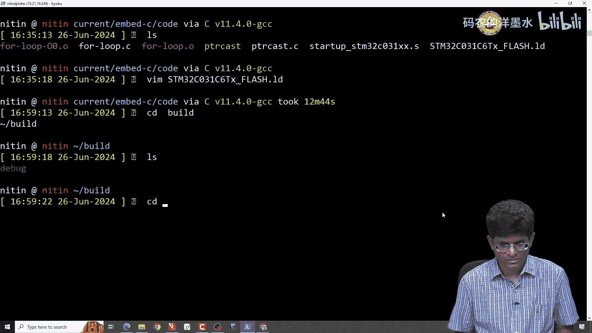
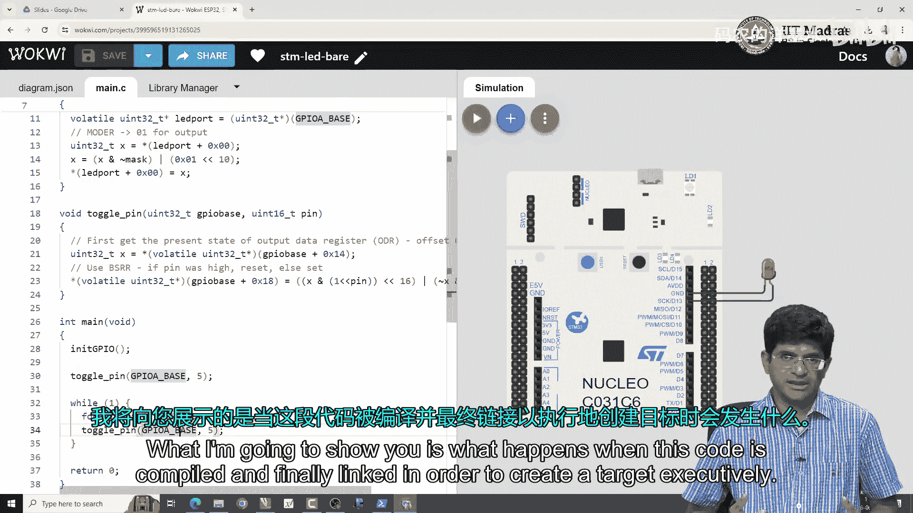
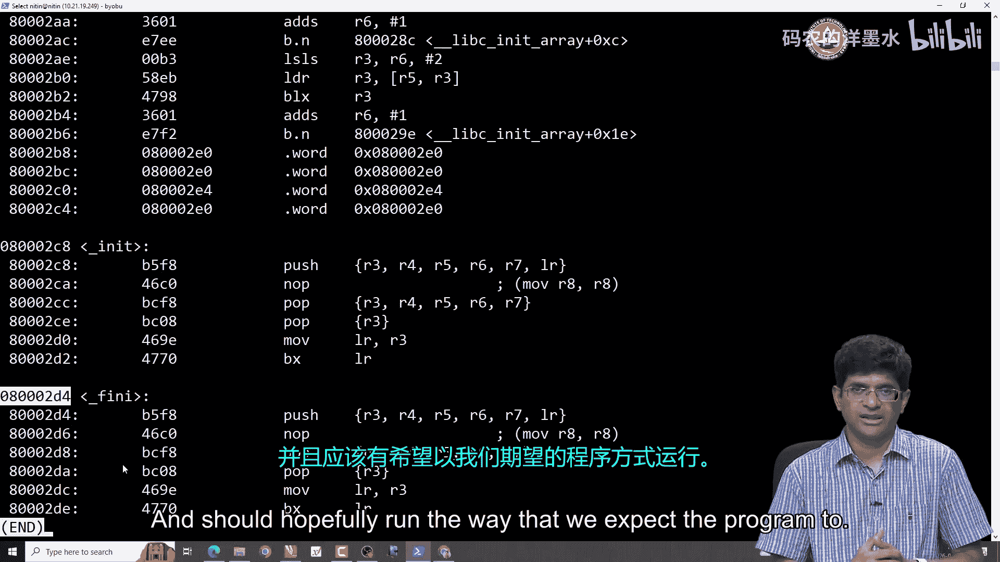
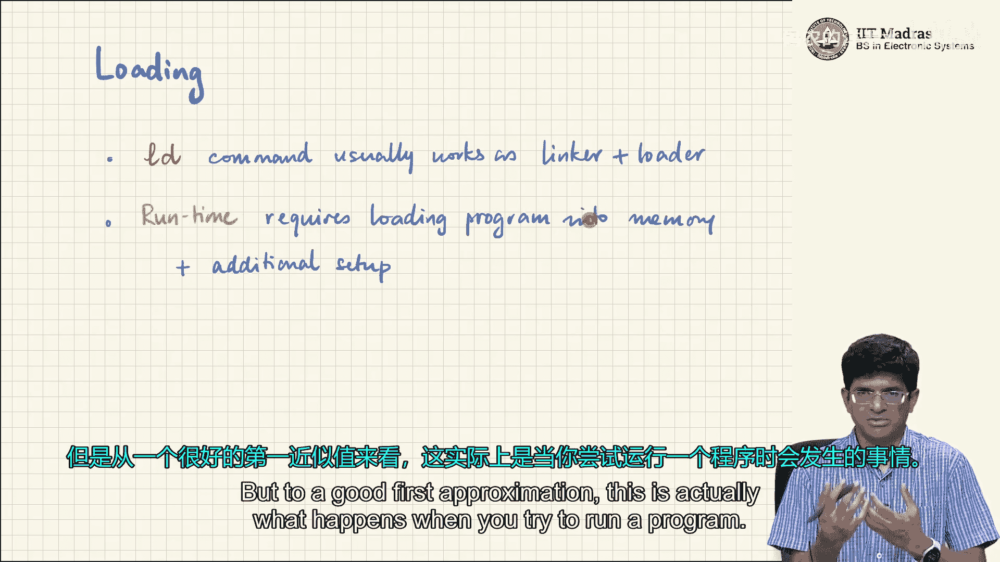

# 025：嵌入式系统中的链接

在本节课中，我们将要学习嵌入式系统开发中的一个关键步骤：链接。我们将了解为什么编译后的代码不能直接运行，链接器如何将多个目标文件和库组合成一个完整的可执行程序，以及链接器脚本如何定义程序在内存中的布局。

## 链接过程概述

上一节我们介绍了编译过程，它将源代码转换为目标文件。本节中我们来看看链接过程。编译成功后，通常会生成一组扩展名为 `.o` 的目标文件。将这些文件组合起来，使其能在处理器上实际运行，这个过程就叫做链接。

当一个程序在处理器内存中执行时，它会占用处理器可用内存中的一大块空间。程序在内存中的布局主要分为以下几个部分：
*   **文本段**：这是需要在处理器上运行的实际代码。
*   **数据段**：包含已初始化的全局变量和静态变量。
*   **只读数据段**：包含常量等只读数据。
*   **BSS段**：代表“由符号开始的块”，用于存放所有未初始化的全局变量和静态变量。程序本身不包含它们的初始值，但需要为它们分配空间。
*   **堆**：用于动态内存分配。
*   **栈**：用于函数调用时的局部变量和返回地址。

仅仅生成机器指令是不够的。我们至少需要将这些指令复制到为程序分配的内存文本段中，并管理好其他数据段。链接器需要修改生成的机器码，例如分支指令和函数调用，使它们指向系统中的物理地址，而不是程序中的逻辑地址。这是因为在编写程序时，我们并不知道代码最终会驻留在哪个物理地址，甚至可能在不同的处理器变体上运行。

## 链接器的作用

考虑到上述背景，我们需要做两件事：一是在编译时，需要将包含不同函数的多个目标文件系统地组合起来，创建一个更大的程序；二是在实际运行时，需要确保以正确的方式将它们加载到内存中，以便代码能够执行并利用内存中其他部分的数据。

为了理解链接过程的具体作用，需要知道系统中通常存在**库**。库是预编译代码的集合。在C语言中，当我们使用 `printf`、`scanf` 等函数时，我们并没有编写这些函数的实现代码，它们属于**标准库**。同样，像 `sin`、`cos` 或网络相关函数等，也可能来自其他专门的库。

这意味着，我们之前讨论的将代码转换为目标文件的编译步骤，只是整个过程的一小部分。然后，你需要将你的目标文件与一大堆其他库链接起来，生成一个更大的二进制文件，其中包含比你开始时多得多的细节。这样做的核心思想是**代码复用**。

以下是链接过程的主要输入和输出：
*   **用户代码**：你自己编写的代码。
*   **库代码**：例如，通过 `-lm` 标志显式链接的数学库（`sin`, `cos`）。
*   **操作系统运行时库**：操作系统提供的一组预编译函数集合。

链接器的作用就是将所有这些东西整合在一起，创建一个单一的目标文件或二进制映像。这个文件可以被你用来运行的系统识别和处理，系统知道如何将其加载到内存中，使其能够作为一个程序执行。

## 链接器脚本

为了完成链接过程，我们需要指定一些信息，这就需要用到**链接器脚本**。链接器脚本用于指定内存布局，它不是一种像C语言那样的完整编程语言，而是用于描述程序各部分应放置在内存的哪个区域。

在资源受限的微处理器或微控制器中，了解内存布局信息非常重要。它告诉你程序是否能装入内存，如果不能，你可以采取哪些措施来调整。

链接器脚本中定义了一些关键信息：
*   **入口点**：指定程序开始执行的函数。在嵌入式系统中，这通常是 `Reset_Handler` 函数，它是运行时库的一部分。当系统加载并运行程序时，会将程序计数器初始化为这个函数的地址。
*   **内存区域定义**：描述系统中存在的物理内存类型、起始地址和大小。例如，常见的两种内存是：
    *   **RAM**：可读写内存，用于存放变量、堆和栈。其属性标记为 `xrw`（可执行、可读、可写）。
    *   **Flash**：通常用于存放程序代码和常量，属性为 `r`（只读），有时也可执行。
*   **段分配**：定义程序的不同部分（段）应放置在哪个内存区域。
    *   `.text`（代码段）和 `.rodata`（只读数据段）通常放在 Flash 中。
    *   `.data`（已初始化数据段）的初始值存放在 Flash 中，但在程序启动时需要被复制到 RAM 中。
    *   `.bss`（未初始化数据段）直接分配在 RAM 中，启动代码会将其初始化为零。
    *   堆和栈也分配在 RAM 中，链接器脚本会为其预留最小空间。

链接器脚本的作用就是指定内存布局。实际的链接器程序会根据这个脚本，将所有代码和数据组合起来，创建一个满足所有这些条件的最终可执行文件。

## 链接实例分析

让我们通过一个具体的例子来看看链接前后的变化。我们使用之前让LED闪烁的C程序，它主要包含 `init_GPIO` 和 `toggle_pin` 两个函数。

首先，我们查看编译后但未链接的目标文件（`main.o`）的反汇编结果。你会注意到，`init_GPIO`、`toggle_pin` 和 `main` 函数的地址都是从 `0` 开始的。这显然不对，因为内存中不能有三个函数同时从地址0开始执行。这些地址是临时的、逻辑上的偏移量。

然后，我们查看链接后生成的最终可执行文件（ELF文件）的反汇编结果。现在情况发生了变化：
*   代码被整合到一个统一的 `.text` 段中。
*   所有函数都被分配了具体的、不冲突的物理地址（例如从 `0x8000000` 开始，这是Flash的起始地址）。
*   除了我们自己编写的函数，链接器还自动加入了大量来自C运行时库的函数（如 `Reset_Handler`、`SystemInit` 等）。

链接过程创建了一个最终可以被加载到系统内存中的文件。此时，我们可以将这个ELF文件加载到目标系统的内存中，跳转到指定的起始地址（如 `Reset_Handler`），程序就应该能按照预期运行了。

## 加载器的作用

链接过程还有一个问题：链接器创建了包含地址信息的可执行文件，但还需要有人或某个程序将这些内容放到内存的实际物理位置。这个工作通常由**加载器**完成。

在像Linux这样的操作系统中，命令 `ld` 通常作为链接器，而操作系统内核在运行程序时扮演加载器的角色。当你键入命令或双击程序时，操作系统会读取磁盘上的ELF文件，由加载器将文件的不同部分放入内存的不同区域，分配足够的空间，然后跳转到程序的第一个指令处开始执行。

在嵌入式系统（尤其是无操作系统的裸机环境）中，加载过程可能通过编程器将二进制文件烧录到Flash中，芯片上电后由启动代码自动完成从Flash到RAM的数据复制和初始化工作。

## 总结

本节课中我们一起学习了嵌入式系统中的链接过程。我们了解到，编译生成的目标文件不能直接运行，需要通过链接器将它们与必要的库文件组合，并依据链接器脚本指定的内存布局，生成一个完整的可执行文件。链接器解决了函数地址重定位的问题，并管理程序在内存中的文本、数据、BSS、堆和栈等各个区域。最后，加载器负责将可执行文件放入物理内存并启动执行。理解链接过程对于嵌入式开发，特别是在资源受限环境下进行内存优化和管理至关重要。