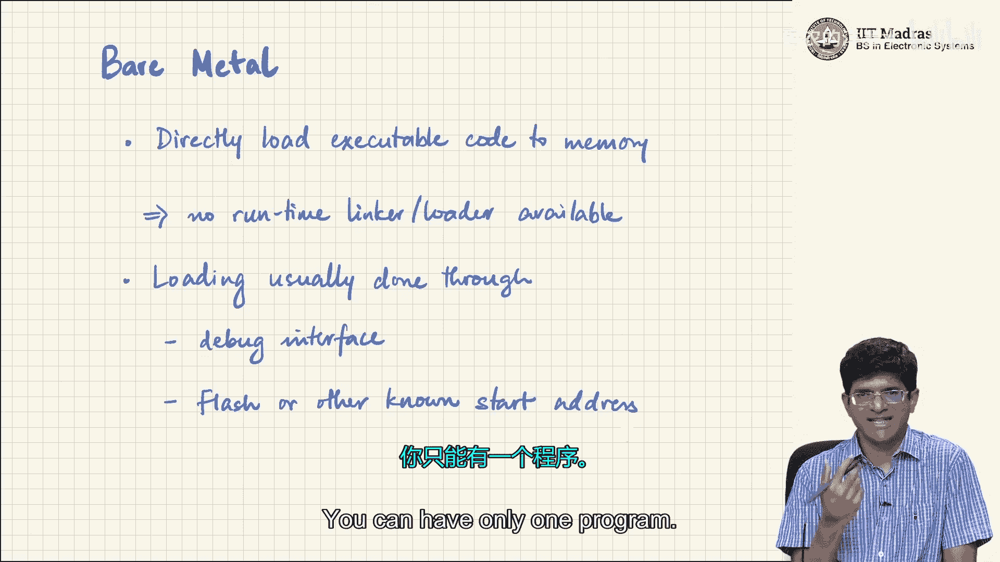

# 026：嵌入式系统中的运行时

## 概述
在本节课中，我们将要学习嵌入式系统中的“运行时”概念。我们将探讨系统启动时发生了什么，程序计数器如何工作，以及代码如何被加载和执行。我们还将比较“裸机”编程和使用操作系统的两种主要模式。

## 系统启动与复位
上一节我们介绍了嵌入式系统的基本概念，本节中我们来看看系统启动时的具体过程。

当您首次打开一个基于微控制器的系统时，会发生系统复位。在电气层面，复位会初始化寄存器。微处理器内部最重要的寄存器之一是程序计数器（PC）。在复位或上电时，需要确保程序计数器从一个已知值开始。

CPU的基本功能意味着，默认情况下，程序计数器在每个时钟周期会自动递增，除非它获取的指令明确告诉它跳转到其他地方（即发生分支）。因此，只要我能将程序计数器指向一个有效的起始指令，我的系统就可以从最开始执行指令。

复位条件（通常是某个特定引脚保持高电压或低电压）移除后，程序计数器会在每个时钟周期自动递增，以获取下一条指令。对应的地址会出现在地址总线上，指令被取回系统并执行。

## 程序计数器与起始地址
如果我能确保在复位时，程序计数器被赋予一个值，并且该值在总线上能取回某条指令，就意味着我对系统的运行方式有了一定程度的控制。

因此，在系统启动时，我们保证有一个已知的起始地址被加载到程序计数器。最简单的值可能是0。某些CPU不使用0作为默认值，而使用其他值，但只要它是固定的就没关系。

特别是在微控制器上，您可能会发现这个起始地址有时可以通过跳线设置或引脚设置来修改，这些设置将不同的电压连接到处理器的特定引脚。通过选择这些设置，您可以改变特定程序或特定微控制器的行为方式，甚至可以改变它尝试启动的源。

## 启动过程详解
那么，这个启动过程具体做什么呢？在大多数情况下，第一条指令并不复杂，它只是跳转到内存中的另一个位置，那里有实际要执行的指令。

以我们简单的LED闪烁程序为例。上电时，程序计数器获得值0。我们知道系统中的闪存起始于某个地址（例如0x800）。这个地址是处理器和所构建系统（或ARM处理器本身）的物理属性，它告诉您闪存预计在这个位置，RAM预计在那个位置开始。您无法改变这一点。

这意味着链接器和加载器必须使用这些地址将数据放入系统。一旦有了这些，起始于地址0的指令只需要跳转到闪存起始地址（例如0x800）。之后，一切就准备就绪了。

在大多数情况下，我们有一个称为“复位处理程序”的东西。这是一个您可以编写的函数，它可以被加载到内存的特定区域，它基本上告诉您在复位时需要触发和执行哪个程序。此后，鉴于您可以跳转到内存中的任何其他位置，我应该能够运行任何我想要的代码，即使它来自外部存储，前提是我已经提前将代码放入了那些内存位置。

## 代码加载与执行
例如，当您使用基于Arduino的系统或STM32 Nucleo开发板时，将十六进制文件或二进制文件下载到系统时，发生的就是这个过程。下载过程将您生成的编译代码放入一组内存位置，这些位置从一个已知地址（通常是0x800，具体取决于您拥有的处理器类型）开始。对于STM32 Nucleo系列是如此，对于Arduino则是其他地址。

之后需要发生的是，您复位处理器。当处理器复位时，它开始执行一条指令，该指令通常会告诉它：“跳转到这个特定的内存位置，并开始执行那里的指令。”然后您就完成了，您编译、链接并加载到内存中的任何内容都将开始执行。

## 裸机模式与操作系统模式
这里需要注意的有趣之处在于，微控制器执行程序主要有两种方式。

以下是两种主要模式：
*   **裸机模式**：我演示的LED闪烁示例就是所谓的“裸机”模式。在这种模式下，我们直接将可执行代码加载到内存中。除了已经编译到程序中的内容外，没有所谓的“运行时”。没有其他程序能够将您的程序加载到内存中。您编写的代码直接在CPU上运行。这通常被称为裸机编程。此处的加载部分通常通过某种调试接口完成，例如Arduino的USB线，它允许您对开发板进行编程，这实际上就是将您编写的代码直接放入处理器内存的某一部分，该部分将在您退出复位状态后立即被激活。这通常会将代码放入某种闪存或其他已知的起始地址，以便系统复位并退出复位状态后，能够从那里开始执行指令。
*   **操作系统模式**：可以想象，裸机模式在范围上有些限制，您只能有一个程序，更改它很困难，需要重新编程整个系统等。因此，另一种选择通常是使用操作系统。在操作系统中，您简化了这个过程。您基本上是说：是的，我仍然需要经历相同的过程，因为当我退出复位时，我所做的只是跳转到一个特定位置并开始在那里执行指令。但您只需确保运行的第一个程序（通常称为内核）会为您做一些有趣的工作。它不进行计算，也不进行任何复杂的通信，它所做的是设置其他所有东西，初始化子系统和外设。然后，它进入一种模式，可以将其他程序加载到内存中并执行它们。因此，操作系统通过作为在系统上运行的第一个程序来接管，从而使这成为可能。然后它接管并说：您需要执行的任何其他程序，您不需要再将它们放入闪存然后复位整个处理器，我会负责将它们加载到内存中的某些位置并跳转到起始点，以便它们可以自行运行。

裸机和操作系统是微控制器或基于CPU的系统可以运行的两种主要模式。到目前为止，我们主要关注的是裸机系统。后续会有相关背景介绍，我们也将看看操作系统的基础知识以及如何使用它们。

## 总结
本节课中，我们一起学习了嵌入式系统中的运行时概念。我们了解了系统启动和复位时程序计数器的作用，代码如何被加载到内存并从特定地址开始执行。我们重点比较了“裸机”编程和“操作系统”管理两种模式的区别：裸机模式下，用户程序直接控制硬件，启动流程简单直接；而操作系统模式下，一个核心程序（内核）首先启动，负责初始化和管理系统资源，然后才能加载和运行其他用户程序。理解这些基础概念对于进行嵌入式系统开发至关重要。