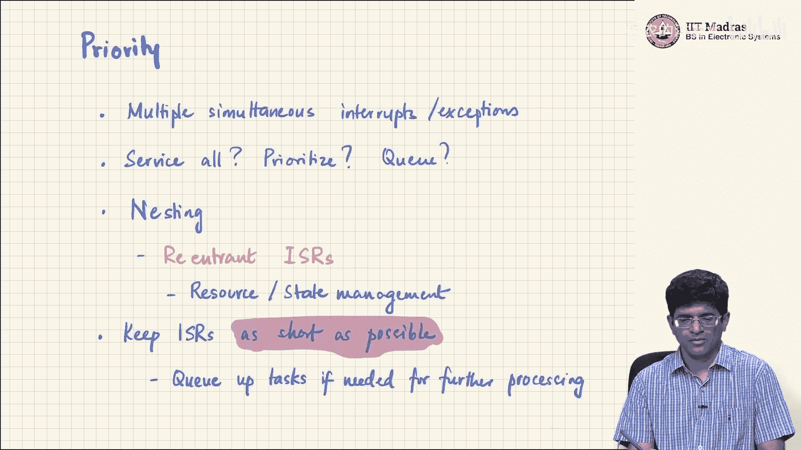

# 027：微控制器中的中断与异常 🚨

在本节课中，我们将要学习微控制器中两个至关重要的概念：**中断**与**异常**。它们是处理器响应外部事件和内部错误的核心机制，对于构建实时、高效的嵌入式系统至关重要。

## 中断的概念

上一节我们介绍了微控制器的基本工作原理。本节中我们来看看什么是中断。中断是指当CPU正在执行其常规工作（如取指、解码、执行指令）时，外部事件（如复位、定时器触发、通信数据到达）需要CPU立即处理。这些事件是**异步**的，CPU无法预测其发生时间，它们甚至可能在一条指令执行的中间时刻到来。

处理器不会忽略这些事件，而是通过一种称为**中断服务程序**的代码来处理。正常程序流程是程序计数器顺序递增或跳转执行。当中断发生时，硬件会保存当前程序计数器的值（即当前执行位置），然后跳转到一个特定的地址去执行对应的中断处理代码。

这个特定的跳转地址被称为**中断向量**。不同的中断源（如复位按钮、GPIO引脚变化、UART接收数据、定时器溢出）对应不同的中断向量。处理器通过一个**查找表**（即中断向量表）将中断编号转换为对应的处理函数地址。

以下是中断处理的基本流程：
1.  保存当前程序计数器（PC）值。
2.  根据中断源，查找中断向量表，获取中断服务程序地址。
3.  跳转到该地址执行中断服务程序。
4.  中断服务程序执行完毕后，恢复保存的PC值，继续执行原程序。

## 中断屏蔽

我们可以对中断进行**屏蔽**，这相当于给CPU挂上“请勿打扰”的牌子。可以全局禁用所有中断，也可以选择性地禁用特定类型的中断。

但使用中断屏蔽时必须非常小心。有些情况（如系统复位）必须保证CPU能响应，因此不应被屏蔽。为此，许多处理器提供了**不可屏蔽中断**，这类中断拥有最高优先级，无法被软件屏蔽。

## 异常的概念

刚才我们讨论了来自外部的中断。现在，我们来了解一个相关的内部概念：**异常**。异常是由CPU内部在执行指令时产生的同步事件，例如**除以零**或遇到**未定义指令**。

异常与中断的主要区别在于其**同步性**。异常与处理器时钟同步，由正在执行的指令直接触发。处理异常也需要软件例程，称为**异常处理程序**。与中断类似，可以通过异常向量表来查找对应的处理函数。

无论是中断还是异常，它们都是处理器正常控制流中的“例外”情况。

## 中断与异常的优先级和嵌套

在实际系统中，可能同时或几乎同时发生多个中断或异常。处理器需要一种机制来决定处理顺序，这就是**优先级**。例如，复位或不可屏蔽中断通常具有最高优先级，定时器中断的优先级可能高于UART中断。

根据优先级，处理器可以选择排队处理所有中断，或者只处理最重要的中断而丢弃其他。

另一个重要概念是**中断嵌套**。这意味着在处理一个中断服务程序时，另一个更高优先级的中断到来，CPU会暂停当前ISR，转去处理新的中断。这引出了**可重入服务程序**的概念。

并非所有中断服务程序都能设计成可重入的。如果一个ISR在执行时被另一个中断打断并试图处理，可能会导致系统状态混乱或行为不可预测。编写可重入的ISR需要进行细致的资源和状态管理，这在操作系统等复杂场景中常常是必需的。

## 编写中断服务程序的注意事项

由于中断和异常是“例外”行为，会打断正常的程序流，因此对它们的响应应尽可能**简短高效**。

不应在中断服务程序中执行耗时很长的计算。通常的做法是，在ISR中仅设置一个标志位或向操作系统任务队列发送一个消息，表明有事件需要处理（例如，UART数据已存入缓冲区）。而实际的数据搬运或复杂处理则留给主循环或低优先级的后台任务去完成。

这样可以确保系统能及时响应后续的中断，并且主程序的任务有机会得到执行。

## 总结

本节课中我们一起学习了微控制器中的**中断**与**异常**。中断是响应外部异步事件的机制，而异常是处理内部同步错误的机制。我们了解了中断向量表、中断屏蔽、优先级、嵌套以及编写中断服务程序的基本原则。这些概念是理解处理器如何管理多任务、构建实时操作系统的硬件基础，在后续的嵌入式系统开发中会反复应用。