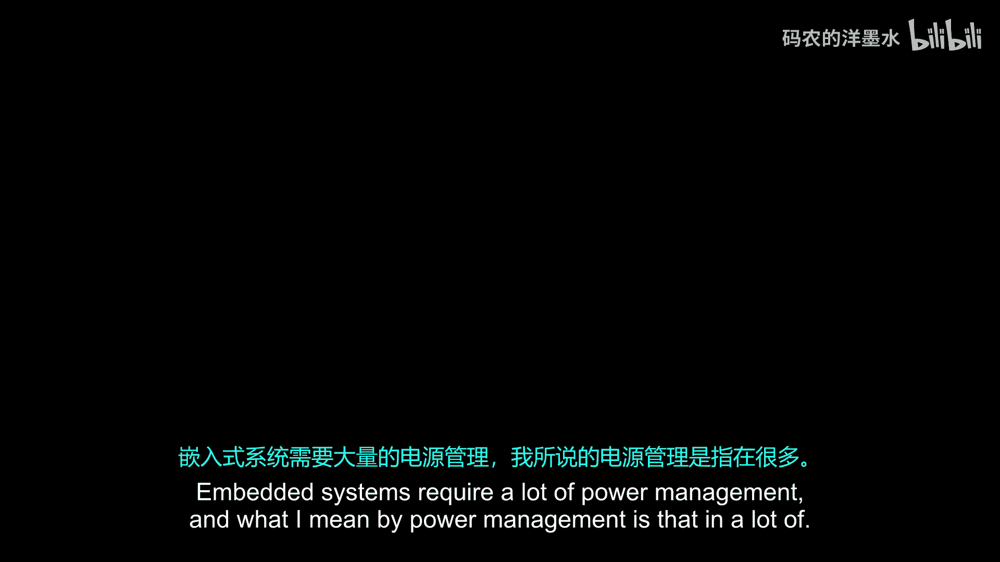
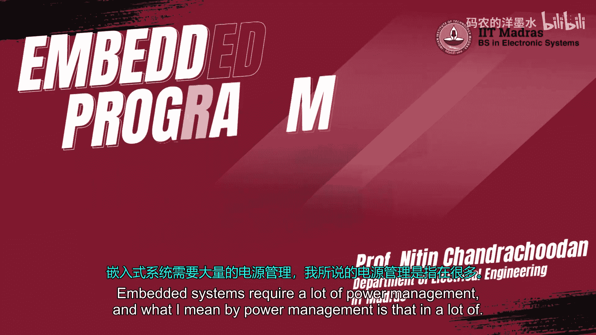
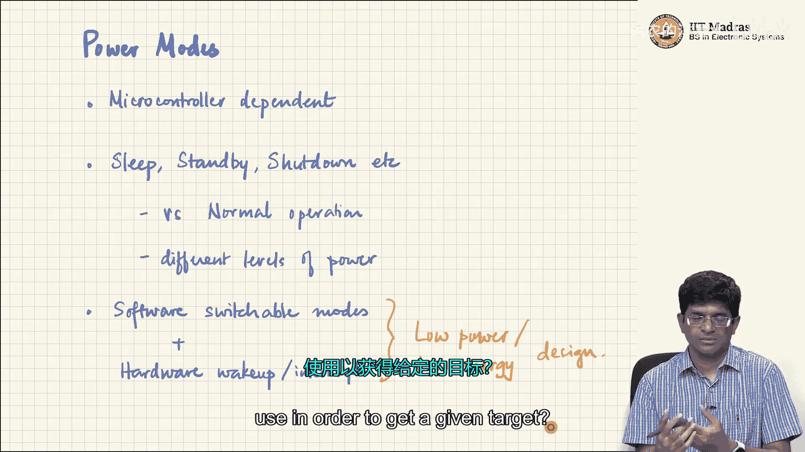
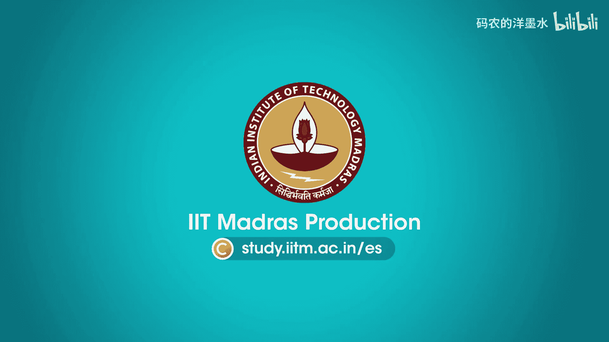

# 028：电源管理 ⚡

在本节课中，我们将要学习嵌入式系统中的电源管理。嵌入式系统通常运行在有限的电源上，例如电池或太阳能电池，因此有效管理功耗和能量至关重要。我们将探讨功耗与能量的基本概念，以及如何在嵌入式设计中应用这些概念来优化系统性能。

---

## 功耗与能量 🔋

上一节我们介绍了电源管理的重要性，本节中我们来看看功耗与能量的基本区别。

任何电子系统都有一个电压源为其供电。当系统运行时，例如执行CPU操作或与外围设备通信，就会从电源汲取电流。电流的流动是因为系统内部的逻辑门在0和1之间切换，这个过程需要能量。

功耗的计算公式为：
**P = V × I**
其中，P代表功率（瓦特），V代表电压（伏特），I代表电流（安培）。

能量是功率在一段时间内的积分，计算公式为：
**E = ∫ P dt**
如果电压和电流恒定，则可简化为 E = V × I × t。

功耗直接影响系统的发热量。设计系统时，必须考虑散热设计，例如使用散热片或风扇，以确保设备不会过热。

能量则关乎系统的长期运行。高功耗短时间运行与低功耗长时间运行可能消耗相同的总能量。这直接关系到电池寿命。设计者需要在执行有用工作和延长系统运行时间之间做出权衡。

---

## 微控制器的电源模式 💤

了解了基本概念后，我们来看看微控制器如何通过不同的电源模式来管理功耗。

微控制器通常提供多种电源模式，以在不同场景下降低功耗。常见的模式包括：

以下是常见的电源模式及其特点：
*   **运行模式**：处理器以额定时钟速度执行指令，进行有效工作，此时功耗最高。
*   **睡眠模式**：CPU暂停，但部分外设和内存可能保持供电，可以快速唤醒。
*   **待机模式**：仅保持核心部件（如实时时钟或特定唤醒源）供电，功耗极低。
*   **关机模式**：几乎关闭所有电路，仅保留最低限度的状态，功耗最低，唤醒时间最长。

每种模式消耗的电流不同，具体数值通常在微控制器的数据手册中给出。通过软件或硬件唤醒源（如定时器或按键）在不同模式间切换，是延长电池寿命的关键。

---

## 低功耗设计策略 🎯

掌握了电源模式，我们接下来探讨实现低功耗设计的策略。

设计低功耗嵌入式系统需要考虑多方面因素，目标可能是降低峰值功耗（改善散热），也可能是减少总能量消耗（延长电池寿命）。

以下是实现低功耗设计的关键策略：
*   **选择合适的工作模式**：根据任务需求，让系统大部分时间处于低功耗模式（如睡眠或待机），仅在需要时短暂进入运行模式。
*   **优化时钟速度**：在满足性能要求的前提下，使用尽可能低的时钟频率，因为动态功耗与频率成正比。
*   **管理外设**：不使用的外设应及时关闭其时钟和电源。
*   **利用硬件特性**：使用低功耗定时器、事件唤醒等硬件功能来替代软件轮询，减少CPU活动时间。
*   **仔细查阅数据手册**：根据数据手册中提供的各模式电流值和工作条件，计算和评估系统的能量预算。

通过综合运用这些策略，并结合具体的应用场景，可以设计出既能完成功能又非常节能的嵌入式系统。

---

本节课中我们一起学习了嵌入式系统中的电源管理。我们理解了功耗与能量的区别，认识了微控制器提供的各种低功耗模式，并探讨了实现低功耗设计的核心策略。有效地管理电源是嵌入式系统设计，尤其是电池供电设备设计中的一项关键技能。