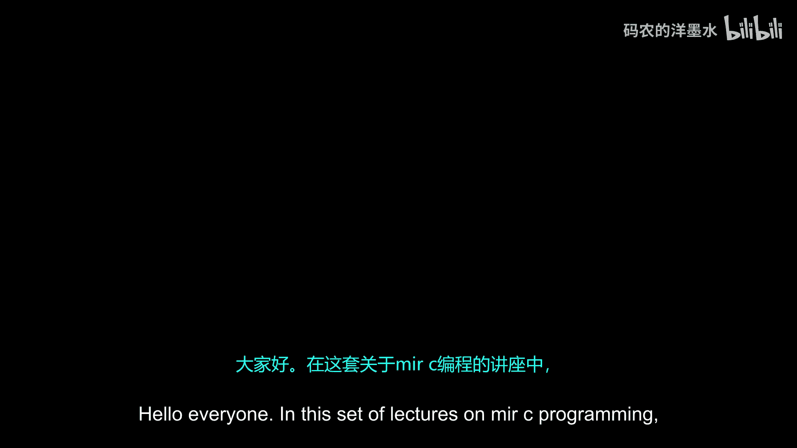
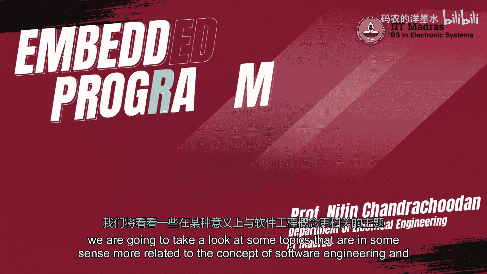
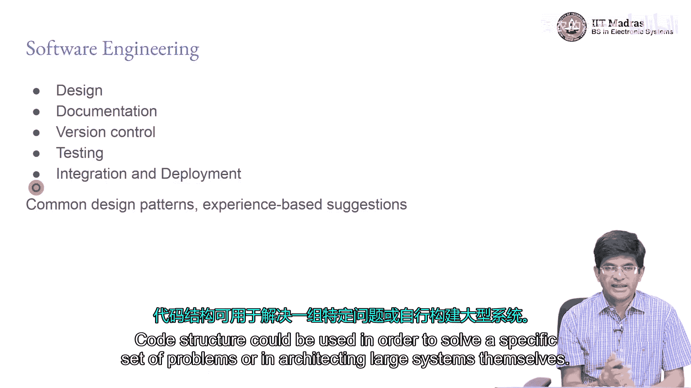

嵌入式C语言编程：第29讲：软件架构 🏗️

在本节课中，我们将学习软件架构的概念，特别是如何为嵌入式系统（如一个家庭自动化系统）设计和组织代码。我们将探讨如何将程序分解为模块化的文件，以及为什么良好的架构对于开发可维护、可扩展的软件至关重要。

---

### 为什么软件架构重要？

在嵌入式C编程的这一系列课程中，我们将探讨一些与软件工程概念更相关的主题。这些主题不仅涉及C语言编程本身，更关注如何开发程序来解决问题。因此，我们需要了解软件架构为何重要，以及它如何影响嵌入式系统的开发方式。

我们将从讨论软件架构开始。作为一个例子，我将以家庭自动化系统为例进行案例分析。需要说明的是，这里展示的代码并非真实可运行的代码，它更多是示意性的，旨在展示开发家庭自动化系统时可能使用的典型函数、例程和结构。

### 什么是家庭自动化系统？

家庭自动化系统通常需要实现一些功能。其中之一是监控房屋内不同区域的温度。此外，还可能监控湿度，以及其他传感器，例如运动传感器、光线传感器、门禁入侵检测、气体泄漏检测等。这些都是家庭自动化过程中通常包含的内容。

但在本例中，我们将限制自己，仅以温度和湿度为例。我们假设可以通过开关空调来控制空气温度。作为系统的一部分，我们可能还希望向用户发出状态变化的警报。我们首先要回答的问题是：如何构建这样的系统？如何开发或设计这样的系统？

在这里，我们将探讨一种可能的方法。需要强调的是，我们讨论的所有架构模式和结构都是解决问题的可能方式。从根本上说，并没有唯一的答案。不同的人根据开发方式、使用的编程语言、微控制器类型和传感器种类，都会影响其软件所采用的架构和结构。

我们将探讨几种不同的可能性，并首先从一种可能的方式开始。

### 典型的文件结构

在现代软件开发方法中，一个常见的做法是采用文件结构。我们通常认为程序的每个部分都写在某种文件中。我们将其视为C源代码文件，通常具有像 `main.c` 这样的扩展名。当我们看到 `main.c` 时，就知道它包含一些文本，这些文本本质上对应一个C程序。

在某种程度上，理解这些都是约定俗成很重要。`main.c` 文件甚至 `.c` 文件本身并不一定必须包含C源代码；它完全可以包含文本、PDF或电影，只是被重命名为 `.c` 文件。系统本身并不阻止你这样做，但显然约定很重要，它们帮助我们构建和使用系统。因此，我们自动假设，如果看到一个名为 `main.c` 的文件，它很可能包含C源代码。

更重要的是，`main.c` 很可能是C源代码中包含主执行结构或主函数的部分，该函数在C程序执行时首先被调用。

另一方面，对于每个 `.c` 文件，通常还有一个 `.h` 或头文件。为什么需要头文件？主要是为了正确定义函数原型，将C源代码中使用的任何参数抽象到头文件中。你可以在头文件中定义宏，然后在代码的不同部分使用。

所有这些的要点在于，它有助于你组织代码。当你需要调用的函数超过一两个时，认真考虑如何将代码拆分到多个文件中，并让每个文件包含一个内聚的源代码单元，就变得很有意义。

在最底部，还有一个名为 `Makefile` 的文件。`Makefile` 的作用是什么？它本质上提供了一种结构，或者说允许你编译所有源代码，并将它们组合成一个可执行文件。我们已经学习过程序的编译、链接和执行阶段。编译和链接所需的所有步骤都在 `Makefile` 中指定。这同样是一种常见的做法。

`Makefile` 通常是所谓的“构建系统”的一个例子。换句话说，我们将编写的软件视为构建一个程序。这就是为什么你会看到“架构”这个词贯穿始终。人们将构建软件的想法与构建建筑物类比，这是有道理的，因为两者都需要大量的思考和规划，就像建造建筑物一样。如果你的基础和基本结构不正确，你的软件也会崩溃。

因此，你可以看到这是一个典型的结构。我的意思是，会有 `.c` 文件及其对应的头文件，头文件包含函数原型、数据类型等。通常会有一个需要运行的主例程。

在大多数嵌入式系统中，你会看到一种结构，其中包含传感器、执行器、通信模块。这是任何嵌入式系统的三个主要部分：你需要感知外部世界的信息；你需要执行某些操作，比如打开LED、启动电机或关闭水泵；最后，你需要将所有这些决策传达给其他系统，可能是监控人员，也可能只是一个日志系统。

此外，几乎任何系统都会有一些实用函数，这些函数不一定属于上述任何一类，但它们是使代码更易于阅读、理解、修改等的良好函数。最后，还有 `Makefile` 帮助你编译所有内容并将其组合在一起。

这是一个相对大型软件开发项目中典型的文件结构。

### 代码结构示例

现在，我们可以看一个实际代码的例子。我们将更详细地查看一下。例如，这是 `main.c` 源代码的样子，而 `main.h` 头文件则是另一个样子。这里有一些惯例，例如头文件中的 `#ifndef` 守卫。这同样是常见的做法，原因很简单：如果在构建系统时多次包含同一个头文件，编译器可能会报错，提示你重定义了某些宏或函数。通过使用这种检查特定变量或宏是否已定义的守卫，可以避免重复包含文件的其余部分。

这同样是一个常见惯例，虽然不是必需的，但却是良好实践。这个头文件非常简单，只包含一个函数定义。这个函数在哪里定义和使用？就在 `main.c` 源代码中。

有时，尤其是初学者，倾向于将一个 `.c` 文件包含在另一个 `.c` 文件中。从技术上讲，编译器允许这样做，但这并不是好的实践，因为它使得程序难以扩展。当你将一个文件包含在另一个文件中，然后又将其包含在其他地方时，很容易陷入循环包含的场景，即一个文件通过包含链中的某个循环试图包含自身。不仅如此，这也使得编译器更难优化代码，因为它现在需要处理一个越来越大的预处理后文件。

正如我们已经讨论过的，推荐的方法是将代码分解为多个不同的 `.c` 文件，分别将每个文件编译成 `.o` 或目标文件，最后再将它们链接在一起。

在这种情况下，我们可以看到我们的 `main` 函数看起来非常简洁。我所说的简洁，希望你同意，是指 `main` 函数中实际代码很少。事实上，这些代码可以分为两部分：有一个设置阶段，我基本上调用某些函数来初始化；然后是一个事件循环，在这里是一个无限循环，我读取传感器、处理数据、控制一些执行器、发送一些状态数据，并可能延迟一定的时间（本例中是1000毫秒）。

这种结构在嵌入式系统中再次非常常见。如果你编写的程序只是为了打印“Hello World”，你并不真的需要这种“设置后接循环”的结构。同样，如果你的程序需要读取一些CSV文件，计算不同科目学生的平均成绩，并绘制直方图然后退出，你也不会有这种 `while` 循环的概念。

但是，嵌入式系统通常不是那种运行一次就退出的程序。它们用于用户交互，这意味着这种“设置阶段后接循环阶段”的结构是构建嵌入式程序时非常常见的模式。

“模式”这个词在我们后续的讨论中会经常出现。但现在，希望你已经注意到的重要一点是，这完全类似于Arduino草图中的 `setup` 函数部分和 `loop` 函数部分。事实上，如果你查看一个实际的Arduino程序，你会发现它正是将你的 `setup` 和 `loop` 扩展成一个更大的C程序，其中 `setup` 被调用一次，而 `loop` 被放入一个无限循环中，被反复调用。

这就是主例程的结构。

### 模块化分解

现在，我将非常简要地查看其余代码，但不会深入细节，只是为了让你了解它是如何组织的。我在这里使用了VSCode界面，但坦率地说，这并不是一个要在VSCode上运行的程序。它可能可以编译，甚至可能运行，打印语句可能工作，可能能够通过UART输出一些东西，但这并不是我们在这里查看的主要目的。我想展示的只是文件的结构。

我们已经看过了 `main.c`。它基本上有一个设置部分，调用 `system_init` 函数；还有一个循环部分，通过一个 `while` 循环进行。

现在，在 `system_init` 内部，你可以看到它基本上调用了一系列函数：`sensors_init`、`actuators_init`、`communication_init`。关键是，这些函数都没有在你的 `main.c` 文件中定义。它们各自进入对应的 `.c` 文件，而定义本身位于对应的头文件中。

例如，如果我查看 `sensors.h`，我可以看到有一种结构体的类型定义，用于保存传感器信息，基本上是当前温度和湿度值。我将如何获取这些值？我们稍后会看到。似乎有一个名为 `init_sensors` 的函数，另一个名为 `read_sensors` 的函数，后者大概用于更新温度和湿度的值。

你还会注意到，`read_sensors` 在这种情况下接收一个指向 `sensor_data` 结构体的指针。这同样是一种干净整洁的做法。另一种做法是让 `read_sensors` 返回一个 `sensor_data` 类型的对象或结构体。另一种选择是我在某个地方创建 `sensor_data` 并不断更新它。

事实上，如果我回到这个 `main.c`，我会看到这一行：`sensor_data`，在这种情况下初始化为零，它充当了系统的某种记忆。每次我循环时，我都在更新那个特定的结构体，即数据体。基于那里存在的数据，我将控制某些执行器，最后发送一些状态信息。因此，感知、处理（实际上发生在CPU上）、执行和通信，这大致是任何嵌入式程序中位于循环内的四个主要部分，都是基于作为输入传递给它们的数据完成的。

当它作为输入传递时，你可能会争论，为什么不直接将其声明为全局变量，这样我就不需要到处传递它了？从技术上讲，你可以这样做。这再次是一个关于良好、清晰编程实践的问题。如果你需要扩展代码并编写更大的系统，让每个函数基于某个指针或数据的副本工作，而不是假设存在一个可以修改的全局变量，是有意义的。因此，只要你将参数传递给函数，函数修改它们，然后要么返回值，要么使用指针就地修改，你就有了一种可以泛化你正在执行的操作的方法。

这个 `sensor_data` 变量充当了与系统对应的某种状态。它基本上具有记忆的概念；存在一些系统级状态，即当前温度、湿度等，存储在这个特定变量中，并围绕它引导系统的其余流程。

### 系统设计思维

根据你的背景，如果你做过其他类型的编程，比如PC或桌面或移动设备上的GUI编程，可能是Web应用开发，或者完全与计算机相关的事情，你正在尝试构建一个需要获取某些输入、反应和响应的系统，这种对应于系统的中心状态以及检查状态、处理状态、更新状态的循环，是一种非常强大的系统思考方式。

你甚至可以将其应用到与计算机完全无关的事情上，比如驾驶汽车。汽车的当前状态基本上包括：引擎是否启动？档位是否接合？是否在向前移动？当前速度是多少？发生的感知就是仪表盘，它基本上向你显示所有这些值：处于哪个档位、行驶速度是多少。执行器对应于油门，帮助你加速；刹车帮助你减速。在那种特定情况下，通信可能并不重要，除了仪表盘再次在向用户传达信息方面扮演重要角色。

因此，所有这些方面并不一定局限于嵌入式系统。我们谈论的是一般的系统级设计。我们正在查看的软件结构当然与嵌入式系统的特定领域相关。

### 各模块详解

好的，`sensors.h` 定义了这些函数以及数据类型。`sensors.c` 反过来实际包含执行工作的函数。在这种情况下，我只是留空了，我基本上说“初始化传感器硬件”。很可能，这将执行诸如设置寄存器地址或指针之类的操作，以便读取特定的传感器值。我们已经看到如何使用内存映射将特定传感器映射到CPU的内存空间布局中，以便通过读取特定地址来获取数据。因此，传感器的初始化通常包括为以后使用设置所有这些参数。

在这种情况下，数据处理被包含在传感器模块下。它也可能属于 `main`，因为毕竟它并不真正属于感知本身，这是我试图执行的实际计算。在这种情况下，我有一个非常简单的逻辑：如果温度太高，那么基本上将 `is_too_hot` 设置为1，否则设置为0，将其视为一种布尔值。我还增加了一个计数，该计数也存在于该结构体中，只是为了跟踪我运行了多少次。

执行器呢？`actuators.h` 包含几个函数的定义，它还包含了 `sensors.h`，因为我需要 `sensor_data` 数据类型。`actuators.c` 告诉我该做什么：如果我想实际控制执行器，那么我将打开风扇或关闭风扇等等。

你可能会想知道 `turn_on_fan` 和 `turn_off_fan` 是在哪里定义的。这就是在 `hal.c`（硬件抽象层）中发生的事情。因此，像 `read_temperature`、`read_humidity`、`turn_on_fan` 等函数，最终确实需要使用内存映射信息、实际的执行器信息等，但它们并不真正属于程序逻辑本身。它们基本上可以被抽象出来。

这变得非常有用，因为假设你已经为Arduino开发了所有代码，然后想切换到树莓派或基于STM的微控制器。你几乎可以只进入这个 `hal.c` 并更改设置，使得读取温度、打开风扇等只需进行这些微小的更改，而程序的其余逻辑保持完全相同。

当然，这就是构建和抽象程序不同部分的全部意义，但这就是你在实践中会如何做。

最后，我们有 `communication.c`，它告诉我们如何发送状态。在这种情况下，我假设某处有一个UART外设。我们甚至可能最终只使用像 `printf` 这样的语句，它在底层可能也使用UART。

总的来说，你在这里看到的目的是向你展示不同的函数可能是什么样子，以及它们如何被组织。这里的关键点是，这并不是唯一的做法，这只是推荐的良好实践。学习如何做到这一点的唯一真正方法是通过经验：查看其他人编写的代码，尝试从中推断出哪些是良好实践，哪些是不良实践，并尽你所能遵循它们。

### 总结与软件工程概念

总而言之，代码的构建方式如下：我们有包含原型和数据类型的头文件；我们有一个主例程，它具有你已经见过的非常常见的结构——`setup` 和 `loop`；整个程序基本上被分解了，它是模块化的。包含相关函数的模块被放在一起，以便它们可以被使用。

那么，为什么我们把所有这些称为架构？为什么称之为软件架构？我在开始时简要提到过这一点：你需要仔细的前期设计和规划，因为这些项目通常会发展成相当大的规模。它可能始于一个简单的家庭自动化系统，但一旦你想要纳入多个不同的传感器、不同的执行器、不同的日志记录功能、不同的警报功能（即通信方面），以及可能涉及的不同供应商的数量（你可能拥有不同种类的灯泡、不同种类的传感器，所有这些都有一些有趣的变体，让生活不那么简单），考虑到所有这些因素，构建一个大型项目需要大量的规划。

这本质上对应于设计一座建筑物。当然，我们谈论的是软件，所以代码的可读性和可维护性，而不是建筑物的强度。在某种意义上，软件的强度对应于它的健壮性，以及它是否会在任何条件下崩溃。

因此，我们在这里有很多理想的特性：
*   **模块化代码**：我们将其分解为可以重用的函数。
*   **关注点分离**：传感器代码应处理传感活动，执行器应关注执行器，通信子系统应基本关注通信。理想情况下，我不应该在 `communication.c` 文件中读取传感器。当然，这不是一个硬性规定，在某些情况下，唯一有意义或合理的方式可能确实是在通信代码中读取传感器并做出响应。但将关注点分离作为一个指导原则，可以使抽象代码变得非常容易，以至于更改通信系统或传感系统变得容易得多，因为你从一开始就考虑到了这一点。
*   **内聚性**：内聚的代码是那种紧密结合在一起的代码。当你将所有与通信相关的部分隔离到一个文件中时，所有这些部分都彼此相关，它们相互加强。你可以在同一文件的不同部分重用函数调用，等等。它成为一个内聚的单位，而不是一堆杂乱无章的函数调用。
*   **可配置性**：系统具有某种可配置性，允许你只需调整几个参数就能改变你正在构建的系统类型。

所有这些都是设计良好的软件系统最终应具备的一些理想特性。

软件工程本身是一个巨大的领域，它可能是整个学期甚至更长时间课程的主题。其中有很多方面超出了我们在这门课程中能够涵盖的范围。

如何设计大型系统？设计中最重要的部分之一是文档记录。你如何记录为达成特定设计所采取的所有步骤？

版本控制是电气或电子工程师往往不太重视的东西。我们习惯于只是复制文件、进行修改，并希望一切顺利。但这无法扩展到大型项目。对版本控制如何使用的良好理解，会对你实际开发系统的方式产生重大影响。

测试同样是软件开发中非常重要的一部分。这里有各个阶段，比如单元测试、系统级集成测试以及其间的许多其他步骤。这些步骤对于你的系统在实际应用中的预期运行效果有很大影响。

最后，你如何实际集成和部署？换句话说，每次你在代码中进行一些更改时，如何确保一切仍然正常工作，并定期部署新的更新版本？你可能偶尔会在手机上看到一条消息，提示需要下载新固件。根据你拥有的电视或其他此类设备，你可能也会发现需要下载并安装系统的新固件更新。为什么？因为人们一直在寻找软件中的问题，修复这些问题，然后发布更新。这意味着，如何测试所有这些更新、集成并实际部署这些更新，本身就成为一项重要的工程实践。

当然，在理想世界中，你没有错误，你只是编写完美的软件，它第一次就能工作，并且在部署之前已经考虑了一切。但这在实践中不会发生，这就是为什么我们需要所有这些其他步骤来使事情正常进行。

设计模式基本上来自于多年来处理软件工程所有这些不同方面的经验。我们将要做的是，基本上看看各种不同的设计模式，无论是在解决特定问题集时使用的特定代码结构方面，还是在构建大型系统本身的架构方面。