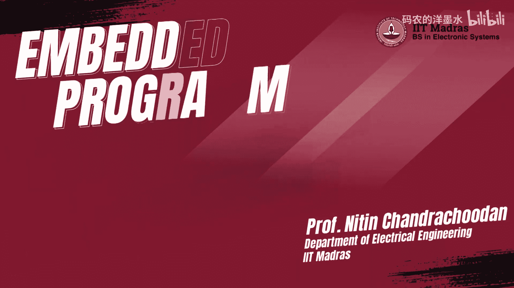
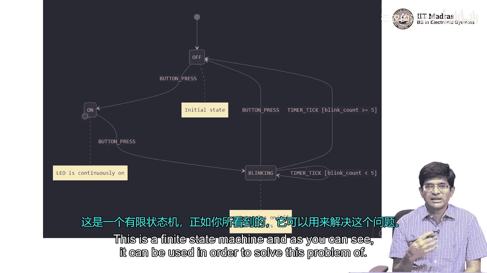
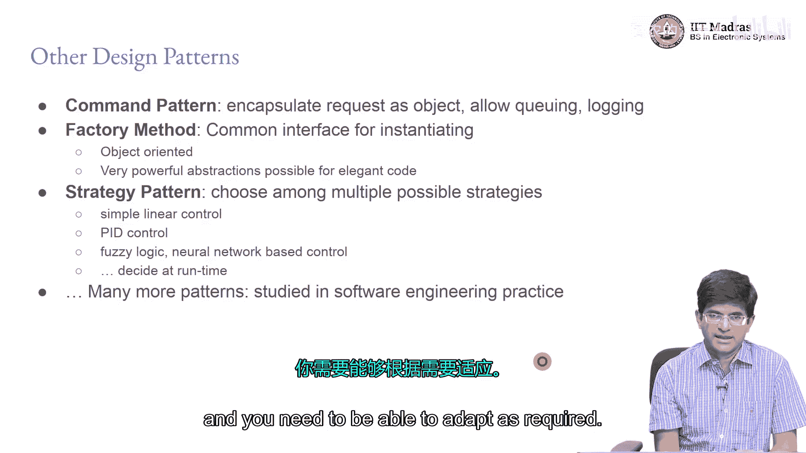

# 030：嵌入式系统与软件开发的设计模式 🧩




在本节课中，我们将要学习嵌入式系统开发中的一个重要概念：设计模式。我们将探讨什么是设计模式，为什么它们重要，并深入了解几种在嵌入式开发中常用的模式，特别是状态机模式。

## 概述

设计模式本质上是经验的结晶。多年来，许多高技能和聪明的工程师和开发人员在开发各种软件的过程中，基于经验总结出了一些观察结果。这些观察结果有时被称为最佳实践、编码风格约定或命名约定。所有这些本质上都是指导方针，它们告诉开发者，如果遵循这些实践，代码将更健壮、更易理解。

当我们将这种思想提升到系统架构层面时，就形成了设计模式。换句话说，当你试图为特定问题设计解决方案时，这些模式是过去被证明有效的通用解决方案。因此，建议你至少理解这些模式是什么，然后看看是否可以使用其中之一来解决你的问题。

## 状态机模式 🚦

上一节我们介绍了设计模式的基本概念，本节中我们来看看一个最基础且重要的模式：状态机。

从数字系统课程中，你已经听说过有限状态机的概念。本质上，它表示存在一组寄存器来保存某些值，状态机根据这些寄存器的当前状态和输入，通过组合逻辑进行计算，然后更新状态并生成输出。

在嵌入式系统中，我们之前看过的家庭自动化例子遵循完全相同的原则。系统有一个与之关联的状态，这个状态对应于系统的一些内存数据，例如当前温度、湿度值或其他相关参数。换句话说，存在一个“系统状态”的概念，它是系统当前正在做什么的记忆。

我们思考程序开发的方式是：我们有一个当前状态，并希望这个状态随时间演变。我们希望它基于通过传感器或其他方式输入的数据进行计算，从而决定系统的新状态。例如，检测到温度过高可能意味着房屋着火，或者发现温度过低可能导致水管冻结。系统状态的演变以及如何响应它，是思考嵌入式系统应做什么的一种自然模式。

### 状态机实例：单按钮控制

一个常见的例子是只有一个或两个按钮的手表或小闹钟。你需要用这两个按钮完成所有控制：设置时间、日期、闹钟等。这些闹钟的工作原理就是利用状态的概念。

例如，一个带单按钮控制的LED灯：按一次按钮，LED常亮；再按一次，LED开始闪烁。闹钟也类似：按一次可能显示日期，快速按两次则进入可以更改时间的状态。在每个状态下，如果一段时间没有操作，系统可能会自动回到原始状态。

### 状态图与核心概念

以下是描述此类系统状态转换的方式：


状态图中的矩形代表系统的状态。系统从“关闭”状态开始，这意味着LED熄灭。实线箭头表示状态转换，由事件（如按钮按下）触发。虚线是注释，帮助理解图表。

以下是状态机中的核心概念：
*   **状态**：代表系统可以处于的不同模式或条件。
*   **事件**：可以触发状态转换的触发器（如按钮按下）。
*   **转换**：定义状态如何从一个转移到另一个（如从“关闭”到“开启”的条件是“按钮按下一次”）。
*   **动作**：在特定状态下执行的操作（如在“开启”状态下点亮LED）。



这种基于状态的方法不仅适用于数字逻辑系统（如交通灯控制器），也完美适用于嵌入式系统设计，甚至在操作系统、图形界面等涉及交互的领域也广泛应用。

### 状态机方法的优势

基于状态的方法有以下好处：
*   **可预测性**：每个状态都有明确定义的系统行为。
*   **易于修改和扩展**：理解不同状态的功能后，可以轻松添加新状态以引入新功能。
*   **简化调试**：只要知道系统状态，跟踪系统行为并定位问题就相对容易。
*   **高效实现**：状态可以用很少的资源表示（如数字系统中用log₂(n)个触发器表示n个状态）。在嵌入式系统中，即使用一个8位数表示状态，也能支持多达256个不同的状态。

### 状态机的代码实现

那么，这如何转化为实际代码呢？一种非常典型的方式是使用`switch-case`结构。

首先，我们使用枚举数据类型来定义状态和事件：

```c
// 定义状态
typedef enum {
    STATE_OFF,
    STATE_ON,
    STATE_BLINKING
} SystemState;

// 定义事件
typedef enum {
    EVENT_NONE,
    EVENT_BUTTON_PRESSED,
    EVENT_TIMER_TICK
} SystemEvent;

// 系统控制结构，包含当前状态和其他内存（如计数器）
typedef struct {
    SystemState currentState;
    int blinkCount;
} LEDControl;
```

接着，处理状态转换的核心函数可能如下所示：

```c
void handleEvent(LEDControl *led, SystemEvent event) {
    switch (led->currentState) {
        case STATE_OFF:
            if (event == EVENT_BUTTON_PRESSED) {
                led->currentState = STATE_ON;
                printf("LED turned ON.\n");
            }
            break;

        case STATE_ON:
            if (event == EVENT_BUTTON_PRESSED) {
                led->currentState = STATE_BLINKING;
                led->blinkCount = 0; // 初始化闪烁计数器
                printf("LED started BLINKING.\n");
            }
            break;

        case STATE_BLINKING:
            if (event == EVENT_BUTTON_PRESSED) {
                led->currentState = STATE_OFF;
                printf("LED turned OFF.\n");
            } else if (event == EVENT_TIMER_TICK) {
                // 使LED闪烁，并增加计数
                led->blinkCount++;
                if (led->blinkCount >= 5) { // 闪烁5次后回到关闭状态
                    led->currentState = STATE_OFF;
                    printf("Blinking finished. LED OFF.\n");
                }
            }
            break;
    }
}
```

如你所见，我们在状态图中绘制的状态可以很容易地转换为`switch-case`语句中的各个`case`。这种编码风格编译后通常非常高效。

对于复杂的状态机，`switch-case`可能会变得冗长。此时，可以考虑使用**状态表**来定义状态和转换关系，或者在使用C++等语言时，利用类和面向对象的特性，将每个状态定义为一个类，使系统表示更清晰。

### 状态机面临的挑战

当然，状态机模式也面临一些挑战：
*   **复杂性**：状态和转换过多时，理解和绘制状态图会变得困难。
*   **时序处理**：在实时系统中，事件发生的精确时间以及事件间的时间差可能导致不同的转换。确保状态转换的正确时序可能很困难。
*   **死锁状态**：可能进入某个状态后无法退出。
*   **测试困难**：测试依赖于系统状态。除非知道系统处于何种状态，否则很难测试其在各种输入条件下的行为。将系统从一个状态引导到特定测试状态本身可能就是个难题。

## 其他常见设计模式 🔄

上一节我们深入探讨了状态机模式，本节中我们来看看嵌入式系统中其他几种有用的设计模式。

### 观察者模式 👁️

观察者模式表示一种“一对多”的依赖关系。例如，假设你家里有一个运动传感器。传感器被触发（检测到移动）时，可能需要引发多种不同的响应：触发警报系统、启动自动喂食器（如果是宠物猫）、或打开车库门。

一种实现方式是让多个功能模块“观察”这个传感器事件。一旦传感器被激活，所有观察者都会收到通知。每个观察者自行判断是否需要响应并采取相应行动。

在实践中，观察者模式通常通过**回调函数**实现。在C语言中，这通常使用**函数指针**来完成。

```c
// 定义回调函数类型
typedef void (*ObserverCallback)(void);

// 注册观察者（回调函数）到某个事件列表
void register_observer(ObserverCallback cb) {
    // 将cb添加到观察者列表
}

// 当事件发生时，通知所有观察者
void notify_observers(void) {
    // 遍历观察者列表，调用每个回调函数
    for (each observer in list) {
        observer();
    }
}
```

通过注册多个回调函数，可以让多个不同的模块响应同一个事件。这种模式在以下场景很常见：
*   **传感器数据**：同时记录到文件和显示在屏幕上。
*   **按钮按下**：触发系统中多个部分的更改。
*   **网络连接**：连接到Wi-Fi后，触发下载、应用更新、系统检查等多个任务。

### 单例模式 1️⃣

单例模式常用于管理全局唯一的资源。一个典型的例子是**UART通信模块**。通常一个系统中只有一个UART。

与其在代码中到处传递这个UART实例，不如将其定义在单一位置，并通过特定的函数来获取访问权。

```c
// UART单例结构（简化）
typedef struct {
    // UART相关配置和数据
} UART_Instance;

// 获取UART单例实例的函数
UART_Instance* get_uart_instance(void) {
    static UART_Instance the_instance; // 静态变量，保证唯一性
    // ... 初始化（如果需要）
    return &the_instance;
}
```

这样，代码的任何部分都可以通过调用`get_uart_instance()`来访问这个唯一的UART，而无需担心多个实例或全局变量的直接修改。这是一种将全局变量封装在明确定义的函数中的方式。

### 其他模式简介

嵌入式开发中还有其他有用的模式：
*   **命令模式**：用于抽象向系统发送命令的方式（如“开灯”、“闪烁”）。它将请求封装为对象，从而允许参数化、队列化或记录请求。
*   **工厂方法模式**：用于创建不同类型的对象。例如，可以有LED灯泡、白炽灯泡等不同类型的光源。工厂方法封装了创建逻辑，允许你在更高层次上思考“光源”这个抽象概念，而由工厂决定具体创建哪种光源。
*   **策略模式**：允许在运行时选择不同的算法或策略。例如，遥控车的电机控制可以采用简单的线性控制、PID控制，甚至更复杂的神经网络控制。根据剩余电量、响应时间等条件，在运行时选择合适的策略。

## 总结

本节课中我们一起学习了嵌入式系统设计模式的核心思想。

我们首先了解了设计模式是解决特定问题的经验总结和最佳实践。然后，我们深入探讨了**状态机模式**，它是嵌入式系统中最基础的模式之一，用于管理系统的状态和基于事件的转换。我们学习了状态、事件、转换和动作等核心概念，并看到了如何用代码（如`switch-case`语句）实现一个简单的状态机。

接着，我们概览了其他几种常见模式：**观察者模式**用于处理一对多的依赖关系（如事件通知）；**单例模式**用于管理全局唯一资源（如硬件外设）；此外还有命令模式、工厂方法模式和策略模式等。




重要的是要记住，设计模式是指导设计的工具和指南，而非必须严格遵守的教条。在使用它们时，应关注是否解决了正确的问题，并根据实际需求灵活适应，避免过度设计。理解这些模式背后的“为什么”，将帮助你构建更健壮、更可维护的嵌入式系统。