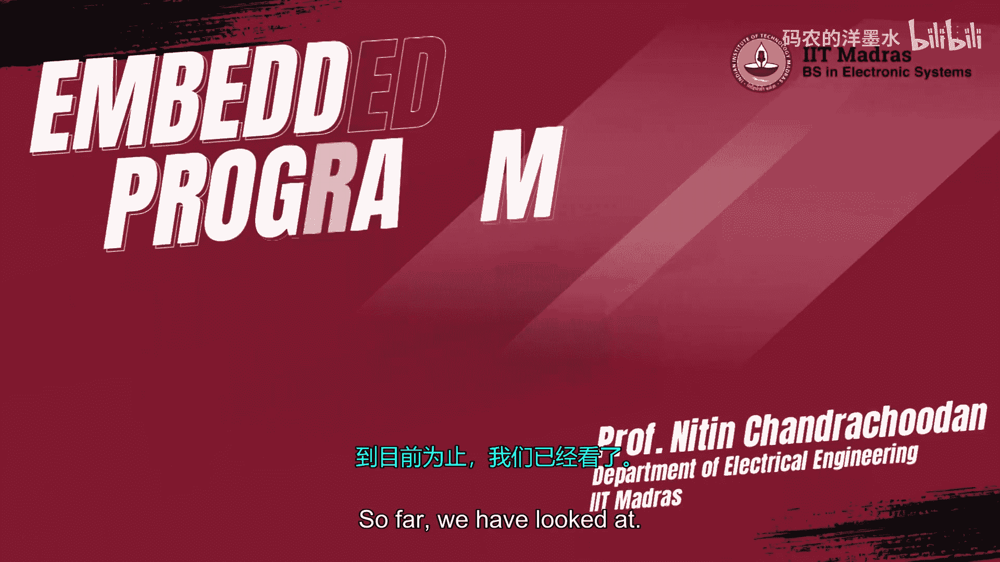
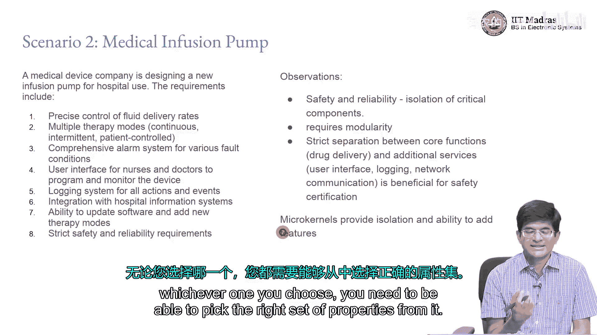

# 031：模块化可扩展嵌入式软件设计的架构模式 🏗️

在本节课中，我们将要学习嵌入式系统设计中几种关键的架构模式。我们将探讨分层架构、事件驱动架构和微内核架构，理解它们的设计思想、优缺点以及适用场景。通过学习这些模式，你将能够为不同的嵌入式项目选择并设计合适的软件架构。

## 分层架构 🥞

上一节我们介绍了软件设计模式，本节中我们来看看更高层次的系统架构设计。分层架构是大型软件系统设计中最基础的架构模式之一。

分层架构的核心思想很简单。系统从底层到顶层被划分为不同的层次。最底层是硬件。为了与硬件交互，我们定义驱动程序。驱动程序封装了特定外设对应的内存布局，并提供标准功能，例如激活外设、读取或写入特定内存位置。

在C语言编程中，很多事物可以抽象为文件。例如，一个温度传感器可以被视为一个文件，你可以打开并读取它。通过这种方式，温度传感器被抽象为一个文件系统。相应的驱动程序需要编写，但之后所有人都能以标准化的方式使用它们。

在硬件之上构建驱动程序，意味着实现了第一层抽象。然后，可以在此基础上构建辅助函数。这些函数处理来自温度传感器等设备的数据，进行实用计算，提供处理后的数据（例如转换为摄氏度或华氏度），或衍生出其他信息（如温度是否过高、过低，是否需要基于当前温度生成其他事件等）。

最后，在所有层次之上，是你实际开发的应用程序软件。它根据处理后的数据做出决策，例如温度过高时执行某个操作，温度过低时执行另一个操作。

可以看到，我们抽象出了不同的层次。实际上，可以让不同的开发人员负责不同抽象层次的工作。硬件工程师可以主要设计他们的系统，而无需过多担心最终将运行什么软件。但需要注意的是，这些划分并非绝对严格。一个完全不了解驱动程序工作原理的硬件工程师可能会给驱动软件带来问题，并且从硬件角度看，也可能无法做出最佳设计。

分层架构的好处是显而易见的：模块化、可重用性。核心功能、驱动程序甚至中间件都可以在不同的应用程序中重用。它具有可扩展性，如果要向系统中添加新型灯泡或执行器，可以专注于为其添加额外功能，而无需修改其余代码。整个系统也更容易测试，因为可以编写单元测试来测试每个独立功能，而不必关心整个系统如何工作。

以下是分层架构的一个具体示例：

1.  **硬件抽象层**：这是最接近硬件的软件层，基本上是驱动程序。例如，函数 `HAL_GPIO_WritePin()` 直接设置特定地址的值，从而更新寄存器。
2.  **驱动层**：在硬件抽象层之上，提供更高层次的抽象。例如，函数 `LightDriver_On()` 抽象了“打开灯”这个操作，其内部可能调用了 `HAL_GPIO_WritePin()`。
3.  **控制器层**：在驱动层之上，围绕实际控制逻辑构建。它可能包含更复杂的功能，例如基于某些逻辑条件决定何时开灯、关灯前应执行何种检查等。
4.  **应用层**：最顶层，直接与控制器层交互。它可能检查按钮是否被按下，接受通过Wi-Fi或蓝牙远程传入的命令，然后决定控制开关。在应用层，我们无需关心哪个GPIO引脚连接了哪个灯泡。

这种分层架构帮助我们创建了不同层次的应用程序逻辑，并构建了结构化的代码。这意味着我们可以将整个应用程序从一个STM32微处理器移植到树莓派或ATmega上，而无需在整个代码中做大量修改。

## 事件驱动架构 ⚡

上一节我们介绍了分层架构，本节中我们来看看另一种在嵌入式系统中非常常见的架构模式：事件驱动架构。

要理解事件驱动架构，我们需要考虑松耦合系统。松耦合系统意味着你有各种不同的传感器、执行器等，它们可能不会一直处于活动状态。例如，在家庭自动化中，电视或微波炉可能并未通电。一个正常的分层架构可能会要求程序去检查每一个设备的状态，而事件驱动架构则允许新系统接入，而不会破坏已存在的其他部分。

在这种场景下，有许多实体独立或半独立地工作，它们之间没有非常紧密的交互，但确实会产生其他实体需要响应的事件。在家庭自动化中，按下按钮、温度超过阈值等都是事件。我们希望有一个系统能够基于事件做出响应，但同时，如果系统的某个特定部分没有响应或不存在，系统也能继续运行而不会崩溃。

实现这一目标的常见方法是使用回调函数和中断服务程序。中断和事件密切相关：在硬件层面有中断，在软件层面可以将其视为事件。系统产生中断就是一种事件。按下按钮可以被视为触发一个中断，进而生成一个事件。但事件也可以通过其他方式生成，例如，通过将温度读数与阈值比较来生成事件，这不一定是一个中断。

如果使用ISR，那么它是传递事件通知的理想方式。ISR通常通过调用某种回调函数来响应。我们之前讨论过的回调模式在这里再次出现：注册一组函数指针作为特定事件或中断的回调。当该中断发生时，相应的函数就会被调用。

事件管理器代码本身相当简单。基本上，它将所有事件放入某种队列中。队列是一种先进先出的数据结构。这意味着如果有多个事件（例如多个按钮被按下、多个温度警报响起），我需要处理所有这些事件，但不能同时处理。ISR或回调函数所做的就是将它们放入队列。之后，我可以遍历该队列，逐个取出事件。

对于每个事件，我查看所有已为该事件注册的处理程序，并逐个调用它们。因此，单个事件可以触发许多不同的处理程序。观察者模式的思想在这里发挥作用，但这是通过事件实现该模式的一种明确方式。

事件处理程序本身可能非常简单：它查看发生了哪种事件，并基于此决定需要执行什么功能，例如打开或关闭灯泡。

事件驱动架构的最大优势是响应性。由于与中断等的紧密联系，它们可以对外部输入做出高度响应。特别是在输入不可预测或组件间松耦合的系统中，当某些组件可能失效或由于某种原因不存在时，这种架构尤其有用。

另一方面，事件驱动架构也可能非常复杂，难以调试。因为中断最终会打断程序的执行流。任何时候发生中断，都是一个异步事件。它不是你所期望的标准控制流，而是将程序带到其他地方，迫使其以不同的方式运行。此外，还存在“回调地狱”这个术语，指的是可能陷入一种场景：一个特定事件回调一个函数，该函数又触发其他事件，最终你可能不知道是如何进入某个特定函数的，或者至少很难跟踪执行流程。

## 微内核架构 ⚙️

到目前为止，我们已经看了两种模式：分层架构和事件驱动架构。它们在某些意义上最终将你引向操作系统的概念。在嵌入式系统领域，迈向操作系统的第一步是所谓的微内核架构。

当你的应用程序增长到需要更复杂交互的程度时，微内核架构就派上用场了。例如，你可能需要将数据写入文件、通过网络通信、管理多个外设和驱动程序等。这时，你可能开始考虑让所有这些不同的驱动程序等以某种方式交互。

“内核”一词指的是核心部分或核心功能，当系统运行时，这些功能将被触发。整体式内核的理念是它像一块完整的巨石，一个程序控制着系统上发生的一切。另一方面，特别是在嵌入式系统领域，有一种向微内核发展的趋势。微内核的理念是，不是让一个操作系统程序为你管理所有资源，而是将其分解成小部分。每个单独的驱动程序等都有非常具体的任务，它们执行一些最少的资源管理，包括进程间通信，使不同进程之间可以通信，并且还有某种形式的任务调度。

所有这些概念在我们真正进入操作系统领域时会详细探讨。但你已经可以看出，为什么一个简单的分层架构（演变为事件驱动架构）可能不够，你实际上需要进入某种允许你创建更复杂操作系统的架构。这就是微内核背后的理念。

还有许多其他不同的架构模式，例如基于消息传递的架构、基于组件的架构、客户端-服务器架构等。其中许多并不一定属于纯嵌入式系统的领域，但关键在于嵌入式系统本身的定义是流动的。你完全可能遇到一个嵌入式系统，其中有多个不同的网络组件相互通信，整个系统需要以执行某种有用功能的方式进行思考和设计。

这里我想再次强调一个重要点：许多这些架构模式并不是互斥的；它们完全有可能重叠。特别是像硬件抽象层这样的东西，在任何地方都会出现，无论是操作系统、事件驱动架构、分层架构还是消息传递架构，在某个时刻你都会有一个硬件抽象层。驱动程序、中断等术语是通用的，几乎会在所有这些系统中出现。因此，与其试图简单归类，更重要的是能够理解相关的属性，以便判断是否可以从这种架构模式中汲取一些想法，应用到当前上下文中，从而获得或构建一个更好的系统。

## 架构选择实例 🎯

带着这个思路，让我们快速看两个例子，看看在特定情况下，什么因素可能指导不同架构模式的选择。

假设有一家公司正在开发智能家居安防系统。系统中有遍布房屋的多个传感器、一个带触摸屏的中央控制面板、一个用于监控的移动应用、不同类型的智能设备、实时警报、视频录制、软件更新等。问题是：应该为这个系统选择哪种架构？

通过分析，我们可以得出以下观察：
1.  输入不可预测：用户交互和传感器激活都是异步的，无法保证在什么时间会有什么样的输入。
2.  需要实时响应：需要对发生的事件做出响应，并且可能同时有多个异步事件。
3.  存在松耦合：如果一个传感器被拔出、更换或在其他地方添加了新传感器，应该能够让其向系统发送新消息，并使整个系统适应这种变化。

考虑到高响应性和松耦合的需求，事件驱动架构听起来是这个场景中一个很好的候选方案。你希望快速响应事件，希望有一种结构允许你构建一个能够实时快速响应事件发生的系统。因此，我们认为事件驱动模式可能是这个问题合适的架构。

让我们看另一个例子。假设你负责为某种医疗用途设计一个新的输液泵。医疗用途自动意味着出现了一系列新的要求。你需要精确控制发生的情况，泵必须准确并受到仔细监控。可能有连续操作模式、间歇操作、患者控制等不同的触发执行器的方式。最重要的是，你会发现很多要求都围绕着安全性、可靠性和报警系统的理念。对于任何故障情况，都应该有快速的检测。你可能需要良好的用户界面，因为使用它的人不一定是传统工程师。此外，可能还有很多网络相关的活动，因为需要记录数据，需要与医院信息系统集成等。

在这种情况下，微内核架构可能提供了许多不同类型的用户交互、网络等功能。除此之外，它还提供了你所拥有的不同系统之间的隔离。你需要强大的安全性和可靠性保证，希望它是模块化的，以便这些事物彼此不干扰。核心功能必须保证正确工作，而附加服务即使不工作也不会危及生命，这种分离正是基于微内核架构的操作系统可以大放异彩的地方。

当然，你也可以提出论据说明为什么不同的架构在这里更有意义。但归根结底，无论选择哪一种，你都需要能够从中选取正确的属性集，并在此基础上进行构建。

## 总结 📝

本节课中我们一起学习了嵌入式软件设计的三种核心架构模式。我们首先探讨了**分层架构**，它将系统划分为硬件、驱动、控制器和应用等层次，实现了关注点分离和代码复用。接着，我们分析了**事件驱动架构**，它通过事件和回调机制处理异步输入，特别适合需要高响应性和组件松耦合的系统。最后，我们介绍了**微内核架构**，它将操作系统核心功能模块化，提供了更好的隔离性、安全性和可扩展性，适用于复杂的嵌入式应用。理解这些模式的原理和适用场景，将帮助你在实际项目中做出更明智的架构设计决策。