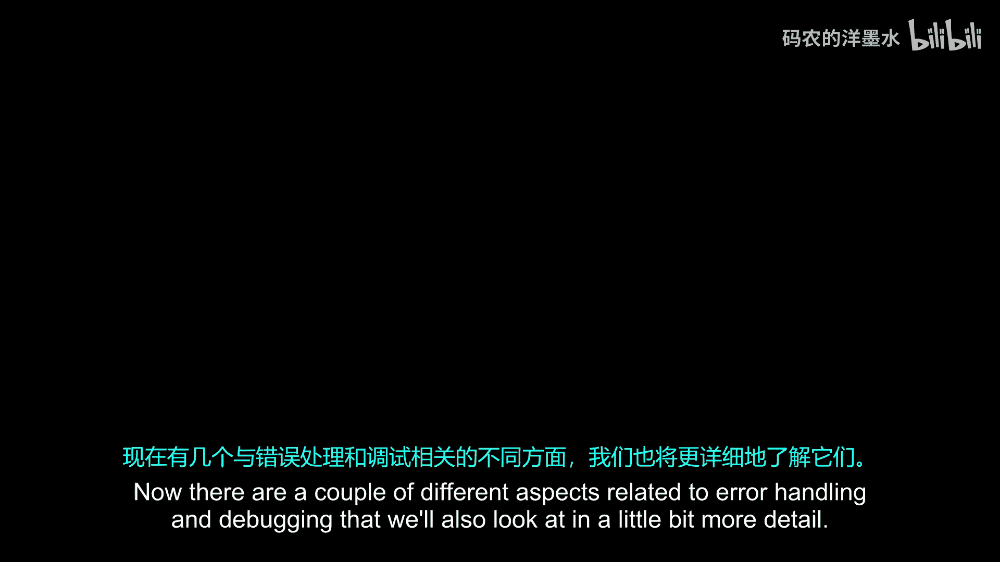
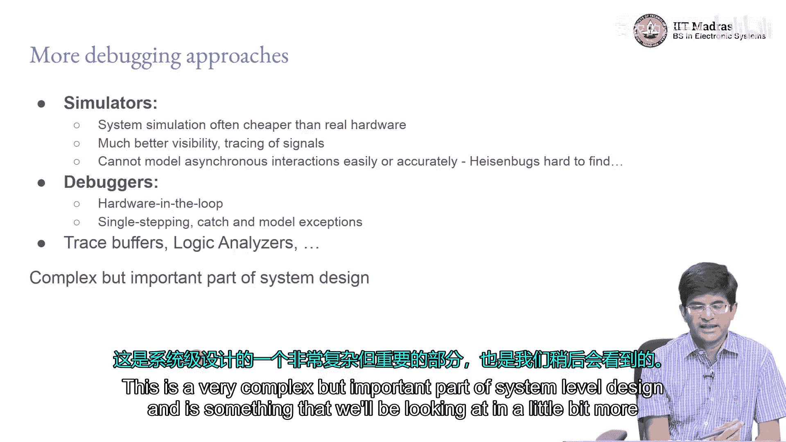

# 032：嵌入式系统中的错误处理与调试策略 🐛

在本节课中，我们将要学习嵌入式系统中错误处理与调试的核心概念和策略。我们将探讨错误的定义、分类、常见的处理方法以及实用的调试技术，旨在帮助初学者理解如何在资源受限的嵌入式环境中构建更健壮的系统。

## 什么是错误？🤔

上一节我们介绍了课程概述，本节中我们来看看什么是错误。错误指的是程序或系统中的任何错误行为。这里的“错误”可能只是指行为出乎意料，也可能是未定义的。它不一定像计算器算出“2加2等于5”那么简单，也可能是系统执行了某种你未预期的行为。

那么，错误发生会带来什么问题呢？嵌入式软件通常是长期运行的。这意味着系统一旦开启，就期望能持续稳定工作。反复或频繁地重启、复位系统可能很困难，甚至是不可能的。有些安全关键应用，如核电站控制系统，重置系统根本不是一个选项。系统必须时刻保持正确运行。

嵌入式系统中的错误处理与传统软件系统的一个不同之处在于资源限制。系统没有足够的计算能力或内存来浪费在错误行为上。

## 错误处理系统的理想特性 ✅

以下是错误处理系统应具备的一些高度期望的特性：

*   **优雅恢复**：如果发生错误，如何从中恢复并以某种方式让系统继续运行？整体用户体验，即错误发生时实际使用系统的用户会经历什么，是一个关键考虑因素。
*   **易于调试和维护**：必须假设某些错误可能发生，并尽可能减少它们。但如果错误确实发生，调试、维护和修复系统的难易程度至关重要。

## 错误的分类 📊

我们可以将错误大致分为以下三种类型：

*   **编译时错误**：例如语法错误、类型不匹配。这类错误总是更受青睐，因为可以及早发现。尤其是在嵌入式系统中，这很关键。嵌入式系统通常运行时间很长，编译一次后部署到系统上，然后就会一直运行。因此，在嵌入式系统中，编译时间与实际运行时间相比是微不足道的。如果能在编译时发现问题，总是更好的。
*   **运行时错误**：在运行时可能遇到的很多问题都与内存相关。例如缓冲区溢出、空指针问题等。也可能有硬件错误，但硬件故障并不总是能通过软件修复。不过，检测硬件故障或由硬件引起的错误，并在不损失整个系统的情况下从中恢复，也是容错设计中非常重要的一部分。这里我们主要讨论软件相关的错误。
*   **逻辑错误**：这是指程序逻辑本身错误，功能实现就是错的。这类错误可能发生在系统某些难以达到的状态下，因此在编译或初始测试阶段都未被捕获。例如，系统在某些特定条件下可能进入死锁，或者由于异步事件及其发生顺序导致竞态条件，所有这些都可能导致特定类型的错误。

## 错误处理方法 🛠️

上一节我们介绍了错误的类型，本节中我们来看看如何处理这些错误。以下是关于错误处理的一些通用建议：

*   **错误返回码**：一个非常常见的做法是使用错误返回码。通常，每个函数会返回一个计算值。然而，在很多情况下，你希望函数执行一些有副作用的操作，例如更新内存、打印输出或发送网络数据。在这种情况下，函数应返回的值可以被用作返回码。在C语言中，一个常见的约定是：如果函数返回`0`，则表示没有错误。任何从函数调用返回的非零值通常都被视为错误。这意味着函数返回后，调用者必须检查该返回值，并决定是否需要根据此值进行后续处理。在某些情况下，如果读取传感器失败，调用`read_sensor`的函数可能需要将该错误向上传播，一直传到最终向用户显示错误信息的地方。这种方法实现简单，开销低，但容易被忽略。它也可能导致代码混乱，因为需要执行大量检查条件来判断发生了什么以及如何响应。
*   **全局错误标志**：另一种方法是使用某种全局变量作为标志。你可以在全局变量空间中定义一个错误标志。有些函数可以设置这个错误标志，而在其他地方，你可以检查错误条件。例如，你的主循环可以在每次进入循环前检查是否有任何错误，如果有，则采取不同的行为。当然，问题是可能有多个不同的部分试图写入该错误标志，这可能导致竞态条件。错误标志很常见，主要是因为它们易于在代码的任何地方检查，这对于内存空间有限的嵌入式系统来说，可以使代码更简单、更易于实现。
*   **断言**：断言本质上检查特定条件是否满足。在编写程序时，你会有“不变式”的概念，即某个条件必须始终满足。例如，你测量温度，可以直接断言该温度值不应为负（可能是因为它使用开尔文温标）。你可以设置一个断言，如果该值变为负，则意味着发生了根本性错误。断言有助于及早捕获错误，因为很容易添加。从编译器的角度来看，它基本上只是让程序在断言失败的地方崩溃。然而，这也意味着你通常不希望在生产代码中使用断言。因为如果程序崩溃，对最终用户来说，错误信息是什么并不重要，他们不可能坐在那里调试并找出系统的问题。
*   **异常**：异常与中断的概念相关，但它们是同步的、由软件生成的。例如，你可以创建一个通信异常，因为通信通道无法工作，无法打印输出，于是抛出这个异常。可能有一个备用通信通道或其他日志记录通道，或者只是简单地让一个LED灯亮起。异常并不总是可用，例如C语言本身没有异常的概念，但C++有。根据所使用的语言和开发方式，你可能会发现异常是处理某些类型错误的好方法，但它们通常实现更复杂，开销也比我们看过的其他方法更高。

还有许多其他技术。我们已经简要讨论过看门狗定时器的概念。还可以有故障安全模式、冗余设计（例如，让三个不同的系统执行计算，如果其中一个出错，多数结果仍然有效，这在太空应用中很常见，因为存在硬件错误的风险）。对于通信，可以使用纠错码。自检和诊断也经常使用，特别是在系统启动时。关键是，处理错误的方法有很多种。

理想情况下，你希望防止错误发生，或者希望在编译时尽早捕获它们。如果错误在运行时发生，你需要有某种方式来处理，以便用户尽可能容易地响应。

## 错误处理策略 📈

我们可以将错误大致分类为可恢复或不可恢复错误，系统级或模块级错误。可恢复意味着虽然出错了，但系统继续运行。不可恢复通常就是我们所说的崩溃，系统停止工作，希望重启后能正常工作。系统级与模块级意味着可能只是你的Wi-Fi芯片停止工作，而计算机的其余部分继续工作，只需关闭再打开它，希望它能恢复。

关于错误，你如何处理它们？如何报告它们？你可能需要某种日志记录机制来记录发生的错误类型。如果你能与外部世界通信，那么理想情况下应该发送一条消息说明出了问题。在某些情况下，你可能没有这种能力，可能只能打开一个指示灯，表示出了问题。

最后是恢复机制本身。对于可恢复错误，可以简单地“报告并继续”。你可能拥有所谓的“优雅降级”。例如，你的Wi-Fi芯片停止工作，但系统的其余部分继续运行，直到你决定如何处理。你是否能够在不关闭整个系统的情况下单独重启Wi-Fi？如果不行，也许你必须重启整个操作系统。当然，在很多情况下，恢复机制最终涉及某种系统级复位，要么是仅复位受影响部分的局部复位，要么是整个模块的完全关闭和重启。在许多嵌入式系统中，应尽可能避免全系统复位，但在某些情况下无法避免，这是唯一的选择。

## 调试简介 🔍

在了解了所有这些软件设计模式之后，我们将非常简要地看一下调试的概念。我们将在后续课程中，结合实际的硬件辅助调试工具，更详细地探讨调试。在此，我们仅从高层次的角度来看待它。

“Bug”一词的首次报告使用是在海军上将格蕾丝·霍珀的日志中，她至少普及了这个术语。这实际上是在计算机内部发现的一只虫子（一只飞蛾），它进入了真空管或继电器，导致系统无法正常工作。

那么，什么是Bug？尤其是在嵌入式系统的背景下？正如我们所知，Bug就是错误。它们也可能是某种错误行为。总的来说，我们之前归类为错误的行为，即你不期望系统做的事情，都是故障行为。任何Bug都是坏消息。但在嵌入式系统中，某些特性使得Bug的存在更加糟糕。

这些特性包括：对系统状态的可见性非常有限，很难在嵌入式系统中添加大量日志和调试信息。许多系统具有实时性，这意味着你可能会遇到一些瞬态Bug，它们出现一次，下次当你试图复现时却无法获得相同的行为。还可能存在硬件软件交互问题。当然，这些问题在一般软件中也会出现，但在嵌入式系统中，由于你还要处理一个非常受限的系统（有限的计算能力、内存资源、通信能力等），它们会变得更加严重。

## 调试策略 🧪

那么，我们可以使用哪些策略来进行调试呢？

*   **状态指示灯**：最简单的方法是使用某种状态指示灯，例如LED。LED在嵌入式系统中如此受欢迎的原因之一，是因为它们是将信息从系统传达给用户的最简单手段。你甚至可能没有使用`printf`语句发送消息的奢侈，只能使用某种状态LED。通常，如果某个LED亮红灯，表示出错了；而如果亮绿灯，则表示一切正常。这些约定使得一眼就能判断事情是否正常。不幸的是，这也意味着其表达能力非常有限，你无法用一个甚至几个LED传达大量信息。
*   **基于`printf`的调试**：基于`printf`的调试意味着你在代码中的各个点插入`printf`命令或函数调用。你可以将一个函数分解为多个步骤，每完成一部分工作就发送一个`printf`，然后再做更多工作，再放另一个`printf`。这是一种日志记录，它给编写和监控代码的人提供了一些关于到目前为止发生了什么事情的信息。这是一种非常简单而强大的调试方式。例如，从零开始启动Linux系统时，在内核消息滚动过去之后，你才会看到系统启动。这样做的原因是，在系统启动时，你访问权限非常有限，无法在屏幕上绘制图形，只能将文本打印到控制台或串口。这种调试信息或任何有用的信息告诉你系统在启动过程中已经进行了多远。同样，它之所以重要，是因为在那个时候通信设施非常有限。这种基于`printf`的调试非常有用，它是一种蛮力方法，直接告诉你你在代码中的位置。但它确实需要一个通信通道。有趣的是，它实际上会影响实践中事物运行的时序。例如，一个`printf`可能通过UART外设发送数据。以一个运行在9600比特每秒的UART为例，这意味着传输每个比特大约需要1.1毫秒。对于CPU来说，1毫秒实际上是很长的时间。即使使用1MHz的时钟，那也是大约1000个时钟周期。如果你有一个更快的CPU，比如树莓派，打印一个字符的时间可能是数十万甚至接近百万个时钟周期。如果你打印整个字符串，在`printf`语句完成的时间内，可能已经过去了数百万个时钟周期。这意味着，如果有一个与事件发生时间过于接近相关的Bug，仅仅因为引入了一个`printf`语句，就可能导致Bug消失或行为不同。这种现象有一个戏称，叫做“海森堡Bug”，基于海森堡的不确定性原理，当然与海森堡本人无关。其要点是，如果你观察或试图测量它，它就消失了。
*   **其他调试方法**：我们将在后面更详细地探讨许多其他调试方法。特别是系统级模拟器的概念。在很多情况下，系统级模拟可能比在实际硬件上构建和测试更便宜。你首先尝试对你想要做的一切进行完整模拟。模拟器还提供了更好的可见性，你可以在模拟中记录任意多的信号。模拟器的问题是它们难以轻松或准确地模拟异步交互。例如，如果你的程序中发生了与时间相关的错误，通过模拟器很难捕获它们，因为模拟器具有可预测和可重复的行为，这可能不是你捕获Bug所需要的。还有涉及硬件在环的调试器，它们允许你逐条单步执行代码中的汇编语言指令，或者单步执行你用C等语言编写的代码行。例如，你可以说“执行到这一行然后停止”。GDB就是我们在C编程背景下已经看过的一个例子。类似的事情可以通过GDB与外部硬件的连接来完成，利用其连接性来单步执行运行在该外部硬件上的代码。还有其他工具，如跟踪缓冲区、逻辑分析仪等。换句话说，有很多不同的工具可用于帮助调试和识别程序中的问题。这是系统级设计中一个非常复杂但重要的部分，我们将在后续课程中更详细地探讨。

## 总结 📝

本节课中我们一起学习了嵌入式系统中的错误处理与调试策略。我们首先定义了错误，并讨论了嵌入式环境中错误处理的特殊挑战。接着，我们学习了错误的分类：编译时错误、运行时错误和逻辑错误。然后，我们探讨了多种错误处理方法，包括错误返回码、全局标志、断言和异常，并分析了各自的优缺点。最后，我们介绍了调试的基本策略，从简单的状态指示灯到基于`printf`的调试，并简要提及了更高级的调试工具和方法。理解这些概念对于开发稳定、可靠的嵌入式系统至关重要。