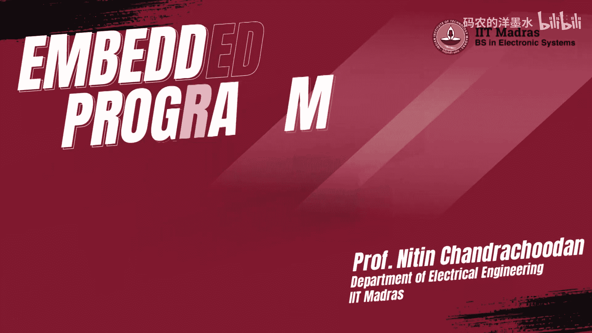
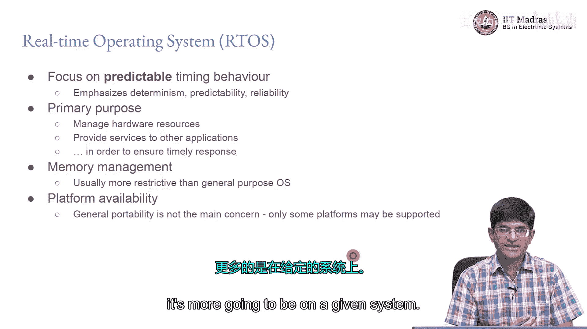
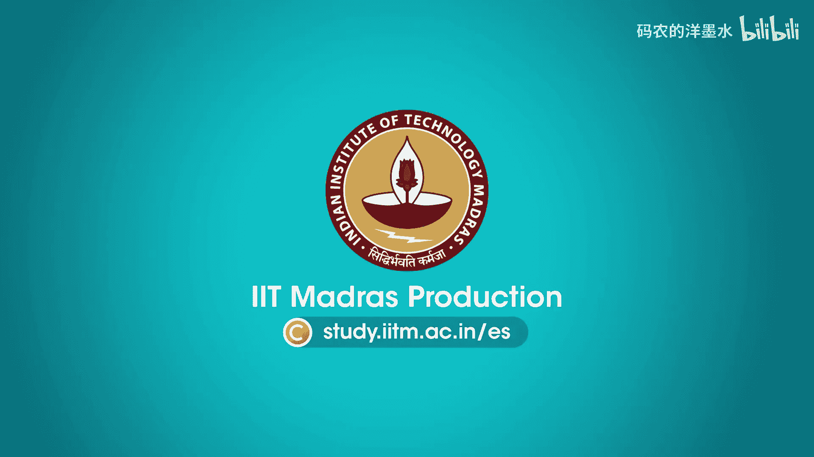

# 033：嵌入式系统的实时操作系统基础

## 概述
在本节课中，我们将要学习嵌入式系统中的一个重要概念——实时操作系统。我们将了解什么是操作系统，它与通用操作系统的区别，以及实时操作系统在嵌入式环境中的核心特性和作用。

## 什么是操作系统？
上一节我们介绍了嵌入式系统编程的背景，本节中我们来看看操作系统的核心概念。计算机本身是一种资源，同时也拥有需要被管理的资源。当我们说计算机是资源时，指的是我们用它来完成特定任务。反过来，计算机拥有的资源也需要被管理，其中最重要的资源是**时间**。时间通常以时钟周期数或计算机能为特定任务分配的指令数来衡量。换句话说，计算机越快，意味着在给定时间内它能执行更多操作或指令，因此至少就计算机能做的事情而言，它能做更多有用的工作。

为了完成工作，计算机需要将数据存储在某个地方，这意味着**内存**也是我们需要仔细管理的资源。除此之外，系统可能还有其他类型的资源，例如**存储**（可能是闪存、外部磁盘或其他类型的文件系统），或者**网络**（用于设备间通信）。换句话说，我们到目前为止在本课程中看到的、作为基于微控制器系统一部分的所有外围接口，都将被视为资源。最后，系统消耗的**电力**本身也是一种资源。消耗的电力越多，意味着产生的热量越多，需要更好的散热能力。相应地，这也意味着在给定电池供电下能运行的时间越短，因为你在给定时间内消耗了更多能量。

总而言之，计算机拥有资源。计算机运行任务。这些任务可能很简单，比如用户交互（等待用户在键盘上输入、移动鼠标或触摸触摸屏），并相应地在显示器上显示内容（可能是七段数码管、单个LED、LCD显示器或现代手机中常见的全彩有源矩阵OLED）。所有这些都属于用户交互的范畴。除此之外，还有需要控制的外围设备。其中一些当然是人机交互设备本身，但也可能有其他类型的外围设备，例如通信系统、执行器、电机控制器等。总的来说，它们提供的是服务。一个例子是主要目的是监听网络并响应请求的计算机，大多数网络服务器都属于这一类。我们通常不认为网络服务器是嵌入式设备，但只要它们执行相对固定的功能，它们肯定满足我们通常与嵌入式系统相关的一些标准。

核心要点是：你拥有资源，并且需要执行任务。任务会使用资源。这意味着我们需要某种管理器，能够决定这些资源如何在系统需要执行的所有不同任务之间分配和使用。这就是操作系统的作用所在。需要理解的是，严格来说，操作系统是可选的。你并不绝对需要操作系统来让计算机工作。例如，没有电源，计算机就无法工作；没有内存，它实际上也做不了什么。但操作系统在某种意义上至少是可选的，因为可以直接编写在计算机上执行并完成有用工作的程序，而不使用操作系统。然而，操作系统提供了许多不同的功能，极大地改善了实际使用计算机的体验。

那么，操作系统到底是什么？它是一个程序。它是计算机启动时运行的第一个程序。从技术上讲，可能不是第一个，通常首先运行的是一个叫做引导加载程序的程序，它反过来加载操作系统。但就所有实际目的而言，它是第一个接管整个计算机的程序，然后决定从此刻起，其他应用程序如果要在这台计算机上运行，必须通过这个操作系统加载。

它的作用是控制所有资源并提供所谓的驱动程序功能。当我们说控制资源时，我们已经知道如何编写代码与外围设备交互。假设它是一个像UART这样的通信设备。如果我们想在上面传输数据，我们需要将想要发送的字节写入特定的内存位置或地址。同样，如果我们想查看是否收到了任何数据，我们可以监控一个控制寄存器来检查UART缓冲区中是否有数据，如果有，我们可以从另一个地址读取数据到系统中并进行实际处理。

现在想象一下，你希望有两个不同的程序在同一时间与同一个UART通信。你如何决定谁有权访问它？因此，管理这个——决定哪个程序在哪个时间点可以访问计算机的哪个部分——是操作系统做的事情。这实际上引出了操作系统的一个非常重要的作用：在给定时间点，它上面可以运行多少个任务？需要理解的是，早期的操作系统本质上是单任务的。即使是像MS-DOS这样的磁盘操作系统（Windows就是基于或构建于其上），本质上也是一个单任务系统。在任何给定时间点，一旦你启动一个新程序，操作系统就会将控制权完全转移给该程序，程序必须退出，你才能回到操作系统，然后继续用它做其他事情。换句话说，它们是单任务程序，但用途有限，因为可以想象，如果我在一台计算机上一次只能运行一个任务，那么这个任务最好能真正充分利用计算机的能力。

另一种选择是多任务处理。在这里，操作系统实际上扮演着非常重要的角色，因为最终发生的情况是：你试图运行多个任务，其方式是让实际使用系统的最终用户感觉好像所有这些任务都在同时运行。但你只有一台计算机，一个处理器在里面（也许你有两个或四个，取决于核心数量，但即使是这也是计算能力相对较新的发展）。即使只有一个处理核心，也完全有可能制造出你的系统实际上在同时做多件事的假象。这是由操作系统处理的。基本上，它做的是建立某种基于定时器的方法，在一定时间后，操作系统重新开始行动，从当前正在运行的程序那里接管控制权，将其搁置一旁（冻结其当前状态），切换到另一个程序，让它运行一会儿，停止它，再切换到另一个程序，依此类推。通过足够快地执行此操作（足够快只需要快到能欺骗人类），它可以制造出所有程序实际上都在同时运行的假象。事实证明，今天的计算机速度如此之快，制造这种假象对它们来说并不困难。

这就是多任务处理的由来。多个任务在给定时间点在同一处理器上运行，只是它们实际上是时间片分割的，在时间上略有偏移。它们并非在完全相同的瞬间运行；它们是一个接一个地运行，但速度快到足以让所有实际目的看起来像是在同时运行。这意味着可能有多个设备试图写入UART串口或试图在屏幕上绘制内容，操作系统为计算机管理这些资源。

## 通用操作系统与嵌入式系统
上一节我们介绍了操作系统的基本概念和多任务处理，本节中我们来看看通用操作系统与嵌入式系统需求的区别。我们大多数人习惯的是通用操作系统。这些系统需要在多变的环境中运行，它们通常拥有大量的计算和内存资源。这里的首要重点是用户体验，因为它是一个面向用户的操作系统。因此，当你使用Microsoft Windows、Mac或Linux桌面环境时，你正在与一个为人类使用而调整的操作系统和环境进行交互。除此之外，它们还为你提供了许多开发资源，你可以编写程序，创建自己的程序或编程环境，并与在同一时间运行的其他程序，甚至可能与同时远程登录的其他用户共享系统上可用的所有资源。

以下是通用操作系统的例子：
*   **Linux**
*   **MacOS**（运行在苹果系统上）
*   **Windows**（目前至少在基于Intel的平台上占多数，并逐渐转向基于ARM的笔记本电脑）
*   **Android** 或 **iOS**（作为手机操作系统）

这些手机操作系统属于一个更细分的类别。从某种意义上说，它们是通用的，因为它们具有通用操作系统的所有这些特征，但它们也具有某些特征，使其专门适用于它们主要被看到的使用环境，即基本上是手机的通信设备。正如我们稍后将看到的，实时操作系统的某些方面也出现在手机或手机类型的操作系统中。

考虑到以上所有内容，我们讨论了通用操作系统。嵌入式系统有更具体的要求。它们通常具有有限的硬件资源。在这些系统上运行的进程数量和类型是有限的。我的意思是，你不太可能在嵌入式系统上同时运行电子表格、浏览器、视频播放器和游戏。可能有为此设计的嵌入式系统，但通常它要么只用于玩游戏，要么只用于浏览互联网，或者只用于打电话，或者至少这是它的主要目的。你通常不会期望用户可以在任何时间点在任何功能之间切换。

但对许多这些系统来说，重要的要求是**实时响应**。实时响应意味着什么？实时通常经常与“快速”混淆。实时并不意味着快速。实时意味着在确定、合理且固定的时间内。换句话说，正在执行的任何任务或发送的任何请求都会有一个截止时间，重要的是要满足这个截止时间，这就是实时的含义。截止时间本身可能是毫秒，甚至可能是几秒之后。但如果违反了截止时间，则意味着系统可能发生灾难性故障，出现严重问题。这并不一定意味着你必须在纳秒或微秒内完成事情，所以从这个意义上说，它不一定意味着快速。但你确实有这个要求：存在关键任务，它们有截止时间，并且必须满足截止时间。

确定性行为是高度可取的，在大多数情况下是强制性的，在某些情况下可能只是作为可取的。例如，如果你按下电视遥控器上的一个按钮，你确实希望频道能立即切换。但另一方面，如果有延迟，也不是世界末日。另一方面，当你踩下汽车的刹车时，你期望汽车立即通过减速来响应。如果不响应，实际上可能是灾难性的。

拥有实时响应的另一面是，一般来说，这样的系统可能不需要处理任意程序。你可以对允许在你的系统上运行的程序类型施加一些限制，你可以施加额外的约束，并说除非程序实际满足这些要求，否则甚至不允许在系统上运行。你对什么能在上面运行有更多的控制权。

## 实时操作系统
考虑到以上所有内容，我们可以思考一下实时操作系统可能是什么样子。在这里，操作系统的主要目的保持不变，即管理资源，但重点将放在可预测的时序行为上。RTOS（实时操作系统）的设计强调**确定性**、**可预测性**和**可靠性**。确定性意味着事情将按预期发生，在给定的时间内。可预测性意味着你能够提前预测响应将是什么。可靠性意味着每次你执行一组特定的操作时，你都会得到相同的行为。所有这些都是一种要求，它们显然是相互关联的。例如，可靠性和可预测性是相辅相成的。确定性也是如此。例如，在常规操作系统中，你可能不保证确定性。这意味着可能存在这样的情况：根据鼠标和按键按下的顺序，你最终会得到不同的行为。RTOS要求的是，应该有一些方法来保证这类属性，至少在大多数情况下，如果无法保证，至少应该让设计者或开发者清楚什么可能出错。

因此，RTOS的主要目的当然仍然是管理硬件资源并为其他应用程序提供服务，主要重点当然是确保及时响应。现在，RTOS的另一个特征（我们不会深入探讨太多细节）是，RTOS中的内存管理通常比通用操作系统中的限制更多。从C编程课程中你知道，例如，我们可以动态分配内存，你可以使用`malloc`来为你的程序分配空间。原则上，至少没有什么能阻止你分配或请求尽可能多的空间，最终操作系统可能实际上空间不足，此时它将采取适当的行动，可能包括终止你最初启动的程序。但在RTOS中，通常你有更受限制的内存管理。甚至可能存在这样的情况：即使在通用操作系统中提供的虚拟内存或内存保护等功能，在RTOS中也可能受到限制甚至不存在。因此，在通用操作系统中，一个进程不能读取或修改另一个进程拥有的内存，这一点非常重要，因为多个任务同时运行，你无法保证任何给定应用程序的凭证、资格或编写质量。而在RTOS中，你对应用程序有更多的控制，因此可以在一定程度上放宽内存管理的这种约束。

最后，平台可用性。像Linux或Windows这样的操作系统，其目标之一是尽可能多地运行在不同的系统上。你希望它支持不同的系统，以便它实际上可以在那些系统上启动，并且在几乎所有那些系统上都能获得相同的行为。Mac OS明显不同，他们选择几乎只在他们自己的硬件上运行它，并且绝对不保证，事实上，它很可能会拒绝在任何不符合其特定要求的其他硬件上启动。另一方面，Linux和Windows确实有更多可以运行的目标平台。对于RTOS来说，情况可能并非总是如此，因为在RTOS中，你可以提前决定说这些是你所针对的微控制器或系统平台的类型。如果这样的平台不可用，是的，可能可以将RTOS移植到它上面，但这不会是主要目标。主要目标将更多地集中在给定系统上，我们如何能最好地管理资源。

## 总结
本节课中我们一起学习了实时操作系统的基础知识。我们首先回顾了操作系统作为资源管理器的基本角色，然后比较了通用操作系统与嵌入式系统在资源限制和实时性要求上的区别。我们明确了实时操作系统的核心特征：**确定性**、**可预测性**和**可靠性**，其核心目标是确保任务在**截止时间**前完成。我们还了解到，RTOS在内存管理和平台支持方面可能比通用操作系统更具限制性和针对性。理解这些概念是设计高效、可靠的嵌入式系统的重要基础。