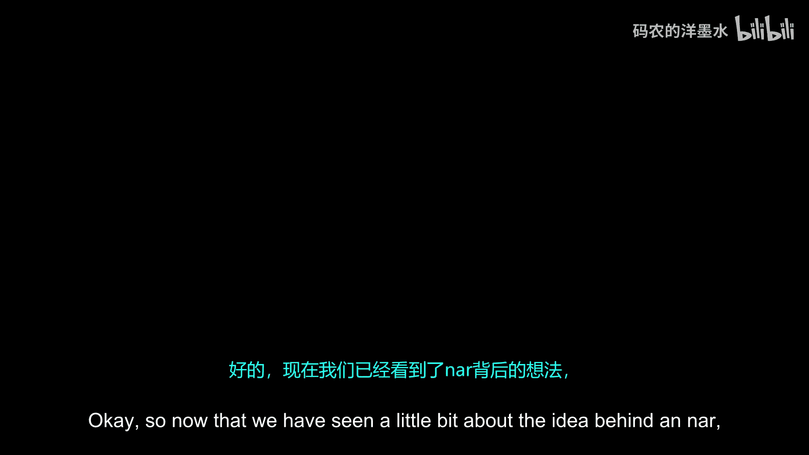
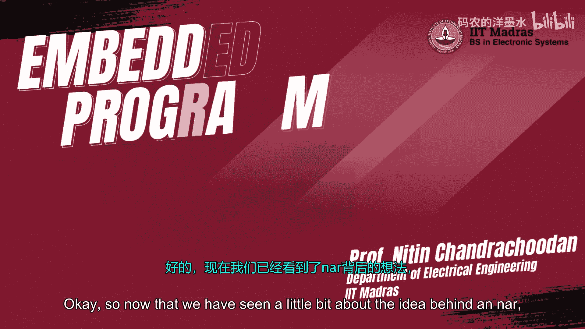
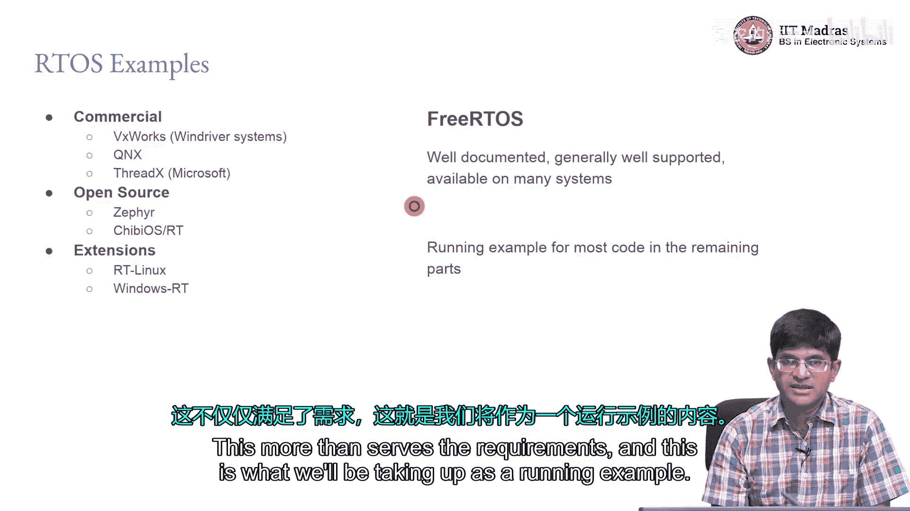
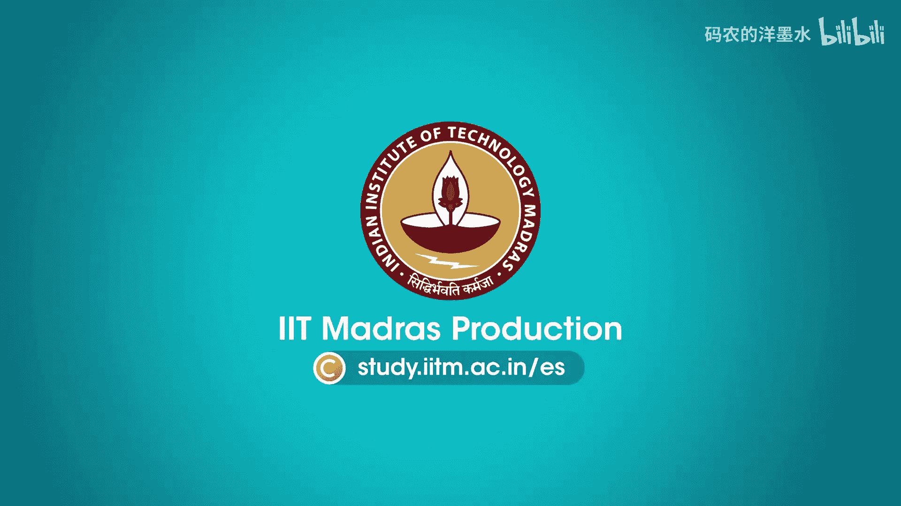

# 034：操作系统概念





在本节课中，我们将深入学习操作系统的一些通用概念，特别是实时操作系统（RTOS）的核心思想。理解这些概念有助于我们充分认识RTOS的功能与价值。

## 设备驱动程序

上一节我们介绍了RTOS的基本思想，本节中我们来看看操作系统中的一些基础组件。首先，设备驱动程序是一组提供给用户的函数，用于与特定外设或外部设备进行交互。它帮助你在一个比直接操作硬件更高的抽象层次上进行接口调用。

例如，在AVR系列微控制器中，直接与UART通信需要检查和控制多个寄存器：

```c
while (!(UCSR0A & (1<<UDRE0))); // 等待发送缓冲区为空
UDR0 = data; // 写入要发送的数据
```

而设备驱动程序则将这些底层操作封装成更易用的函数，如 `uart_init()`、`uart_transmit()` 和 `uart_receive()`。编写驱动程序需要对目标硬件有深入的了解，包括内存映射和寄存器设置等细节。

## 硬件抽象层

在设备驱动程序之上是硬件抽象层。HAL的目标是提供更通用的抽象接口。虽然HAL提供的函数名（如 `uart_init`）可能与驱动程序类似，但其关键作用在于为不同的微控制器硬件提供一个统一的接口标准。

HAL包裹了直接访问硬件的代码，它本身是通用的，并建立了一套基础函数规则。这使得上层的操作系统或应用程序无需关心底层硬件的具体差异。通过HAL，我们离实际硬件又远了一步，调用的是知道如何操作寄存器的函数，而不是直接操作寄存器。

## 操作系统与资源控制

操作系统构建在HAL之上，其主要功能之一是提供资源控制。例如，当多个任务都需要使用同一个UART发送数据时，操作系统需要确保在任一时刻只有一个任务能访问该设备，并且任务之间不会相互干扰。

为了使操作系统尽可能通用，能运行在不同硬件上，我们通常将其构建在HAL之上。因此，操作系统依赖于HAL，而HAL又依赖于驱动程序来提供代码的实际灵活性。

需要明确的是，这些层次划分并非绝对严格。在实际系统中，可能会看到操作系统直接与驱动程序对话，或者用户直接编写代码调用驱动程序，甚至直接操作寄存器。这些抽象层主要是帮助我们理解系统结构和组织代码的框架，只要它们能提供效用，就是有用的。

## RTOS核心概念：任务与状态

在RTOS的语境下，有几个重要术语。首先是**任务**，它是一个独立的执行单元。在实践中，一个任务通常看起来像一个用C语言编写的函数。

那么，为什么称其为“独立的执行单元”呢？这是因为这些函数（任务）的调用方式。我们的目标是能够在不同时间、以不同顺序调用对应于任务的函数，从而使这些任务能够相互协作以解决更大的问题。

就像每个函数有自己的寄存器空间和关联的栈内存一样，系统中的每个任务也有自己的**状态**（或称**上下文**），包括自己的寄存器和栈内存。上下文指的是为了清楚了解操作系统某部分当前正在处理什么所需知道的所有信息。

此外，任务还拥有不同的**操作状态**。最明显的状态是“运行中”，即函数已被调用，正在执行代码。但任务与普通函数的一个主要区别在于，任务可能因为等待输入、数据或资源而被**阻塞**。

与函数调用中只能原地等待不同，任务有能力**挂起**操作进入挂起状态，并在所需资源可用时**恢复**操作。任务还可能处于**就绪**状态，即它已准备运行，只是在等待其他事件发生。任务也可能被操作系统直接**挂起**，使其暂时不活动。

## 调度与优先级

当有多个任务需要在单个处理器上运行时，就产生了**调度**问题。调度本质上意味着需要确定在什么时间点运行哪个任务。任务在处理器上执行，需要处理器时钟周期来运行其指令以完成有用工作。

如果只有一个处理器，却想以时间片方式运行多个任务，决定下一个运行哪个任务就是调度问题。即使有多个处理器，如果任务数量多于处理器，问题依然存在，甚至更复杂。

调度中另一个关键问题是**优先级**。某些任务可能需要高优先级，要求尽早或立即执行。调度器必须基于分配给每个任务的某种优先级来决定下一个执行的任务。存在多种不同的调度算法，在RTOS中，调度问题研究得很深入，通常对可使用的算法有严格的约束。

## 抢占与确定性

在优先级背景下，产生了**抢占**的概念。一个高优先级任务能够中断（抢占）一个低优先级任务并接管处理器。之后，操作系统在大多数情况下能够回来恢复被抢占的低优先级任务。这对于大型系统中资源的有效管理非常重要。

RTOS的另一个关键概念是**确定性**。它指的是特定操作的结果能否被准确预测。在实时系统中，确定性至关重要，因为你可能有非常具体的时间期限（截止时间）。如果系统行为不确定，无法保证在截止时间前完成操作，就可能导致严重问题。

大多数RTOS都提供某种特性来保证这种确定性。

## 实时操作系统示例

存在许多不同的实时操作系统示例。其中包括商业RTOS，如VxWorks、QNX，以及微软的ThreadX（也用于一些英飞凌的USB微控制器等）。也有一些开源RTOS，如Zephyr和ChibiOS。

此外，还有对常规操作系统的扩展，以提供实时性保证。例如，RTLinux是为Linux系统提供确定性和时间关键行为能力的一组扩展。同样，Windows也有相应的RT版本。

## 为什么选择FreeRTOS

在本课程后续部分，我们将以FreeRTOS作为主要示例进行讨论。为什么选择FreeRTOS？首先，因为它是**免费开源**的，这意味着我们可以访问其源代码，理解其工作原理，必要时甚至可以改进它。它文档齐全，支持良好，并且在足够多的系统上可用。虽然商业系统在某些特定情况下可能提供更好的功能和支持，但对于理解RTOS是什么以及入门学习而言，FreeRTOS完全满足要求。





本节课中，我们一起学习了操作系统的基础概念，特别是实时操作系统的核心组件：设备驱动程序、硬件抽象层和操作系统本身。我们探讨了任务、状态、调度、优先级、抢占和确定性等关键思想，并了解了FreeRTOS作为学习示例的价值。这些概念是理解嵌入式系统中软件如何组织和管理硬件资源的基础。