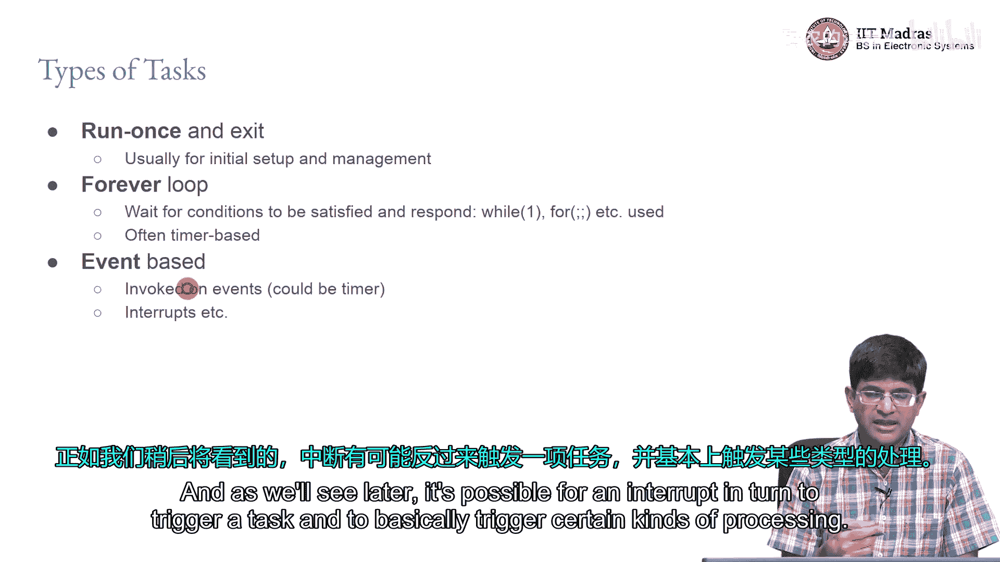

# 035：实时操作系统中的任务 🧵


在本节课中，我们将深入学习实时操作系统（RTOS）的核心概念，从“任务”开始。我们将探讨任务的定义、状态、管理方式，并通过代码示例来理解其工作原理。

## 任务是什么？

上一节我们介绍了RTOS的基本概念，本节中我们来看看任务。任务是一个独立的执行单元，有时也被称为线程。我们可以将其类比为程序中的主函数，或者一个负责创建其他任务的主线程。

## 任务代码示例

以下是使用FreeRTOS和Arduino框架编写的一个简单双任务程序示例。它展示了如何创建任务以及任务的基本结构。

```c
#include <Arduino_FreeRTOS.h>

void task1(void *pvParameters) {
    int count = 0;
    for (;;) {
        Serial.print("Task 1: ");
        Serial.println(count);
        count++;
        vTaskDelay(1000 / portTICK_PERIOD_MS);
    }
}

void task2(void *pvParameters) {
    int count = 0;
    for (;;) {
        Serial.print("Task 2: ");
        Serial.println(count);
        count++;
        vTaskDelay(500 / portTICK_PERIOD_MS);
    }
}

void setup() {
    Serial.begin(9600);
    xTaskCreate(task1, "Task1", 128, NULL, 1, NULL);
    xTaskCreate(task2, "Task2", 128, NULL, 1, NULL);
    vTaskStartScheduler();
}

void loop() {
    // 空循环，所有工作由任务完成
}
```

## 任务如何工作？

在上一节的示例中，我们看到任务函数内部是一个无限循环。任务通过调用 `vTaskDelay` 函数主动让出CPU控制权。这个函数告诉调度器：“我现在暂停，请在指定的毫秒数后唤醒我”。

关键点在于，当任务被再次唤醒时，它会从上次暂停的地方继续执行，而不是从函数开头重新开始。这通过保留任务的栈和上下文状态来实现。

## 任务的状态

一个任务在其生命周期中会经历多种状态。理解这些状态对于设计可靠的嵌入式系统至关重要。

以下是任务可能处于的主要状态：
*   **运行中**：任务正在CPU上执行。
*   **就绪**：任务已准备好运行，正在等待调度器分配CPU时间。
*   **阻塞**：任务正在等待某个事件（如定时器到期）或资源（如串口可用）。
*   **挂起**：任务被应用程序或操作系统主动暂停，需要被显式恢复。
*   **终止**：任务已完成其工作并退出。

## 任务状态转换

任务的状态并非固定不变，它们会根据事件和调度器的决策进行转换。下图描述了典型的状态转换流程：

```
创建 → 就绪 ↔ 运行
运行 → 阻塞 → 就绪
运行 → 挂起 → 就绪
运行 → 终止
```

从运行状态，任务可能因等待资源而进入**阻塞**状态，待事件发生后回到**就绪**队列。多个同时就绪的任务由调度器根据优先级决定谁进入**运行**状态。

## 任务管理函数

RTOS通过API提供任务管理功能。以下是核心函数及其作用：

以下是FreeRTOS中常用的任务管理函数：
*   **xTaskCreate**：创建新任务。它分配栈空间、初始化上下文并将任务添加到调度器的就绪列表。
    *   函数原型示例：`xTaskCreate(TaskFunction_t pvTaskCode, const char * const pcName, configSTACK_DEPTH_TYPE usStackDepth, void *pvParameters, UBaseType_t uxPriority, TaskHandle_t *pxCreatedTask)`
*   **vTaskDelete**：删除一个任务。将其从调度器列表中移除，并释放其占用的所有资源。
*   **vTaskDelay**：使调用任务阻塞指定的时间（以系统节拍数为单位）。这是实现周期性任务或协作式多任务的关键。

## 任务设计模式

根据不同的需求，任务可以有不同的设计模式：

以下是常见的任务执行模式：
*   **运行一次后退出**：例如系统初始化任务，完成设置后便终止。
*   **无限循环**：最常见的嵌入式任务模式。任务包含一个永久循环，在循环内执行工作并调用 `vTaskDelay` 或其他阻塞函数以让出CPU。
    *   代码模式：`for (;;) { /* 工作 */ vTaskDelay(...); }` 或 `while (1) { ... }`
*   **事件驱动**：任务的执行完全由外部事件（如中断）触发。

## 协作式与抢占式多任务

任务调度主要有两种方式：
*   **协作式多任务**：任务必须主动调用如 `vTaskDelay` 这样的函数来让出CPU。优点是开销小，但风险是如果一个任务不让出CPU，整个系统可能被阻塞。
*   **抢占式多任务**：调度器（通常基于高优先级定时器中断）可以强行暂停当前运行的任务，将CPU交给更高优先级的就绪任务。这保证了系统响应性，即使有任务出现bug。

## 总结




本节课中我们一起学习了实时操作系统中**任务**的核心概念。我们了解了任务是一个独立的执行线程，通过无限循环和阻塞调用来实现持续运行。我们探讨了任务的多种状态（运行、就绪、阻塞等）及其之间的转换。通过代码示例，我们看到了如何使用 `xTaskCreate` 创建任务，以及如何使用 `vTaskDelay` 实现周期性执行和协作。最后，我们区分了协作式与抢占式多任务调度机制。理解这些是构建复杂、可靠嵌入式系统的基础。