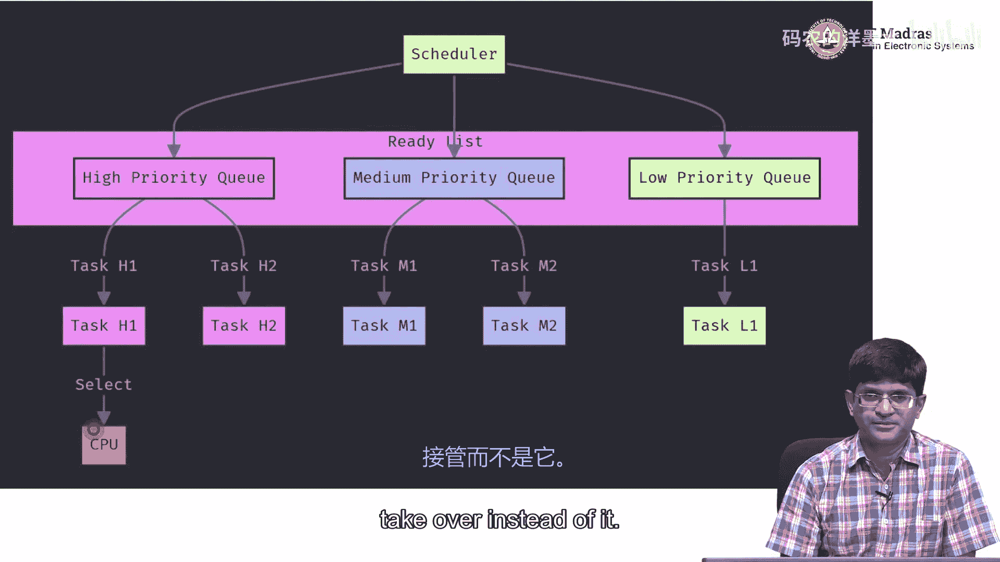
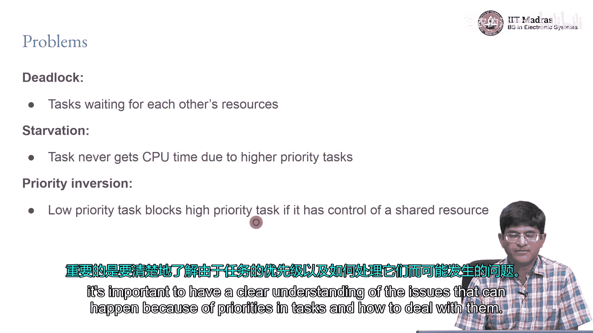

# 036：实时操作系统中的调度

## 概述
在本节课中，我们将要学习实时操作系统（RTOS）中任务调度的核心概念。我们将探讨多任务处理、并发与并行的区别、调度器的工作原理，以及调度过程中可能遇到的典型问题。

## 多任务处理与并发
上一节我们介绍了如何创建任务。本节中，我们来看看任务是如何被调度执行的。首先，我们需要更好地理解多任务处理这个概念。

多任务处理本质上是一种模拟能力，它模拟了多个任务可以同时运行的事实。这里强调“模拟”一词，是因为在实际系统中，可能根本没有多个物理处理器核心，而完全是在单个处理器核心上运行。然而，处理器通常以至少兆赫兹的速度运行，如今，即使是小型嵌入式处理器，达到数百兆赫兹甚至千兆赫兹也很常见。

当处理器工作在纳秒时间尺度上时，对于无法感知少于数十或数百毫秒时间尺度的人类来说，这意味着在人类的每一次反应之间，实际的计算机可以处理数百万个时钟周期。这意味着，处理器可以通过在任务之间足够快地切换，潜在地执行许多不同的任务，以至于人类甚至不知道后台发生了这样的事情。

在这个背景下，有两个非常重要的术语值得理解。

*   **并发**：基本上指的是以不同顺序运行多个不同程序单元的能力。右侧的图表展示了一个例子。该图显示的是在单核系统上的并发执行。我们有两个任务：任务A和任务B。任务A执行一段时间，然后停止，切换到任务B执行一段时间，再切换回任务A执行一段时间并完成，最后切换回任务B完成。这意味着到此时，任务A和任务B都已完成。只要整个持续时间在几毫秒的量级，对于最终用户来说，它们看起来就像是同时发生的。我无法分辨它们实际上被分割成这样的片段，对我来说，它们是同时发生的。

*   **并行**：建立在并发思想之上，换句话说，它要求操作之间具有并发性，然后说明如果我有两个物理处理器，我可以让任务A和任务B在时间上完全重叠，同时运行。因此，如果我取任何一个时间点，我实际上会发现任务A的某些指令和任务B的某些指令正在两个物理上可用的处理器上运行。

所以，并行性在某种意义上建立在并发性之上，它表示系统具有并发性，并且现在有两个不同的处理器。与其试图让用户以为它们在同时发生，不如实际让它们同时运行。因此，从操作系统的角度来看，并发性在某种意义上更为重要，你需要知道哪些任务可以并发运行。并行性则是性能所需，它让你能在给定时间内做更多事情。除非你具有并发性，否则拥有并行性是无用的，你无法并行运行两个任务，除非它们首先具有并发属性。

## 调度器的工作原理
现在，我们遇到了一个问题：我们有了并发任务，如何调度它们？我们之前看到的例子基本上就是，我们有两个任务在这里。考虑到它们基本上会进入休眠状态（这里调用了任务延迟函数），我可以将它们视为并发任务。任务启动，做一些工作，然后基本上说：“好了，现在我没事可做，就去休眠一段时间吧。” 因此，我可以认为这些是并发任务，它们都在开始时启动。我实际上并不等待任务1完成（事实上，这个任务没有完成的概念，它永远不会结束）。所以，如果我说“我必须等待任务1完成才能启动任务2”，那我就卡在这里了，永远无法超越任务1，也永远不会启动任务2。但关键在于，由于这些任务的创建方式和行为方式，它们实际上可以并发操作，这就是为什么当你运行这个程序时，你会看到任务1和任务2的消息交错出现。

因此，任务创建会设置两个任务，并将它们注册到调度器。然后，各个任务调用延迟功能，这基本上是将控制权交还给调度器，以允许其他任务运行。

那么调度器具体在做什么呢？调度器的工作毕竟也是一个函数。想一想发生了什么：`task_create`，`task_create`，所以任务1启动，它做一些事情，在此时，它将跳转到调度器代码的某个部分。在那个调度器代码中，调度器将做的是：它会有某种任务列表，但基本上会说：“好的，哪些任务准备就绪可以运行？” 准备就绪意味着它们的计时器已经到期，所以它们基本上在说：“好了，我已经等待了足够的时间，下次你有空时，请让我运行。” 如果有任务准备就绪，它将继续运行那个任务（任务1或任务2）。如果两者都准备就绪，它会按照某种优先级运行它们（在这个例子中，两者优先级相同，这没问题，它会以任意顺序选择并运行它们）。一旦两者都运行过并进入休眠状态，我们就回到调度器，现在它看到没有任务准备就绪。调度器也会等待，它只是坐在那里等待某些任务变为就绪状态。

这就是调度器的工作，它始终在查看当前准备就绪的任务列表。如果那里有任务就绪，它就将控制权交给那个任务，并等待该任务交回控制权。所以调度器也是一段代码，一个函数，就像我们编写的任何其他函数一样，但它在如何跳转到另一个函数（即到目前为止已部分执行的其他任务）的中间方面具有非常特定的行为。

## 计时器的作用
计时器是整个系统中非常重要的一部分，它是最常见的任务类型之一，或者更准确地说，是用于调度任务的最常见事件类型之一。特别是，你可以有周期性任务，我们之前看到的例子就是自动调度的，那些是周期性任务，在1000毫秒或500毫秒后，任务基本上会说“好了，再次调度我”。

我们可以用稍微不同的方式来实现，基本上可以说你可以有一种叫做“计时器回调”的东西。它的工作方式是我们创建一个计时器。这实际上会利用大多数微控制器中存在的硬件定时器外设。记住，定时器外设是独立于CPU运行的东西，CPU不需要实际计数或在计数器上加一，实际上有物理硬件在后台负责计数。因此，`timer_create` 函数实际上能够通过硬件抽象层和设备驱动程序，最终设置系统中的某个硬件定时器，以便在一定间隔后唤醒我。屏幕上可能看不到，但假设是几十或几百毫秒。这意味着，只要我能够创建这样一个计时器，启动它，基本上每次计时器到期时，这个计时器回调函数就会被自动调用。在这种情况下，每次持续时间到期时，它会打印出“timer trigger”。我没有展示这个实际运行的例子，但你可以编写这样的代码并进行测试。

再次强调，任务调度器仍然存在。任务调度器所做的是，它将计时器本身视为需要重复执行的任务，因此它确保该功能已经提供。而计时器反过来也可以用于触发其他类型的任务。计时器通常甚至可以被视为一个中断，它可以用来产生中断，正如我们稍后将看到的，中断反过来可以触发某些任务的执行。

## 调度器的内部结构
这张图是一个繁忙的图，它展示了调度器内部通常是什么样子。调度器的功能是维护其内部的一些数据结构，基本上是称为队列的东西。队列是我们将在不同上下文中更详细讨论的内容，但就所有实际目的而言，你可能对队列有一个直观的理解：当任务准备就绪时，它们一个接一个地排队。调度器所做的就是基本上从队列中取出一个任务并运行它。

如你所见，这里通常有不同优先级的队列，或者你可以有一个单一的队列，但它被称为基于优先级的队列，这意味着最高优先级的任务自动排到队列的前面。无论哪种方式，调度器需要做的是：在像这样有多个队列的场景中，它会首先检查高优先级队列。如果高优先级队列上有任何任务，它将从中取出一个任务，在CPU上运行它。一旦这个任务完成或交回控制权，它就会去取下一个任务。只有当高优先级队列变空时，它才会去中等优先级队列并开始运行那里的任务；只有当高优先级和中等优先级队列都变空时，低优先级队列才能运行。

无论你实际上明确拥有三个不同的队列，还是拥有一个单一队列（其中高优先级项目自动排到前面，这也可以作为一种数据结构高效实现），两者都是解决同一问题的不同方法。

所以，这就是调度器的工作：它基本上只需要管理这个队列，挑选出当前准备就绪的最高优先级项目并执行。这里“就绪”这个词实际上很重要。系统中可能有很多任务，其中许多可能在等待。它们可能在等待计时器到期，或者等待其他某种资源变得可用。这意味着队列中的项目只是那些如果获得机会就实际准备好上CPU运行的任务。这就是调度器必须做的全部：它必须首先检查队列中是否有任务在等待，然后切换过去实际运行那个任务。完全有可能有时没有任务等待运行，在这种情况下，基本上总有一个叫做“空闲任务”的东西，它的工作基本上就是等待一段时间，它通常是优先级最低的任务，这意味着任何其他任务在任何时候出现都可以立即中断或抢占空闲任务并取而代之。

## 调度中的问题
现在，在调度上下文中会出现几个问题。

*   **死锁**：例如，如果我有两个任务，一个在等待来自B的输入，而B又在等待来自A的输入，就会发生死锁。两个任务都在等待对方的东西，没有一个能够向前推进。这本质上是一个错误，是代码的问题，但这些错误不容易发现。有些场景可能相当复杂，甚至难以分析并判断“这里是否真的有可能发生死锁？”

*   **饥饿**：这尤其发生在低优先级任务上。饥饿的情况是，你总是有高优先级任务占用CPU，因此低优先级任务根本无法运行。有太多其他工作在进行，低优先级任务根本没有机会执行。如果发生这种情况，可能有多种可能性：一是你的优先级设置错误，你不应该将如此高的优先级分配给这么多其他任务；或者可能是你的高优先级任务有问题，因为它们执行时间太长；或者可能只是你选择的CPU对于你想要运行的系统来说不够强大，它无法足够快地完成高优先级任务来实际处理低优先级任务。

*   **优先级反转**：这是一个非常有趣的概念，这里不深入细节，但我强烈建议你阅读相关资料。有一个关于火星探路者号的非常有趣的轶事。那是NASA在1997年发送到火星的航天器，它有一个问题，即系统时不时会停止响应。那里发生的情况是，有一个低优先级任务阻塞了一个高优先级任务，因为低优先级任务基本上控制了一个资源。高优先级任务到来并抢占了低优先级任务，但低优先级任务没有放弃对资源的控制权。实际上情况比这更复杂一些：通常你可以通过说“一旦高优先级任务到来，低优先级任务也应该在中间将资源控制权交给高优先级任务”来绕过这个问题，但那里还有一个中等优先级任务实际上在中断低优先级任务。所以这是一个有点复杂的故事，但另一方面，在尝试为任务分配优先级时可能出错的事情方面非常有趣。因此，优先级反转本质上是一种场景，其中有一个高优先级任务和一个低优先级任务都依赖于一个共享资源。高优先级任务抢占了低优先级任务，但仍然被阻塞，因为它正在等待被低优先级任务锁定的资源。

现在，这个问题以及与之相关的各种其他问题，是人们随着时间的推移识别出的问题。有推荐的方法来避免此类场景并解决这类问题。因此，特别是当你开始使用此类系统进行实时编程时，清楚地理解由于任务优先级可能引发的问题以及如何处理它们非常重要。

## 总结
本节课中，我们一起学习了实时操作系统中任务调度的核心机制。我们理解了**并发**（多任务在单核上交替执行）与**并行**（多任务在多核上真正同时执行）的区别。我们深入探讨了调度器如何通过管理**就绪队列**，依据**优先级**选择并切换任务来工作。我们还认识了调度中可能出现的**死锁**、**饥饿**和**优先级反转**等关键问题及其成因。掌握这些概念是设计和调试可靠嵌入式多任务系统的基础。