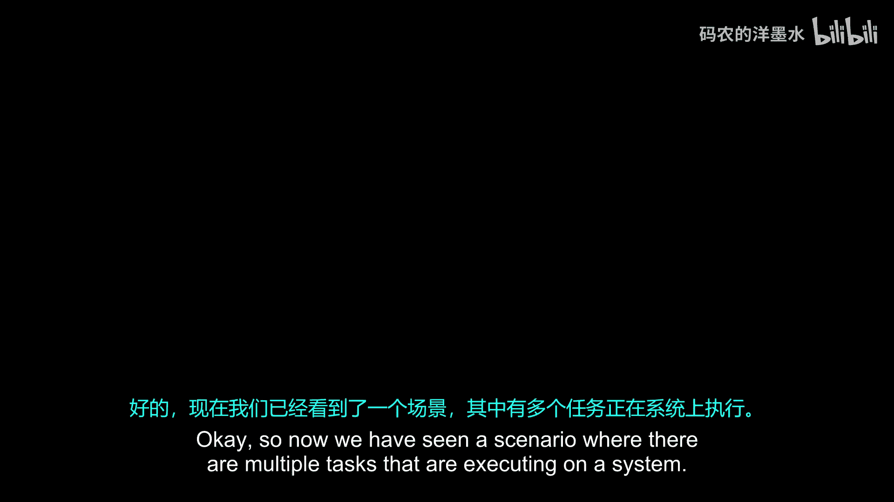
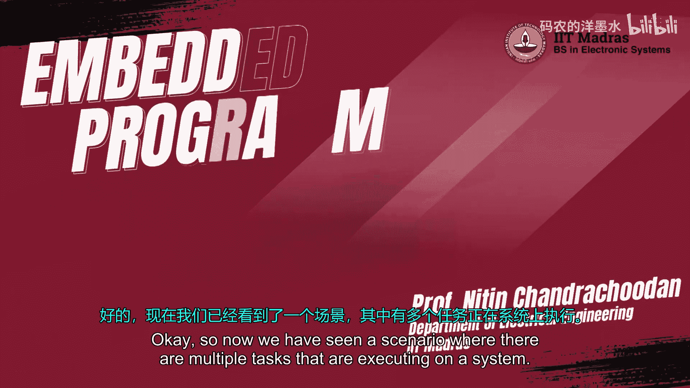
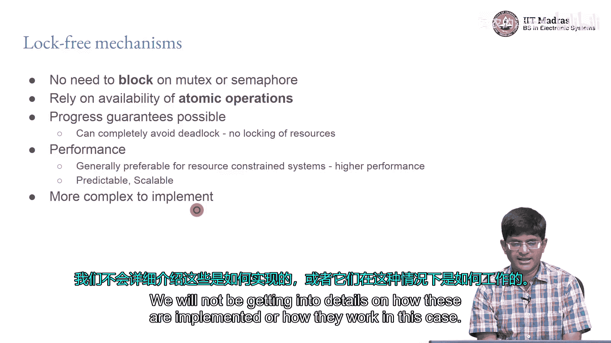

# 037：实时操作系统中的通信与同步 🔄





在本节课中，我们将要学习在实时操作系统（RTOS）中，多个任务之间如何进行通信与同步。当系统中有多个任务并行运行时，它们通常需要交换数据或协调对共享资源的访问。我们将探讨实现这些目标的基本机制，包括队列、信号量和互斥锁。

## 任务间通信的需求

上一节我们介绍了多任务执行的基本场景。本节中我们来看看任务间为何需要通信。

在嵌入式系统中，不同的任务通常负责不同的功能。例如，一个任务可能负责从传感器读取数据，而另一个任务可能负责将数据记录到网络、文件，或执行某些计算并驱动执行器（如打开空调）。将所有功能放在同一个任务中会违背使用RTOS的初衷。

然而，如果由不同的任务处理这些功能，那么它们之间如何通信呢？基本问题在于如何在不同任务之间共享数据。

## 共享数据的挑战

最简单的想法可能是让两个任务使用同一个变量。但我们知道，在C语言中，变量的作用域仅限于其定义的代码块内。这意味着在一个函数中声明的变量，在另一个函数中是不可见的。任务本质上就是C语言函数。

唯一能在函数间可见的变量是全局变量。虽然可以声明全局变量，但这会带来严重问题。如果多个任务同时尝试修改一个全局变量的值，可能会导致非常奇怪甚至严重错误的场景。

尽管如此，全局变量在嵌入式系统编程中比在常规C程序中更为常见。部分原因是，解决多任务同时修改全局变量问题的其他方案都会引入开销，而嵌入式系统通常无法承受这种开销。因此，在嵌入式程序中经常看到全局变量的使用，但这仍然不是最佳实践。如果可能，应优先选择其他方式。

## 队列：一种通信机制

那么，替代方案是什么？我们需要在不同任务之间显式地传递消息。这就引出了如何传递消息以及会遇到哪些问题。

我们需要同步，确保从一个任务发送的消息能可靠地到达另一个任务，同时还要保证消息按发送顺序到达目的地。

有多种解决方案可以解决这个问题。我们将更详细地探讨其中一种：队列。

队列是一种先进先出（FIFO）的数据结构。在C语言中，队列的实现相对简单，主要需要一段连续的内存空间和指针，并且可以实现得非常高效。

使用队列时需要注意：尝试从队列读取数据时要确保队列不为空，尝试向队列写入数据时要确保队列未满。只要通过特定的函数调用（如入队和出队）来操作队列，就可以在不过多增加计算开销的情况下，清晰地管理这些情况。

队列的本质保证了消息或数据被推入队列的顺序，与它们被拉出的顺序相同。

一个需要注意的问题是，队列作为数组，有其容量限制。如果不仔细选择队列大小，可能会遇到缓冲区溢出等问题，即队列已满时仍尝试写入数据。

以下是使用队列的一个代码示例。在FreeRTOS的上下文中，可以直接访问名为队列句柄的数据结构。主要使用两个函数：`xQueueSend` 和 `xQueueReceive`。

```c
// 示例：生产者任务向队列写入数据
void producerTask(void *pvParameters) {
    int data = 0;
    for(;;) {
        xQueueSend(xQueue, &data, portMAX_DELAY);
        printf("Produced: %d\n", data);
        data++;
        vTaskDelay(1000 / portTICK_PERIOD_MS); // 等待1秒
    }
}

// 示例：消费者任务从队列读取数据
void consumerTask(void *pvParameters) {
    int receivedData;
    for(;;) {
        xQueueReceive(xQueue, &receivedData, portMAX_DELAY);
        printf("Consumed: %d\n", receivedData);
        vTaskDelay(1500 / portTICK_PERIOD_MS); // 等待1.5秒
    }
}
```

在这个例子中，生产者任务每秒写入一个数据，消费者任务每1.5秒读取一个数据。由于消费者速度较慢，队列会逐渐填满。当队列达到其容量（例如5个元素）后，生产者将被阻塞，直到队列中有空间可用。这产生了一种“背压”效应，自动调节了生产者的速率，使其与消费者的处理能力匹配。

如果将消费者速度加快（例如等待15毫秒），而生产者保持每秒一次，那么队列将基本保持空状态，因为数据一产生就被立即消费。队列在这种情况下可以很好地处理任务执行时间的不确定性。

队列还支持非阻塞操作。如果队列已满，非阻塞写入操作不会等待，而是立即返回（可能丢失数据），这可以防止生产者任务被卡住，在某些场景下很重要。

## 同步与资源访问控制

现在我们已经看到了任务间如何通信。下一个问题是任务间的时间关系，即同步。我们希望两个任务能同步工作，例如，每当一个任务产生数据时，确保另一个任务被唤醒并执行某些计算。

特别是，可能存在两个任务试图使用同一资源的情况，如串口、网卡或需要共享的磁盘文件。在这些情况下，需要一种同步机制来协调访问。

互相同步可以看作是通信的一个方面。更常见的场景是控制对共享资源的访问，这是一种信号传递形式。它允许我们从一个任务向另一个任务发送信号，指示任务已完成、缓冲区中有数据可用，或者资源使用完毕可以移交。

有多种方法实现同步。我们之前看到的队列是一种：任务1将信息放入队列，任务2从队列中读取并处理。这适用于从一个地方向另一个地方推送数据。

但还有其他机制，我们将简要介绍其中两种：信号量和互斥锁。

## 信号量

信号量用于控制对共享资源的访问。假设任务3和任务4都需要访问一个共享资源。任务3需要显式地将信号量控制权交给任务4，然后任务4才能使用该资源。在此期间，即使任务3准备就绪，也不能使用该资源。任务4完成后，必须归还信号量，此时任务3或其他任务才能获取。

一个典型的类比是银行柜台。有三个出纳员（资源），顾客（任务）排队等候。当有出纳员空闲时，下一个顾客可以上前办理业务。信号量记录了当前正在使用的资源数量。

在操作信号量计数时，存在一个潜在问题：在检查计数值和增加计数值之间，可能会发生中断，导致资源状态意外改变。这就是所谓的竞态条件。

原子操作的概念由此引入。原子操作保证“检查值并递增”这一系列动作作为一个不可分割的指令执行。要么成功检查并递增，要么发现计数已满而无法递增，从而避免了竞态条件。

以下是使用信号量的一个简要代码示例：

```c
// 示例：使用信号量控制资源访问
SemaphoreHandle_t xSemaphore;

void resourceUser(void *pvParameters) {
    char *taskName = (char *)pvParameters;
    for(;;) {
        // 尝试获取信号量（获取资源）
        if(xSemaphoreTake(xSemaphore, portMAX_DELAY) == pdTRUE) {
            printf("%s acquired the resource.\n", taskName);
            // 模拟使用资源一段随机时间
            vTaskDelay((rand() % 1000) / portTICK_PERIOD_MS);
            printf("%s released the resource.\n", taskName);
            // 释放信号量（归还资源）
            xSemaphoreGive(xSemaphore);
        }
        // 短暂延迟后再次尝试
        vTaskDelay(1 / portTICK_PERIOD_MS);
    }
}
```

在这个例子中，我们创建了一个计数为3的信号量和四个任务。任何时候最多只有三个任务能“获取”资源（信号量），第四个任务必须等待，直到有任务“释放”资源（信号量）。运行模拟时，可以看到三个任务先获得资源，第四个任务等待，直到有资源被释放后它才能获取。

## 互斥锁

互斥锁是信号量的一个特例，用于实现互斥访问。它确保一次只有一个任务可以访问某个资源。需要访问资源的任务必须先“锁定”互斥锁，使用完后再“解锁”。

互斥锁与二进制信号量类似，但通常用于保护临界区代码或数据结构，确保在锁定期间没有其他部分能访问它。

```c
// 示例：使用互斥锁保护共享资源
SemaphoreHandle_t xMutex;

void sharedResourceAccess(void *pvParameters) {
    for(;;) {
        // 锁定互斥锁
        if(xSemaphoreTake(xMutex, portMAX_DELAY) == pdTRUE) {
            // 访问共享资源
            // ... 执行操作 ...
            // 解锁互斥锁
            xSemaphoreGive(xMutex);
        }
        vTaskDelay(10 / portTICK_PERIOD_MS);
    }
}
```

需要注意的是，等待互斥锁的任务并不总是按请求顺序获得访问权，它们必须持续等待，直到锁可用。

## 无锁机制

除了基于锁的机制（如信号量和互斥锁），还有无锁机制。它们依赖于原子操作的硬件支持，不需要在互斥锁或信号量上阻塞。在嵌入式系统中，无锁机制对于资源受限系统可能更可取，因为它们能提供更高的性能，并且可以完全避免死锁等情况。然而，它们的实现也更为复杂。

## 总结

本节课中我们一起学习了在实时操作系统中实现任务间通信与同步的关键机制。

我们首先探讨了任务间通信的需求和挑战，指出全局变量虽然常用但存在风险。接着，我们深入介绍了队列作为一种简单有效的通信方式，它能在任务间可靠地传递数据并管理速率不匹配的问题。

然后，我们转向同步问题，介绍了信号量和互斥锁。信号量用于控制对有限数量资源的访问，而互斥锁则确保对单一资源的互斥访问。我们还简要提到了原子操作在避免竞态条件中的重要性，以及更复杂的无锁机制。



这些机制是构建可靠、高效多任务嵌入式系统的基石。理解它们的工作原理和适用场景，对于嵌入式系统开发者至关重要。