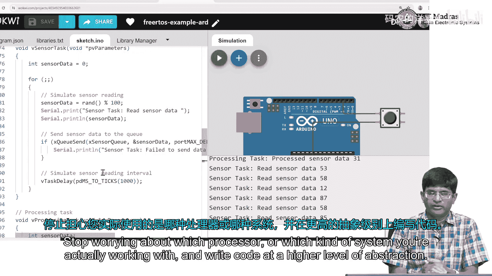

# 038：实时操作系统中的中断 🚨


## 概述
在本节课中，我们将学习中断在实时操作系统（RTOS）中的作用。我们将探讨如何通过中断服务程序（ISR）响应外部事件，以及如何将耗时的工作“推迟”给后台任务处理，以确保系统的实时性和响应性。我们还将通过一个具体的代码示例，展示如何将传感器数据采集、中断触发和任务处理结合起来，构建一个完整的系统。

---

## 中断在RTOS中的角色
上一节我们介绍了任务激活的各种机制，如定时器和任务休眠。本节中，我们来看看外部事件如何通过中断来激活任务。

中断主要由外部事件触发，例如按钮按下、定时器溢出或网络数据到达。CPU的中断处理系统会注册这些事件，并调用对应的**中断服务程序**。ISR通过**中断向量表**进行注册，该表存储了每个中断号对应的函数指针。

---

## 中断处理的核心原则
一个核心原则是：**中断服务程序必须尽可能短小精悍**。ISR应能快速执行完毕，以便系统能及时响应其他中断或事件。

然而，有时中断需要处理大量数据、进行复杂计算或做出决策。将这些工作全部放在ISR中会导致其运行时间过长，可能阻塞其他高优先级中断。

解决方案是采用**推迟中断处理**。即，ISR仅快速处理中断（如清除中断标志），然后将实际的工作“委托”给一个后台任务。这样，ISR能迅速退出，系统得以继续运行。

---

## 实现推迟处理的三种方法
以下是三种在RTOS中实现推迟中断处理的常见方法，它们都涉及ISR与任务间的同步或通信。

### 1. 使用信号量
在ISR中，我们可以“给出”一个信号量。RTOS通常提供特定的函数，允许ISR安全地操作信号量。

```c
// 在ISR中
xSemaphoreGiveFromISR(xSemaphore, &xHigherPriorityTaskWoken);
```

一个后台任务会持续等待并“获取”这个信号量。一旦成功获取，该任务便开始执行推迟的处理工作。

### 2. 使用队列
ISR可以快速读取数据（例如从ADC或UART），然后将数据发送到一个队列中。

```c
// 在ISR中
xQueueSendToBackFromISR(xQueue, &data, &xHigherPriorityTaskWoken);
```

一个处理任务则等待从队列中接收数据。一旦队列中有数据，任务便取出并进行耗时的计算处理。

### 3. 使用任务通知
任务通知是一种更轻量级的通信机制，它不传输具体数据，仅发送一个“事件已发生”的信号。

```c
// 在ISR中
xTaskNotifyFromISR(xTaskHandle, ulValue, eAction, &xHigherPriorityTaskWoken);
```

任务等待该通知。当通知到达时，任务便知道需要处理数据了（数据可能已由ISR存入共享内存或全局变量中）。

这三种方法都是有效的通信机制。选择哪种取决于具体场景的复杂度（即执行所需代码的时钟周期数）。ISR本身只做最少的工作：处理中断、清除标志，并通知其他任务开始工作。

---

## 综合示例：传感器数据采集与处理系统
现在，我们来看一个综合示例，演示如何利用RTOS的功能，将系统分解为多个协同工作的任务。

### 系统设计
该系统包含两个主要任务：
1.  **传感器任务**：模拟每秒读取一次传感器数据，并将生成的随机数写入队列。
2.  **处理任务**：从队列中取出数据并进行处理。但该任务不会在数据到达时立即处理，而是**等待一个信号量**。只有当中断（例如按钮按下）触发，ISR给出信号量后，处理任务才会被唤醒并一次性处理队列中积压的所有数据。

### 代码解析
以下是基于Arduino FreeRTOS库的核心代码结构：

```c
// 全局定义
QueueHandle_t xQueue;
SemaphoreHandle_t xSemaphore;
const int QUEUE_LENGTH = 5;

void setup() {
    // 1. 创建队列，用于传感器任务向处理任务发送数据
    xQueue = xQueueCreate(QUEUE_LENGTH, sizeof(int));
    
    // 2. 创建二进制信号量，用于ISR通知处理任务
    xSemaphore = xSemaphoreCreateBinary();
    
    // 3. 配置硬件中断（按钮按下触发）
    attachInterrupt(digitalPinToInterrupt(2), vISR_Handler, FALLING);
    
    // 4. 创建传感器任务和处理任务
    xTaskCreate(vSensorTask, "Sensor", STACK_SIZE, NULL, 1, NULL);
    xTaskCreate(vProcessingTask, "Process", STACK_SIZE, NULL, 1, NULL);
    
    // 5. 启动调度器
    vTaskStartScheduler();
}

// 中断服务程序
void vISR_Handler() {
    // 仅给出信号量，通知处理任务可以工作了
    xSemaphoreGiveFromISR(xSemaphore, NULL);
}

// 传感器任务
void vSensorTask(void *pvParameters) {
    int sensorValue;
    while(1) {
        sensorValue = random(100); // 模拟读取传感器
        xQueueSend(xQueue, &sensorValue, portMAX_DELAY); // 发送到队列
        vTaskDelay(1000 / portTICK_PERIOD_MS); // 休眠1秒
    }
}

// 处理任务
void vProcessingTask(void *pvParameters) {
    int receivedValue;
    while(1) {
        // 等待信号量（即等待按钮按下中断）
        xSemaphoreTake(xSemaphore, portMAX_DELAY);
        
        // 一旦收到信号量，就处理队列中所有积压的数据
        while(xQueueReceive(xQueue, &receivedValue, 0) == pdTRUE) {
            // 处理数据（此处仅为打印）
            Serial.print("Processing: ");
            Serial.println(receivedValue);
        }
    }
}
```

### 系统运行流程
1.  系统启动后，传感器任务每秒生成一个随机数并尝试写入队列。
2.  处理任务启动后，立即阻塞在 `xSemaphoreTake` 处，等待信号量。
3.  由于处理任务没有运行，队列很快被填满（容量为5）。传感器任务在尝试写入第6个数据时也会被阻塞。
4.  当用户按下按钮时，触发中断，ISR运行并给出信号量。
5.  处理任务立即获取到信号量，从等待中唤醒，然后进入循环，一次性将队列中的所有数据取出并“处理”（打印）。
6.  队列被清空后，传感器任务解除阻塞，继续生成并发送数据。
7.  如果用户频繁按按钮，数据会得到及时处理。如果用户长时间不按按钮，数据会在队列中累积，直到下次按钮按下时被批量处理。

这个示例展示了如何利用RTOS的中断、队列、信号量和任务管理功能，构建一个响应外部事件、具备数据缓冲能力的嵌入式系统。这种设计模式可以方便地移植到不同的硬件平台（如STM32），这正是RTOS通过提供统一编程接口所带来的强大优势。

---




## 总结
本节课中我们一起学习了：
1.  **中断的作用**：作为RTOS响应外部事件的关键机制。
2.  **ISR设计原则**：必须简短，复杂工作应推迟给任务处理。
3.  **推迟处理的三种方法**：使用信号量、队列或任务通知进行ISR与任务间的通信。
4.  **综合系统设计**：通过一个实例，学习了如何将传感器数据采集、中断触发和任务处理模块整合，构建一个职责分明、协同工作的RTOS应用。