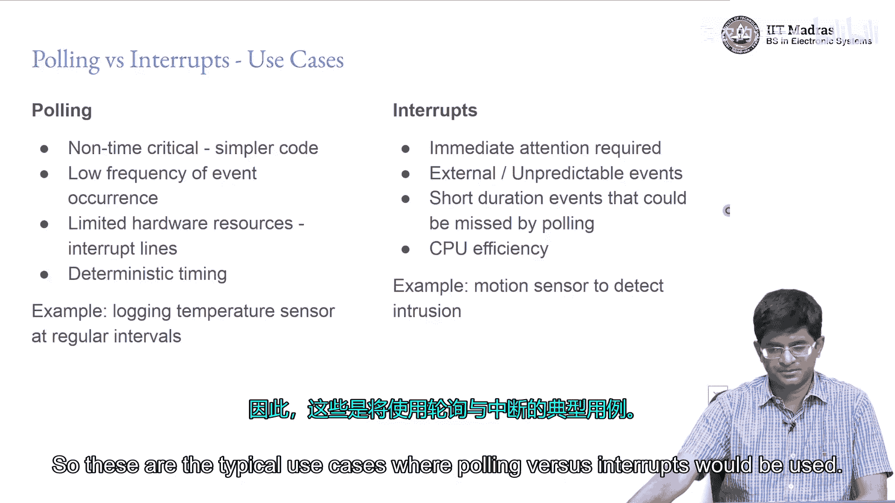

# 039：高效嵌入式系统


在本节课中，我们将学习一个广泛定义为“高效嵌入式系统”的主题。我们的目标是超越嵌入式系统的基本功能，探讨如何使其高效工作。这里的“高效”有多重含义，它可能意味着**快速**、**低功耗**或**占用最小面积**。我们将深入探讨设计和构建嵌入式系统的这些方面。

## 效率的定义

首先，我们需要对“效率”有一个更清晰的定义，以便明确我们的目标。核心思想是，构建嵌入式系统时资源是受限的，因此需要谨慎使用，并希望尽可能充分利用可用资源。

我们可以用以下功能定义来描述效率：
> **最大化系统性能，同时最小化系统内资源的利用率。**

这里的“资源”可以是多种事物：**CPU处理能力**、**花费的时间**、**占用的内存量**、**功耗**，甚至仅仅是**构建和部署系统的成本**。当我们谈论效率或优化特定指标时，会涉及多个方面。接下来，我们将探讨一些有助于实现这些目标的嵌入式系统设计方面。

## 两种输入处理方式：轮询与中断

在理解如何提高系统效率的背景下，我们首先需要了解嵌入式系统与外界交互的两种基本方式。这两种方式通常被称为接收外部输入的两种对比风格：**中断**和**轮询**。

让我们先理解这个常见的设计问题。我们通常需要监控某个条件、标志、状态寄存器等，并根据该条件执行特定功能。例如：**按钮是否被按下？** 或 **通信设备的缓冲区中是否有数据？** 或 **自上次检查以来是否经过了特定时间？** 每个条件都可以表示为标志、寄存器设置等。

从系统设计角度看，我们需要能够检查这个特定条件，并根据结果（如按钮按下或缓冲区有数据）做出反应，例如处理数据、点亮LED或改变系统状态。这种“检查某物并根据状态执行操作”的模式在嵌入式系统设计中非常常见，主要是因为我们需要与外部刺激（如人类或其他外部世界方面）进行交互。

### 轮询

最简单的方法是**轮询**。在轮询中，我们**反复检查值**。其算法非常简单：检查条件，如果满足则执行所需操作；如果不满足，则返回并再次检查。这有时被称为“忙等待”，即处理器除了等待条件满足外，几乎不做其他事情。

其代码结构通常如下：
```c
while (1) {
    if (digitalRead(buttonPin) == LOW) {
        // 执行操作，例如切换LED状态
        toggleLED();
    }
    // 如果不满足条件，则循环继续
}
```

**轮询的优点**：
*   **实现简单**：从编程角度看，逻辑直接。
*   **时序确定**：通过控制循环大小，可以精确控制对事件的响应速度，从而提供确定性的响应时间边界。

**轮询的缺点**：
*   **CPU占用率高**：CPU持续处于忙碌状态，反复执行检查、分支跳转等指令，无法执行其他有用任务。
*   **可能导致高功耗**：为了实现快速响应，CPU可能需要高速运行，从而消耗更多功率。
*   **可能错过事件**：如果事件发生在两次检查之间且持续时间很短，则可能被遗漏。
*   **处理多事件时复杂**：当需要监控多个以不同频率发生的事件时，轮询循环会变得复杂且低效。

### 中断

另一种方法是**中断**。中断会**打断程序的正常流程**，几乎可以在任何两条指令之间发生。当中断发生时，CPU会跳转执行一个称为**中断服务程序**的函数。

ISR通常像C语言函数一样编写，它是一段预先编译好并存储在内存中的代码。系统有一个**中断向量表**，它将每个中断号映射到对应的ISR起始地址。当中断发生时，硬件根据中断号查找该表，并跳转到相应的ISR。

中断的关键优势在于，**CPU在等待事件时可以执行其他任务，甚至进入休眠模式**。只有当事件实际发生并触发中断时，CPU才会被唤醒并执行ISR。

其代码结构示例如下：
```c
// 中断服务程序
void buttonInterrupt() {
    // 执行所需操作，例如切换LED状态
    toggleLED();
}

void setup() {
    // 初始化代码...
    // 将中断服务程序关联到特定的引脚和触发条件（如下降沿）
    attachInterrupt(digitalPinToInterrupt(buttonPin), buttonInterrupt, FALLING);
}

void loop() {
    // CPU可以在这里执行其他任务，或者进入低功耗模式
    doOtherWork();
    // 或者 sleep();
}
```

**中断的优点**：
*   **CPU使用效率高**：CPU可以在等待事件时执行其他有用工作或进入低功耗状态。
*   **响应迅速**：事件一旦发生，几乎可以立即得到响应（取决于中断延迟和ISR长度）。
*   **更适合处理多事件和短时事件**：可以更好地处理多个异步事件和持续时间很短的事件。

**中断的缺点**：
*   **代码更复杂**：ISR需要精心设计，必须**简短快速**。复杂的处理可能需要触发后台任务，增加了代码复杂度。
*   **调试更困难**：异步发生的中断行为难以模拟和调试。
*   **可能引发并发问题**：如优先级反转，即高优先级任务被低优先级任务阻塞。
*   **依赖硬件支持**：需要CPU具备中断硬件支持（现代CPU基本都具备）。

## 实践示例：轮询与中断的代码对比

上一节我们介绍了轮询和中断的基本概念，本节中我们来看看一个具体的Arduino代码示例，它演示了如何为同一个功能（按钮按下切换LED）实现两种模式。

以下是代码的核心逻辑概述：

1.  **定义与初始化**：定义了按钮引脚、LED引脚、LED当前状态以及一个决定工作模式的变量（`pollMode`）。
2.  **`setup()`函数**：初始化引脚方向（按钮上拉输入，LED输出）、串口，并打印操作提示。
3.  **`loop()`函数主体**：
    *   首先，它**使用轮询检查串口缓冲区**是否有数据。如果有数据且为字符‘1’，则切换到轮询模式（分离中断）；如果为字符‘2’，则切换到中断模式（附加中断）。这本身就是一个轮询的应用。
    *   然后，检查`pollMode`变量。如果为真（轮询模式），则**轮询检查按钮引脚状态**。如果检测到低电平（按钮按下），则切换LED状态，并打印“button pressed polling”消息，随后延时200毫秒以消除按键抖动。
4.  **中断服务程序**：`buttonInterrupt()`函数。当在中断模式下且按钮引脚出现下降沿时，此函数被调用。它切换LED状态并打印“button press interrupt”消息（注：在实际应用中，应避免在ISR内进行串口打印等耗时操作）。

通过串口发送‘1’或‘2’，可以动态切换系统处理按钮事件的方式，直观地比较两种模式的行为差异。

## 应用场景与总结

本节课我们一起学习了轮询和中断这两种处理外部输入的核心机制。那么，在实际项目中应如何选择呢？

以下是典型的使用场景：

**何时使用轮询？**
*   **代码简单优先**：当系统对时间不敏感，响应在10毫秒或50毫秒内均可接受时。
*   **事件频率低**：已知事件发生频率很低，不太可能因轮询间隔而错过事件。
*   **硬件资源受限**：中断引脚数量有限，且已被其他更关键的功能占用。
*   **需要确定性时序**：需要精确控制检查或执行操作的周期，例如定时采集传感器数据（如每秒钟读取一次温度传感器）。在这种情况下，甚至可以使用定时器中断来唤醒CPU进行“轮询式”采集。

**何时使用中断？**
*   **需要即时响应**：对事件的响应时间有严格要求，例如汽车障碍物传感器触发紧急刹车。
*   **处理不可预测或短时事件**：事件随机发生且持续时间极短，轮询可能完全错过，如某些报警信号。
*   **追求CPU效率与低功耗**：希望CPU在空闲时能执行其他任务或进入休眠/低功耗模式，以节省能耗，例如由电池供电的移动设备。

**总结**
轮询和中断是嵌入式系统与外界交互的基石。**轮询**以其简单性和确定性著称，适用于非实时或低频场景，但代价是CPU资源浪费。**中断**则提供了高效的CPU利用率和快速的事件响应能力，适用于实时性要求高、多事件处理或低功耗设计的系统，但带来了代码复杂度和调试难度的增加。




理解这两种模式的优缺点及其适用场景，是设计高效、可靠的嵌入式系统的关键一步。在实际项目中，根据具体的性能、功耗、成本和复杂度约束做出恰当的权衡与选择。