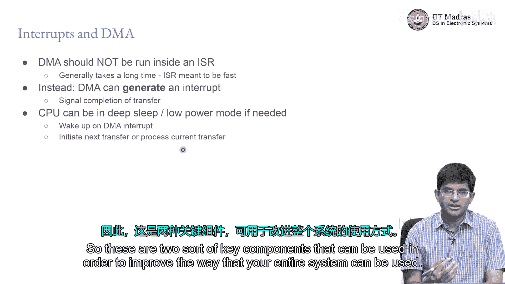

# 040：直接内存访问（DMA）🚀

在本节课中，我们将要学习直接内存访问（DMA）的概念。DMA是一种用于提高嵌入式系统效率的重要技术，它允许数据在内存和I/O设备之间直接传输，而无需中央处理器（CPU）的持续干预。

---

## 为什么需要DMA？🤔

上一节我们讨论了系统设计中的效率问题，本节中我们来看看一个值得深入理解的主题：直接内存访问。

为了理解为什么首先需要DMA，我们先回顾一下典型的CPU系统结构。系统总线是一组连接CPU与系统不同部分（如内存、I/O设备或其他外设）的导线。CPU被称为总线上的**主设备**，因为它负责在总线上发出地址。如果地址对应内存，则内存会响应请求，这使得内存成为总线结构中的**从设备**。同样，当CPU读写UART等外设时，它也是作为主设备进行访问。

这种方式的问题是，CPU需要参与每一次数据传输。例如：
*   UART接收数据时，CPU需要将数据复制到内存缓冲区。
*   发送数据块或从网络下载页面时，CPU需要将数据复制到发送缓冲区或等待接收缓冲区的数据。
*   视频显示时，如果屏幕需要每秒刷新60次，CPU若需为每个像素复制数据，则将没有时间处理其他任务。

在计算机早期，这确实是主要方式。但人们很快意识到这种方式不可行，无法扩展系统。在这些场景中，CPU仅在进行数据传输，其核心的算术逻辑单元（ALU）并未被使用。

---

## DMA如何工作？⚙️

替代方案是在总线上引入一个**次级主设备**，即直接内存访问（DMA）控制器。

DMA控制器可以作为总线上的次级主设备，这意味着它也可以开始在地址总线上生成地址。例如，它可以：
*   从内存读取数据。
*   如果目标是将一块数据写入Wi-Fi发射器，DMA能够生成读取地址，并执行写事务将数据输出到I/O设备。
*   更新屏幕时，DMA可以被指示从内存的特定区域（称为帧缓冲区）复制数据到视频屏幕外设。

在此期间，**CPU不参与**，甚至不需要使用总线。

---

## 总线仲裁与资源利用

现在出现了一个问题：总线上有两个主设备（CPU和DMA），但物理共享总线只有一条。谁在特定时间点使用总线？这就引入了**仲裁**的概念。

系统需要一个称为**仲裁器**的电路。它接收来自CPU和DMA的总线使用请求，根据优先级决定哪个主设备获得总线访问权。CPU通常被赋予很高的优先级。

DMA本质上是一个**仅用于内存的总线主设备**。它可以生成地址以及读写地址所需的控制信号。任何与内存相关的事务都可以由DMA控制器发起。

其好处在于实现了资源的最大化利用（不涉及计算，仅进行数据传输），并且支持更复杂的数据传输模式，例如可以进行**突发传输**，将大块数据从一个内存区域复制到另一个区域，或复制到外设。

---

## 如何配置DMA？🔧

DMA设备本身并不知道该做什么，因为它不执行计算，也没有自行获取和执行指令的能力。因此，除了作为总线上的次级主设备，DMA通常还有一个**从设备接口**。

这意味着CPU可以通过某个配置地址连接到DMA设备，并设置一些寄存器值来指示DMA如何工作。以下是典型的配置步骤：

1.  **设置源地址**：CPU写入一个寄存器，指定DMA应从哪个内存地址开始读取数据。
2.  **设置传输长度**：CPU写入一个寄存器，指定需要传输的字节数。
3.  **设置目标地址**：CPU写入一个寄存器，指定数据应写入的第一个目标地址（可以是内存地址或外设地址）。
4.  **启动传输**：CPU向一个控制寄存器写入特定值，命令DMA开始传输。

配置完成后，DMA便可以接管总线，生成实际传输数据所需的地址。在此期间，CPU通常可以处理其他工作。

---

## DMA与CPU缓存🔄

一个关键问题是：如果CPU同时也想访问内存怎么办？这涉及到**缓存**的概念。

CPU执行处理时，需要从主内存加载和存储数据。然而，CPU速度极快（时钟频率可达数百MHz甚至GHz），而主内存的访问延迟通常较高。为了解决这个速度不匹配问题，几乎所有计算系统都引入了**缓存内存**。

缓存位于CPU和主内存之间。当CPU需要从主内存访问数据时，它首先检查数据是否已在缓存中。如果在（缓存命中），数据直接从缓存返回，速度极快。如果不在（缓存未命中），缓存会向主内存发出请求，获取数据，然后提供给CPU。

缓存容量较小，但设计上可以实现极低的延迟（可能只需几个时钟周期）。这对于性能提升至关重要，尤其是当CPU重复执行循环指令或频繁访问同一数据区域时。即使是在低成本嵌入式系统中，少量缓存（几KB）也能显著提升性能。

考虑到CPU的指令或所需数据可能驻留在缓存中，这意味着CPU可能并不总是需要访问总线和主内存。因此，可以出现这样的场景：CPU从主内存读取一些数据后，便开始主要与缓存交互并进行计算。在此期间，DMA可以接管总线，将数据从一个地方传输到另一个地方。之后，CPU再回来访问主内存。

虽然这不能完全保证，但在实践中，这种模式通常能带来相当不错的整体性能。

---

## DMA的工作模式：周期窃取

DMA有多种变体，其中一种是**周期窃取DMA**。

在这种模式下，CPU配置DMA进行数据传输（例如，将X字节数据从地址A传输到地址B），然后继续处理其他工作。CPU本身也需要定期访问主内存（加载数据到寄存器、执行计算、存回数据等）。

以下是周期窃取DMA的工作流程：

1.  DMA模块持续请求总线访问。
2.  仲裁器接收来自CPU和DMA的请求信号。
3.  CPU通常被赋予最高优先级。如果CPU请求总线，仲裁器通常会将总线控制权授予CPU。
4.  然而，CPU并非总是在加载或存储数据。当CPU不使用总线时，就会出现“间隙”。
5.  一旦出现间隙，仲裁器便将总线控制权授予DMA。
6.  DMA利用这个间隙传输少量数据（例如几个字节），然后释放总线控制权。
7.  如果CPU之后不使用总线，DMA会再次请求并获取控制权，继续传输。

从宏观时间尺度（毫秒或几十毫秒）看，DMA看起来是在持续传输数据，而CPU也保持活跃。这种模式对于音频处理等实时应用非常有用。音频采样率通常不高（几十kHz），但要求实时性。如果错过将数据复制到发送缓冲区或处理缓冲区的截止时间，就会导致质量损失。通过周期窃取DMA，可以确保DMA利用CPU使用总线的任何间隙传输数据，从而很好地满足实时性要求。类似的方法也可用于网络或磁盘读写等场景。

---

## DMA与中断的关系🔗

我们之前讨论过中断。中断和DMA是相关的。

首先，**通常不应在中断服务程序（ISR）内运行DMA**。因为这违背了ISR应快速执行的原则，而DMA通常用于可能需要较长时间的大块数据传输。

另一方面，我们可以很好地以相反的方式结合使用它们：**DMA可以由CPU启动，并在传输完成后产生一个中断**。这是理想的使用案例。DMA被赋予一个长时间运行的后台任务（我们不知道具体需要多长时间，因为它可能需要从CPU“窃取”周期）。一旦传输完成，DMA通过中断唤醒CPU。CPU可以在DMA中断中决定下一步操作（例如，检查是否有新的数据块待处理，并启动下一次DMA传输）。

例如，在音频处理中，CPU可以积累几百个样本，然后启动DMA将这些样本传输到另一个位置。在DMA传输期间，CPU可以处理其他任务或进入低功耗状态。当DMA完成传输并产生中断时，CPU被唤醒，检查总线上的新样本，并启动下一次传输。

因此，中断和DMA可以很好地协同工作，结合使用可以实现硬件资源的高效利用。它们是提升整个系统使用效率的两个关键组件。

---

## 总结📚

本节课中我们一起学习了直接内存访问（DMA）的核心概念。我们了解到DMA作为一种次级总线主设备，能够在不占用CPU资源的情况下，直接在内存与I/O设备之间传输数据，从而极大提升了系统效率。我们探讨了总线仲裁的必要性、DMA的配置方法、其与CPU缓存的协同工作原理，以及周期窃取这一重要工作模式。最后，我们明确了DMA与中断的关系：应避免在ISR内启动DMA，但可以利用DMA完成中断来高效地协调CPU与DMA的工作。掌握DMA是设计高效、实时嵌入式系统的关键技能之一。