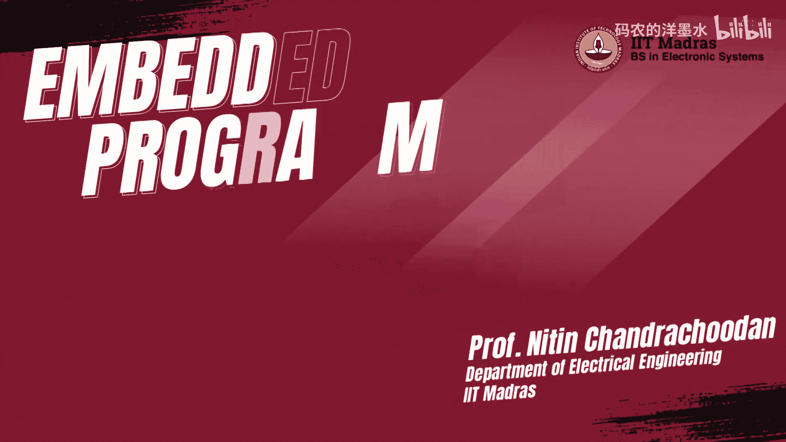
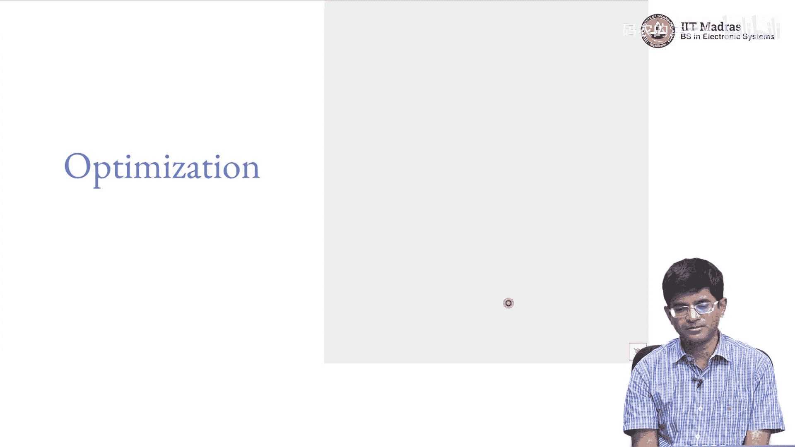

# 041：电子系统中的电源管理 🔋

在本节课中，我们将要学习嵌入式系统设计中一个至关重要的方面：电源管理。我们将探讨功耗的来源、如何估算系统功耗，以及如何通过硬件和软件策略来优化功耗，以延长电池供电设备的运行时间。

## 功耗的来源

上一节我们介绍了电源管理的重要性，本节中我们来看看功耗是如何产生的。在电子系统中，功耗主要分为两大类：动态功耗和静态功耗。

### 动态功耗

动态功耗源于电路内部晶体管或逻辑门的开关活动。每当一个信号从逻辑0切换到逻辑1（VDD）或反之，都需要对相关的寄生电容进行充放电。这个过程会从电源汲取电流，从而消耗能量。

以下是影响动态功耗的关键因素：
*   **电路复杂度**：电路中的晶体管或逻辑门越多，潜在的开关活动就越多，功耗通常也越高。
*   **工作频率**：系统时钟频率越高，单位时间内的开关次数就越多，功耗也越高。

动态功耗的简化公式可以表示为：
`P_dynamic ≈ α * C * V^2 * f`
其中，`α` 是开关活动因子，`C` 是负载电容，`V` 是供电电压，`f` 是时钟频率。

### 静态功耗

静态功耗，也称为泄漏功耗，是指即使晶体管处于关闭状态，从电源到地之间仍然存在的微小电流。这种泄漏电流是由半导体工艺的物理特性决定的，无法完全消除。

以下是关于静态功耗的关键点：
*   **始终存在**：只要系统通电，泄漏功耗就会持续存在，与CPU是否工作、时钟是否运行无关。
*   **电池自放电**：电池本身也存在内部电阻和泄漏，即使不连接任何负载，电量也会随时间缓慢耗尽。

## 系统级功耗分析

理解了基本概念后，我们来看看在嵌入式系统层面，哪些组件是主要的耗电源。

以下是嵌入式系统中常见的功耗组件：
*   **CPU核心**：执行计算任务时功耗较高，尤其是在高频下。
*   **时钟树**：生成和分配时钟信号的电路本身也会消耗可观的功率。
*   **输入/输出引脚**：驱动片外信号需要驱动较大的电容，功耗相对较高。
*   **存储器**：读写数据时，存储单元和总线的开关活动会产生动态功耗。
*   **外设与传感器**：这些是嵌入式系统的核心，其数据采集和通信过程都涉及开关活动。
*   **显示单元**：尤其是背光LED或需要高频刷新的屏幕，往往是系统中最耗电的部分之一。
*   **电源管理电路**：如稳压器，在转换电压时自身也存在效率损耗。

因此，设计低功耗系统不仅仅是选择一个低功耗的微控制器，而是需要对系统中每一个组件进行审视和优化。

## CPU功耗模式

为了优化功耗，现代CPU通常提供多种工作模式。

以下是常见的CPU功耗模式：
*   **活动模式**：CPU全速运行，性能最高，功耗也最高。用于需要快速响应的计算任务。
*   **空闲/睡眠模式**：CPU暂停执行或降低频率，关闭未使用的外设。此时功耗（主要是静态功耗）远低于活动模式。通过让CPU在大部分时间处于睡眠模式，可以显著降低平均功耗。
*   **超低功耗模式**：一些微控制器（如TI MSP430系列）提供特殊的深度睡眠模式，其静态功耗极低，可使设备依靠小型电池运行数月甚至数年。

## 估算电池寿命

现在，我们结合软件行为来估算系统的整体功耗和电池寿命。假设我们设计一个由微控制器、传感器和无线电台组成的系统。

以下是估算平均功耗的步骤：
1.  **获取参数**：从数据手册中查找每个组件在活动模式和睡眠模式下的功耗值。
2.  **确定占空比**：根据程序逻辑，确定每个组件在特定时间周期内处于活动状态的时间百分比。这由程序员通过控制睡眠、唤醒和通信时机来决定。
3.  **计算平均功耗**：对每个组件，使用公式 `平均功耗 = (活动功耗 × 占空比) + (睡眠功耗 × (1 - 占空比))` 进行计算。
4.  **汇总系统功耗**：将所有组件的平均功耗相加，得到系统的总平均功耗。

以一个简化示例为例：
*   MCU：活动功耗 50mW，睡眠功耗 1mW，占空比 20%。
*   传感器：活动功耗 10mW，睡眠功耗 0.5mW，占空比 5%。
*   电台：活动功耗 100mW，睡眠功耗 1mW，占空比 2%。

计算可得系统总平均功耗约为 13.9mW。

**注意**：电池需要能提供所有组件同时活动时的峰值电流（本例中为 50+10+100=160mW），但决定续航时间的是平均功耗。

## 电池容量与续航估算

电池容量通常以毫安时（mAh）标注，例如一块 3.7V、400mAh 的电池。

其能量容量约为：
`能量 (mWh) = 电压 (V) × 容量 (mAh) = 3.7V × 400mAh ≈ 1480 mWh`

对于平均功耗为 13.9mW 的系统，理论续航时间可估算为：
`续航时间 (h) ≈ 电池能量 (mWh) / 系统平均功耗 (mW) ≈ 1480 / 13.9 ≈ 106 小时`

这是一个粗略估算，实际续航会受到电池放电特性、环境温度和电路效率等因素影响。

## 降低功耗的策略

最后，我们来看看如何从硬件和软件层面降低系统功耗。

### 硬件策略

以下是关键的硬件级功耗优化选择：
*   **组件选择**：选择支持多种低功耗模式且满足需求的微控制器。选择高效的显示技术（如电子墨水屏）和无线通信协议（如蓝牙低能耗）。
*   **电路技术**：利用CPU提供的时钟门控、动态电压频率调节等功能，在不需要高性能时降低频率或关闭模块。
*   **电源设计**：选择高效率、低静态电流的电源稳压器（如开关稳压器通常比线性稳压器效率更高）。

### 软件策略

软件对功耗的控制主要体现在优化“占空比”上。

以下是有效的软件优化方法：
*   **优化I/O操作**：减少不必要的传感器读取次数；将通信数据打包批量发送，以减少电台的启动次数和时间。
*   **使用高效算法**：例如，使用快速傅里叶变换代替离散傅里叶变换；用移位和加法操作代替乘法。
*   **管理内存**：减少动态内存分配的次数和规模。
*   **明智使用中断**：通常，使用中断让CPU在等待事件时进入睡眠，比轮询更省电。但需注意避免中断频率过高，否则频繁唤醒CPU反而会增加功耗。有时，定期唤醒并检查所有传感器可能比为每个传感器设置中断更高效。

## 总结

本节课中我们一起学习了嵌入式系统中的电源管理。我们了解了动态功耗和静态功耗的来源，认识了系统级功耗的构成。我们学习了如何通过数据手册参数和程序占空比来估算系统的平均功耗和电池续航时间。最后，我们探讨了从谨慎选择硬件组件到优化软件算法等一系列降低功耗的策略。掌握这些知识，对于设计高效、长续航的嵌入式产品至关重要。