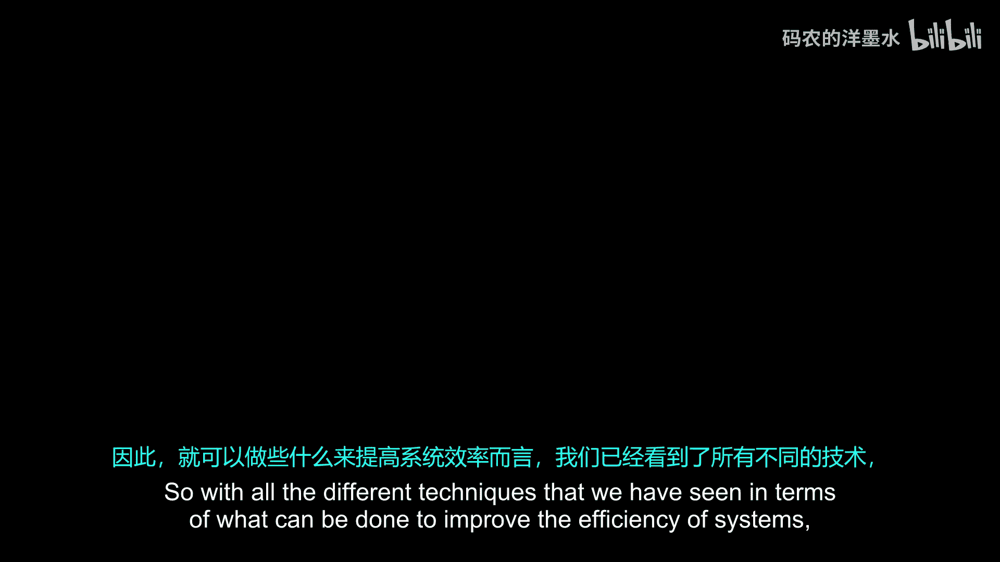
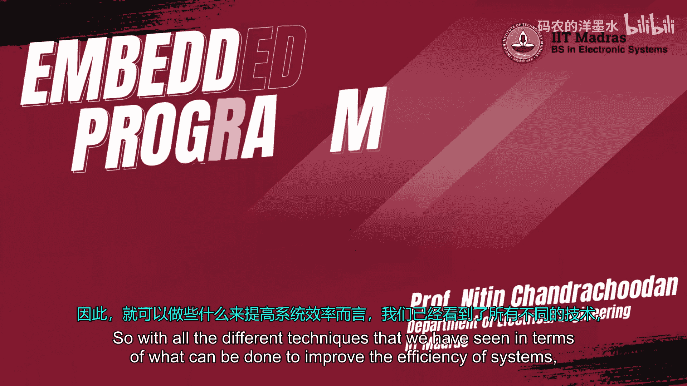
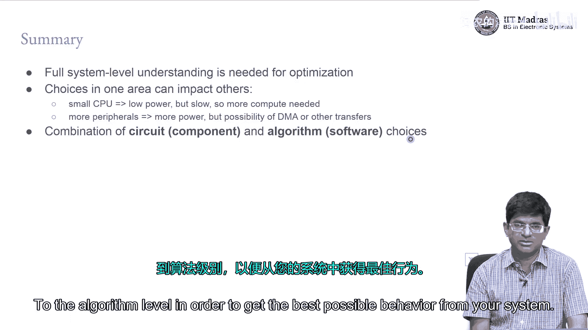

# 042：嵌入式系统性能与效率的优化策略 🚀





在本节课中，我们将学习如何优化嵌入式系统的性能与效率。我们将探讨从算法选择到代码实现，再到系统级权衡的各种优化策略，目标是让系统运行更快、占用资源更少、功耗更低。

## 概述 📋

优化是一个使某物（如设计、系统或决策）尽可能完美、功能完善或有效的过程或方法。在嵌入式系统领域，我们通常关注优化速度、面积（或内存占用）、电池寿命/功耗以及系统总成本。我们将探讨实现这些目标的各种“旋钮”和关键方法。

## 算法优化 🧮

上一节我们介绍了优化的总体概念，本节中我们来看看最首要的优化手段：算法优化。它指的是为手头的任务选择最高效的算法。

以下是几种常见排序算法的性能对比示例：

```c
// 冒泡排序示例
void bubbleSort(int arr[], int n) {
    for (int i = 0; i < n-1; i++) {
        for (int j = 0; j < n-i-1; j++) {
            if (arr[j] > arr[j+1]) {
                swap(&arr[j], &arr[j+1]);
            }
        }
    }
}
// 时间复杂度：O(n²)

// 插入排序示例
void insertionSort(int arr[], int n) {
    for (int i = 1; i < n; i++) {
        int key = arr[i];
        int j = i - 1;
        while (j >= 0 && arr[j] > key) {
            arr[j+1] = arr[j];
            j--;
        }
        arr[j+1] = key;
    }
}
// 时间复杂度：O(n²)

// 快速排序示例（通常通过库函数调用）
// 时间复杂度：O(n log n)
```

通过实验对比，当排序元素数量（n）为1000时，快速排序比插入排序快约6倍；当n为10000时，快约100倍。这表明算法选择对运行时间有巨大影响。即使同为O(n²)复杂度的算法，插入排序通常也比冒泡排序快约3倍，因为它平均执行更少的交换操作。

算法选择不仅影响速度，也影响功耗。更快的算法可能允许CPU更快地进入深度睡眠，从而在总体上节省能量。此外，减少内存访问次数的算法也能降低功耗，因为每次内存访问都会激活总线和相关引脚，消耗能量。

## 内存优化 💾

在了解了算法层面的优化后，我们转向另一个关键资源：内存。内存优化关注如何高效地使用RAM和Flash等存储。

以下是需要考虑的几个方面：

*   **存储介质选择**：将频繁变化的数据直接写入Flash通常是耗能且低效的，应优先使用RAM。
*   **数据结构和缓存**：设计能完全放入CPU缓存的数据结构，可以显著减少访问主存的能耗和时间。
*   **数据类型选择**：使用能满足需求的最小数据类型。例如，使用`int8_t`（8位整数）通常比`int32_t`（32位整数）更节省空间和总线带宽。避免不必要的浮点数运算，因为浮点单元通常更耗电。
*   **代码精简**：移除未使用的代码和函数，减小最终二进制文件的大小，使其能适配资源受限的嵌入式设备。

## 代码优化 ✨

除了算法和内存，代码本身的编写方式也至关重要。编译器在其中扮演了重要角色。

以下是一些常见的代码优化技术：

*   **循环展开**：减少循环控制开销。编译器通常可以通过标志（如`-funroll-loops`）自动执行此优化。
    ```c
    // 优化前
    for (int i = 0; i < 100; i++) {
        process(i);
    }
    // 手动循环展开示例（展开因子为4）
    for (int i = 0; i < 100; i += 4) {
        process(i);
        process(i+1);
        process(i+2);
        process(i+3);
    }
    ```
*   **定点运算替代浮点**：在精度允许的情况下，用整数运算模拟小数运算，可以大幅提升速度并降低功耗。
*   **编译器优化标志**：充分利用编译器提供的优化选项，例如`-Os`（优化代码大小）、`-O2`/`-O3`（优化运行速度）等。理解这些标志能帮助你生成更高效的代码。
*   **消除冗余计算**：手动或依靠编译器识别并消除重复的计算过程。
*   **面向特定硬件的优化**：针对目标处理器的特定指令集（如ARM Cortex-M的Thumb指令）或硬件加速模块进行优化。好的编译器能针对特定处理器家族生成最优代码。

## 输入/输出与功耗优化 ⚡

系统的输入/输出和功耗管理是嵌入式优化的核心环节。

以下是相关的优化策略：

*   **使用DMA**：对于大量数据搬运，使用直接内存访问代替CPU轮询，可以解放CPU去处理其他任务或进入低功耗模式。
*   **功耗管理技术**：
    *   利用处理器的多种睡眠模式。
    *   在性能满足时降低时钟频率。
    *   关闭未使用的外设模块。
*   **优化工作周期**：通过优化算法和代码结构，减少各组件处于激活状态的时间，增加睡眠时间，从而降低平均功耗。

## 系统级权衡与总结 🎯

本节课中我们一起学习了多种嵌入式系统优化策略。最后需要强调的是，优化是一个需要系统级视角的任务。

**优化 = 速度、面积、功耗、成本的权衡**

你不能孤立地优化某一个方面而不考虑其对其他方面的影响。例如：
*   选择一款简单、低功耗的CPU，但如果它缺乏浮点单元，而你不得不用软件模拟浮点运算，可能会抵消其功耗优势，甚至使性能更差。
*   集成更多外设可能增加静态功耗，但像DMA这样的外设又能提高数据搬运效率，从而在系统层面节省时间和能耗。




因此，构建一个高效优化的嵌入式系统，不能仅仅依赖于选择某个优秀组件或编写一段优质代码。它要求开发者具备从电路特性到算法行为的系统级知识，并在设计过程中进行全局权衡，才能最终使系统达到最佳的综合表现。