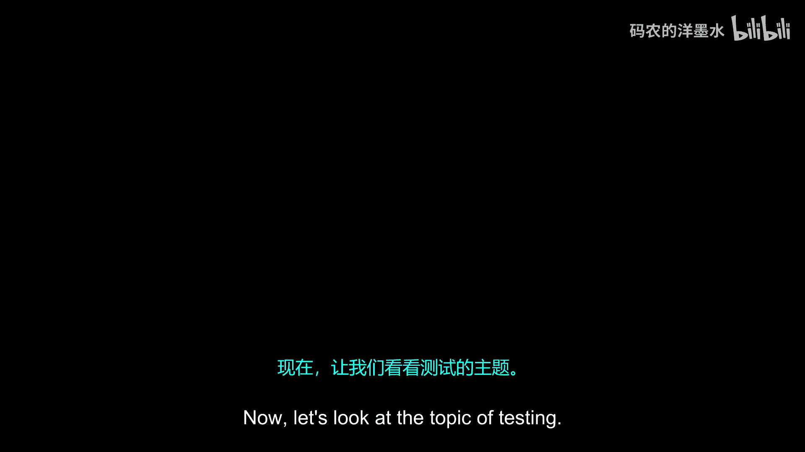
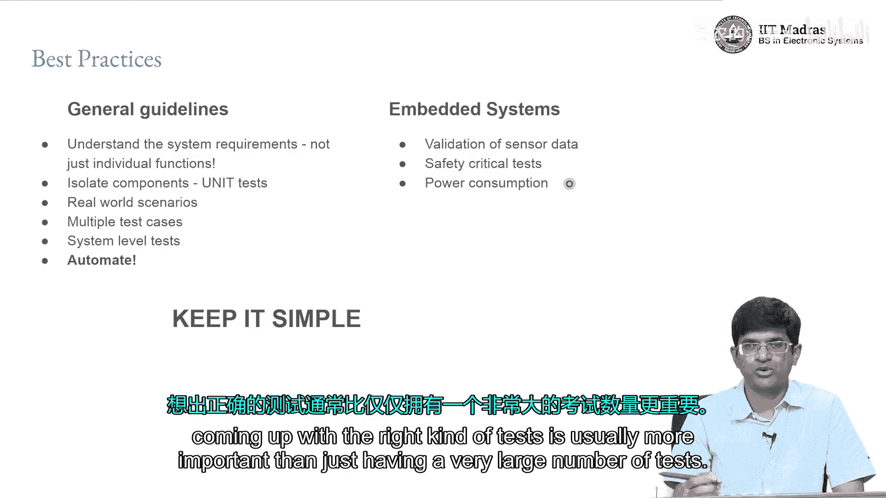

# 043：嵌入式软件开发中的测试策略与最佳实践 🧪




在本节课中，我们将要学习嵌入式软件开发中的测试策略与最佳实践。我们将探讨为何需要进行测试，以及如何通过单元测试、集成测试和系统级测试等方法来确保代码的可靠性和正确性。同时，我们也会了解一些专门针对嵌入式系统的测试方法，如硬件在环测试。

## 为何需要测试代码？

首先，我们需要理解为何要对代码进行测试。编写代码后，有人认为运行代码本身就是测试过程。然而，这通常太晚，无法及时发现错误。我们不希望在实际运行环境中才发现错误。

测试的目的是验证基本功能，并确保即使在极端环境（如未预料到的温度变化）或输入存在不确定性（如未预期的异常行为）的情况下，程序仍能按预期运行。我们需要定义正确的行为，并确保程序能保证这种行为的正确性。

## 如何进行测试？

接下来，我们来看看如何进行测试。我们关注的是如何测试代码，以及哪些部分可以自动化。任何需要手动检查代码每个部分的方法本身都容易出错。

### 单元测试

以下是单元测试的基本概念。

*   **定义**：单元测试将每个函数作为一个独立的单元进行测试。理想情况下，应在编写函数之前编写测试。这在软件工程领域有时被称为**测试驱动开发**。
*   **实践**：即使不完全遵循测试驱动开发，在开始编写代码之前，先在脑海中构思或正式写下测试用例，始终是一个好习惯。因为当你编写一个函数时，你应该清楚输出应该是什么样子，这样当你看到最终输出时，就能判断其是否正确。
*   **回归测试**：一个重要的变体是，一旦为函数编写了测试，即使在后续对整个代码库进行修改后，这些测试也不应该失败。这有时也被称为**回归测试**。我们需要确保不会出现旧行为的回归或错误行为。

通常，对于任何相当复杂的软件系统，最终都会有一个庞大的测试套件。它包含大量的小测试，每个测试本身应该运行得非常快，并且易于设置、运行和理解。测试必须快速的原因是，我们通常希望自动化这个过程。

在软件工程项目中，通常的做法是建立一个自动化系统。例如，每当有人将一组更改签入版本控制仓库（如使用Git或GitHub）时，所有测试都应该自动运行。或者，也可以设置一个场景，例如每晚触发系统运行全部测试。这样做的目的是确保在第二天人们回来工作时，能够清楚地知道之前通过的测试是否因为前一天推送的更改而失败。

### 模拟函数

上一节我们介绍了单元测试的基本概念，本节中我们来看看一个重要的测试工具：模拟函数。

让我们看一个代码示例。假设你正在开发一个温度监控系统，有两个函数：一个用于读取温度，另一个用于设置警报。

```c
// 示例函数声明
int read_temperature(void);
void set_alarm(int temperature);
```

如果我想测试功能，我可能不会直接测试`read_temperature`函数本身。实际的`read_temperature`可能会从传感器读取一个值。同样，`set_alarm`的行为可能需要去打开一个灯或LED。在硬件上测试这些功能很困难。

因此，我可以做的是声明几个其他的辅助函数，称为**模拟函数**。模拟函数的目的是说，在进行测试时，如果我调用`read_temperature`，就使用这个模拟的`read_temperature`函数。模拟的`read_temperature`行为更简单，它只是返回一个已知值。模拟的`set_alarm`可能只是将警报设置为已知状态并返回值。

这很有用，因为当我运行测试时，我可能没有能力实际去读取寄存器，我可能不是在硬件上运行，而是在模拟这个函数在更大系统上下文中的行为。

在实践中，我们可以将`read_temperature`视为一个函数指针。这样，在运行测试时，我可以让这个函数指针指向模拟的`read_temperature`函数；而在运行实际系统时，则让它指向实际从寄存器读取数据的`read_temperature`函数。

我并不是在单独测试`read_temperature`或`set_alarm`函数本身，我是在测试当这些函数被执行时，程序的其他条件或其他部分如何运行。例如，我可以有一个“温度低于阈值”的测试，使用一个返回低温的模拟函数，来找出系统在接收到低温时的行为。

总而言之，模拟函数用于替换将要执行的实际函数或将要运行的实际数据，用某种模拟的、伪造的数据或功能来代替，这些足以测试你感兴趣的部分。

### 单元测试、集成测试与系统测试

现在，让我们更深入地探讨不同类型的测试。

*   **单元测试**：涉及验证代码的独立单元（如单个函数或模块）在**与系统其他部分隔离**的情况下是否按预期运行。单元测试在某种意义上就是隔离测试。例如，一个模数转换器（如温度传感器），你想检查它对于不同输入电压是否返回正确的值。我们可以测试一个函数，它接收一个数字作为输入，将其转换为对应的实际温度浮点值并返回。通过输入可能来自寄存器的不同读数，测试其转换是否正确，确保没有溢出，范围正确，转换函数的线性度正确等。重点是，我们关注的是一个单一的、自包含的函数。
*   **集成测试**：通常在你有多个代码单元，并试图让它们协同工作时进行。你已经单独测试了不同的单元函数，现在尝试将它们集成在一起。例如，你有一个直流电机，编写了一个PID（比例-积分-微分）控制器（这是嵌入式系统中用于控制电机的常见控制机制）。这意味着控制器内部运行着某种算法，还有别的东西实际控制直流电机，将PID算法生成的值输出给电机，然后会有传感器检查电机速度并作为反馈。你有多个不同的函数，想把它们全部集成在一起，并进行某种测试，以告诉你整体功能是否正常工作。
*   **系统级测试**：将整个系统提升一个层次。基本上是说，我正在构建整个系统。例如，你有一个使用多个传感器和执行器的机器人手臂。你的系统级测试可能是：如果某个特定位置有一个球，我希望机器人手臂能正确地去拾取它。根据定义，系统级测试比单元级测试要复杂得多，运行时间可能更长，并且通常不会像单元测试那样频繁地运行。

### 嵌入式系统的特殊考量

理解嵌入式系统总是面向最终用户这一点很重要。这意味着用户的接受度是你需要考虑的一个非常重要的部分。嵌入式系统通常不是为你自己私人使用而设计的，你是为他人设计的，那个人就是最终用户，他们是利益相关者，也就是你试图构建的产品的潜在客户。

因此，你可能需要进行更复杂的测试。客户可能感兴趣的是：机器人手臂是否真的能从特定位置拾取肥皂，将其放入正确的包装中，妥善安装好，然后关闭包装。这就是他们的特定用例。但验收测试基本上是必需的，并且需要直接来自系统最终用户的输入。

特别是在嵌入式系统领域，有所谓的**硬件在环测试**。到目前为止我们所做的很多测试可能只是软件测试，可以自动化。但嵌入式系统最终很可能要与现实世界交互。例如，你可能有一个交通灯系统，你希望模拟真实的交通模式，但即使是这样的模拟也不是硬件在环。你实际上希望它能与直接来自系统的潜在输入一起运行。或者你可能有一个电机控制，不是使用电机模型，而是将实际的电机接入系统，将PID控制输出直接馈送给它，让传感器给你返回与电机速度相对应的数据。因此，测试环路中存在的实际硬件确保了测试的输入和条件是真实的，你无需担心模拟函数是否准确捕捉了真实场景。这对于嵌入式系统来说尤其重要，甚至比通用软件更重要。

## 测试最佳实践

可以想象，有很多最佳实践。这里我将简要回顾一下，而不是深入细节。

以下是通用指南。

*   **理解系统需求**：你不仅需要理解分配给人们开发的各个功能，还需要理解你在什么背景下开发这样的系统，以及潜在问题可能从哪里产生。
*   **隔离单元测试**：根据定义，单元测试基本上是在隔离状态下完成的。你需要隔离整体设计的各个组件，并能够单独测试它们。
*   **考虑真实场景**：尽可能尝试思考能反映系统预期工作条件的真实世界场景，这样你的测试才是现实的。
*   **拥有多个测试用例**：不用说，要有多个测试用例。只有一个测试就说系统有效，与拥有许多测试并说现在我有合理信心认为它至少在这些条件下有效，是不同的。但仅仅拥有大量测试是不够的。
*   **自动化测试**：最重要的是，你应该能够自动化这些测试。否则，特别是在单元测试层面，没有自动化，它或多或少就变得无用了。你无法真正定期手动运行大量单元测试，除非你有某种方式来自动化，并说：好的，这是一个命令，它将运行所有这些测试并报告有多少通过和多少失败。否则，单元测试的目的就丧失了。

## 嵌入式系统的特定测试

具体到嵌入式系统，有一些测试可能通常不适用于其他类型的软件系统。

*   **处理真实世界传感器数据**：嵌入式系统可能应用于特定的安全关键场景，这意味着你需要进行某种测试，以检查在极端条件下的行为。需要知道如果出现问题会发生什么，以及系统如何失效。有所谓的**故障安全机制**，基本上是说，即使出现问题，也应该有某种方式安全地关闭系统。
*   **功耗测试**：在嵌入式系统背景下可能发生的另一件事与功耗有关。你的系统是否有功耗限制？如果有，是否有方法可以测试你的系统永远不会违反这类限制？所有这些都更具体地与嵌入式系统领域相关。

但有一条规则比其他任何规则都重要，当我们看单元测试等时，有时会忘乎所以，试图编写越来越复杂的测试。从任何系统设计的角度来看，最重要的规则可能是：**保持简单**。我的意思是，尝试让你的测试易于理解。应该能够清楚地解释为什么需要一组给定的测试，以及如果你选择不测试其他东西，为什么它与你的系统不相关。虽然我们通常说要有多个测试，但拥有太多测试也是一件坏事，因为这意味着你只是依赖于拥有大量测试，并假设仅仅通过拥有大量测试就能证明什么。而实际上并非如此。真正发生的是，你可能遗漏了关键的边界情况，仔细思考并提出正确的测试通常比仅仅拥有大量测试更重要。

## 总结




本节课中我们一起学习了嵌入式软件开发中的测试策略与最佳实践。我们探讨了测试的重要性，并详细介绍了单元测试、集成测试和系统级测试等不同层次的测试方法。我们还了解了模拟函数在测试中的作用，以及针对嵌入式系统特有的硬件在环测试和验收测试。最后，我们回顾了测试的最佳实践，强调了理解需求、隔离测试、考虑真实场景、拥有多个测试用例以及自动化测试的重要性，并特别指出在嵌入式系统测试中需要关注安全关键场景和功耗限制等特定问题。记住，保持测试的简单性和可理解性是关键。