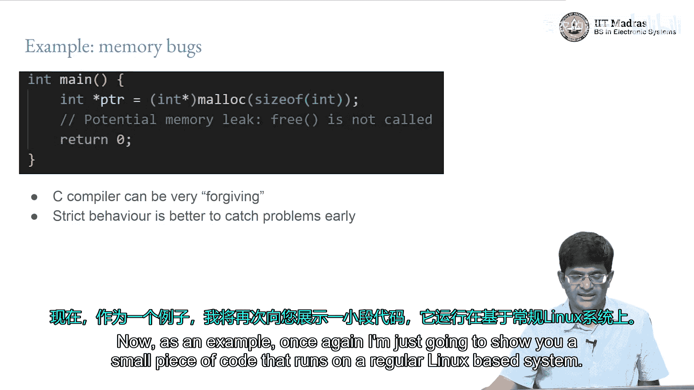
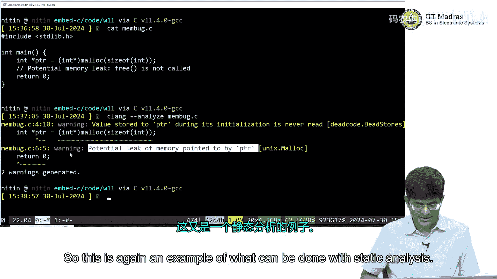
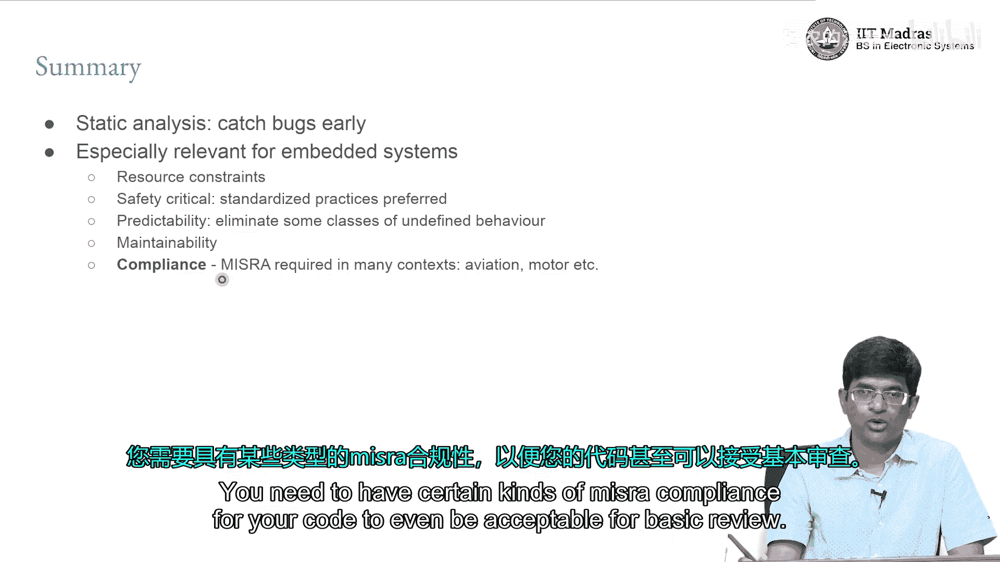

# 044：静态分析技术 🛠️


在本节课中，我们将学习静态分析技术。静态分析是指在程序运行之前，对源代码进行检查和分析的过程。这对于嵌入式系统开发尤为重要，因为它有助于在编译阶段就发现潜在的错误和性能问题，从而提高代码的可靠性和效率。

## 什么是静态分析？

静态分析中的“静态”指的是在程序不运行的状态下进行分析，这与程序实际运行时的“动态”分析相对。静态分析的核心是在编译时，即在程序实际运行之前，对代码进行检查。

上一节我们介绍了静态分析的基本概念，本节中我们来看看为什么静态分析在嵌入式系统中如此重要。

嵌入式系统与许多一次性运行的程序不同。例如，一个工资单程序可能只运行一次逻辑就结束了。而嵌入式系统恰恰相反，系统一旦启动，通常会持续运行，除非发生重大故障，否则不会关闭。因此，在编译时投入大量精力进行静态分析和优化，尽可能多地消除错误和性能问题，是非常有意义的。

静态分析可以帮助识别潜在问题，这些问题可能是代码中的直接错误，也可能是风格问题、未遵循最佳实践或性能相关问题。专门的静态分析工具通常作为编译器的补充，它们能够在早期阶段就发出潜在问题的警报。

## 静态分析实例：内存泄漏



为了具体说明，让我们看一个简单的代码示例。这段代码本身非常简单，但它展示了一个潜在的问题。

```c
int main() {
    int *ptr = (int*)malloc(sizeof(int)); // 动态分配内存
    return 0; // 未释放内存，直接返回
}
```

严格来说，这段代码可能不算一个“错误”，因为程序运行到 `return` 后就会退出，一旦程序退出，内存应该会自动释放。然而，在嵌入式系统的上下文中，情况并非总是如此。嵌入式系统通常没有一个会退出的 `main` 函数，而是有一个被初始化后永久运行的线程。如果在一个函数退出前没有释放类似这样的内存，这块内存就可能一直驻留。编译器不会自动判断变量是否已超出作用域并释放它。只有在整个程序退出时，内存才会被释放，而这在嵌入式系统中通常不会发生。

C编译器默认可能非常“宽容”，但这不一定是好事。我们可以通过指定某些编译标志来要求编译器更严格，并指示错误，而不是让这类问题悄悄通过。此外，还有一些工具可以作为编译器的组件或编译过程的一部分，来指示这类问题。

## 使用Clang进行静态分析

让我们看看如何使用Clang编译器来对上述代码进行静态分析。Clang和GCC是当今最著名的两个编译器。GCC是GNU编译器集合，历史更悠久。Clang则是基于LLVM（低级虚拟机）基础设施构建的编译器。

我们将使用Clang的 `-analyze` 标志来分析上面的程序（假设文件名为 `mem_bug.c`）。这个命令不会真正编译程序，但会给出一些警告。



```bash
clang --analyze mem_bug.c
```

运行后，你可能会看到两个警告：
1.  **值在初始化时存储到 `ptr`，但从未被读取**：这表示你声明了一个变量并赋值，但程序中没有其他代码实际使用这个值。这是一个“死代码”的例子。
2.  **此处存在潜在的内存泄漏**：这正是我们之前指出的问题，因为在返回前没有调用 `free(ptr)`。

这个例子展示了静态分析能做什么。

## 静态分析可检测的常见问题类别

接下来，我们将快速浏览一系列静态分析可以捕捉到的潜在代码问题示例。请注意，以下列表并非详尽无遗，编译器会根据各种规则来判断什么是潜在问题。这里展示的只是一些相对容易识别的常见问题类别。

以下是静态分析工具通常可以检测的一些问题类型：

1.  **内存泄漏**
    声明一个指针并为其分配内存（例如使用 `malloc`），但在指针离开作用域前没有对应的 `free` 调用。如果指针没有传递给其他函数使用，这就会导致分配的内存无法被回收。

2.  **缓冲区溢出**
    声明一个固定大小的字符数组（缓冲区），然后使用如 `strcpy` 这样的函数向其中复制一个更长的字符串。`strcpy` 不会检查目标缓冲区大小，导致数据写入相邻内存区域，可能覆盖其他变量。建议使用更安全的函数变体，如 `strncpy`。

3.  **未初始化的变量**
    声明一个变量（如 `int x;`），并在为其赋值之前就使用它（如 `return x;`）。此时返回的值是未定义的，可能是任何值。

4.  **死代码**
    代码中存在永远不会被执行到的部分。例如，在 `if-else if-else` 结构中，所有条件分支都已覆盖，其后的 `printf` 语句就是死代码。

5.  **资源管理**
    打开一个文件（使用 `fopen`）后，在函数返回前没有关闭它（使用 `fclose`）。虽然可能打算在别处关闭，但很容易遗漏，导致文件句柄泄漏。

6.  **非线程安全代码**
    一个函数递增一个全局变量。在单线程环境中没问题，但在多线程或嵌入式多任务环境中，如果多个任务同时调用此函数，由于读取-修改-写入操作的非原子性，可能导致数据竞争和不一致的结果。

7.  **空指针解引用**
    将一个指针显式设置为 `NULL`（如 `int *ptr = NULL;`），然后尝试向其指向的内存写入数据（如 `*ptr = 10;`）。这相当于尝试向内存地址0写入，通常会导致程序崩溃或未定义行为。

8.  **释放后使用**
    为指针分配内存，然后释放它（`free(ptr)`），之后又尝试使用这个指针（如 `*ptr = 20;`）。此时指针可能指向已分配给其他部分的内存，导致不可预测的数据损坏。

9.  **整数溢出**
    对一个已达到最大值的整数变量加一，可能导致其值“环绕”变成负数或其他意外值。静态分析工具可以警告可能超出范围的运算。

10. **除以零**
    进行除法运算时，分母有可能为零（例如 `int y = 10 / x;`，而 `x` 可能为0）。这取决于运行时值，静态分析可能将其标记为潜在风险。

需要注意的是，静态分析工具不一定会将所有这些问题都报告为编译错误，很多情况下只是给出警告，提示这不是一种良好的编码方式。

## 静态分析工具与编码标准

有许多工具可用于静态分析。我们已经看到了Clang的例子，它是一个支持静态分析的编译器工具包。另一个优秀的开源工具是 **Cppcheck**。此外，还有一些商业工具，如 Coverity、PC-lint 等。有些工具是平台特定的，例如针对特定ARM微控制器的工具。

在许多情况下，这些工具还负责检查代码是否符合特定的**编码标准**。编码标准在某种程度上是设计模式的演进，它们规定了推荐的代码编写方式，实践证明这些方式可以减少特定类别的错误。

其中最著名的是 **MISRA** 标准（汽车工业软件可靠性协会）。虽然它主要源自汽车行业，但其准则广泛适用于许多嵌入式系统领域，涵盖了C和C++语言。

MISRA标准规定了软件应如何编写的规则：
*   **强制规则**：如果违反，则直接视为不符合MISRA标准。
*   **必要规则**：通常也必须满足，但如果能为特定项目提供充分且有文档记录的正当理由，仍可视为符合。
*   **建议规则**：更像是最佳实践，不满足不会导致违规，但建议尽可能修复。

由于投入了大量精力制定这些标准，它们在消除特定类型错误方面备受推崇。在许多行业，尤其是政府、航天和其他安全关键型应用中，MISRA编码标准常被作为代码验收的强制性要求。

**MISRA规则示例**：
考虑以下代码：
```c
for (i = 0; i < 10; i++);
    x += i;
```
由于 `for` 循环末尾有一个分号，`x += i;` 实际上并不在循环体内执行，尽管缩进暗示了这一点。MISRA规定，`for` 循环内的任何代码都必须明确放在花括号 `{}` 内。虽然C语言编译器通常认为花括号是可选的，但对MISRA而言，它们是必需的。这只是MISRA众多易于自动化检查的规则中的一个简单例子。

## 总结 🎯

本节课中我们一起学习了静态分析技术。总结如下：

*   **目的**：静态分析的核心目的是尽可能早地捕获错误，这对于嵌入式系统尤其重要。
*   **重要性**：
    *   **资源约束**：嵌入式系统通常资源有限。
    *   **安全关键**：常用于安全关键型应用。
    *   **可预测性**：需要消除未定义行为，保证系统行为可预测。
    *   **可维护性**：使代码易于他人阅读、维护、改进功能或修复错误。
*   **合规要求**：像MISRA这样的编码标准，在某些政府、航天或国防相关领域，可能是代码被接受评审的强制性要求。



通过利用静态分析工具和遵循严格的编码标准，嵌入式系统开发者可以显著提高代码质量、可靠性和安全性。