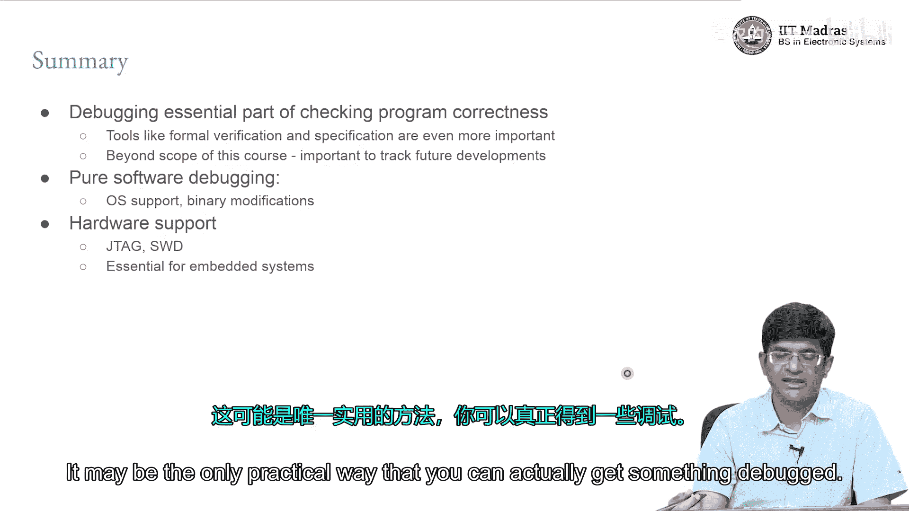

# 045：调试与测试 🐛

在本节课中，我们将要学习嵌入式系统中调试与测试的核心技术与工具。调试是软件开发中不可或缺的一环，它能帮助我们定位和修复程序中的错误，确保系统的可靠性与正确性。

## 调试的重要性

在理想世界中，我们编写的程序第一次就能完美运行，无需调试。然而现实并非如此，程序总会存在各种问题或“漏洞”。这些漏洞的产生原因多种多样，有些我们已经讨论过。从根本上说，编写完全没有漏洞的复杂程序是不现实的。因此，调试是软件开发中必须面对的现实。

## 基本调试方法

最原始的调试方法是在代码中插入打印语句。当程序执行到特定位置时，屏幕上会显示一条信息，表明已到达该点。如果没有`printf`函数或控制台，更简单的方法是使用LED灯来指示程序执行到了某个位置。

这种方法非常粗糙。通过LED灯能传递的信息极少，而打印语句也存在问题：添加过多打印语句会显著增加代码体积。更重要的是，打印语句执行速度慢，会改变操作的时序，可能导致某些只在没有打印语句时才会出现的漏洞。

## 单步调试

当处理需要相互调用的多个函数的大型程序时，确定在哪里插入打印语句并不简单。与其在代码中随意插入打印语句，不如采用更优的方法——单步调试。

单步调试的基本思想是在代码中定义“断点”。断点是代码中的一个位置，当程序执行到此处时，它会暂停并等待用户指示继续执行。

这里存在一个问题：我们编写的C代码并非最终在处理器上运行的代码。C代码会被编译成中间表示，最终转换为机器语言。因此，C代码中的某一行可能并不对应实际运行系统中的任何机器代码。但在大多数情况下，它确实对应最终机器语言中的代码。更重要的是，在调试条件下编译程序时，可以确保代码被保留。这意味着，你可以在C代码中标记一个点，编译器会生成一个包含断点的可执行二进制文件。

实际上，断点的设置通常由所谓的“交互式调试器”完成。调试器本身是一个程序，很可能运行在你的主机电脑上。在嵌入式系统中，我们通常进行交叉编译：在PC上编写和编译代码，但生成的代码将在微控制器上运行。交互式调试器也运行在主机上，因此它需要某种方式与运行代码的目标系统通信。

## 断点的实现原理

实现断点的一种方法是修改代码，在特定位置插入一条无效指令。当处理器遇到无效指令时，不会直接崩溃或进入死循环，而是会生成一个“无效指令异常”。这意味着，我们可以将遇到无效指令视为遇到了代码中的断点。然后，我们可以检查程序暂停时的程序计数器值，如果它对应我们设置的断点，就可以将控制权交还给用户，询问下一步操作。

当然，插入无效指令也可能导致系统崩溃。如果存在操作系统，控制权通常会返回给操作系统，并产生一个“核心转储”。核心转储是系统内存的二进制映像，可用于调试。但这不是我们想要的交互式调试。我们想要的是创建一个软件触发的中断（通常称为异常），并通过异常处理程序来处理它，将控制权交还给调试器。

## 条件断点与日志点

这种机制非常强大，它允许你在运行代码的任意位置暂停程序。更强大的是，你可以设置“条件断点”。条件断点意味着，当遇到断点并触发异常时，不会立即将控制权交还给用户，而是先检查某个条件是否满足。例如，你可能对`for`循环的计数器是否超过100次迭代感兴趣，可以设置一个条件断点：如果`i > 100`，则中断。

另一种变体是“日志点”。日志点与断点类似，但它不是将控制权交还给用户进行交互，而是在代码执行到特定点时，记录你感兴趣的变量的值。这样，之后可以通过监控日志来判断系统是否正常工作，而无需进行缓慢的交互式单步调试。

## 单步执行与硬件辅助调试

单步调试的核心思想是，在断点之后，可以允许代码单周期步进。这通常需要一个与系统关联的时钟。时钟是一个在高低电压之间切换的方波电信号。当我们遇到断点时，可能会导致一种不同的操作模式：供应给CPU的时钟被暂停。

这在硬件辅助调试中特别有用。在纯软件调试中，不可能真正停止时钟，因为那样CPU就完全停止了，你将失去所有控制。在纯软件调试中，你通过其他方式控制从该点开始如何执行单个指令。但在硬件调试中，你可以实际停止时钟的切换，然后通过外部机制控制时钟，让它单步执行一个周期。在此期间，你可以检查CPU内部所有寄存器或内存的内容，前提是你有适当的控制机制。

这只能通过硬件对调试的支持来实现，通常被称为某种形式的“在线调试”。在嵌入式系统领域，每个微控制器供应商都有自己的在线调试实现方式。

## 为什么需要硬件调试？

首先需要明确的是，硬件和软件并不完全相同。你当然可以选择在软件中模拟整个系统。我们课程中多次演示使用的WalkWe网站，基本上就是运行各种处理器的软件模拟器。但问题在于，软件通常无法模拟所有物理条件。

即使在WalkWe中，某些处理器的特定行为也没有被完全建模。更重要的是，某些不确定性，如DRAM的刷新速率、访问外部存储器的延迟，或者两个按钮被按下时的竞争条件，都极难建模，更不用说精确模拟所有可能的物理条件了。实时交互尤其难以模拟。

模拟器只能做到这一步。当然，如果你有模拟器，单步调试等许多事情实现起来相对容易。模拟器几乎可以在任何点停止程序，并显示CPU内部每个寄存器的确切状态。但硬件的表现不同，要获取其确切状态要困难得多。

## JTAG标准

尽管如此，仍有机制可以接入硬件并获取有用信息。其中一个电气电路标准是JTAG。JTAG代表“联合测试行动组”。从名称可以推断，它最初是为测试硬件而定义的。这是一个IEEE标准。

标准很重要，因为没有标准，为一个系统定义的东西很可能无法在另一个系统上工作，这使得构建可互操作的机制变得非常困难。JTAG专门用于电路测试问题。

他们的方法是：如果你在一个整体系统中有多个数字电路，你想知道每个设备内部每个寄存器或触发器的状态。通常我们会认为需要为每个寄存器引出导线，但这不切实际，因为每个设备内部可能有成千上万个寄存器。即使你设法引出了上千个引脚，也没有简单的方法来协调它们。

因此，他们采取了另一种极端方法：只使用一组引脚。基本上，有一个时钟引脚、一个输入引脚和一个输出引脚。由此，他们构建了一个“菊花链”。调试系统的输入通过TDI引脚进入第一个设备，依次经过该设备内部的所有寄存器，最后通过TDO输出。然后，TDO的输出可以馈送到第二个设备的TDI，依此类推，最终返回到主机。

通过这种方式，我们可以发送电信号通过大量寄存器，将它们链接通过多个设备，最后在另一端取出。我们还可以使用TMS信号，通过发送合适的信号组合，来激活每个设备的调试状态。我可以指定哪个设备需要被调试，其他设备则进入直通模式，即它们的TDI直接连接到TDO。

## 边界扫描

如果没有旁路，即信号确实通过了所有寄存器，那么T时钟就起作用了。对于T时钟的每个脉冲，我可以在TDI上推入一个比特。这个比特将依次通过链中的每个寄存器。经过一定数量的时钟周期后，我实际上可以发送对应于每个内部寄存器的比特，将它们设置为已知状态。

完成此操作后，我可以切换模式，给整个系统的实际运行时钟一个脉冲，看看会发生什么。内部寄存器有某种状态，在这些条件下有组合逻辑，它们的行为如何？每个寄存器的下一个状态是什么？你给时钟一个脉冲，捕获所有这些内部状态，然后再次通过脉冲T时钟，我可以在TDO上读出每一个比特，并将其全部返回到主机。

这种方法通常称为“边界扫描”。这意味着你只能访问芯片的边界，即输入和输出，但你能够扫描整个系统并获取其状态更新。

## JTAG与软件调试的关系

所有这些对我们有何意义？事实证明，由于所有这些寄存器都连接在一条链中，你可以设置或读取单个寄存器的值，因此可以在软件环境中利用它。例如，我可以使用它来读取寄存器值：程序计数器的状态是什么？寄存器R0、R1、R2的状态是什么？系统内部的所有寄存器、控制和状态寄存器、标志位等，都可以通过JTAG链取出。

此外，由于你可以设置单个寄存器，你甚至可以使用它来切换某些位，并最终将值缓慢写入内存。当然，这很慢，但另一方面，它让你对硬件中实际发生的情况有了难以置信的控制力，因此成为一个非常有用的调试工具。

它最初是为调试硬件而设计的，后来被重新用于软件调试，并且在该领域非常有效。在软件调试中，你可能不会让用户直接使用所有这些链，而是直接与CPU内部的某个模块通信，该模块的职责是在更高层次上执行单步执行、控制程序计数器等操作。一旦你有了以受控方式将数据传入和传出系统的方法，就意味着你可以编程让它执行任何你想要的操作，这就是JTAG所实现的。

## 单线调试

JTAG功能强大但复杂、速度慢，并且其功能超出了软件调试的实际需求。因此，人们提出了其他标准。最流行的是“单线调试”，主要用于ARM微控制器。

它基本上使用两根线：一个时钟和一根调试数据输入/输出线。从逻辑上讲，你只需要一根线来输入数据，所以称之为“单线”调试。可选地，它还允许你有另一根称为调试输出的线，但我们的主要目的是调试数据输入/输出。

在功能上，它与JTAG允许你做的事情非常相似。它不是使用边界扫描，而是允许你直接控制内置在ARM处理器中的调试模块。因此，并且因为它放弃了JTAG的一些功能，所以它比JTAG更快。它使用的引脚也更少。JTAG本身使用的引脚就很少，而SWD使用的更少。但这本身不是主要目的，其主要目的是为软件调试而设计，这使得它在许多实际应用中比JTAG快得多。

JTAG更灵活，支持更多设备。SWD更特定于ARM，但速度更快。如果你使用ARM处理器，它很可能是更高效的处理方式。

## 物理连接器与软件支持

所有这些也转化为实际的物理连接器。当你开始使用硬件时，很可能会遇到类似这样的接头，通常称为一组跳线引脚。你会看到这样的电缆，如果仔细观察，会发现电缆上有设置，确保电缆只能以一种方式插入。

JTAG是一种电气协议，这意味着当你设计并构建带有JTAG连接器的芯片时，还需要考虑信号的终端匹配等。最好的方法通常是采用已知的架构或电路布局，然后根据需求进行修改。

当然，除此之外，我们还需要调试所需的软件支持。这通常来自各种集成开发环境。我们目前看到的是WalkWe，这是一个基于Web的环境，主要用于模拟。有些人可能见过WalkWe的VS Code扩展，它允许你在本地PC上运行的Visual Studio Code中编写代码，运行ARM编译器生成代码，甚至本地运行模拟。

那些已经实际使用过开发板的人可能遇到过像STM32Cube、Keil或德州仪器的Code Composer Studio等开发环境。Eclipse平台是一个通用平台，已被许多人采用来构建整体开发环境。

这主要是出于便利性和一致性的考虑。人们习惯于某种开发代码的方式：如何设置断点、如何观察变量值、如何逐步执行代码的不同部分等。越熟悉，使用起来就越容易。大多数这些开发环境也与硬件调试器集成得很好，可用于实际的调试过程本身。

## 总结

本节课中我们一起学习了嵌入式系统中调试与测试的核心概念与工具。

调试是检查程序正确性的重要部分。正如所述，有些工具如形式化验证过程、形式化规范过程等在某种意义上甚至比调试更重要，因为它们在一定程度上允许你通过构造来避免某些类别的漏洞。如果程序编译通过，就能保证某些类型的漏洞不存在。然而，这超出了本课程的范围，但绝对是一个需要关注的重要领域，尤其是在嵌入式系统领域。

调试主要有两种方式：一种是纯基于软件的调试，另一种是硬件辅助调试。纯软件调试需要操作系统的某种支持，可能需要对可执行二进制文件进行修改以添加调试符号等，但通常侵入性最小。然而，硬件支持则不那么直接，需要特定的硬件支持。特别是在嵌入式系统领域，硬件调试可能是唯一可行或实际的方法。

通过理解断点、单步执行、JTAG、SWD等概念，你将能够更有效地在嵌入式环境中定位和解决问题，从而构建更可靠、更健壮的系统。