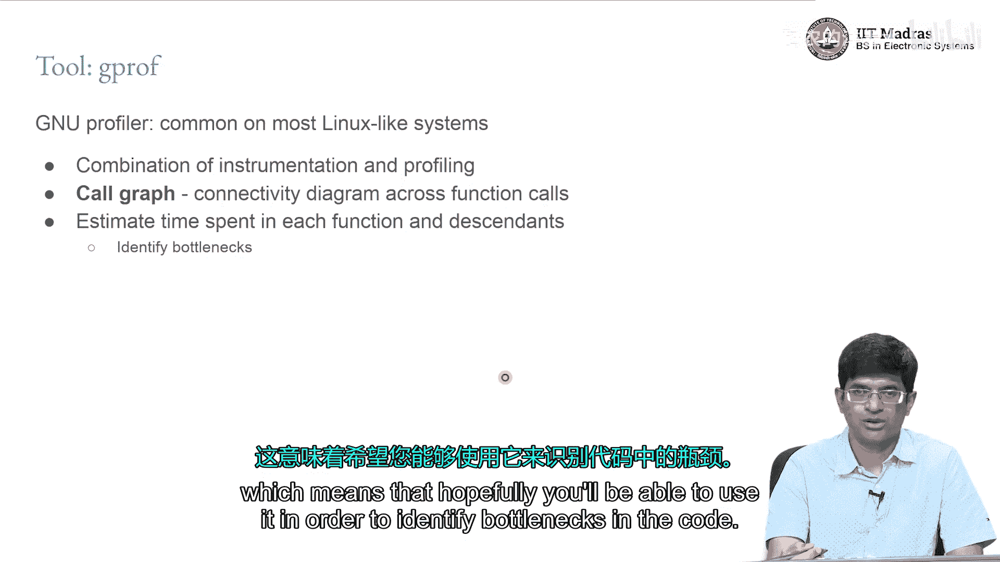
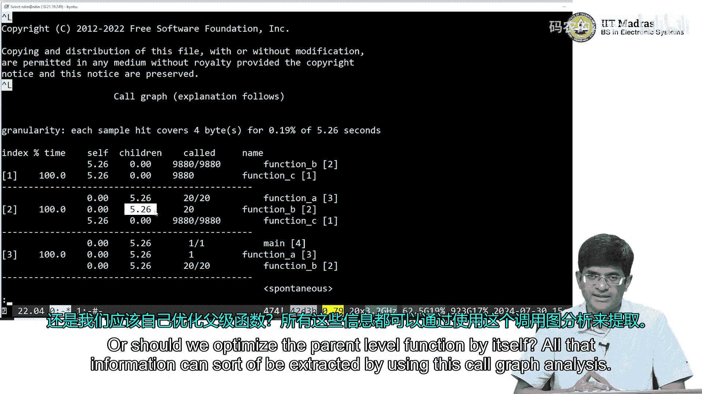
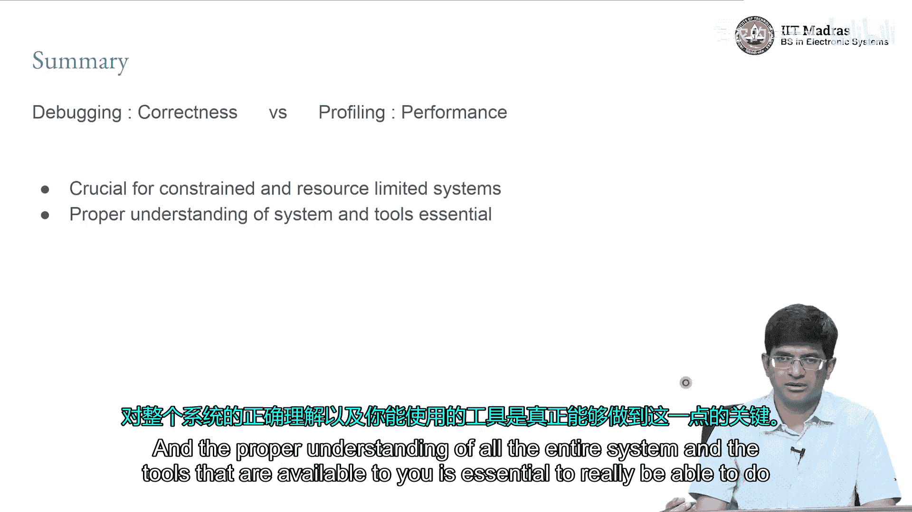

# 046：性能剖析与性能优化工具 🛠️


在本节课中，我们将要学习性能剖析的概念、常用工具及其在嵌入式系统中的应用。性能剖析是分析程序运行时行为的关键技术，它能帮助我们识别性能瓶颈、内存使用问题以及潜在的优化空间。

## 什么是性能剖析？ 🔍

性能剖析指的是分析程序的运行时行为。这与编译时行为不同。调试通常也处理运行时行为，但调试主要关注程序中的错误。性能剖析则更侧重于识别特定类型的信息，例如性能瓶颈、程序运行缓慢的原因、内存资源限制以及程序改进的空间。

## 性能剖析的方法 📊

以下是几种常见的性能剖析方法。

### 插桩法

插桩法是最简单的性能剖析方法之一，它通过在程序中添加额外的代码来实现。一个典型的做法是在需要剖析的函数开始和结束时测量时钟，从而计算中间所花费的时间。

```c
#include <time.h>
clock_t start, end;
start = clock();
// 需要剖析的代码
end = clock();
double time_used = ((double) (end - start)) / CLOCKS_PER_SEC;
```

然而，这种方法存在一些限制。测量精度取决于操作系统和`clock`函数的工作方式，可能只能精确到微秒甚至毫秒级别。对于处理器而言，即使是像树莓派这样接近1GHz运行速度的设备，1微秒也相当于1000个时钟周期，1毫秒则是一百万个时钟周期。因此，这些测量可能不够精确。更重要的是，插桩代码本身会带来开销，改变程序的行为。



### 采样法

另一种获取程序信息的方法是采样法。这种方法通过定期采样或记录程序的状态（如程序计数器或内部寄存器）来工作。采样意味着需要以某种方式（例如定时中断）暂停程序，然后检查中断前最后运行的代码或程序计数器值。

采样法通常比插桩法的开销小，因为你不需要修改代码，可以通过其他基于中断的机制来实现采样。例如，你可以在一秒内中断程序100次（大约每10毫秒一次），记录每次中断时正在执行的函数。这些信息足以告诉你程序大部分时间花在了哪里。

## 性能剖析工具 🧰

上一节我们介绍了性能剖析的基本方法，本节中我们来看看一些具体的工具。

### GProf 工具

在大多数类Linux系统上，有一个名为GProf的性能剖析工具。它结合了插桩和采样技术，通过修改二进制文件本身（无需更改源代码）来添加额外的逻辑。GProf会构建一个调用图，这是一个连接图，用于显示哪个函数调用了哪个其他函数，并跟踪调用的次数。

以下是一个使用GProf的示例代码：

```c
#include <stdio.h>

int count_a = 0, count_b = 0, count_c = 0;
int count_internal = 0;

void functionC(int j) {
    count_c++;
    for (int k = 0; k < j; k++) {
        count_internal++;
    }
}

void functionB(int i) {
    count_b++;
    for (int j = 0; j < i; j++) {
        functionC(j);
    }
}

void functionA() {
    count_a++;
    for (int i = 0; i < 20; i++) {
        printf("Function A: %d\n", i);
        if (i % 2 == 0) {
            functionB(i * i);
        }
    }
}

int main() {
    functionA();
    printf("A called: %d, B called: %d, C called: %d\n", count_a, count_b, count_c);
    printf("Internal count: %d\n", count_internal);
    return 0;
}
```

编译时需要使用`-pg`标志来生成剖析信息：

```bash
gcc -pg -o prof_example prof_example.c
```



运行程序后，会生成一个名为`gmon.out`的文件。然后可以使用GProf来分析这个文件：

```bash
gprof prof_example gmon.out > analysis.txt
```

分析文件会显示每个函数花费的时间百分比、实际时间、自用时间（函数本身运行的时间）以及调用关系。调用图特别有用，它能清晰地展示函数之间的调用层次和耗时分布，帮助你快速定位性能瓶颈。

### Valgrind 工具

Valgrind是另一套强大的工具集，主要用于Linux和类Unix系统。它通过动态二进制插桩技术，在虚拟环境中运行你的代码，从而跟踪和分析代码行为。

Valgrind可以帮助识别多种问题：

*   **内存错误**：如未初始化的内存使用、内存泄漏、缓冲区溢出等。
*   **线程相关错误**：如竞态条件、死锁等。
*   **性能问题**：分析代码各部分耗时，评估缓存性能和分支预测效果。
*   **动态内存分配**：分析堆内存的使用情况，检查`malloc`和`free`操作的效率。

## 嵌入式系统中的性能剖析挑战 ⚙️

在嵌入式系统环境中，性能剖析面临一些独特的挑战：

1.  **资源有限**：系统内存和存储空间可能非常紧张，添加额外的插桩代码可能变得不可行。
2.  **干扰行为**：插桩代码会改变程序的运行时行为，可能使系统变慢或更确定，从而影响你试图剖析的原始代码。
3.  **缺乏完整操作系统**：许多嵌入式系统没有完整的操作系统，这使得像GProf或Valgrind这样依赖操作系统库的工具难以直接运行。
4.  **函数短小频繁**：嵌入式系统中有许多短小但被频繁调用的函数，基于采样的剖析器很容易错过这些函数的信息。

## 嵌入式系统的硬件支持与解决方案 💡

与调试类似，嵌入式系统通常提供硬件支持来进行性能剖析。JTAG和SWD等调试接口可以被重用，用于访问CPU的内部寄存器、性能计数器，并提取运行时信息。

常见的硬件辅助剖析方法包括：

*   **性能计数器**：许多CPU（如ARM处理器）内置了性能计数器，可以精确统计时钟周期数、指令执行数等。通过读取这些寄存器，可以获得高精度的性能数据。
    ```c
    // 示例：读取ARM DWT周期计数器
    #define DWT_CYCCNT (*((volatile uint32_t *)0xE0001004))
    uint32_t start_cycles = DWT_CYCCNT;
    // 执行代码
    uint32_t end_cycles = DWT_CYCCNT;
    uint32_t cycles_used = end_cycles - start_cycles;
    ```
*   **基于跟踪的剖析器**：这些工具记录每一条执行的指令，生成大量的跟踪数据。这对于系统启动调试或分析复杂问题非常有用。通常结合JTAG/SWD将跟踪数据导出到主机进行分析。
*   **厂商特定工具**：许多微控制器厂商提供自己的调试和剖析接口及工具链，需要针对具体使用的CPU进行学习和使用。

## 总结 📝

本节课中我们一起学习了性能剖析的核心概念、主要方法和工具。调试主要关注程序的正确性，而性能剖析则更侧重于程序的运行时性能和效率。在实践中，调试和剖析往往是迭代进行的。




对于资源受限的嵌入式系统，选择合适的剖析方法和工具至关重要。充分利用硬件提供的性能计数器、跟踪模块以及厂商特定的调试接口，是进行有效性能分析和优化的关键。深入理解整个系统架构和可用工具，才能更好地完成嵌入式软件的开发和优化工作。