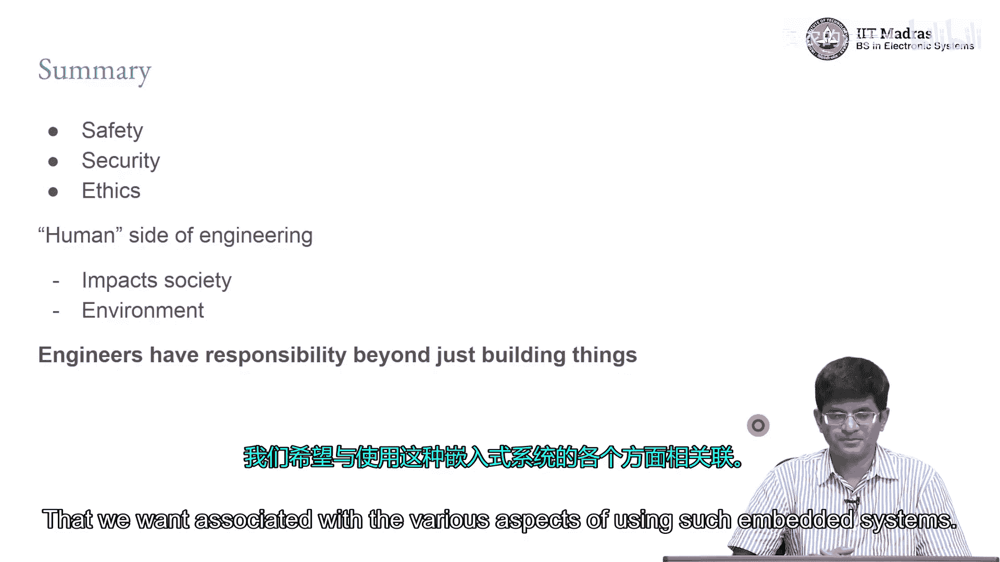

# 047：嵌入式系统中的伦理考量 🧭

在本节课中，我们将探讨嵌入式系统设计中的伦理考量。我们将了解伦理的基本概念、指导工程师行为的一般原则、几种伦理决策框架，并通过实际案例来理解伦理问题在现实世界中的重要性。

## 概述

伦理涉及道德原则和价值观。作为工程师，我们通常习惯于处理具有数学框架的数字和物理系统，而伦理则关乎人类如何互动，以及我们的决策和行为如何影响社会、个人和环境。虽然这是本课程中最不具技术性的部分，但对于嵌入式工程师而言，理解并重视这些伦理问题至关重要。

## 伦理的一般原则

上一节我们介绍了伦理的基本概念，本节中我们来看看指导嵌入式工程伦理应用的一些核心原则。

以下是几个关键原则：

*   **责任**：工程师需要为软件中可能存在的任何缺陷负责。这意味着应尽最大努力完成工作，即使仍可能存在不足，但至少应确保工作不是草率完成的，并已尽可能多地考虑了各种因素。
*   **诚信**：如果系统存在局限性，应明确披露。尤其在医疗设备等领域，任何缺陷都需要让使用者知晓，以便他们做出明智的决定。例如，药品说明书会列出所有可能的副作用。
*   **隐私**：这是一个非常重要的问题，与我们之前讨论的安全话题密切相关，尤其是在医疗记录等数据的使用方面。数据使用的隐私保护至关重要。
*   **可持续性**：这更多与环境相关。虽然不直接作用于个人，但最终会影响到人类。我们有责任理解设计对环境的影响，并尽可能系统地减少或缓解这种影响。
*   **问责制**：当产品发布供他人使用时，需要明确责任归属。无论是声明“按现状提供，风险自负”，还是承诺提供系统性的支持和更新，都是一种问责形式。

## 伦理决策框架

了解了基本原则后，我们来看看在面临伦理困境时，有哪些框架可以帮助我们理解和做出决策。

以下是几种常见的伦理框架：

*   **功利主义**：在设计工程系统时，目标是设计能使最多人受益并提升整体结果的功能。如果某些功能只对特定个体有改进，但总体上会造成更多问题，那么可能需要决定不包含该功能。其核心思想可概括为：**追求最大多数人的最大幸福**。
*   **义务论**：这是一种“遵循规则”的方法。它认为，人们已经系统地制定了标准，遵循这些标准至少能为你的决策提供明确的理由。标准的存在有其原因，通常是基于对潜在问题的理解而制定的最佳实践。然而，这也可能导致人们以“我只是在遵守规则”为由，而不去思考决策可能带来的负面影响。
*   **美德伦理学**：该框架认为，存在一些美德，如诚实、正直和透明，是值得遵循的。如果我们能明确我们希望个人或组织具备哪些美德，就可以优先考虑这些美德来做出决策。
*   **关怀伦理学**：一个重要的例子是辅助设备的设计，特别是为残障人士设计的设备。设计必须基于对使用者实际需求的深刻共情理解。产品应服务于最终使用者，而不仅仅因为某些功能对工程师来说“很酷”或易于实现。

## 伦理决策流程

有了这些框架，我们可以遵循一个结构化的流程来处理伦理问题。

以下是典型的伦理决策流程步骤：

1.  **识别潜在伦理困境**：系统地找出设计中可能涉及的伦理问题。
2.  **使用框架进行评估**：运用上述伦理框架（如功利主义、义务论）对识别出的困境进行评估。可以尝试进行量化比较，或通过相对重要性进行排序。
3.  **做出决策并采取行动**：基于评估结果，决定设计方向或应采取的具体行动。
4.  **适应与迭代**：这是一个循环过程。在做出决策或构建系统后，需要重新审视，看看是否引发了新的伦理困境，然后重复整个识别、评估、决策的过程。

简而言之，就像任何其他工程实践一样，伦理考量也涉及大量迭代。通过设计、发现不足并改进的过程，结合这些伦理框架，是工程师训练中非常重要的一环。

## 嵌入式系统中的伦理问题实例

理论需要结合实际。本节我们通过两个著名案例来具体理解嵌入式系统和相关软件中的伦理问题。

以下是两个典型案例：

*   **大众汽车排放门丑闻**：大众在其柴油车中安装了软件，能够检测汽车是否处于实验室排放测试环境。在测试时，软件会激活额外的减排功能，使污染物排放大幅降低；而在实际道路行驶时，这些功能被关闭，导致真实世界的氮氧化物排放量可能高达实验室条件的40倍。这是一种明显的伦理违规，为了通过测试标准并降低成本，牺牲了真实环境下的污染控制。
*   **剑桥分析公司数据丑闻**：一个心理测验应用收集了大量Facebook用户的数据，并在未经用户同意的情况下，将这些数据出售给了剑桥分析公司。这些数据可能被用于影响政治选举。这个案例凸显了**隐私**和**知情同意**的重要性。如今，许多可穿戴设备收集健康数据，其配套应用如何处理这些数据往往不够透明，这直接关系到嵌入式系统工程中的伦理问题。即使不直接泄露原始数据，从**元数据**中也可能推断出大量个人隐私信息。

## 总结

本节课中，我们一起学习了嵌入式系统中的安全、安全和伦理考量。这些内容可以广义地归类为工程的“人文面”，它们影响着社会、个人以及我们周围的环境（包括生物和非生物）。

核心要点在于，工程师的责任不仅仅是构建系统或编写代码。我们必须思考技术可能带来的、起初未曾预料的影响。一个简单的应用可能突然流行，并引发严重的伦理问题。因此，至关重要的是要将这些考量放在心上，思考如何承担责任、如何确保信息被适当披露，以及如何保障使用此类嵌入式系统时所涉及的隐私、安全等各个方面。

最终，我们的目标是理解并努力减轻工程实践对世界产生的负面影响。