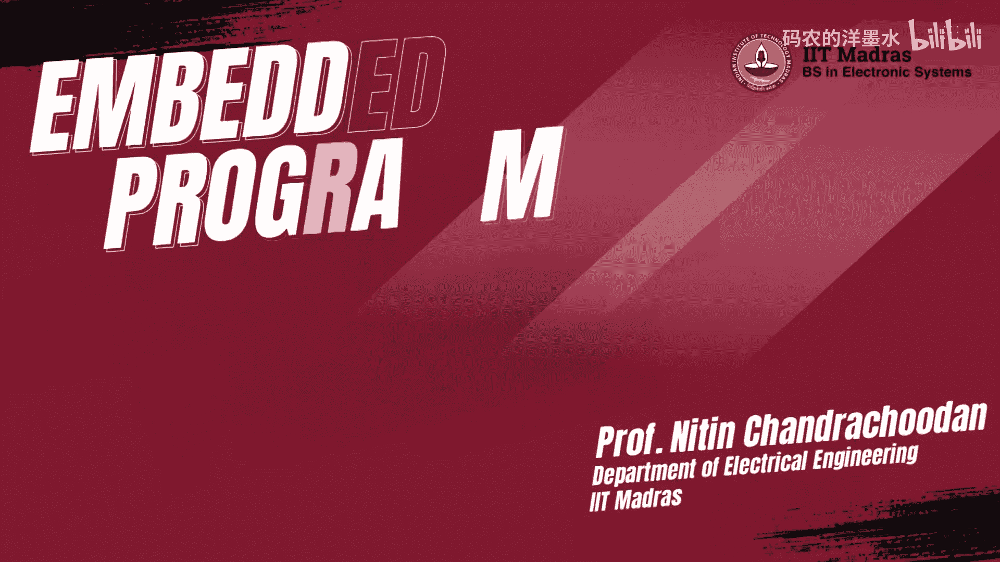
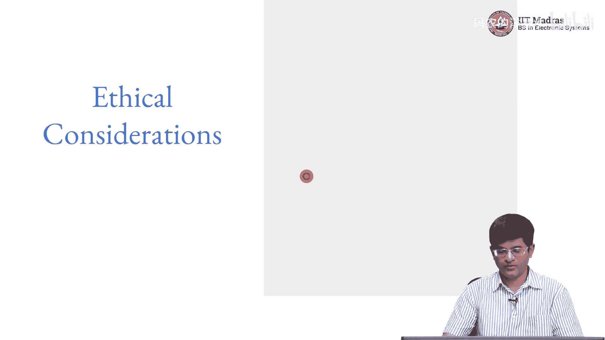

# 048：嵌入式系统安全

在本节课中，我们将要学习嵌入式系统安全的核心概念。我们将探讨安全与安全的区别，理解安全性的三大支柱（保密性、完整性、可用性），并介绍常见的威胁模型和防护机制，例如加密和访问控制。课程最后会通过真实案例（如Stuxnet和Mirai）来加深理解。

## 安全与安全的区别

上一节我们介绍了安全性的概念，本节中我们来看看安全与安全的区别。虽然这两个术语常被一起提及，但它们关注的重点不同。

*   **安全** 主要关注系统的**物理福祉**，旨在防止因系统故障或意外事件造成的人身伤害、财产损失或环境危害。其问题通常是**非故意**的，源于设计疏忽或未预见的故障模式。
*   **安全** 主要关注系统和数据的保护，旨在防止**故意**的**未授权访问、使用、披露、破坏、修改或销毁**。其核心是确保信息的**保密性、完整性和可用性**。

简而言之，安全关乎“防止意外伤害”，而安全关乎“防止恶意攻击”。两者都需要在系统设计中单独考虑。

## 安全的核心原则（CIA三要素）

理解了安全的基本目标后，我们来详细看看构成安全基础的三个核心原则，通常被称为CIA三要素。

*   **保密性**：确保敏感信息只能被授权的人或系统访问。例如，你的银行账户余额和交易记录就是需要保密的信息。公式可以理解为：`授权用户 ∩ 信息 = 可访问信息`。
*   **完整性**：确保数据在存储或传输过程中没有被未授权地篡改或破坏。例如，确保无人能非法修改你的银行账户金额。这通常通过哈希校验等技术来保障，例如使用SHA-256算法生成数据指纹：`hash = SHA-256(data)`。
*   **可用性**：确保授权用户在需要时可以可靠地访问信息和系统资源。例如，在线购票系统必须保持在线以供用户使用。拒绝服务攻击就是针对可用性的典型威胁。

## 威胁模型与攻击

在构建安全系统时，明确可能面临的威胁至关重要。这就需要建立**威胁模型**。

威胁模型旨在识别潜在攻击的性质、攻击者、攻击动机和攻击手段。它帮助我们回答：谁可能攻击我们？他们想达到什么目的（窃取数据、破坏系统）？他们可能如何实施攻击？

一个常见的误区是过度关注复杂的攻击手段（如暴力破解密码），而忽略了更常见的威胁，例如：
*   密码被写在便签上并贴在显示器旁。
*   输入密码时被他人“肩窥”。
*   因共享数据中心物理资源而导致的信息侧信道泄漏。

因此，建立切合实际、考虑常见弱点的威胁模型是设计有效安全措施的第一步。

## 常见安全机制

基于威胁模型，我们可以部署相应的安全机制。以下是几种在嵌入式及通用系统中常见的关键安全技术。

### 1. 数据加密
加密是保障**保密性**的核心技术。它使用密钥对数据进行转换，使其在没有密钥的情况下无法读取。
*   **静态加密**：保护存储介质（如硬盘）上的数据。即使设备丢失，数据也无法被直接读取。
*   **传输加密**：保护在网络中传输的数据（如HTTPS协议）。确保数据在传输过程中不被窃听或篡改。
*   **同态加密**：一种高级加密技术，允许对加密数据进行计算，而无需先解密。这能在处理敏感数据时提供更强的保密性。核心思想是：`Encrypt(Compute(data)) == Compute(Encrypt(data))`（在特定算法下）。

### 2. 安全启动与固件
此机制主要用于保障**完整性**。它确保设备只加载和执行经过数字签名的、未被篡改的软件（如引导加载程序、操作系统）。这可以防止攻击者植入恶意代码。

### 3. 访问控制（AAA模型）
访问控制是限制系统资源访问权限的机制，通常遵循AAA模型：
*   **认证**：验证用户或实体的身份（“你是谁？”）。例如，通过用户名和密码登录。
*   **授权**：确定通过认证的用户拥有哪些权限（“你能做什么？”）。例如，管理员可以修改设置，普通用户只能查看数据。
*   **审计**：记录用户的所有操作（“你做了什么？”）。用于事后追溯和分析。

## 安全标准与最佳实践

为了系统地应对安全挑战，行业制定了许多标准和最佳实践框架。

*   **NIST网络安全框架**：由美国国家标准与技术研究院发布，提供了一套基于现有标准、指南和实践的网络安全风险管理方法。其特别出版物800系列详细涵盖了风险管理、加密、访问控制等主题。
*   **OWASP**：开放Web应用程序安全项目，专注于Web应用安全。它持续更新并发布“十大Web应用安全风险”等指南，对任何连接互联网的嵌入式设备（尤其是内置Web服务器的设备）都极具参考价值。

## 安全案例分析

理论需要结合实例来理解。下面我们通过两个历史上著名的安全攻击案例，来具体看看安全威胁的形态和影响。

### 案例一：Stuxnet（震网）
Stuxnet是一种极其复杂的计算机蠕虫，于2010年被发现，其主要目标是伊朗的核设施。
*   **攻击目标**：工业控制系统，特别是西门子的可编程逻辑控制器，这些控制器用于控制铀浓缩离心机。
*   **传播方式**：由于目标系统是**物理隔离**的，攻击者巧妙地利用受感染的**U盘**进行传播。
*   **攻击手段**：蠕虫会篡改PLC的程序， subtly 地**加快离心机转速至超出设计极限**，同时向监控系统反馈正常的假数据。这导致离心机在未被察觉的情况下**物理损坏**。
*   **影响**：这是一次典型的从**网络空间到物理世界**的攻击，成功破坏了伊朗的核计划，展示了针对工业控制系统的安全威胁的严重性。

### 案例二：Mirai（未来）
Mirai是一个于2016年出现的恶意软件，它主要感染物联网设备（如摄像头、路由器）。
*   **攻击目标**：安全措施薄弱的智能嵌入式设备。
*   **传播方式**：通过尝试常用默认用户名和密码进行暴力破解来感染设备。
*   **攻击手段**：将受感染的设备组成一个庞大的**僵尸网络**。攻击者操控这个网络发起大规模的**分布式拒绝服务攻击**。
*   **影响**：Mirai僵尸网络曾对包括Dyn DNS在内的重要互联网基础设施发起DDoS攻击，导致美国东海岸大面积断网，影响了Twitter、Netflix等众多知名网站的服务**可用性**。这个案例凸显了物联网设备安全性不足可能带来的全局性风险。

## 总结

本节课中我们一起学习了嵌入式系统安全的基础知识。我们首先区分了**安全**与**安全**，明确了安全性的三大支柱：**保密性、完整性和可用性**。接着，我们探讨了建立**威胁模型**的重要性，并介绍了**加密、安全启动和访问控制**等关键安全机制。最后，通过分析**Stuxnet**和**Mirai**这两个真实案例，我们看到了安全威胁的多样性和严重性，以及嵌入式设备在互联世界中可能面临的风险。在设计嵌入式系统时，必须将安全作为核心考量之一，从硬件、固件到应用软件层面实施纵深防御策略。