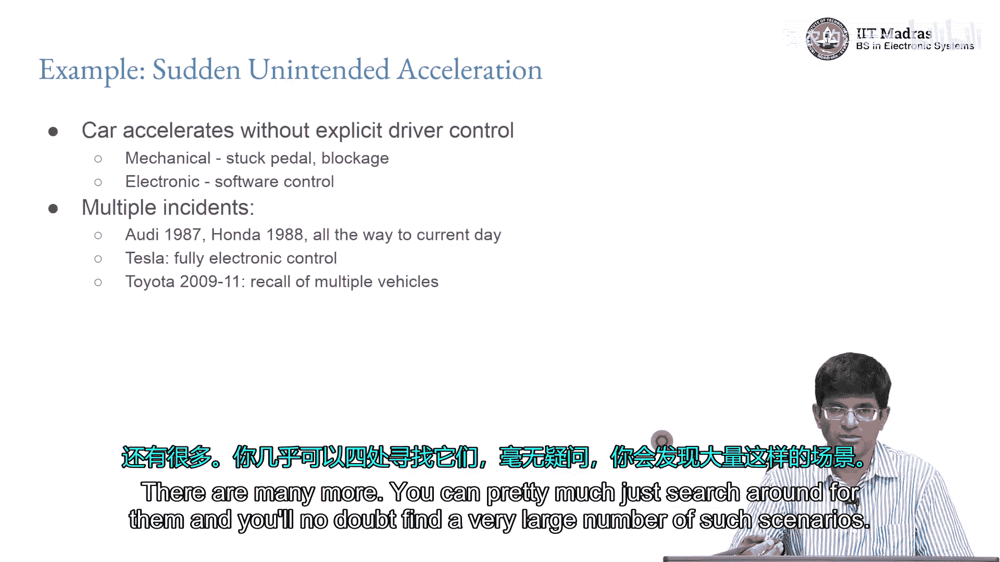

# 049：嵌入式安全关键系统中的安全标准与风险缓解 🛡️

在本节课中，我们将要学习嵌入式安全关键系统中的核心概念，包括安全性的定义、相关国际标准、风险识别与缓解策略，并通过历史案例了解安全设计的重要性。

## 概述：什么是嵌入式系统的安全性？

上一节我们介绍了嵌入式系统编程的基础，本节中我们来看看一个至关重要的非编程层面——安全性。在嵌入式系统的语境下，安全性通常被定义为：**操作一个系统时，不会造成人身伤害、人员健康损害、环境破坏或财产损失等不可接受的风险**。

这里有几个关键点需要理解：
*   **不可接受的风险**：现实中几乎任何活动都伴随一定风险。安全性的目标是将风险降低到“可接受”的水平。
*   **损害的范围**：损害可能涉及操作者或受影响者的健康、周边环境（如核电站事故），或直接造成财产损失。
*   **嵌入式系统的角色**：许多关键设施（如核电站、工厂）的核心控制都依赖于嵌入式系统。

因此，嵌入式系统安全的主要焦点在于**预防事故**和**减轻危害**，即降低可能导致伤害的危险事件发生的概率。

## 安全关键系统与应用场景 🚨

当系统失效会导致严重后果时，我们称之为**安全关键系统**。以下是几个典型领域：

以下是安全关键系统的主要应用领域：
1.  **医疗设备**：例如，血压监测仪的重要性在于其测量数据用于治疗决策；而**心脏起搏器**若失效，则可能直接危及患者生命。
2.  **交通运输**：**空中交通管制系统**是复杂且关键的代表，需要确保多架飞机在机场附近安全运行，避免碰撞。
3.  **工业自动化**：在高速运转的流水线（如传送带）旁，任何微小失误都可能对附近人员造成严重伤害。
4.  **能源设施**：如**发电厂**，其内部蕴含巨大能量。一旦控制失效，可能对设施本身及周边区域造成灾难性影响。

在这些场景中，系统的安全性是至高无上的，有时甚至需要牺牲部分功能来确保安全。

## 为什么需要安全标准？📜

为了系统化地设计和保障安全，业界制定了各种标准。标准的存在基于以下几点：

以下是采用安全标准的主要原因：
*   **系统化设计方法**：标准凝聚了过往工程师的最佳实践经验，为新入行者提供了可靠的设计框架。
*   **确保互操作性**：标准化的接口（如特定尺寸的螺母螺栓）使得不同团队或公司设计的部件能够协同工作。
*   **简化测试与验证**：统一的标准使得大型系统的测试和验证过程更为高效和可靠。

## 主要安全标准简介

国际上存在多种针对不同领域的安全标准。

以下是两个重要的国际标准组织及其相关标准：
*   **国际标准化组织 (ISO)**：制定广泛领域的标准。例如，**ISO 26262** 专门针对道路车辆的功能安全，详细规定了汽车设计应满足的安全保证。
*   **国际电工委员会 (IEC)**：更侧重于电气电子领域。例如，**IEC 61508** 是关于电气、电子及可编程电子系统功能安全的基础标准。

此外，**航空电子设备（机载系统）** 因其失效后果极其严重（飞机失控难以挽回），通常遵循更为严格的安全标准。

## 风险识别：故障模式与影响分析 (FMEA) 🔍

识别系统中的潜在风险是安全设计的第一步。**故障模式与影响分析 (FMEA)** 是一种系统化的方法。

FMEA的核心流程是列出系统所有可能的故障模式，并量化其影响。这通常涉及为每个故障模式评估三个指标：
1.  **严重度 (Severity)**：故障发生后后果的严重程度。
2.  **发生度 (Occurrence)**：故障发生的概率。
3.  **探测度 (Detection)**：在故障造成影响前，系统或操作者发现它的难易程度。

基于这些评估，可以计算风险优先级，并制定相应的**行动计划**来改进设计，例如降低故障发生概率或提高探测能力。这个过程需要反复迭代，直到风险降至可接受水平。

## 风险缓解策略 🛠️

风险缓解的核心思想是：承认系统总有出错的可能，但通过设计将故障概率降至极低，或确保故障发生时能快速、有效地控制其影响。

以下是几种常见的风险缓解策略：
*   **冗余设计**：在航空航天等关键系统中，常部署多套飞行控制系统。当主系统失效时，备份系统可以立即接管。
*   **故障安全设计**：系统在发生故障时应能切换到一种预定的安全状态。例如：
    *   **防抱死刹车系统 (ABS)** 的电子部分若失效，机械刹车部分应仍能工作，使车辆安全减速。
    *   自动门锁在断电时，应根据场景设计为“故障时开启”（便于人员逃生）或“故障时关闭”（保障银行金库安全）。
*   **看门狗定时器**：用于在软件死锁或失去响应时，自动复位系统。
*   **优雅降级**：当系统部分功能失效时，核心功能仍能维持运行。例如，心脏起搏器在复杂控制电路失效后，至少应能维持基本的心律起搏。
*   **定期维护与测试**：这是无可替代的基础工作，通过定期检查和预防性维护确保系统持续正确运行。

## 历史案例分析：当安全设计失效时 ⚠️

了解历史上的事故能帮助我们深刻理解安全设计的重要性。

以下是两个著名的嵌入式系统安全相关事故：
1.  **Therac-25 放射治疗机事故 (1980年代)**：该设备由机械控制改为软件控制后，因**竞态条件**等软件缺陷，导致多名患者接受了超致死剂量的辐射，造成伤亡。此事件凸显了软件在安全关键系统中的巨大责任。
2.  **汽车突然意外加速 (SUA)**：这是一个长期存在的问题，在采用电子油门和控制后更为复杂。驾驶员未操作时车辆自行加速，原因可能是踏板卡滞（机械问题）或电子控制单元(ECU)故障（电子问题）。丰田在2009-2011年因此问题大规模召回车辆，损失巨大。这表明，电子系统的失效模式可能更隐蔽，更难诊断和恢复。

## 总结

本节课中我们一起学习了嵌入式安全关键系统的核心知识。我们首先定义了**嵌入式系统的安全性**，并探讨了其在医疗、交通、工业等领域的**关键应用**。为了系统化地管理安全，业界依赖如**ISO 26262**和**IEC 61508**等**国际标准**。我们介绍了**故障模式与影响分析 (FMEA)** 这一系统化的风险识别工具。最后，我们详细讨论了包括**冗余设计**、**故障安全**、**优雅降级**在内的多种**风险缓解策略**，并通过**Therac-25**和**汽车突然加速**等历史案例，深刻理解了安全设计失误可能带来的严重后果。牢记这些原则，是每一位嵌入式系统设计者的重要责任。