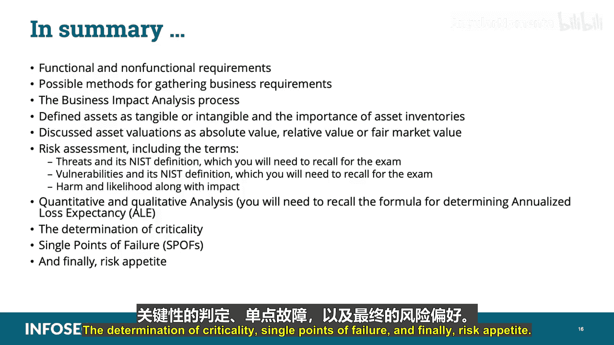

# 【Infosec】认证云安全专家 ｜ Certified Cloud Security Professional (CCSP) p12 02_01_06_design-requirements -BV1TWrHBrEbk_p12-

As part of the architectural concepts and design domain of the CCSP certification。

 let's look at the cloud design requirements。

Before we dive into this learning path， I want to point out that I will be calling out specific information you must know for the CCSP exam by placing a double asterisk in front of it and highlighting it in a different color as seen on the strain。

All right， let's start with requirements analysis。Many organizations are currently considering moving their network operations to a cloud based design。

Obviously， the greatest driver pushing organizations towards cloud migration is cost savings but since there are different service and delivery models of cloud computing。

 an organization must decide which one will optimize their success This decision is not made lightly and business requirements must be supported by this transition so the business must have a true evaluation and understanding of their process。

 assets and requirements， there are two types of requirements you should understand functional requirements。

 those performance aspects of a device process or employee that are necessary for the business task to be accomplished。

 for example， a salesperson in the field must be able to remotely connect to the organization's network。

 Nofunctional requirements Those aspects of a device。

 process or employee that are not necessary for accomplishing a business task but are desired or expected。

For example， the salesperson's remote connection must be secured。A full inventory of assets。

 profits and requirements is necessary， and there are various methods for collecting this data Typically。

 several methods are used jointly as a means to reduce the possibility of missing something on the screen I've listed some not all methods for gathering business requirements such as interviewing functional managers。

 interviewing users， interviewing senior management， surveying customers， collecting network traffic。

 inventory and assets， collecting financial records， collecting insurance records。

 marketing data collection and collecting regulatory mandates。

 After sufficient data has been collected， a detailed analysis is necessary。

 This is the point where a business impact analysis takes place which we will discuss next。

The Business impactmpact analysislysis BIA is an assessment of priorities given to each asset and process within the organization。

Asets can be tangible or intangible。 They can include hardware， software， intellectual property。

 personal property processes and so on。 An example of tangible assets would be things like a router and a server。

 whereas intangible assets are generally something you cannot touch， such as patents， trademarks。

 copyrights and business methodologies。 a proper analysis should consider the effects。

 In other words， impact any harm or loss of each asset might mean to the organization overall。

 during the business impact analysis。 we need to identify critical paths and any single point of failure。

You also need to determine the cost of compliance that is the legislative and contractual requirements mandated for your organization your organization's regulatory restrictions will be based on many variables including the jurisdictions where your organization operates。

 the industry your organization is in the type and location of your customers and so on Once you have a clear picture of what your organization does in terms of lines of business and processes。

 you can get a better understanding of what benefits the organization might derive from cloud migration。

 as well as the cost associated with the move the business impact analysis is designed to identify and produce a prioritized listing of systems and services critical to the normal functioning of the business。

A business impact analysis has three primary goals， determine criticality。

 estimate maximum allowable downtime， and evaluate resource requirements when determining criticality。

 every critical business function must be identified and the impact of a disruption must be determined。

Estimating maximum allowable downtime MAD or maximumim allowable outage MAO。

 which is also known as maximum Tolerable Downtime MTD is basically the measurement of how long an organization can survive an interruption of critical functions。

In other words， you'll need to estimate the maximum amount of time that the organization can tolerate to be without its critical assets or services you need to prioritize continuity and recovery objectives。

 for example， very high moderate or low， something that is very high may need to be restored immediately。

 something that is moderate could take three days， something that is very low， perhaps 30 days。

 Each business function and process within the organization should be placed in one of five categories。

 critical， urgent， important normal and nonesential things that are critical may need to be restored within minutes to hours。

 urgent within 24 hours， important 72 hours， normal seven days， nonessential possibly 30 days。

 so that management can better assess criticality and recovery requirements。

 the recovery point objectives is the age of files that must be recovered from the last known backup for example。

Sunday to the date that the event happened， let's say Thursday。

 the recovery time objective is the time that it takes to recover from the recovery point objective to the recovery time objective。

 So we stay under the maximum time of disruption or maximum tolerable period of disruption the recovery time objective is basically the total time from disruption to resumption of processing The recovery time objective always has to be less than the maximum allowable downtime or the maximum tolerable downtime。

 It includes infrastructure facility and workspace restoration。

 The last goal is to evaluate resource requirements and recovery efforts the resources required to resume critical operations and related interdependencies is what we're looking at here。

 This involves documenting all the processes， procedures analysis and results and then presenting to senior management identifying。

Critical departments and processes， significant interdependencies。

 a summary of vulnerability assessments and recommended recovery priorities generated from the analysis there are certain things we need to know in order to decide how we will handle risks within our organization these include an inventory of all assets evaluation of each asset。

 a determination of critical paths， processes and assets and a clear understanding of the risk appetite the organization has In other words。

 the acceptable level of risk they are willing to take。

Risk assessment is the process used to identify， estimate and prioritize information security risks this is a key component of the risk management process as defined in the national Institute of standards and technologies NISist special publication 839 managing information security risks organization mission and information systems view according to NIST special publication 839 the purpose of engaging in a risk assessment is to identify threats to organizations in other words。

 operations assets or individuals or threats directed through organizations against other organizations also vulnerabilities internal and external to the organization as well as the harm in other words adverse impact that may occur given the potential for threats exploiting vulnerabilities and finally the likelihood that harm will actually occur identifying these。

Facts helps determine risk， which includes the likelihood of harm occurring and the potential degree of harm looking at the picture that Ive provided here。

 let's say I was a sheep farmer and I had a sheep in this case。

 my assets in a pen to protect them that would be the controls I placed in order to protect the assets the threat to my assets in this case is a wolf if I had a vulnerability in any of my controls like a hole in the fence around the pen。

What are the chances that the threat， the wolf in this case will exploit the vulnerability。

 the whole and then affect my assets， in other words。

 create some kind of an impact on my assets chances are pretty good in this case assesssing risk requires the careful analysis of threat and vulnerability information to determine the extent that the circumstances or events could adversely impact an organization and the likelihood that those circumstances or events will occur this is part of the business impact analysis。

The National Institute of Standards and Technology NIST in Special Public 830 defines threats as any circumstance or event with the potential to adversely impact organizational operations and assets。

 individuals or other organizations or the nation through an information system via unauthorized access。

 destruction， Disc or modification of information and or denial of service， according to NIST。

 special publication 830 a threat source is categorized as the intent and method targeted at the exploitation of a vulnerability or a situation and method that may accidentally exploit a vulnerability threat sources can be grouped into a few categories as listed here on the screen each of these categories can be expanded with specific threats human In other words。

 malicious outsiders' malicious insiders， bioterrorism， saboteur spies political。

Or competitive operatives， loss of key personnel errors made by human intervention or cultural issues。

Natural such as fire， flood， tornadoes， hurricanes， snowstorms， earthquake。

Technical such as hardware failure， software failure， malicious code。

 unauthorized use and use of emerging services like wireless or new technologies。

 physical like closed circuit television failures due to facility components or perimeter defense failures environmental。

 like hazardous waste biological Age and utility failures and operational。

 a process either manual or automated that affects confidentiality。

 integrity and availability the National Institute of Standard and Technology。

 special publication 830 defines a vulnerability as a weakness in an information system。

 system security procedures， internal control or implementation that could be exploited by a threat source。

In our profession， it's common to identify vulnerabilities as they relate to people， processes， data。

 technology and facilities， Ex of vulnerabilities could include absence of a receptionist。

 a mantra or other physical security mechanisms upon entrance into a facility inadequate integrity checking in financial transaction software neglecting to require users to sign an acknowledgement of their responsibilities with regards to security。

 as well as an acknowledgement that they have read。

 understand and agreed to abide by the organization's security policies or patching and configuration of an organization's information systems are done on an ad hoc basis and therefore are neither documented nor up to date likelihood along with impact determines risk and this is a component of a qualitative risk assessment。

Likelihood can be measured by capabilities of the threat and the presence or absence of countermeasures。

Organizations that do not have trending data available may use an ornal scale labeled high。

 medium and low to score likelihood rankings。Impact can be ranked much the same way as likelihood the main difference is that the impact scale is expanded and depends on definitions rather than ordinal selections definitionitions of impact to an organization often include loss of life。

 loss of dollars， loss of prestige， loss of market shares and other facets。

Once the terms are defined， you can calculate impact if an exploit has the potential to result in loss of life like a bombing or a bioterrorist attack。

 then the ranking will always be high。 risk is determined as the byproduct of likelihood and impact。

 for example， if an exploit has a likelihood of one high， and an impact of 100 high。

 the risk would be 100。As a result， 100 would be the highest exploit ranking available these scenarios。

 high likelihood and high impact should merit immediate attention from the organization Orizations have the option of performing a risk assessment in one of two ways。

 quantitatively or qualitatively。Quantitative analysis assigns real numbers costs to the elements of the analysis process。

 For example， safeguard costs， asset value， business impact threat frequency。

 safeguard effectiveness and exploit probabilities。

 the key here is that it's based on real numbers and costs。 When doing quantitative analysis。

 remember， quantitative analysis is based on real numbers like costs to the assets or resources。

 First we figure out the asset value， the AV。 Let's say that we have a building worth $1 million。

 The second thing is to calculate the exposure factor or the EF。

 Let's say that the last time someone ran into the building they caused 100000 worth in damages。

 The single loss expectancy or the SLE is the expected negative impact related to a particular risk being assessed the results。

will be our SLE， our single loss expectancy， our AV $1 million times the exposure factor 10%。

 which equals the single loss expectancy of $100，000。Next。

 we calculate the annual rate of occurrence annual rate of occurrence is the number of times per year a given impact is expected expressed as numbers Let's say someone seems to run into our building once every four years or 0。

25 the single loss expectancy of $100，000 times the annual rate of occurrence of 0。25 equals $25。

000 annual loss expectancy is then the single loss expectancy multiplied by the annual rate of occurrence which gives us an estimated annual cost related to a particular risk In this case。

 the ALE equals the SLE times the ARO， so basically you can expect the set aside 25。

000 a year for four years to cover the expected building damage of $100，000。

 which becomes your safeguard value or your SGV。Or you can invest $20，000， for example。

 in a concrete bullard or a barrier to put in front of the building and mitigate the threat of people running into the building or hitting the building and then reducing your risk。

The other method is qualitative analysis， This is more subjective， no real numbers。

 mostly opinion based on scenarios of risk possibilities and ranking the seriousness of the threats and validity of the countermeasures。

 typically as high medium or low or 1，2，3，4，5 or maybe even on a scale of one to 10 key here is that it is judgmentbased best practices。

 intuition and experience no real numbers associated in a qualitative assessment when focusing on attackers you try to start by identifying the targets or the assets your organization has which an attacker may want to compromise in order to gain entry into your systems and then harden those potential targets first。

When focusing on software， you're testing your software against potential threats like SQL injection。

 broken authentication， crossite scripting， insecure redirects， security misconfiguration。

 sensitive data exposure， crossite forgery and a couple of others， a webage code flaw。

 for example could lead to a threat compromising the webp page code and attack using that vulnerability to compromise your systems or data to protect our assets。

 we first have to know what they are， everything owned or controlled by the organization can be considered an asset。

 and assets take many different forms。Ass can be tangible items such as IT hardware。

 retail inventory， buildings and vehicles， assets can also be intangible。

 such as intellectual property， public perception and goodwill with business partners or vendors personnel can also be considered assets because the skills。

 training and productivity they provide to the organization in order to protect all our assets we have to know what they are and to a lesser extent where they are and what they do if we lose track of something under our control。

 it becomes impossible to secure it therefore the first step in creating a sound security program would be to perform a thorough comprehensive inventory there are many methods and tools for doing so such as surveys。

 interviews， audits and so forth in performing an IT inventory we can also incorporate automation into the process enhancing our capability and efficient。

While we ascertain the number， location and type of assets。

 we also want to determine the value of each。 We need to be able to know which of these assets provide the intrinsic value of our organization and which support this value。

 we need to know the value of the assets we protect so we know how much time。

 money and effort to expend to protect them， we don't want to put a $10 lock on a $5 bicycle Valu is normally part of the business impact analysis。

 we determine a value for every asset， usually in terms of dollars。

 what it would cost the organization if we lost that asset。

 either temporarily or permanently what it would cost to replace or repair that asset and any alternate methods for dealing with the loss of that asset。

 There are various ways to assign cost。 we can use the insured value。

 the replacement cost or some other method。Of making that valuation。

The value metrics usually looks at three areas。 absolute value， relative value and fair market value。

 Absute value looks only at the asset's intrinsic value and does not compare it to other assets。

 For example， a 2019 Osmobilmobil 442。 The manufacturer suggested retail price is $6000。

 That's what that asset would cost。 relative value is the value of similar assets。 For example。

 other cutla 442s， running between $3000 and $7000。 And then finally， the fair market value。

 which is what the asset can be sold for used， For example， you brought a brand new car。

 it was $6000 at the dealership Once you titled it and drove it off the lot。 Now it becomes used。

 Now， the same car is worth $1200 instead of the 6000。Once the inventory evaluation is complete。

 the business impact analysis efforts continue with a determination made by senior management regarding criticality。

 Criity deness those aspects of the organization without which the organization could not operate or exist。

 These could include tangible assets， intangible assets， specific business processes。

 data pathways or even key personnel listed here are some examples of critical aspects in an organization。

 Tible assets， the organization is a rental car company。 Car are critical to its operation。

 If it has no cars to rent to customers， it can't do business。Intangible assets。

 the organization is a music production firm。 Music is the intellectual property of the company。

 If the ownership of the music is compromised， for instance。

 if the copyright is challenged and then the company loses ownership or encryption protecting the music file is removed and the music can be copied with protection。

 the company has nothing of value and will not survive processes。

 the organization is a fast food restaurant noted for its speed。 The process of taking orders。

 preparing and delivering food and taking payment is critical to its operation。

 if the restaurant cannot complete， the process for some reason， for instance。

 the registers fail so the restaurant cannot accept payments， the restaurant cannot function。

 Datapaths。 The organization is in international shipping line。

 matching orders to cargo carriers is critical to its operation。

 If the company cannot complete its logistical coordination assigning cargo request to carriers with sufficient。

capacityacity it cannot provide its services and will not survive personnel。

 The organization is a surgical provider。 The surgeon is critical to the existence of the company。

 if the surgeon cannot operate， there is no company。

 Se management has the correct perspective for making determinations of criticality。

 the senior professional， however， should have a good understanding of the overall mission and function of the organization in order to better serve and advise the organization in securing critical elements Another function of the business impact analysis process that can support the security efforts is the identification of single points of failure。

 if there is any choke point in a process procedure or production chain。

 a place where the entire workflow would halt because of the loss of a single element that's a single point of failure。

 single points of failure， especially in critical paths pose a significant risk to the organization and ought to be addressed as soon as they are identified like critical aspects。

Single points of failure can be caused by hardware。

 software processes or personnel methods for dealing with single points of failure include adding redundancies so that if the single point of failure goes out of service。

 a replacement is immediately available， creating alternate processes to take the place of the single point of failure in times of outages。

Cross training personnel so that they can fill many roles and consistently and thoroughly backing up data in a manner from which it can be easily and quickly restored。

 like load sharing or balancing IT assets。In a cloud environment。

 customers should expect that the provider has no single point of failure within their facilities and architecture。

 part of the benefit of moving to the cloud is the ability of the cloud providers to offer a robust and resilient service that is not susceptible to failures due to single points of failure the customer can therefore focus on attenuating any single points of failure on their own side of the operation for accessing and using the data in the cloud。

Don't get confused， not all single points of failure are part of critical aspects and not all critical aspects of an organization contain single points of failure。

The term risk appetite or acceptable level of risk is not a new concept。

 and the use of cloud services does not significantly change anything about it。

 It bears mentioning here because of the importance of the concept to the overall practice of security and its inclusion in the CCSP common body of knowledge。

 risk appetite or acceptable level of risk is the level amount or type of risk that the organization finds acceptable。

 This varies widely from organization to organization based on a number of factors。

 both internal and external and can change over time。

Here's a quick review of some of the risk fundamentals risk is the likelihood and impact will be realized。

 risk can be reduced， but never eliminated organizations accept a level of risk that allows operations to continue in a successful manner and it legal and defensible to accept risks higher than the norm or greater than your competitors except risk to health and human safety These risks must be addressed to the industry standard or whatever regulatory requirement to which your organization adheres。

Organizations have four main ways to address risk， risk avoidance， acceptance。

 transference and mitigation。Risk avoidance。 This isn't really a method for handling risk。

 It means leaving a business opportunity because the risk is simply too high and cannot be compensated for with adequate control mechanisms。

 In other words， a risk that exceeds the organizations established risk appetite or acceptable level of risk。

 risk acceptance。 This is the opposite of avoidance。

 The risk falls within the organization's risk appetite。

 So the organization continues operations without any additional efforts regarding the risk。

 risk transference here， the organization pays someone else to accept the risk at a lower cost than the potential impact would result in if the risk was realized。

 This is usually in the form of insurance。 This type of risk is often associated with things that have a low probability of occurring。

 but a high impact should they occur。And finally， risk mitigation here。

 the organization takes steps to decrease the likelihood or impact of the risk。

 and often both this can take the form of controls or countermeasures and is usually where security practitioners are involved。

 risk is involved in every activity， we can manage risk， attenuate it， even minimize it。

 but there is always an element of risk in operations。

 when we choose to mitigate risk by applying countermeasures and controls。

 The remaining leftover risk is called residual risk。

 The task of the security program is to continue reducing the risk until it falls within the acceptable level of risk according to the organization's risk appetite。

 The risk appetite of an organization is set by senior management and is the guide for all risk management activities in the organization。

 The security practitioners must have a thorough understanding of the risk appetite of the organization in order to perform their functions。

Properly and efficiently once the business requirements have been determined and the business impact analysis has been completed。

 the information acquired can and should be reused throughout many of the organization's security related efforts。

 For instance， the business impact analysis results can be utilized in the risk assessment。

 the selection of specific security controls throughout the environment and the business continuity or disaster recovery plans。

 knowing the critical aspects of the organization and the value of all assets is essential to accomplishing these tasks。

In summary， we have discussed functional and non-functional requirements。

 possible methods for gathering business requirements， the business impact analysis process。

 defined assets as tangible or intangible， and the importance of asset inventories。

 discussed asset valuation as absolute value， relative value or fair market value。

 we discussed risk assessment， including the terms。

 threats and its N definition which you'll need to recall for the exam。

 vulnerabilities and its N definition which you will need to recall for the exam。

 as well as harm and likelihood along with impact， We also discussed quantitative and qualitative analysis。

 you will need to recall the formula for determining annualized loss expectancy for the exam the determination of criticality。

 single points of failure and finally risk appetite。

