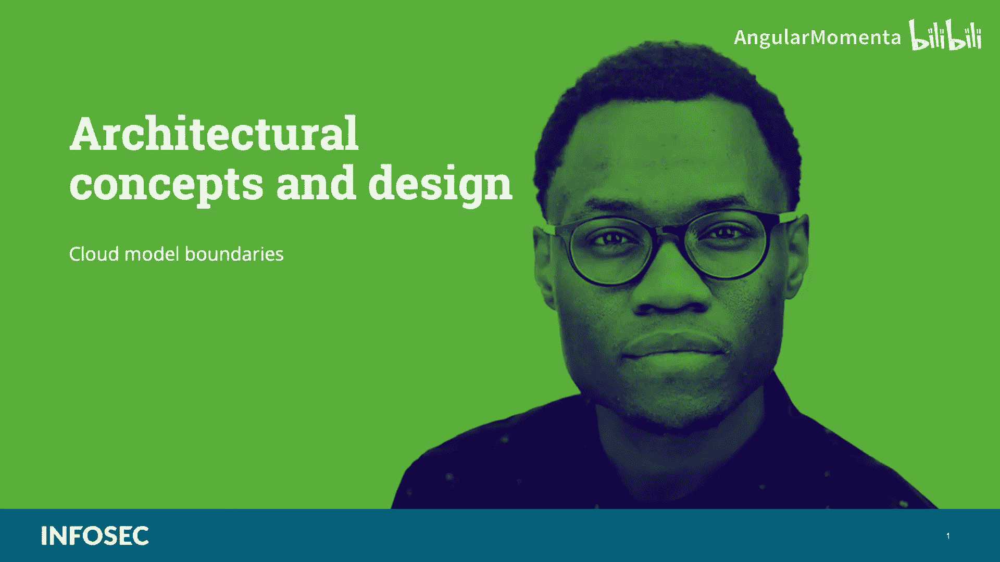
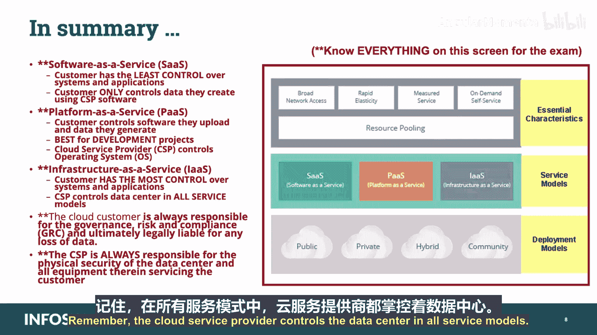

# 【Infosec】认证云安全专家 ｜ Certified Cloud Security Professional (CCSP) p13 02_01_07_cloud-model-boundaries -BV1TWrHBrEbk_p13-

As part of the architectural concepts and design domain of the CCSP certification。

 let's look at the cloud model boundaries Before we dive into this learning path。

 I want to point out that I will be calling out specific information you must know for the CCSP exam by placing a double asterisk in front of it and highlighting it in a different color as seen on the screen Cloud services are usually offered in terms of three general models based on what the vendor offers and the customer needs and the responsibilities of each according to the service contract these models are software as a serviceA here the customer has the least amount of control over the systems and the applications that they contract for the customer only controls the data they create using the cloud service provider software platform as a service PAA here the customer controls software they upload and data they generate the cloud service provider controls the operating system that the customer。

Uses in order to upload their software infrastructure as a service IAAS here the customer has the most amount of control over the systems and applications they use the cloudown service provider controls the data center in all service models regardless of which one they are。

In legacy environments， we had bright line definitions of the organization's IT perimeter。

 Everything inside the perimeter belonged to the organization， including data， hardware and risk。

 everything outside with someone else's problem we could armor our defenses at the interface between the internal environment and the external factors building up a demilitarized zone or a DMZ This is not the case with cloud computing in the cloud design our data resides inside an I environment owned by someone else writing on hardware infrastructure that does not belong to us and largely outside of our control Our users operate programs and machines that we have limited access to and knowledge of It is therefore difficult to know exactly where the boundaries exist in cloud models where our risks are and how far they actually extend in this learning path will apply a notional perspective of cloud computing boundaries。

It is extremely important to remember this。Under the current legal and regulatory regime。

 the cloud customer is ultimately legally liable for any loss of data This is true even if the cloud provider demonstrates negligence or malice the cloud customer can seek restitution if the cloud provider fails in some way causing damage to the customer for instance。

 if the cloud provider hires an administrator who then illegally sells access to data belonging to the cloud customer。

 the customer can sue the provider for damages however。

 the cloud customer is still legally responsible for all mandates applicable to the loss such as complying with data breach notification laws in that jurisdiction like the general data protection regulation GDPR or the US privacy shield this requirement does not cease just because the cloud customer has outsourced operations to the cloud provider the customer is always going to be liable。

😡，For the data that they control So what do these boundaries look like in the different cloud models an infrastructure as a service。

 the cloud customer has the most responsibility and authority of all possible cloud models the provider is responsible for the building and the land that compose the data center must provide connectivity and power and creates and administers the hardware assets the customer programs and data will write on the customer however。

 is in charge of everything from the operating system and up All software will be installed and administered by the customer and the customer will supply and manage all the data in terms of security the cloud customer is still losing some of the control featured in legacy environments For instance。

 the customer obviously does not get to select the specific I assets so the security of the acquisition process during which we normally vet vendors and。

uppliers must be entrusted to the cloud provider。The cloud customer may also lose some ability to monitor network traffic inside the data center。

 The cloud provider might not be willing to allow customers to place monitoring equipment or sensors on the provider's infrastructure and also might refuse to share traffic data they the provider have collected themselves this makes auditing difficult which also affect security policies and regulator compliance an organization migrating to the cloud may need to adapted security policies to reflect the new constraints and will have to find some way to provide the requisite deliverables to appease regulators This must be negotiated at the onset of migration and early communications with regulators as highly advisable for instance。

 if regulators insist on scheduled audits of the environment where data processing takes place what form will those audits take if the organization now cannot directly audit network traffic and event。

It's important to note that in infrastructure as a service。

 the cloud customer may still collect and review event logs from the software they deploy。

 including the operating system， which still lends a great deal of information and insight into the usage and security of the data which could appease the auditors with platform as a service the cloud customer loses still more control of the environment because the cloud provider is now responsible for installing。

 maintaining and administering the operating system this will entail further modification of the security policy and additional efforts to ensure regulatory compliance。

The cloud customer still， however， gets to monitor and review software events since the programs running on the operating system will belong to the customer。

 the responsibility for updating and maintaining the software will also be the customers however。

 updates and administration of the operating system now falls to the provider which while posing a loss of control for operational and security purposes on the customer's part will also represent a cost savings and increase of efficiency with software as a service。

 most of the controls of the environment is relinquish to the provider。😡。

The cloud customer will not have ownership of the hardware。

 the software or the administration of either the customer only supplies and processes data to and in the system for all relevant intent and purposes。

 the cloud customer as an organization has taken the role and responsibilities of what a common user would have in a legacy environment with few administrative rights。

 few privileged accounts and very few permissions and responsibilities。

To repeat what I' mentioned earlier， the customer remains liable for all statutory and contractual obligations related to the safeguarding of data。

 but in this case， has little control over how that data is protected the cloud provider is now almost exclusively responsible for all system maintenance。

 all security countermeasures and a vast majority of policies and implementation of that policy affecting the data。

 but the customer is still liable for loss of any data they collect or retain。In all three models。

 the customer is giving up an essential form of control。

 physical access to the devices on which the data resides this is a serious increase of risk and loss of assurance from an organizational perspective。

 anyone who can physically access the service provider's data location can eventually take it with or without permission。

We can implement means to reduce the likelihood of breaches as a result of this type of risk and we need to do so in order to demonstrate due diligence。

 for example， as part of our contract or service level agreement we can ensure the cloud provider has a process to perform background checks and continual monitoring of all personnel with access to the data center and client data。

 we can verify that physical security measures are implemented at the data center location。

 we can ensure encryption for data processed and stored in the cloud。

 we can also encrypt data prior to posting to the cloud or encrypted in the cloud and control the encryption keys externally to the provider and finally we can include assignments of contractual liability to the provider bearing in mind that legal liability remains with the customer for any data loss In summary we covered。

The nominal boundaries of the various cloud service models and the rights and responsibilities related to each from both the customer and the provider's perspective。

 I have relisted information which you need to know for the exam on this screen software as a service remember。

 customer has the least control over the systems and applications。

 the customer only controls the data they create using the cloud service provider' software。

With platform as a service， the customer controls software they uploaded and data that they generate。

 This is the best model for software development or any development project because you control the software used for development the cloud service provider controls the operating system in this model。

Infrastructure as a service here the customer has the most control over systems and applications remember the cloud service provider controls the data center in all service models。

😡。

