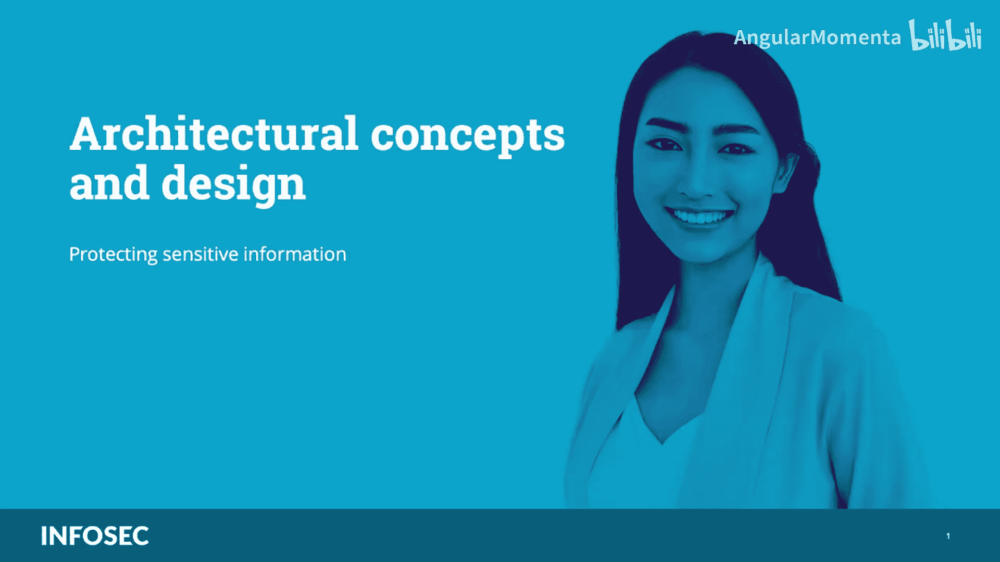
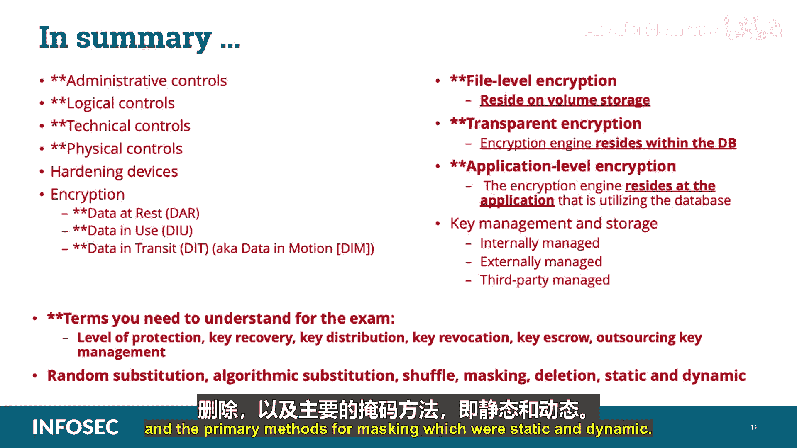

# 【Infosec】认证云安全专家 ｜ Certified Cloud Security Professional (CCSP) p14 02_01_08_protecting-sensitive-information -BV1TWrHBrEbk_p14-

As part of the architectural concepts and design domain of the CCSP certification。

 let's look at protecting sensitive information now。

Before we dive into this learning path， I want to point out that I will be calling out specific information you must know for the CCSP certification exam by placing a double asterisk in front of it and highlighting it in a different color as seen on the screen The image on the screen shows a notional。

 visual depiction of the areas of responsibility and authority and how they relate and blend in the various cloud models derived from cloud security alliance material Defense and depth is not a new concept。

 but one that carries over into the cloud It's the practice of having multiple overlapping means of securing the environment with a variety of methods These should include a blend of administrative。

 logical， technical and physical controls。From a cloud provider's perspective。

 a layered defense should entail strong personnel controls involving background checks and continuous monitoring。

 technological controls such as encryption， event logging and access control enforcement。

 physical controls related to both the overall campus， the various facilities。

 the areas within the data center where the data is processed and individual racks and particular devices and portable media entering and leaving the campus。

 as well as governance mechanisms and enforcement such as strong policies and regular thorough audits。

 from a cloud customer' perspective， similar efforts should include training programs for staff and users that include good coverage of security topics。

 contractual enforcement of policy requirements， use of encryption and logical isolation mechanisms on bring your own device byYOD assets。

 and strong access control methods。Perhaps including multifactor authentication。

In the legacy environment， devices in the DMZ， the area where internal networks connect with the outside world were secured as a matter of practice。

 We knew and understood that these boxes were more likely to suffer intrusion attempts and we hardened them accordingly for the cloud environment is probably best to adhere to this same practice。

 both from the cloud provider side of the equation。

 as well as the cloud user side in treating all cloud related devices as if they were in the DMmZ。

 We are forming good habits and a conceptual way of viewing the cloud。

 The cloud provider should assure that all devices in the data center are secured such that all guest accounts are removed。

All unused ports are closed。 No default passwords remain。 Str password policies are in effect。

 Any admin accounts are significantly secured and logged。All unnecessary services are disabled。

Physical access is severely limited and controlled。And finally， systems are patched。

 maintained and updated according to vendor guidelines and industry best practices。

 the cloud customer has a similar and related but different list of tasks。

Customers must bear in mind the risk related to the way they access the cloud。

 which often takes the form of a bring your own device。

 BYOD environment and always involves remote access。For instance。

 cloud customers should ensure that all assets in their BOD infrastructure that access the cloud be protected with some form of anti malware or security software have remote wipe or remote lock capabilities in the event of loss or theft with the user granting written permission to the organization to wipe or lock via a signed and authorized use policy。

 utilize some form of local encryption。Be secured with strong access controls or perhaps biometrics in a multifactor configuration。

 have and properly employ virtual private network solutions for cloud access and have some sort of data loss。

 leak prevention and protection DLP solution installed。

 usually in the form of a mobile device management system， MM。

 This allows the organization to containerize personally owned devices to isolate their personal data from the organization's information。

 It's not only physical devices that need to be hardened。

 We also think of virtual devices in the same manner。 we consider their physical counterparts。

 because cloud computing relies so heavily on virtualization for load balancing and scalability。

 It is important to remember that virtual instances will require strong protection。

 both when active So that data being in process can't be detected by other instances or users。

 and while store。As files， because they contain so much material attackers would like to acquire and they are so portable in terms of configuration。

 they also have to be hardened in all the same ways we secure physical machines。

The need for the use of cryptography and encryption is universal for provisioning and protection of confidentiality services in the enterprise it's important to be aware of the relevant data security technologies you may need to deploy or work with to ensure the confidentiality integrity and availability also known as the CIA Triad of data in the cloud potential controls and solutions can include encryption for preventing unauthorized data viewing。

 data loss prevention also known as DLP for auditing and preventing unauthorized data exfiltration。

 file and database access monitoringed for detecting unauthorized access to data stored in files and databases and obfuscation ononymization tokenization and masking which are different alternatives for protection of data without encryption it's the process of hiding original data with random characters or data encryption supports the confidentiality leg of the CIA Triad。

How by preventing unauthorized data viewing without encryption it would be impossible to use the cloud in any secure fashion remoteote users use encryption to create the secure communications connection on the cloud customers' enterprise to protect their own data and within the data center it's used by the cloud provider to ensure various cloud customers don't accidentally access each other's data for the purposes of this specific discussion。

 it's enough to say that encryption should be utilized in the data center for long-term storage or archiving。

 protecting nearterm stored files such as snapshots of virtualized instances preventing unauthorized access to specific data sets by authorized personnel for instance securing fields in datas so that the database admins can manage software but not modify or view the content。

😡，In communications between cloud providers and users for creating secure sessions or ensuring the integrity and confidentiality of data in transit eventually we would like to be able to process data in the cloud while it's encrypted without having to decrypted so that it's never exposed even temporarily to anyone other than the authorized users。

 although this capability is not currently available ongoing research shows promise。

 this technology is known as homomorphic encryption and it's worth knowing the term and understanding the possibilities。

 even though it's still in the experimental stages。

Having encryption enabled on all data across the enterprise architecture could reduce the risks associated with unauthorized data access and exposure。

 but there are performance constraints and concerns that would need to be addressed Development staff need to take into account the environment their applications will be running in and the possible encryption or masking dependencies they may have it would be a certified cloud security practitioner' responsibility to implement encryption within the enterprise in such a way that it provides the most security benefits。

 safeguarding the most mission critical data while minimizing systems performance issues as a result of encryption encryption can be implemented within different phases of the data lifecycle and involves the use of keys Without access to proper keys the data is unreadable and unusable What I want you to remember here for the exam is that we use encryption to protect。

Data at rest， data in use and data in transit Let's go ahead and break these down Data at rest Enrypting data at rest is a great way to prevent anyone from seeing data that they are not authorized to see when the data is archived or stored different encryption techniques could be used based on the requirements for example。

 are we implementing an extended retention versus shortterm storage is the data located in a database versus a file system the encryption mechanism itself may vary as well as the manner in which it's deployed when we deploy a data loss prevention system in the cloud data at rest is sometimes referred to as storagebased you need to remember that in this topology the data loss prevention engine is installed where the data is at rest usually one or more storage subsystems and files and application servers remember that for the exam。

Again， sometimes referred to as storage based and in this topology。

 the DLP engine is installed where the data is at rest。

 usually one or more of the storage subsystems and file and application servers。

Data in use this data is being shared， processed or viewed。

 This stage of the data lifecycle is less mature than other data encryption techniques and typically focuses on technologies like data loss prevention system data loss prevention also known as data leakage prevention can be used to detect unauthorized sharing and information rights management or IMs or digital rights management DM solutions can be used to maintain control over the information there may also be a requirement to comply with regulations like HIPAA or PCISS which in turn requires relevant protection of data traversing untrusted networks along with the protection of certain data types when we deploy DLP in the cloud data in use is sometimes referred to as client or endpoint based the DLP application is installed on the user' workstation and endpoint device you need to。

Remember that for the exam again， data in use is sometimes referred to as client or endpoint based and the DLP application is installed on the users' workstations and endpoint devices data and transit also known as data in motion in order to avoid information exposures or data leakage while in motion we use encryption techniques like IPs or virtual private networks VpNs。

 Tl SSl and other wirele protocols an example of a data in transit data in motion would be when the data moves in and out of the cloud for processing archiving and sharing when we deploy data loss prevention in the cloud。

 data in motion is sometimes referred to as network based or gateway DLP in this topology。

 the monitoring engine is deployed near the organizational gateway to monitor outgoing protocols like HtTPttP。

SMTP and FTP traffic again for the exam， remember that data loss prevention systems when deployed in the cloud data in motion is sometimes referred to as networkbased or gateway DLP and in this topology the monitoring engine is deployed near the organizational gateway to monitor outgoing protocols like HttPttpsTP and FTP traffic database encryption dependencies There's basically three options for database encryption you need to understand for the exam file level encryption transparent encryption and application level encryption Let's break these down with filele encryption database servers typically reside on volume storage for this deployment your encrypting the volume or the folder of the database the encryption engine and keys reside on the instances attached to the volumes for example information。

Manment systems or DRM's digital Right management solutions。

 where the encryption engine is commonly implemented at the client side and will preserve the format of the original files。

 transparent encryption many database management systems contain the ability to encrypt the entire database or specific portions like tables with transparent encryption the encryption engine resides within the database and its transparent to the application keys usually reside within the instance but processing and managing them could be offloaded to an external key management system a KMS this encryption can provide effective protection from media theft backup system intrusion and certain database and application level attacks。

The encryption engine resides at the application that is utilizing the database or object in application level encryption。

 the encryption engine resides at the application that is utilizing the database or object storage。

 remember that for the exam it can be integrated into the application components or by a proxy that's responsible for encrypting the data before going to the cloud。

 the proxy can be implemented on the customer's gateway or as a service residing at the external provider since the data is encrypted before reaching the database。

 it's challenging to perform indexing searches and metadata collection when encryption is provided or supported by the cloud provider and understanding of the encryption types strengths。

 algorithm key management and any associated responsibilities of other parties needs to be documented in the service level agreement or contract and understood。

Different techniques are used based on the location of data。

 whether it's at rest in transit or in use while in the cloud。

 different options might apply when dealing with specific threats like protecting personally identifiable information or PI or legally regulated information or when defending against unauthorized access and viewing from systems and platform administrators with basic level storage encryption。

 the encryption engine is located on the storage management level with the keys usually held。

 stored or retained by the cloud provider the engine will encrypt the data written to the storage and decrypt it when it exits the storage。

 for example， when it's going to be used this type of encryption is relevant to both object and volume storage。

 but it will only protect from hardware theft or loss。

 it will not protect from cloud provider administrator access or any other unauthorized access coming。

From the layers above the storage volumee storage encryption requires that the encrypted data reside on volume storage This is typically done through an encrypted container which is mapped as a folder or volume Inbased encryption allows access to data only through the volume operating system and provides protection from physical loss or theft external administrators accessing the storage snapapshot and storage level backups being taken and removed from the system Vole storage encryption does not provide protection against any access made through the instance like an attack that is manipulating or operating within the application running on the instance。

There are two methods that can be used to implement volume storage encryption。

 instance based encryption and proxy based encryption。 When instant based encryption is used。

 the encryption engine is located on the instant itself， keys can be generated locally。

 but should be managed externally to the instance when proxy based encryption is used。

 the encryption engine is running on a proxy instance or appliance。

The proxy instance is a secure machine that will handle all cryptographic actions。

 including key management and storage， the proxy will map the data on the volume storage and provide access to the instances keys can be stored on the proxy or via the external key storage which is the recommended approach with the proxy providing the key exchanges and required safeguarding of keys in memory。

Object storage encryption， the majority of object storage services offer serverside storage level encryption。

 as I just described， this kind of encryption is effectively limited。

 which is why it's recommended to use external encryption mechanisms to encrypt the data before its push to the cloud storage environments。

Key management is one of the most challenging components of any encryption implementation。

Control over the issuance， revocation， recovery and distribution。

Even though new standards like key management interoperability protocols， KMIP are emerging。

 safeguarding keys and appropriate management of keys are still the most complicated tasks you will need to engage in when planning cloud data security。

Additionally， the need for strong key management services and a secure key management lifecycle are also important to integrate into the cryptography solution the importance of key management from a security perspective First you need to remove the dependency or assumption that the cloud provider is handling the encryption processes and controls correctly Secondly you are not bound or restricted by shared keys or data spillage within the cloud environments because you have a unique and separate encryption mechanism to apply an additional level of security and confidentiality at a data and transport level key management considerations we need to understand are how and where encryption keys are stored and how they can affect the overall risk of data when planning key management you should consider random number generation throughout the lifecycl cryptographic keys should never be transmitted in the clear。

And always remain in a trusted environment when considering key escrow or key management as a service。

 carefully plan to take into account all relevant laws， regulations and jurisdictional requirements。

Lack of access to encryption keys will result in lack of access to data。

 this should be considered when discussing confidentiality threats versus availability threats。

When possible， key management functions should be conducted separately from cloud providers in order to enforce separation of duties and force collusion to occur if unauthorized data access is attempted you need to remember that for the exam When possible key management functions should be conducted separately from the cloud provider In other words。

 you don't want to store your encryption keys with the same cloud provider thats providing the encryption there are some common challenges with key management for example。

 access to keys leading practices coupled with regulatory requirements may set specific criteria for key access along with restricting or not permitting access to keys by cloud service provider employees or personnel Key storage secure storage for the keys is essential to safeguarding the data in traditional in-house environments the keys were stored in secure。

HarThis may not always be possible in cloud environments Key storage in the cloud is typically implemented using one or more of the approaches listed internally managed in this method。

 the keys are stored on the virtual machine or application component that is also acting as the encryption engine。

This type of key management is typically used in storage level encryption。

 internal database encryption or backup application encryption this approach can be helpful in mitigating the risks associated with lost media。

Externally managed in this method， keys are maintained separate from the encryption engine and data。

 They can be on the same cloud platform internally within the organization or on a different cloud。

 the actual storage can be a separate instance， hardened。

 especially for this specific task or on a hardware security module an HSM when implementing external key storage you need to look at how the key management system is integrated with the encryption engine and how the entire lifecycle of keys cradle a grave is being managed。

And finally， managed by a third party， this is when key escrow services are provided by a trusted third party key management providers use specifically developed secure infrastructure and integration services for key management。

 you have to evaluate any third party storage service provider you're looking to contract to make sure the risks of allowing a third party to hold encryption keys is understood and documented backup and replication In the cloud data backups and replication happen across a number of different formats。

 This can impact the ability for long and shortter key management to be maintained and managed effectively。

For cloud computing key management services， the following two approaches are most commonly utilized。

 remote key management services and clientside key management services with remote key management services。

 this is where the customer maintains the key management service， the KMS on premise， ideally。

 the customer will own， operate and maintain the key management service。

 resulting in the customer controlling the information confidentiality while the cloud provider can focus on the hosting。

 processing and availability of services。Clientside key management is similar to remote key management the client side approach looks to put the customer or cloud user in complete control of the encryption and decryption keys the main difference here is that most of the processing and control is done on the customer side the cloud provider can provide the key management service but the KMS resides on the customer's premise where the keys are generated held and retained by the customer this approach is typically utilized for software as a service environments and cloud deployments whatever the method ends up being the preferred solution is not to store the crypto keys with the cloud provider Now there are a few terms you need to understand when we're talking about key management for the exam。

Level of protection means basically the keys have to be protected at the same level of the information it protects or higher What key recovery is。

 key recovery can be explained as a backup mechanism that ensures an organization can have continued access to its own encrypted information in the event keys are lost somehow damaged or the holder is fired or dies。

 What key distribution means This is the same issue we have with symmetric key exchanges。

 the cryptographic key can't be sent in the same channel or transmission medium as the data。

 So an out of band distribution is used out of band means using a different channel to transmit the keys like a courier of fax phone or some other method。

 What key revocation is It's basically revoking or terminating access to a key what key escrow is key。

Escrow is the process of ensuring a trusted third party maintains a copy of a private key or key needed to decrypt information and what outsourcing key management means in cloud computing iss preferable to have the keys stored somewhere other than the cloud provider data center One option is using a cloud access security broker a CASB CASBs are thirdpart providers that handle information access management and key management services for cloud customers typicallyyp cloud service providers protect keys using softwarebased solutions in order to avoid the additional cost and overhead of hardwarebased security models The problem is that these softwarebased key management solutions usually don't meet the physical security requirements specified in NIST the National Institute of Standard and Technologies。

 federal information processing standard FPS 1402。1So the lack of FPS certification for encryption may be an issue for US federal government agencies and other organizations。

 especially during audits。The ability to use encryption is not always a realistic option for a variety of reasons。

 including performance， cost and technical abilities。As a result。

 additional mechanisms need to be employed to ensure that data confidentiality can be achieved masking。

 ofuscation， anonymization and tokenization can be used in this regard data masking or data ofuscation is the process of hiding。

 replacing or omitting sensitive information from a specific data set。

Data masking is typically used to protect specific data sets like personally identifiable information。

 P or commercially sensitive data， or in order to comply with certain regulatory requirements like HIPAA or PC DSSS It could also be used for test platforms where test data is not available For the exam。

 you will need to be familiar with these common approaches to data masking listed on the screen。

 random substitution The value is replaced or appended with a random value Algothic substitution。

 The values replaced or appended with an algorithm generated value。

 This typically allows for twoway substitutionuffle shuffles different values from the data set usually from the same columning uses specific characters to hide certain parts of the data usually applies to credit card data formats where the first set of。

Numbers are all xed out and only shows you the last four or six numbers Deletion simply uses a null value or deletes the data The primary methods for masking data are static and dynamic static。

 which is when a new copy of the data is created with the masked values and dynamic which is sometimes referred to as on the fly masking it adds a layer of masking between the application and the database。

 the masking layer is responsible for masking the information in the database on the fly when the presentation layer accesses it。

 for example， this type of masking can hide the full credit card number from the customer service representative but the data remains available for processing。

Next slide for the exam， you will need to know the definition listed here for data anonymization。

Anonymization is the process of removing the indirect identifier in order to prevent data analysis tools or other intelligent mechanisms from collecting or pulling data from multiple sources to identify individuals or sensitive information the process of anonymization is similar to masking and includes identifying the relevant information to anonymize and choosing a relevant method for obscuring the data the two primary components for id of individuals。

 users or personal information is direct identifier and indirect identifier Direct identifiers are fields that uniquely identify the subject and are usually referred to as personal identifying information or PII masking solutions are typically used to protect direct identifiers。

Indirect identifiers typically consist of demographic or socioeconomic information dates or events the indirect identifiers cannot identify the individual the risk is with data aggregation when we start combining a number of indirect identifiers together with external data that can result in exposing the subject of the information the challenge with indirect identifiers is the ability for this type of data to be integrated in free text fields that tend to be less structured than direct identifiers which complicates the process tokenization is the process of substituting a sensitive data element with a non-sensitive equivalent referred to as a token or an identifier that maps back to the sensitive data through a tokenization system that has no intrinsic or exploitable means or value the token is usually a collection of random values with a shape and form。

Of the original data placeholders and map back to the original data by the tokenization application or solution tokenization is not encryption tokenization removes the data entirely from the database。

 replacing it with a mechanism to identify and access the resources it's used to safeguard sensitive data in a secure protected or regulated environment。

Tokenization can be implemented internally， where there is a need to secure sensitive data centrally or externally using a tokenization service。

Tokenization can assist with complying with regulations or laws。

 reducing the cost of compliance or mitigating risks of storing sensitive data or reducing attack vectors on that data In summary。

 we have discussed the concept of defense and depth and the implementation of administrative controls。

 logical controls， technical controls and physical controls， the importance of hardening devices。

 encryption and how it can protect data at rest， including archived when using a DLP is' referred to as a storagebased and the DLP engine is what installed where the data is at rest data in use when using a DLP is referred to as client or endpoint based and the DLP application is installed on the user's workstation and endpoint devices remember that。

Data in transit was the last one this is also known as data in motion when using a DLP data loss Pre iss referred to as a network based or gateway DLP in this topology。

 the monitoring engine is deployed near the organizational gateway to monitor outgoing protocols like HTTP。

 HTTPS， SMTP and FTP traffic。The three options for database encryption were file level encryption which resides on the volume storage。

 remember that transparent encryption， the encryption engine resides within the database。

 and application level encryption， the encryption engine resides at the application that is utilizing the database。

😡，We discussed key management and storage internally managed。

 externally managed and third party managed。 We stated that key management functions should be conducted separately from the cloud provider and never store encryption keys with the same cloud service provider。

 We also discuss terms that you needed to understand for the exam， level of protection， key recovery。

 key distribution， key revocation， key escrow and outsourcing key management。

 you need to know these terms for the exam， data masking or data obfuscation and common approaches。

 which were random substitution， algorithmic substitution， shuffle。

 masking and deletion and the primary methods for masking， which were static and dynamic。

