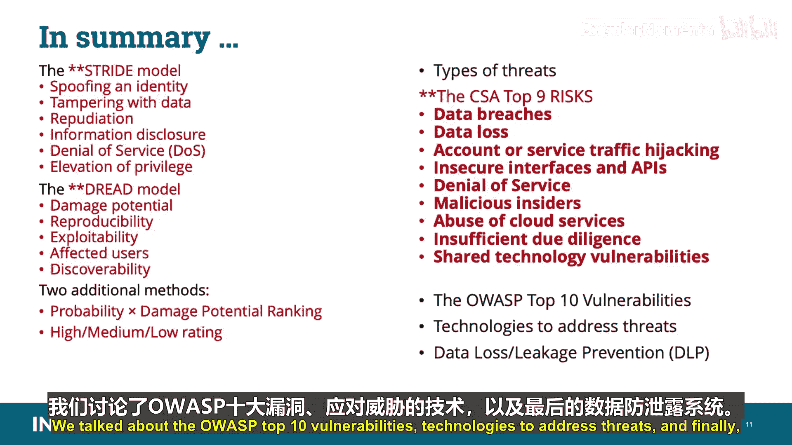

# 【Infosec】认证云安全专家 ｜ Certified Cloud Security Professional (CCSP) p15 02_01_09_threat-modeling -BV1TWrHBrEbk_p15-

As part of the architectural concepts and design domain of the CCSP certification。

 let's look at threat modeling now Before we dive into this learning path。

 I want to point out that I will be calling out specific information you must know for the CCSP certification by placing a double asterisk in front of it and highlighting it in a different color as seen on the screen this is information you must retain for the CCSP certification。

Threat modeling is done when the application design is completed。

 The goal is to determine any weaknesses in the application and the potential ingress。

 egress and actors involved before it's introduced into productionion。

 You have to remember that the overall attack surface will be amplified in the cloud。

 So you need to put on your black hat and think about the different ways hackers could attack the system or connections。

 Stride is typically used to focus on applications and operating system threats。

 but it can be used to identify threats to networks and hosts。

You must be able to recall this acronym and the terms describing it for the exam。 First。

 we have spoofing an identity where an attacker poses as an authorized user。

Tampering with data when the attacker attempts to modify the target data in an unauthorized way。

Reuddiation when the attacker and a participant of a transaction can deny or conceal the attacker's participation in that transaction。

 this is the opposite of nonreudiation where you cannot deny that you actually contributed to the transaction here repudiation is the ability to deny that transaction or the participation in that transaction remember that。

Information disclosure， just like it sounds， this category can include both inadvertent release of data where an authorized user discloses protected data accidentally to unauthorized users or gains access to material that their authorization should not allow and malicious access to data where an attacker is getting unauthorized access denial of service This is an attack on the availability aspect of the confidentiality integrity and availability Triad or the CIA Triad。

 creating situations in the target where authorized users cannot get access to the system application or data。

Elevation of privileges。When an attacker not only gains access to the target。

 but can attain a level of control with which to completely disable or destroy the entire target system。

Once you've identified or documented the threats， you need to assign a threat prioritization level。

 in other words， rank or rate the threats for mitigation。Dread。

 which you will need to recall for the exam， is one of three methods that could be used。

 Dread is made up of the following terms。 First， we have damage potential。

 How serious is the damage If the threat is realized reproducibility。

 how complicated is it for the attacker to reproduce or exploit the threat， Expability。

 How hard is it to perform the attack。 affectedected users， how many users。

 numbers or percentages could be affected by this vulnerability or threat if it actually materialized and discoverability。

 How hard is it for the attacker to discover this weakness。

 The other two are probability multiplied by damage potential ranking and high medium low ratings。

 probability multiplied by damage potential ranking， This is using a scale of one to 100。

100 being the most severe。You basically assign a number between1 and 101 low10 high to each of the values probability。

 multiply that by damage potential， Then the result is scaled1 to 100。

 This is a very subjective approach And the last one here is high medium or low rating This is simpler in that you assign a rating of criticality high address now medium address eventually low could be considered optional data storage is subject to the threat types listed on this screen you should understand what they are for the exam。

 unauthorized usage。 Basically using the data storage without permission by account hijacking or uploading illegal content。

 The multitenency of the cloud storage makes tracking unauthorized usage more challenging。

Unauthorized access， unauthorized access can happen due to hacking improper permissions in multi tenant environments or an internal cloud provider employee liability due to regulatory noncompliance。

Certain controls such as encryption might be required by certain regulations。

 not all cloud services enable all relevant data controls Den of service DOOS attacks on storage systems such as a targeted attack or distributed denial of service DDOS attack like a coordinated attack using various systems against the target system attacks the availability aspect of the CIA Triad Ava is a strong concern for cloud storage without data no instances can launch。

Corruption， modification and destruction of data this can be caused by a wide variety of sources。

 human error， hardware or software failures， events like fires or floods or intentional hacks it can also affect a certain portion of the storage or the entire array。

Data leakage or breaches。 consumers should always be aware that cloud data is susceptible to data breaches。

 It could be external or coming from a cloud provider's employee with storage access data tends to be replicated and move in the cloud。

 which increases the likelihood of a leak。Theft or accidental loss of media。

 this threat applies to portable storage， but as cloud data centers grow and storage devices are getting smaller。

 there are increasingly more vectors for them to experience theft or similar threats as well。

Mowware tax or introduction the goal of almost every malware is eventually reaching the data storage。

And improper treatment or sanitization after end use end use is challenging in cloud computing。

 since we usually cannot enforce physical destruction of media。

 the dynamic nature of data in the cloud where data is kept in different storages with multiple tenants poses the risk that digital remnants can be located unless properly addressed。

 for example， by crypto shredding， which is encrypting the data stores and then destroying the key。

 which makes it impossible to retrieve under normal recovery situations。

The nine top risks identified by the cloud Security Alliance CSA are listed on this screen you should be familiar with these common threats for the exam and be able to recall them You may see a question on the exam specifically addressing these nine CSA risks。

 so know them by name。Data breaches breaches are due usually to poor database security design or configuration whereby data is exposed without proper authorization if a multitenant cloud service data center is not properly design a flaw in one client's application could allow an attacker to access not only that client's data but also every other client's data as well data loss refers to the loss of information。

 deletion， overriding， corruption or loss of integrity related to information stored。

 process or transmitted within cloud environments， any accidental deletion by the cloud service provider or worse a physical catastrophe like a fire or earthquake could lead to the permanent loss of customer data unless the provider takes adequate measures to back up the data Furthermore。

 the burden of avoiding data loss does not fall solely on the provider's shoulders if the customer encrypts their data。

Before uploading to the cloud， but loses the encryption key。

 the data will be lost as well accountcount or service traffic hijacking when successful。

 this allows the attacker to monitor and eavesdrop on communications Sn and track traffic capture relevant credentials and access or alter account and user profile characteristics such as changing passwords if an attacker gains access to your credentials。

 they can eavesdrop on your activities and transactions， manipulate the data。

 return false information and redirect your clients to illegitimate sites and your account or service instances may become a new base for the attacker Insecure interfaces or application interfaces As cloud computing providers expose a set of software interfaces or As that customers use to manage and interact with cloud services provisioning management orchestration and monitoring are all performed using the。

Interfaces the security and availability of general cloud services is dependent on the security of these basic APIs。

 from authentication and access controls to encryption and activity monitoring these interfaces must be designed to protect against both accidental and malicious attempts to circumvent policy bolt on components to APIs significantly increase the complexity resulting in a multilayed API possibly being consumed inecurely。

Deenial of service by forcing the victim's cloud service to consume inordinate amounts of finite system resources like processing power。

 memory， disk space or network bandwidth， the attacker causes an intolerable system slowdown these attacks basically prevent users from accessing services and resources from a specified system or location malicious insiders。

 according to NISist， the national int of standards and technology。

 this is a current or former employee， contractor or other business partner who has or had authorized access to an organization's network。

 system or data and intentionally exceeds or misuses that access in a manner that negatively affects the confidentiality integrity or availability of the organization's information or information systems。

Abuse of cloud services， we already know that the cloud is not always used in the manner in which it was offered to users。

Attackers are able to use directory attacks， execute denial of service attacks。

 crack encryption passwords， or host illegal software and materials for widespread distribution It might take an attacker years to crack an encryption key using his own limited hardware but using an array of cloud servers。

 he may be able to crack it in minutes，Alternatively。

 he might use that array of cloud servers to stage a distributed denial of service attack。

Insufficient due diligence， basically not investigating and understanding the risks a company faces before pushing out a cloud solution without a complete understanding of the cloud service providers environment。

 applications or services being pushed to the cloud and operational responsibilities like incident response encryption and security monitoring。

 organizations are taking on unknown levels of risks in ways they may not even comprehend but that are a far departure from their current risks。

 you have two elements here， due care and due diligence。

 due care is the development and implementation of policies and procedures to aid in protecting the company its assets and its people from threats and due diligence is how we demonstrate our due care。

Shared technology vulnerabilities。 This is based on the fact that the cloud service provider delivers their services in a scalable way。

 They share infrastructure， platforms and applications among tenants and potentially with other providers。

 This can include the underlying components of the infrastructure resulting in shared threats and vulnerabilities。

 A defense and depth strategy is recommended and should include compute， storage。

 network applications and user security enforcement and monitoring whether the service model is infrastructure as a service platform as a service or software as a service。

The key is that a single vulnerability or misconfiguration can potentially lead to a compromise across the entire provider' cloud Open web application security project OAP develops a number of free and useful products and has several guides available for web application development including development guides。

 code review guides， testing guides， the top 10 web application security vulnerabilities which are listed on the screen and OOSP's mobile guide。

 both OAP and SANs provide us with publications like common vulnerability and exposure CVEs。

 Common attack pattern enumeration and classification。

 malware attribute enumeration and categorization， common weakness scoring systems。

 common weakness risk analysis frameworks and build security in or BSI all of those help us find out what's out there so we can protect against them。

😡，Attackers often exploit these types of vulnerabilities to completely take over the software。

 steal data or prevent the software from working at all don't be fooled hackers use this information to target systems and vulnerabilities because it outlines common vulnerabilities they can target it's a roadmap if you will。

You need to leverage different technologies to address the varied threats that the enterprise faces with regards to confidentiality。

 integrity and availability and the safe storage and use of their data in the cloud。

It is important to understand how data dispersion is used in the cloud。

Data dispersion is similar to a array solution， but it's implemented differently。

 Stage blocks are replicated to multiple physical locations across the cloud。

 a originally redundant array of inexpensive disks now more commonly referred to as a redundant array of independent disks is a data storage virtualization technology that combines multiple physical drive components into a single logical unit for the purposes of data redundancy performance improvements or both in a private cloud you would set up and configure data dispersion yourself。

 Use of public cloud would not have the capacity to set up and configure data dispersion。

 although their data may benefit from the cloud provider using data dispersion The underlyinglining architecture of this technology involves the use of erasure coding which chunks a data object。

 think of a file with self-deib metadata into segments Each segment is encrypted and cut into slices。

And then disperse across an organization's network to reside on different hardware drives and servers。

 If the organization loses access to Onerive， the original data can still be put back together。

If the data is generally static with very few rewrites like metadata files and archiving logs。

 creating and distributing the data is a one time cost。😡，If the data is very dynamic。

 the erasure codes have to be recreated and the resulting data blocks redistributed other potential controls and solutions include data loss prevention DLP also known as data leak prevention for auditing and preventing unauthorized data exfiltration encryption for preventing unauthorized data viewing obfuscation anonymization tokenization and masking different alternatives for protecting data without encryption this is not encryption this is an alternate to encryption data loss prevention DLP describes the controls put in place by an organization to ensure that certain types of data structured and unstructured remain under organizational controls in line with policy standards and procedures In other words you want to know where your data is what it's doing and who's doing what to it it's used for auditing and preventing unauthorized data exfiltration to do this。

You first need to know what you have， where it is and who has access to it DLP consists of three components。

 data discovery and classification， monitoring and enforcement you need to remember that for the exam data discovery and classification this is the first stage of a DLP implementation and also an ongoing and reoccurring process。

The discovery process usually maps data in cloud storage services and databases and enables classification based on data categories。

 regulated data， credit card data， public data， and so on monitoring data usage monitoring forms the key function of DLP monitoring usage of data across locations and platforms while enabling administrators to define one or more usage policies。

The ability to monitor data can be executed on gateways， servers， and storage。

 as well as workstations and endpoint devices。The monitoring application should be able to cover most sharing options available for users like email applications。

 portable media and internet browsing and alert them to policy violations。😡，And finally。

 enforcement many DLP tools provide the capability to interrogate data and compare its location。

 use or transmission destination against a set of policies to prevent data loss。

 if a policy violation is detected， specified relevant enforcement actions can automatically be performed enforcement options can include the ability to alert and log。

 block data transfers， reroute them for additional validation or to encrypt the data prior to leaving the organizational boundaries。

We already said that encryption is for preventing unauthorized data viewing and protecting data at rest like file storage。

 database information， application components， archiving， and backup applications。

 typically we have three components associated with most encryption deployments。😡，The data。

 the data object or objects that need to be encrypted encryption engine performs the encryption operation and the encryption keys。

 remember all encryption is based on keys， safeguarding the keys is a crucial activity necessary for ensuring the ongoing integrity of the encryption implementation and its algorithm and finally obfuscation andonmization tokenization and masking which are different alternatives for the protection of data without encryption we've covered portions of the data loss prevention architecture before but this is really important for you to understand for the exam data in motion sometimes referred to as networkbased or gateway DLP remember that the monitoring engine is deployed near the organizational gateway to monitor ongoing protocols like HtTP Https SMmTP and FTP the topology can be a mixture of proxy based。

Bridge， network tapping or STP relays in order to scan encrypted Https traffic appropriate mechanisms to enable SSL interception or broker are required to be integrated into the system architecture data at rest sometimes referred to as storage based data the DLP engine is installed where the data is at rest usually one or more storage subsystems as well as file and application servers This topology is very effective for data discovery and for tracking usage but may require integration with network or endpointbased DLP for policy enforcement and finally data in use sometimes referred to as client or endpoint based the DLP application is installed on the user' workstation and endpoint devices this topology offers insight into how the data is used by the user。

With the ability to add protections that the network DLP may not be able to provide。

 the challenge with clientbased DLP is the complexity。

 time and resources to implement across all endpoint devices often across multiple locations and significant number of users。

 Some points you need to consider for cloud based data loss prevention are the fact that data in the cloud tends to move and replicate whether it's between locations。

 data center， backups or back and forth into the organization。

 the replication and movement can present a challenge to any data loss prevention implementation。

 administrative access for enterprise data in the cloud can be tricky。

 you need to make sure you understand how to perform discovery and classification within cloud based storage。

 and finally， DLP technology can affect overall performance because the network or gateway。

P which scans all traffic for predefined content might have an effect on the network performance client based DLPs scan all workstation access to data。

This can have a performance impact on the workstation's operation。

 You need to look at the overall impact during testing and deployment to see where the bottlenecks might be。

 In summary， we have discussed the stride model， spoofing an identity， tampering with data。

 repudiation， information disclosure， denial of service， elevation of privileges。 the dread model。

 damage potential reproducibility， exploitability， affected users and discovery。

 the two additional methods were high probability multiplied by damage potential ranking and the high medium and low rating system。

 We also discussed the CSA top 9 risks， which I said you also needed to know for the exam。

 data breaches， data loss， account or service traffic hijacking， Insecure interfaces and APIs。

 denial of service， malicious insiders， abuse of cloud services。

Insufficient due diligence and shared technology vulnerabilities。

 we talked about the OAS top 10 vulnerabilities， technologies to address threats， and finally。

 data loss prevention systems。

