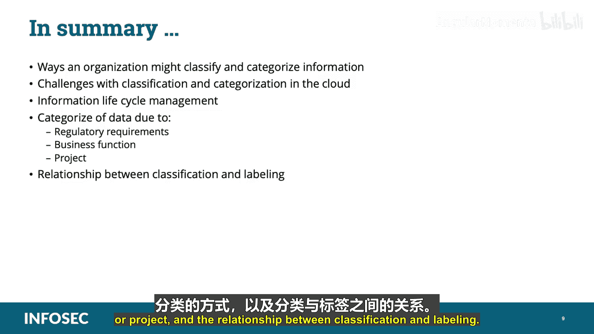

# 【Infosec】认证云安全专家 ｜ Certified Cloud Security Professional (CCSP) p16 03_01_01_classification-and-categorization -BV1TWrHBrEbk_p16-

As part of the cloud data security domain of the CCSP certification。

 let's look at classification and categorization next。

Before we dive into this learning path， I want to point out that I will be calling out specific information you must know for the CCSP exam by placing a double asterisk in front of it and highlighting it in a different color as seen on the screen。

Classification and categorization is used to help standardize a defense baseline for information systems and the level of suitability and trust an employee or system must have to access information by consolidating data of similar category and classification you'll be able to realize the scale of the security controls needed to remediate threats and vulnerabilities identified during your business impact analysis and vulnerability assessments The data owner is in the best position to understand how the data is going to be used by the organization and the value it has to the organization and can therefore classify and categorize it appropriately ways an organization my class data is by sensitivity。

 jurisdiction and criticality ways in organization might categorize data is by a regulatory framework such as Grhamleach Bailey。

 GLB surveyves Oxley Sox PC DSSS payment card industry data。

Security standard or health Information Portability and Accountability Act HIPAA compliance。

 possibly by a business function defined by the organization based on their business model a functional unit requirement such as categories created by each department or office to keep data it controls within its own category or by a project creating data sets by the projects as a means of creating discrete compartmentaalized projects some challenges in this area include data creation。

 the security practitioner needs to ensure that proper security controls are in place so that whenever data is created or modified by anyone they are forced to classify or update the data as part of the creation or modification process。

Classification controls When dealing with data in the cloud。

 controls should be in place which could be administrative such as guidelines for users who are creating data。

 preventative or compensating， and the implementation of these could be challenging for cloud customers。

Metaadata classifications can sometimes be made based on the metadata that is attached to a file like owners or locations。

 this metadata should be accessible to the classification process in order to make proper decisions and that can be challenging at times in cloud implementations。

Classification data transformation controls should be in place to make sure that the relevant properties or metadata can survive data object format changes and cloud imports and exports。

Reclassification considerations cloud applications must support a reclassification process based on the data life cycle。

 sometimes the new classification of a data object may mean enabling new controls like encryption or retention and disposal。

 for example， customer records moving from the marketing department to a loan department。

Data classification， much like categorization， is the responsibility of the data owner。

 It takes place in the create phase of the data lifecycle and is assigned according to an overall organizational motif based on a specific characteristic of the given data set。

 it could take any form defined by the organization and should be applied uniformly throughout the organization There are various ways an organization might class data。

 for example， by sensitivity， jurisdiction or criticality。

 let's break these down by sensitivity like how the military does top secret secret confidential unclass。

 data is assigned a classification according to the sensitivity of the data。

 based on the negative impact an unauthorized disclosure would cause in this kind of model。

 classification must be assigned to all data even in the negative。

 so material that is not deemed to be sensitive must be assigned the unclassified label。

By jurisdiction， like adhering to the EU's GDPR or other regulatory requirements。

 the geophysical location of the source or storage point of the data might have significant bearing on how that data is treated and handled。

 for instance， personally identifiable information PII data gathered from citizens of the European Union EU is subject to the EU's privacy laws。

 which are much more strict and comprehensive than privacy laws in the United States。

Or by criticality， as a result of the business impact analysis。

 vulnerability assessment or risk assessment data that is deemed critical to organizational survival must be classified in a manner distinct from trivial basic operational data。

 The business impact analysis helps us determine which material would be classified in this particular manner。

 There are no industry defined statutory mandated definitions for categorization versus classification of data。

 except in those areas covered by specific regulations。 For instance。

 the military uses classification constructs definedy by federal law。

 The terms can often be used interchangeably。 for the purposes of discussion in this learning path。

 will try to adhere to this understanding of the terms。

 Data is categorized by its use and classified by certain traits。

 Just remember that this is not an industry standard use of these terms。Again。

 data is categorized by its used and classified by a certain trait data classification as a part of the information lifecycle management process can be defined as a tool for categorization of data to enable or help organizations to effectively answer questions like what data types are available。

 where certain data located， what access levels are important， what access levels are implemented。

What protection level is implemented and does it adhere to compliance regulations a data classification process is recommended for implementing data controls like data loss prevention systems and encryption。

Data classification is also a requirement of certain regulations and standards like ISIL 27。

000 and PCI DSS， the payment card industry data security standard。

There are different reasons for implementing data classification and many different parameters and categories for the classification of data。

 some of the commonly used classification categories are。Data type， format and structure。

 jurisdiction， origin or domiced and other legal constraints， context， ownership。

 contractual or business constraints， trust levels and source of origin value。

 sensitivity and criticality to the organization or a third party and obligations for retention and prevention。

 the classification categories should match the data controls to be used for example。

 when using encryption， data can be classified as to encrypt or not to encrypt for data loss prevention systems。

 other categories like internal use and limited sharing would be required to correctly classify the data。

As I previously stated， the data owner will be in the best position to understand how the data is going to be used by the organization。

 This allows the data owner to appropriately categorize the data。

The organization can have any number of categories or types of information these might be clearly defined and reused throughout the organization。

 or they might be arbitrarily assigned by the data owner during the creation phase shown here on the screen are some ways an organization might categorize data Reg compliance。

Different business activities are susceptible to different regulations。

 The organization may want to create categories based on which regulations apply to specific data sets。

 This might include Grraham Leach Bailey Act， GLBA Pay Car Industry Data Security Standard。

 PCI DSS Surys Oxley at or HIPAA compliance， which is the Health Insurance Portability and Accountability Act。

By business function， the organization might want to have specific categories for different uses of data。

 perhaps the data is tagged based on its use in billing， marketing or operations。

Or by functional unit， each department or office might have its own category and keep all data it controls within its own category。

 or perhaps by project， some organization might define data sets by the projects they are associated with as a means of creating discrete compartmentamentalized projects。

 There is literally no limit to how an organization might categorize data。

 Whatever motif the organization uses should be adopted and enforced uniformly throughout the organization。

 ad hoc categorization is as good as having no categorization at all。

 data labeling is usually referred to as tagging the data with additional information like department location or creator。

 One of the labeling options can be classification according to a certain criteria。

 top secret secret confidential So classification is usually considered a part of data labeling。

 classification can be manual。😡，A task usually assigned to the user creating the data or automatic based on a policy rule。

 according to location creator or content。 When the data owner creates categorizes and classifies the data。

 it also needs to be labeled the labels should indicate who the data owner is usually in terms of the office or role instead of the individual name or identity because of course。

 personnel can change roles within an organization or leave the organization altogether。

 the label should take whatever form is necessary for it to be enduring。

 understandable and consistent， for instance， labels on data in hard copy might be printed in the header and footer whereas labels in electronic files might be embedded in the file name or nomenclature labels should be evident and should communicate pertinent concepts without necessarily disclosing the data they describe depending on the needs of the order。

and the nature of its operations labels might include the following kinds of information listed on the screen。

 date of creation， date of schedule destruction or disposal， confidentiality level。

 handling directions， dissemination or distribution instructions， access limitations， source。

 jurisdiction， and possibly applicable regulations。In summary。

 we have discussed ways an organization might classify and categorize information some challenges we face with classification and categorization when deploying to the cloud。

 we discussed information in lifecycl management， as well as commonly used classification categories ways an organization may categorize data due to regulatory requirements。

 business function or project。And the relationship between classification and labeling。

