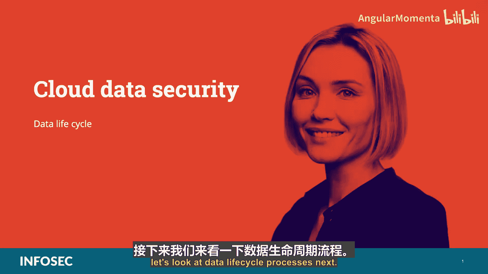
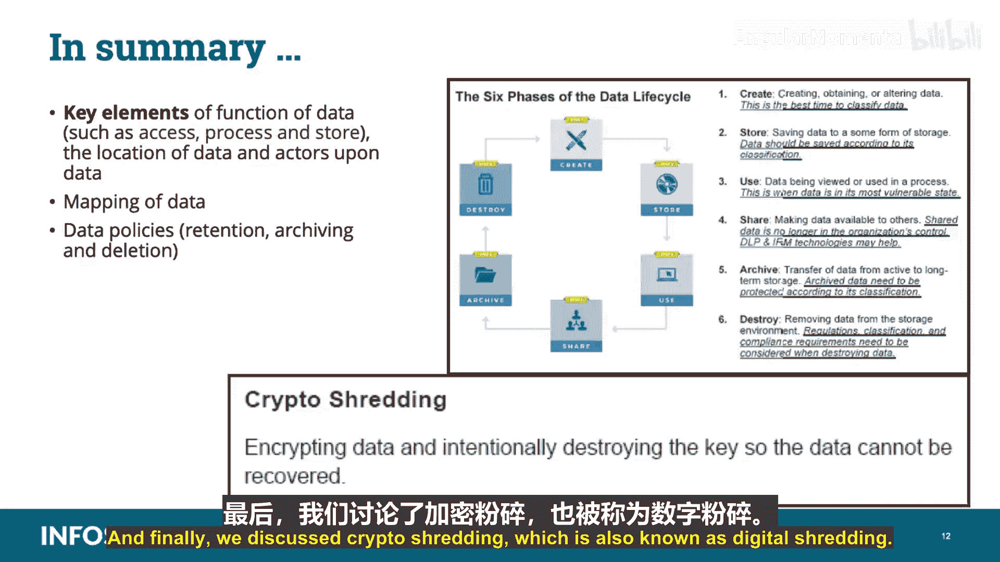

# 【Infosec】认证云安全专家 ｜ Certified Cloud Security Professional (CCSP) p17 03_01_02_data-lifecycle -BV1TWrHBrEbk_p17-

As part of the cloud security domain of the CCSP certification。

 let's look at data lifecycle processes next。

Data is the single most valuable asset for most organizations and depending on the value of their information to their operations。

 security controls should be applied accordingly the data security lifecycle as introduced by Ses and then incorporate it into the Cloudown Security Alliance CSA guidance。

 enables an organization to map different phases in the data lifecycle against the required controls that are relevant to each phase the lifecycle contains three steps First you map the different lifecycle phases。

 then you integrate the different data locations and access types and then finally you map the data into functions actors and controls。

The data lifecycle guidance provides a framework to map relevant use cases for data access while assisting in the development of appropriate controls within each lifecycle stage being create。

 store use， share archive and destroy as listed on the screen as with systems and other organizational assets data has a defined and managed lifecycle across these stages which will break down next create this is the generation or acquisition of new digital content。

 or the alteration or updating of existing content this phase can happen internally in the cloud or externally。

 the creation phase is the preferred time to classify content according to a sensitivity and value to the organization careful classification is important because poor security controls can be implemented if the content is not classified correctly。

Store this is the act of committing the digital data to some sort of storage repository typicallyyp this occurs nearly simultaneously with creation when storing the data。

 it should be protected in accordance with its classification level controls such as encryption。

 access policy monitoring logging and backups should be implemented to avoid data threats。

 content can be vulnerable to attacks if access control lists are not implemented well。

 files are not scanned for threats or files are classified incorrectly。😡，Use。

 this is data that is being viewed， process or otherwise used in some sort of activity。

 not including modification。Data in use is most vulnerable because it might be transported into an unsecured location such as a workstation and to be processed。

 it must be unencrypted controls such as data loss prevention， DLP。

 information right management's IRMs and data and file access monitoring should be implemented to audit data access and prevent unauthorized access。

Share here information is being made accessible to others， such as between users。

 to customers and to partners。😡，Not all data should be shared and not all sharing should present a threat。

 but because data that is shared is no longer at the organization's control。

 maintaining security can be difficult。Technologies such as data loss prevention can be used to detect unauthorized sharing and information rights management technology can be used to maintain control over the information Arch This is data that is leaving active use and entering long term storage archiving data for a long period of time can be challenging costst versus availability considerations can affect data access procedures。

Imagine if data is stored on a magnetic tape and needs to be retrieved 15 years later。

 will that technology still even exist to be able to read that tape。

 data placed and archived must still be protected according to its classification。

 regulatory requirements must also be addressed and different tools and providers might be part of this phase。

And the last one is destroy。This is data that is being removed from service the destroy phase can be interpreted into different technical meanings according to usage。

 data content and application use。Data destruction can mean logically erasing pointers or permanently destroying data using physical or digital means。

Considerations should be made according to the regulations， the type of cloud being used。

 such as infrastructure as a service versus software as a service and the classification of the data。

 remember， you can't deouuse a cloud environment， so crypto shredding。

 which we'll discuss later in this course， is probably the best solution。

 you need to understand that although the lifecycl is described as a linear process。

 data may skip certain stages or indeed switch back and forth between the different phases。

They don't have to follow the 1，2，3，4，5，6 format。 It could jump around， for example。

 one where you're creating the data and then two where you're storing the data and then maybe four where you're sharing the data you get the picture remember that the lifecycle does not have to follow the one。

2，3 format it can jump around you'll need to know that for the exam。

 Also keep in mind that the lifecycle model serves as a reference and framework to provide a standardized approach for data lifecycle and data security not all implementation or situations will align fully or comprehensively there are three key elements you need to be concerned with in order to determine what controls need to be deployed to protect data within this lifecycle methodology they are functions。

 locations and actors functions of the data what can be done with the data。

 such as access process or store。Location of the data。 and remember that this is very portable。

 in other words， depending on how you access the information。

 it may end up on different types of devices and then the actors upon the data。

 which is who can actually access the data。 Each of these functions。

 access process and store is performed in a location by an actor which is a person let's go ahead and break down these areas。

 First， key data function， which are access process and store Each of these functions is performed in a location by an actor。

 a person， you need to remember that for the exam。 In other words。

 what can be done with the data such as a data function and who can access the data such as the person or the actor。

Remember access as viewing or accessing the data， including copying。

 file transfers and other exchanges of information。

 you need to ask who can access relevant data and how are they able to access it， in other words。

 the device or channel。😡，Process is performing a transaction on the data， for example。

 updating it or using it in a business process transaction when storing the data in a file or database。

 for example， you should be asking what or where is it located because data is a portable resource。

 It's capable of moving swiftly and easily between different locations both inside and outside of the enterprise。

 Okay so that's everything I want to discuss under function。

 now the other two areas were location and access of data the lifecycl is not a single linear operation。

 but a series of smaller lifecycls running into different environments at all times。

 it's important to be aware of the logical and physical location of the data to satisfy audit compliance and other control requirements。

 In addition to the location of the data， it's important to know who is accessing the data and how are they。

Remember， the data lifecycle does not require the data location to be specified along with who can access it and from where。

 but as a CCSP， you need to understand and incorporate this function location and actors into your planning in order to fully use the lifecycle within the enterprise。

When we look at data location， you have to keep in mind that data is a portable resource capable of moving swiftly and easily between different locations。

 both inside and outside of the enterprise， as I've already mentioned。

 it can be generated in an internal network be moved into the cloud for processing and then be moved to a different provider for backup or even archival purposes The opportunity for portions of the data to be exported or imported to a different systems at alternate locations can't be overlooked。

You should be asking questions like who are the actors that potentially have access to data I need to protect what is or are the potential locations for data I have to protect。

 what are the controls in each of those locations at what phases in each lifecycle can data move between locations how does data move between locations under what channels or systems and where are these actors coming from what locations and are they trusted or untrusted when we look at access。

 we need to consider that the traditional data lifecycle model does not specify requirements for who can access relevant data nor how are they able to access it for example mobile computing as a manner of which data can be accessed and the wide variety of mechanisms and channels for storing processing and transmitting data across the enterprise have all amplify the impact of this lack of requirement when we consider location。

We also need to look at data dispersion data dispersion is the technique that is commonly used to improve data security but without the use of encryption mechanisms instead we use bit splitting and erasure coding bit splitting is like adding encryption to a random array of interconnected disks array the data is first encrypted then separated to pieces and the pieces are then distributed across several storage areas bit splitliing carries somediages however。

 processing is CPU intensive availability concerns all parts of the data need to be available to decrypt and to use the information and storage requirements and costs are higher than other storage systems。

Bit splitliting can use different encryption methods。

 a large percentage of which are based on two secret sharing cryptographic algorithms。

 Se shared made short SSMS and all or nothing transform with read Solomon Se sharing made short uses a threephase process encryption of information use of the information dispersal algorithm Ida and splitting the encryption key using the secret sharing algorithm。

 The different fragments of the data and encryption keys are then signed and distributed to different cloud storage services。

 This makes it impossible to decrypt without both arbitrarily chosen data and encryption key fragments。

 all or nothing transform with read Solomon integrates the all or nothing transform and erasure coding。

 This method first encrypts and transforms the information and the encryption key into blocks in a way that the information cannot be recovered without using all the blocks and then it uses the information dispersal algorithm Ida to split the blocks into。

Shares that are distributed to different cloud storage services similar to secret shared made short。

 the all or nothing transform is an encryption mode that allows the data to be understood only if all of it is known erasure coding is good for latency tolerant large capacity stores and generally found in context of object stores with very large volume cloud operators erasure coding is like using parity bits for a redundant array of interconnected disk striping in raid parity data helps you recover missing data if one striptried drive gets lost erasure coding helps you recover missing data if a cloud data are unavailable or lost while your data is dispersed。

Erasure coding helps you recover missing data if a cloud data set is unavailable or lost while your data is dispersed erarasure coding is a method of data protection in which data is broken into fragments that are expanded and encoded with configurable numbers of redundant pieces of data and storage across different locations such as disks storage nodes or geographical location This allows for the failure of two or more elements of a storage array offering more protection than a raid system this is commonly referred to as chunking when encryption is used is referred to as sharding In other words。

 dividing a large part into smaller parts If the data is static doesn't change creating and distributing the data is a one time cost if the data is dynamic continuously changing the erasure codes have to be recreated and the resulting data blocks redistributed data dispersion is much like a。

R technology spreading the data across different storage areas and potentially different cloud providers spread across geographic boundaries。

 However， this comes with an inherent risk。 if the data is spread across multiple cloud providers there is a possibility that an outage at one provider will make the data unavailable to the user regardless of the location this would be a threat to availability depending on the implementation。

 once these three items access， process and store have been documented and understood。

 then the appropriate controls can be designated and apply to the system in order to safeguard data and control access to it。

 these controls can be of a preventative detective such as monitoring or corrective nature upon completion of mapping the various data phases。

 data locations and device access it is necessary to identify what can be done with the data that is data functions and who can access the data that is the。

Once this has been established and understood， you can then check the controls to validate which actors have permissions to perform the relevant functions of the data Controls act as the mechanism to restrict a list of possible actions down to allow or permit actions。

 for example encryption can be used to restrict the unauthorized viewing or use of data。

 application controls to restrict processing via authorization and digital rights management。

 storage to prevent untrusted or unauthorized parties from copying or accessing data At this point。

 we're able to produce a high levell mapping of data flow including device access and data locations for each location we can determine the relevant function and actors。

Once this is mapped， we can better define what to restrict from which actor and by which control。

 you simply fill out the function actor and location areas。

 signifying whether the item is possible to carry out with a yes or a no for example。

 on the screen here you see a chart that has functions。

 actors and locations and under actors and locations and functions。

 you see two additional columns possible and allowed looking at the function column， you see a yes。

 yes designation， which identifies items that are available and should be allowed。

 looking at the actor column， you see a yes under possible and a no under allowed。

 which identifies items you could potentially negotiate with the organization to decide to allow at some point in the future and finally。

 looking at the location column， you see a no no designation which identifies items that are not available at this time within the organization you may have to negotiate with the organization to。

ize a plan for deployment and use of the functions in question。

 along with the creation of the required policies and procedures to allow for the functions operation data protection policies should include guidelines for the different data lifecycle phases in the cloud these three policies。

 data retention， data deletion and data archiving and retrieval。

 which will break down over the next few screens should receive proper adjustments and attention a data retention policies is an organization's established protocols for keeping information operational or in compliance with regulatory requirements The objectives of a data retention policy are to keep important information for future use or reference to organize information so that it can be searched and accessed at a later date and to dispose of information that is no longer needed the policy balances the legal regulatory and business data archival requirements against data storage。

Cost， complexity and other data considerations。A good data retention policy should define the data retention periods。

 data formats， the data security and the data retrieval procedures for the enterprise a data retention policy for cloud services should contain the components listed on the screen legislation regulation and standards requirements data retention considerations are heavily dependent on the data types and the required compliance regimes associated with it。

 for example， for financial data， the retention periods for financial transactions should be between three to seven years。

 while according to the PCIDSS requirements 10， all access to network resources and cardholderer data and credit card transaction data should be kept available for at least a year with at least three months available online。

Data mapping is the process of mapping all relevant data in order to understand data types such as structured and unstructured data formats。

 file types and data locations such as network drives databases and object or volume storage data classification classifying the data based on location compliance requirements。

 ownership or business usage in other words its value。

 classification is used in order to decide on the proper retention periods for the enterprise data retention procedures。

 for each data category， the data retention procedures should be followed based on the appropriate data retention policy that governs the data types。

 how long the data is to be kept， where is it to be kept。

 such as physical location and jurisdiction and how which technology and format should all be spelled out in the policy and implemented through procedures。

 the procedures should also include backup options。

Retrieval requirements and restore procedures as required and necessary for the data types being managed and the last one on the screen here is monitoring and maintenance procedures for making sure that the entire process is working。

 including review of the policy and requirements to make sure that there are no changes being made without going through the change management process。

Data archiving is basically identifying and moving inactive data out of current production systems。

 which optimizes the performance of resources needed there and into specialized long term archival storage systems specialized archival systems。

 store information， more cost effectively and provide retrieval when needed all the elements listed on the screen should be contained in your data archiving policy。

Data encryption procedures， long term data archiving with an encryption could be challenging for the organization with regards to key management because bad key management could lead to the destruction of the entire archive。

 The encryption policy should denote which media is used。

 the restore options and what the threats are， which should be mitigated by encryption data monitoring procedures。

 data stored in the cloud tends to be replicated and moved in order to maintain data governance。

 you need to be able to track and log all data access and movements and make sure that all security controls are being applied properly throughout the data life cycle。

 The ability to perform edicovery and granular retrieval。

Arive data may be subject to retrieval according to certain parameters like dates， subjects。

 authors and so on。 The archiving platform should provide the ability to do edicover on the data in order to decide which data should be retrieved backup and disaster recovery options。

 All requirements for data backup and restore should be specified and clearly documented。

 It's important to ensure that the business continuity and disaster recovery plans are updated and aligned with whatever procedures are implemented data format of media type。

 The format of the data is important because it may be kept for an extended period of time。

Proprietary formats can change leaving data in a useless state。

 This is known as media or data obsolescence。 For example。

 what happens when a vendor no longer supports a program or application like when Microsoft stop supporting Windows XP or Internet Explorer 8 Anyone still using it is vulnerable to security risks and viruses technology obsolescence is a significant cause of information loss and data can quickly become inaccessible to users if stored in out- of-date software formats or on outmoded media effective maintenance of digital files depends on proper management of hardware software file formats and storage media as software and hardware evolve。

 datas may need to be migrated to new platforms or saved in formats that are independent of specific platforms or software like ASI2 or delimited files choosing the right long-term storage format。

That is then very important。And finally， data restoration procedures data restore testing should be initiated periodically to make sure that the process is working and that the archive files are complete if you hash them initially that wouldn't be an issue obviously the restore tests should be done in an isolated environment to mitigate risks like restoring an old virus or accidentally overriding existing data a key part of data protection procedures is the safe disposal of data once it's no longer needed failureure to do so may result in data breaches and or compliance failures safe disposal procedures are designed to ensure that there are no files。

 pointers or data remnants left behind in a system that could be used to restore the original data listed on the screen are reasons why a data deletion policy would be required regulation or legislation certain laws and regulations requires。

Specific degrees of safe disposal for certain records。

Business and technical requirements business policy may require safe disposal of data Also processes like encryption may be required for safe disposal of clear text data by encrypting it before disposing of it and then destroying the key。

 a process known as crypto shredding， restoring deleted data in a cloud environment is not an easy task for an attacker because cloudbased data is scattered。

 typically being stored in different physical locations with unique pointers。

But it's still an existing attack vector that you should consider when evaluating the business requirements for data disposal in order to safely dispose of electronic records。

 your data disposal policy should include how data will be destroyed based on the classification and sensitivity of the data and aligned with the destruction methods listed on the screen。

 physical destruction， physically destroying the media by incinating。

 shredding or other means degausing， using strong magnets for scrambling data on magnetic media like hard drives or tapes。

 overr， writing random data over the actual data， the more times the overriding process occurs the more thorough the destruction of the data is considered to be encryption using an encryption method to override the data in an encrypted format to make it unreadable without the encryption key because the first three options are not really applicable to cloud computing the only reasonable。

methodod remaining to dispose of data in the cloud is encrypting the data and then destroying the keys。

 which is known as digital shredding or crypto shredding。 Remember。

 crypto shredding also known as digital shredding is the process of deliberately destroying the encryption keys that were used to encrypt the data originally Since the data is encrypted with the keys。

 The result is that the data is rendered unreadable at least until the encryption protocols used can be broken or is capable of being brufor by an attacker In order to perform proper crypto shredding。

 the data should be encrypted completely without leaving any clear text remaining and the techniques must make sure that the encryption keys are totally unrecoverable。

 This is another reason why we manage the keys separate from the cloud service provider hosting the data In summary。

 during this course we discussed the data lifecycle of create store use， share。

 archive and destroy No these。Order for the exam， but remember that they don't need to be performed in a specific order We discussed the key elements of function of data such as access。

 process and store， the location of data and actors upon the data We went over the mapping of data and we discussed data policies retention archiving and deletion and finally we discussed crypto shredding。

 which is also known as digital shredding。

